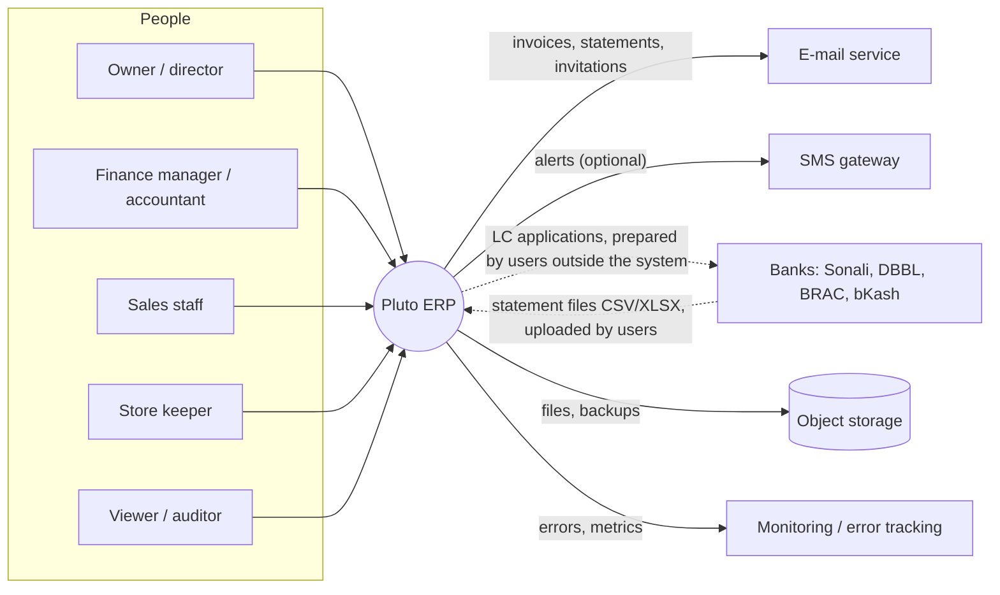
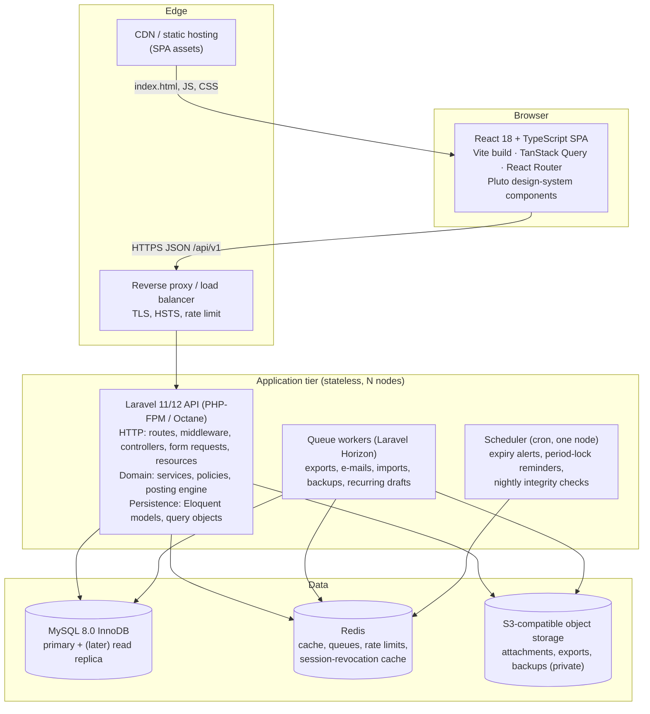
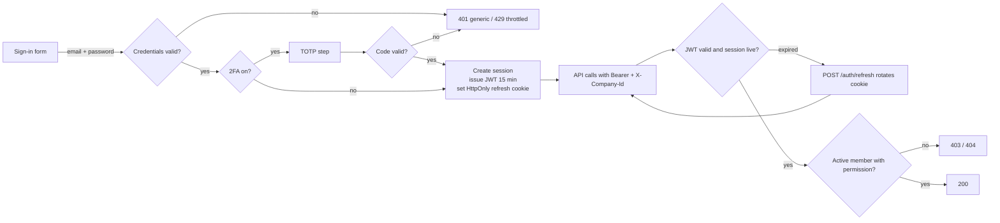
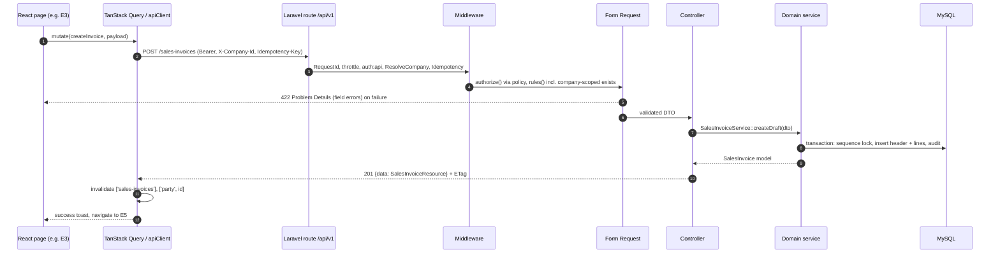
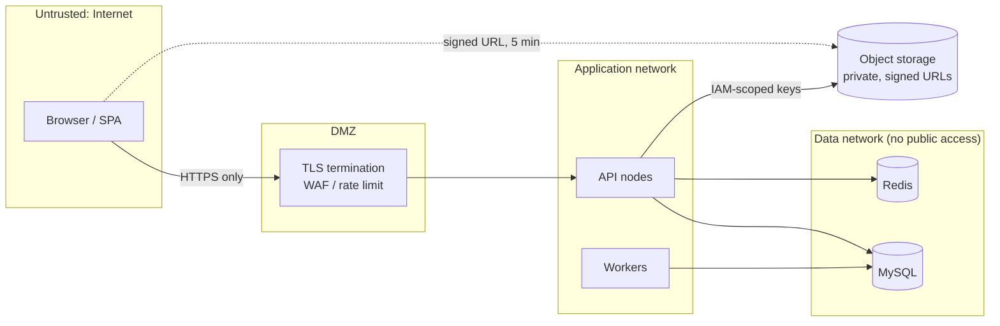
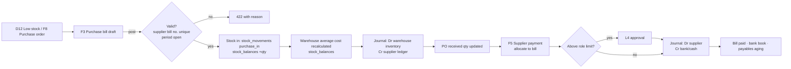
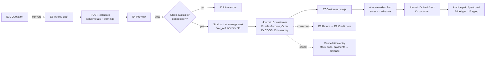
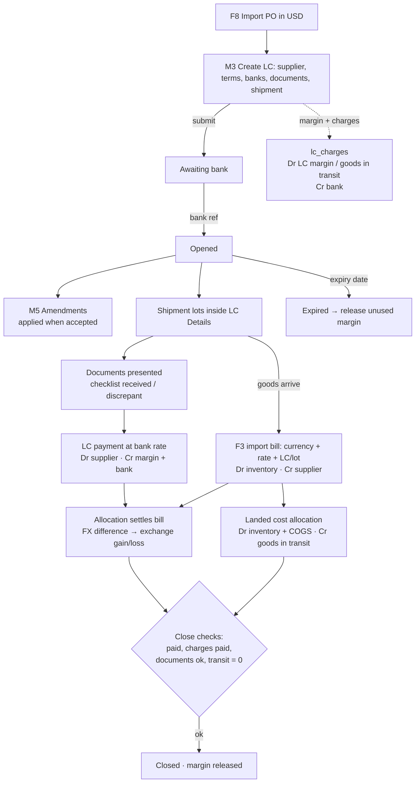
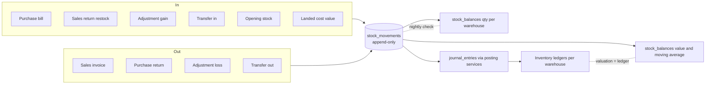

# 03 · System architecture

> Status: **Option A, approved: React + TypeScript SPA · Laravel 11/12 on PHP 8.3 · Eloquent · MySQL 8.0** (ORM decision DEC-01, 18 Oct 2026; [00 §6](00-Discovery-and-Decisions.md#6-orm-compatibility-evaluation--decided-eloquent)).

## 1. Overall architecture
A **modular monolith**: one Laravel application, one MySQL database, one React single-page application. Modules are separated *inside* the codebase (domain folders with explicit service interfaces), not as separate deployables. For an accounting system this is the right trade-off: a sale must move stock, post the journal and take a number in **one ACID transaction**, which microservices would turn into distributed sagas.

### Diagram 1 · System context



People use Pluto through the browser. Pluto sends e-mails (and optional SMS) and stores files and backups in object storage. Bank data enters only as statement files uploaded by users; there is **no direct bank integration in v1** (dotted lines are manual steps). Errors and metrics go to monitoring.

### Diagram 2 · High-level architecture



The SPA is static files served from a CDN and talks only to the API over HTTPS. The API nodes keep no state, so any node can serve any request. MySQL holds all business data; Redis holds caches, queues and rate-limit counters; object storage holds files. Workers run slow jobs off the request path; one scheduler node runs timed jobs.

## 2. Frontend architecture (summary; details in [08](08-Frontend-Backend-Integration.md))
- React 18 + TypeScript (strict), Vite, React Router 6 (data routers, lazy route chunks), and TanStack Query for server state (cache, retries, invalidation). There is no global client store for server data; Zustand holds UI-only state (sidebar, theme, active company).
- The **Pluto design system** is implemented as a typed React component library (`src/design-system/`), matching the 36 components and the tokens in [02 §1](02-UI-Inventory.md#1-design-system-to-preserve). Tokens become CSS variables from `tokens.json`.
- Forms use React Hook Form with zod for *shape* validation only. Business validation always comes from the API (422).
- Feature folders mirror the backend modules (`features/sales`, `features/lc`, …).

## 3. Backend architecture

```
app/
  Http/
    Controllers/Api/V1/{Module}/...Controller.php   thin: authorize → validate → call service → resource
    Requests/{Module}/...Request.php                 Form Requests: rules + company-scoped exists()
    Resources/{Module}/...Resource.php               JSON shape, field masking (view_costs)
    Middleware/ResolveCompany.php, RequireTwoFactor.php, Idempotency.php, ETag.php
  Domain/
    Shared/ Money.php, Quantity.php, Rate.php, DocumentNumberService.php, AuditLogger.php
    Accounting/ JournalBuilder.php, PostingService.php, ReversalService.php, PeriodService.php, AccountMapper.php
    Inventory/ StockService.php, AverageCostCalculator.php, StockAdjustmentPostingService.php, StockTransferService.php
    Sales/ DocumentCalculator.php, SalesInvoiceService.php, SalesInvoicePostingService.php, SalesInvoiceCancellationService.php, ...
    Purchases/ PurchaseBillPostingService.php, ...
    Money/ PartyPaymentService.php, AllocationPlanner.php, VoucherService.php, ReconciliationService.php
    LC/ LetterOfCreditService.php, LcStateMachine.php, LcChargeService.php, LcPaymentService.php, LandedCostService.php
    Access/ AuthService.php, PermissionResolver.php, InvitationService.php
  Models/ (Eloquent, one per table, BelongsToCompany trait, casts to Money/enums)
  Policies/ (one per aggregate)
  Queries/ (report read models: TrialBalanceQuery, AgingQuery, LedgerQuery ...)
  Jobs/, Events/, Listeners/
database/migrations, seeders, factories
routes/api.php (versioned group /api/v1)
```

Rules: controllers contain no business logic (NFR-060). Domain services are the only code that changes financial or stock state. Posting services are the only code that creates journal entries. Read-heavy reports use `Queries/` with the query builder or raw SQL (always with `company_id` first), not N+1 Eloquent loops.

Module boundaries and allowed dependencies (enforced with `deptrac`):

| Module | May depend on |
|---|---|
| Shared | — |
| Access | Shared |
| Accounting | Shared |
| Parties, Inventory | Shared, Accounting (ledger creation, posting) |
| Sales, Purchases | Shared, Accounting, Inventory, Parties |
| Money | Shared, Accounting, Parties, Sales/Purchases (allocation targets via interfaces) |
| LC | Shared, Accounting, Purchases, Money |
| Reports (Queries) | read-only access to all |

## 4. Database architecture
MySQL 8.0 InnoDB, `utf8mb4`, strict mode, UTC. Single schema, row-level tenancy (`company_id`). 83 tables in 9 modules ([04](04-Database-Design.md)). Isolation level is `REPEATABLE READ` (the default), with explicit `SELECT … FOR UPDATE` on the rows a posting changes. Connections are pooled through PHP-FPM persistent connections or Octane. A read replica for heavy reports becomes an option later (reports tolerate seconds of lag; posting never reads from the replica).

## 5. Authentication and authorization
JWT access token in memory + rotating refresh cookie; per-request membership and permission resolution; global tenant scopes; policies; field masking. Full detail: [07](07-Authentication-and-Authorization.md).

### Diagram 4 · Authentication flow (condensed)



## 6. API communication

### Diagram 3 · Frontend-to-backend request flow



A request passes through the same chain every time. Middleware identifies the caller, company and idempotency key; the Form Request authorizes and validates; the thin controller calls one domain service, which does the work in a transaction; the API Resource shapes the JSON. On success the client invalidates the affected cached queries so every screen refreshes.

## 7. Validation and error handling
- **Three layers:** (1) client-side shape checks for instant feedback (required, format); (2) Form Requests (types, lengths, existence within company, cross-field rules); (3) domain services (business rules: stock, periods, allocations, balances), throwing typed `DomainException`s that map to Problem Details codes.
- A central `Handler` maps exceptions: `ValidationException` → 422 `validation_failed`; `DomainRuleViolation` → 422 with its `code`; `ConflictException` → 409; `AuthorizationException` → 403; `ModelNotFoundException` → 404; anything else → 500 with only the `request_id` shown.
- Warnings (non-blocking) travel in `warnings[]` of 2xx responses.

## 8. Logging and monitoring
- Structured JSON logs (Monolog) with `request_id`, `user_id`, `company_id`, route and duration; no PII beyond ids; no amounts in info logs; secrets redacted.
- Error tracking: Sentry (or an equivalent) for API and SPA, with release tags and source maps uploaded privately.
- Metrics: request rate, latency p50/p95/p99, error rate per route, queue depth and age, failed jobs, DB slow-query log (> 500 ms), integrity-job results. Alerts on: error rate > 2% for 5 min, p95 > 1 s for 10 min, queue age > 5 min, any integrity mismatch, backup failure, disk > 80%.
- Business audit is separate from logs (`audit_logs`, [07 §11](07-Authentication-and-Authorization.md#11-audit-logging)).

## 9. File storage
Private S3-compatible bucket (`attachments/`, `exports/`, `backups/`), with object keys `company/{id}/{yyyy}/{mm}/{uuid}`. Uploads are streamed through the API with MIME sniffing, a size limit and an optional ClamAV scan job. Downloads use signed URLs valid 5 minutes. Server-side encryption at rest is on, and lifecycle rules apply backup retention.

## 10. Deployment architecture
Provider-neutral (AS-10): containerised API (PHP-FPM + Nginx, or Octane/FrankenPHP), workers and scheduler; managed or self-hosted MySQL 8.0 and Redis; SPA on any static host or CDN. Environments: development (docker-compose), staging, production. Detail: [11](11-Deployment-and-Operations.md).

## 11. Security boundaries



Trust boundaries: (1) everything from the browser is untrusted, so the API re-validates and re-authorizes every request; (2) only the load balancer is public; (3) database and Redis accept connections only from the application network, with separate DB users for runtime (DML only) and migrations (DDL); (4) object storage is private, and the browser reaches a file only through a short-lived signed URL; (5) the tenant boundary (`company_id`) is enforced inside the application on every query (07 §7).

## 12. Business workflow diagrams

### Diagram 5 · Purchase → inventory → accounting



A purchase order (optional) becomes a bill. Posting the bill brings stock in, updates the average cost and records what is owed to the supplier, all in one transaction. Paying the supplier is a separate voucher, which needs approval above the role's limit, and is allocated to the bill.

### Diagram 6 · Sales → payment → accounting



An invoice is calculated by the server, previewed, then posted. That takes stock out at average cost and posts revenue and cost of goods sold together. A receipt is recorded later and applied to the oldest invoices first. Mistakes are corrected with returns and credit notes, or by cancelling, never by editing a posted invoice.

### Diagram 7 · Import and LC



The LC is created from a PO and goes through the bank. Its margin and charges are recorded as they occur and held as assets. Shipments and documents are tracked inside the LC. Payment is made at the bank's rate. When the goods arrive, an import bill brings them into stock, the charges are spread over them as landed cost, and any exchange difference is recognised. The LC closes when everything is settled. No separate shipment module exists (CF-22).

### Diagram 8 · Inventory movement



Every quantity or value change is one row in the append-only stock ledger, written by the same transaction as the document and its journal. Balances and average costs are caches of that ledger, and the nightly job proves they match it and the inventory ledgers.

The accounting posting workflow (diagram 9) is in [06 §4](06-Accounting-and-Business-Rules.md#4-the-posting-engine); the LC state machine is in [06 §12.1](06-Accounting-and-Business-Rules.md#121-lc-state-machine-br-040); the user–role–permission diagram (11) is in [07 §6](07-Authentication-and-Authorization.md#6-role-based-access-control); the ER diagrams (3) are in [04 §5](04-Database-Design.md#5-entity-relationship-diagrams); the development dependency diagram (12) is in [10 §1](10-Development-Roadmap.md#1-phase-dependency-diagram).

## 13. Naming conventions across layers

| Concept | MySQL | Laravel | API JSON | React/TypeScript |
|---|---|---|---|---|
| Table / model | `sales_invoices` | `SalesInvoice` (model), `SalesInvoiceResource` | resource `/sales-invoices` | `SalesInvoice` type, `features/sales/invoices` |
| Column / attribute | `invoice_date` | `$invoice->invoice_date` | `"invoice_date"` | `invoice.invoice_date` (snake_case kept in API types) |
| Foreign key | `party_id` | `party()` belongsTo | `"party_id"` input, `"party": {id, code, name}` output | `party_id`, `party` |
| Enum | `status VARCHAR(30)` + CHECK | `SalesInvoiceStatus::Posted` backed enum | `"posted"` | `type SalesInvoiceStatus = 'draft' \| 'posted' \| 'cancelled'` |
| Money | `DECIMAL(18,2)` | `Money` cast (brick/math) | `"118450.00"` | `Money` = branded string; formatted only by `<Amount>` |
| Permission | `permissions.key = 'sales.create'` | `can:sales.create` | `x-permission` | `useCan('sales.create')` |
| Action | — | `SalesInvoicePostingService::post()` | `POST /sales-invoices/{id}/post` | `usePostSalesInvoice()` |

