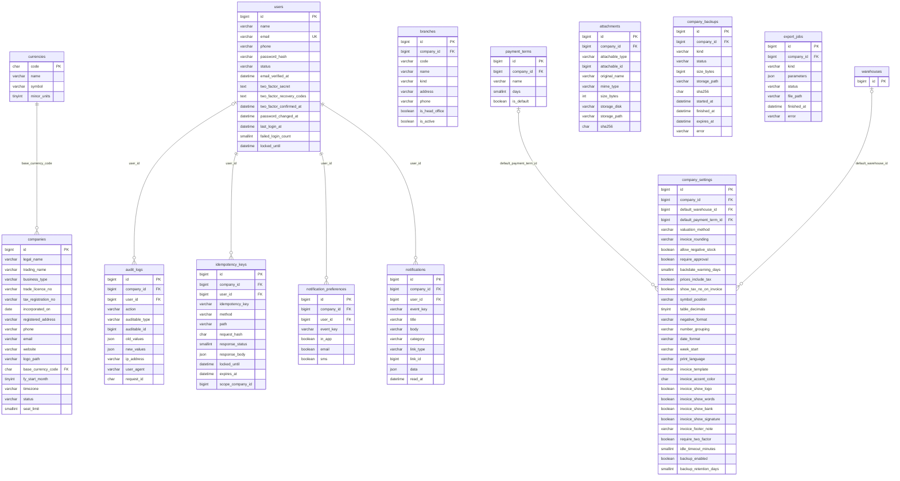
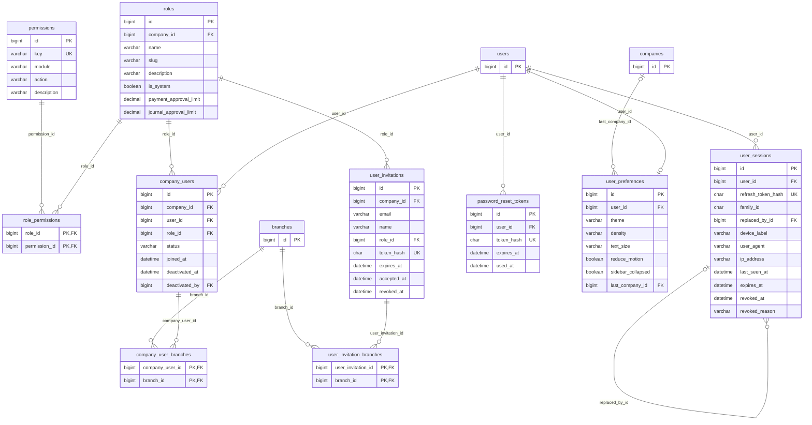
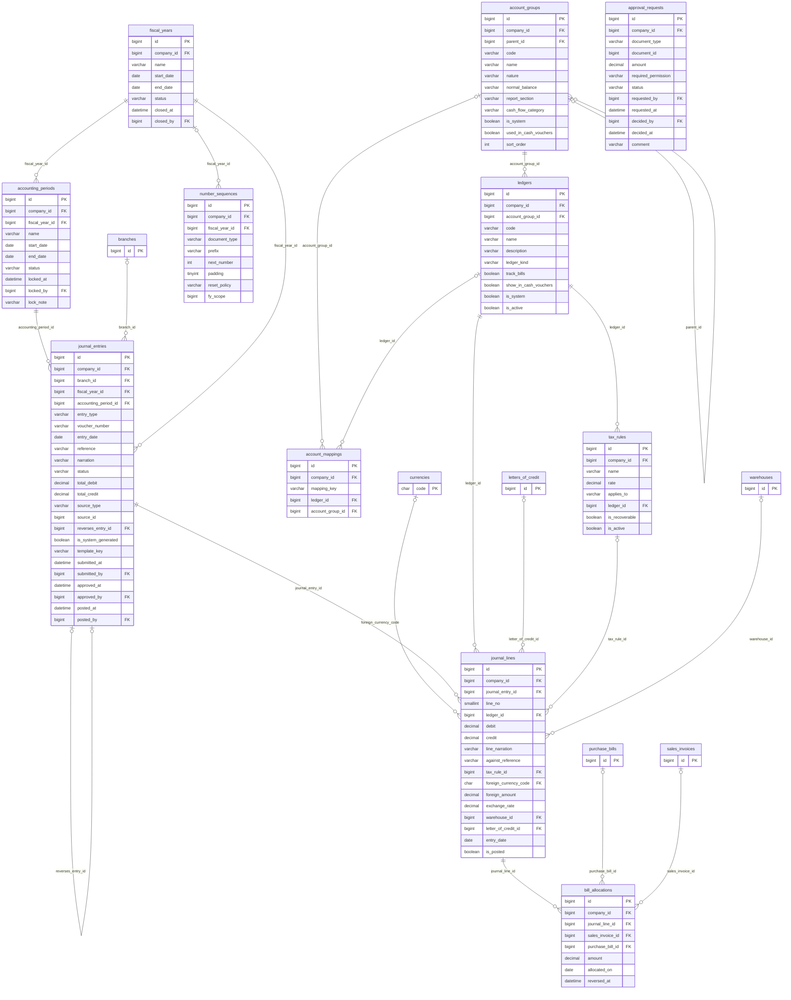
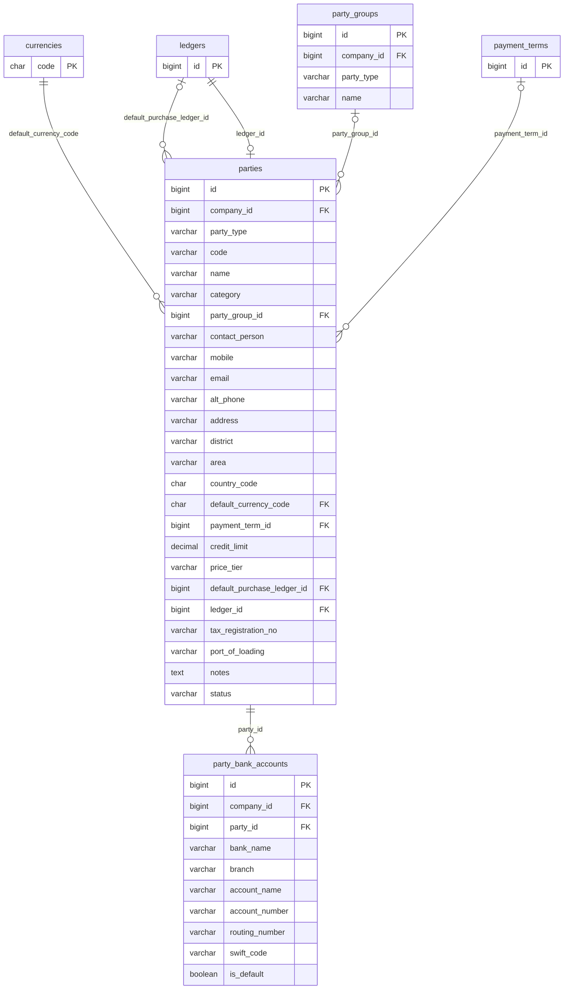
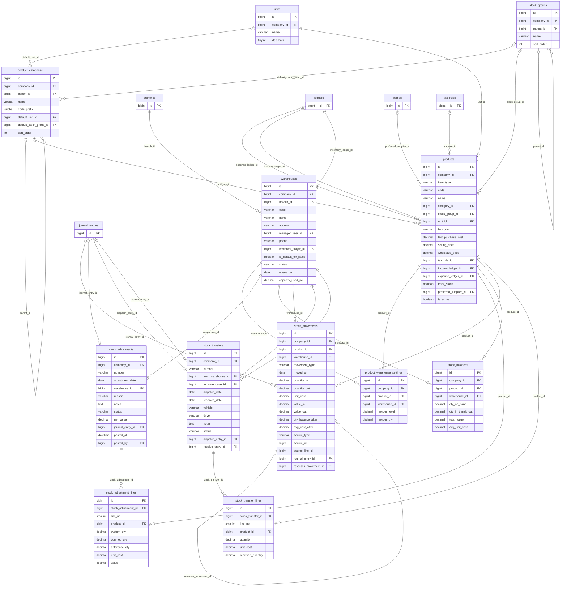
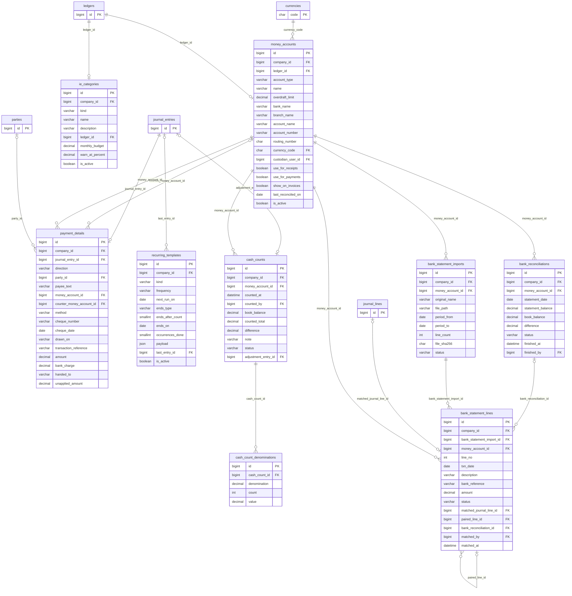
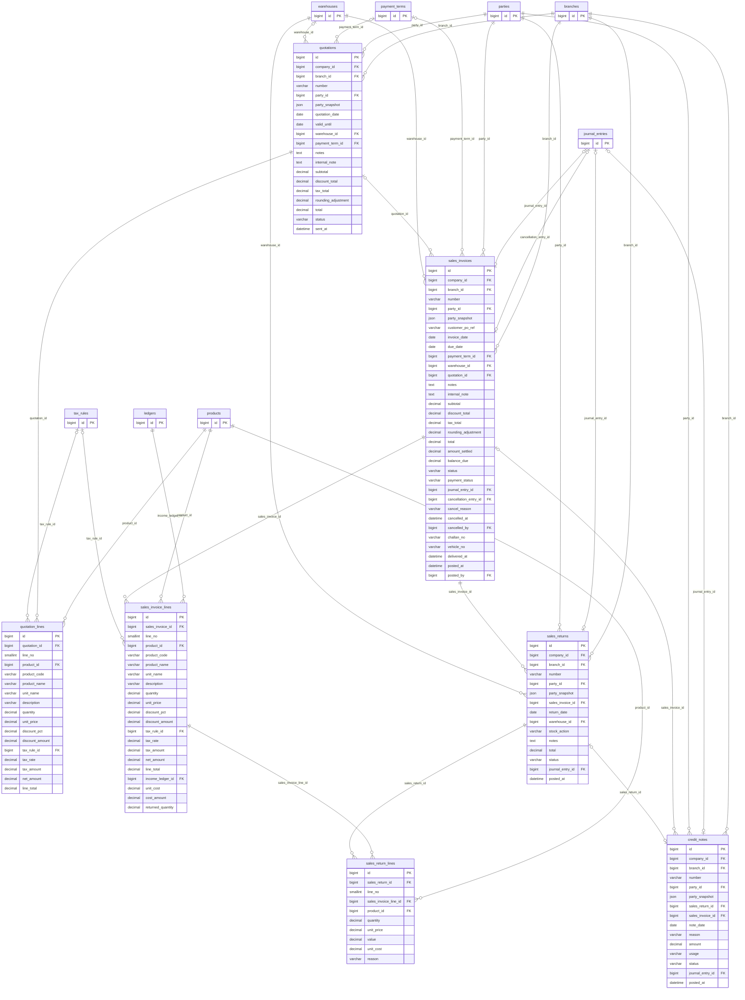
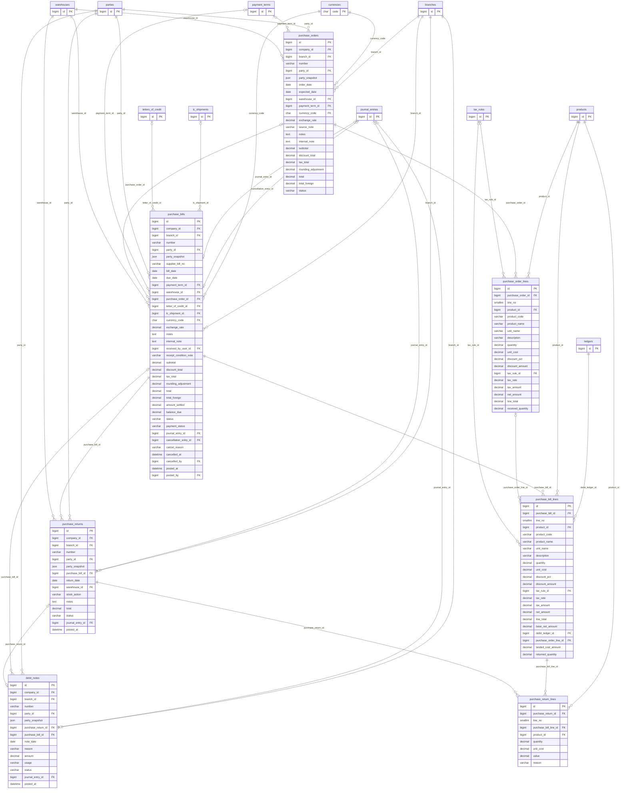
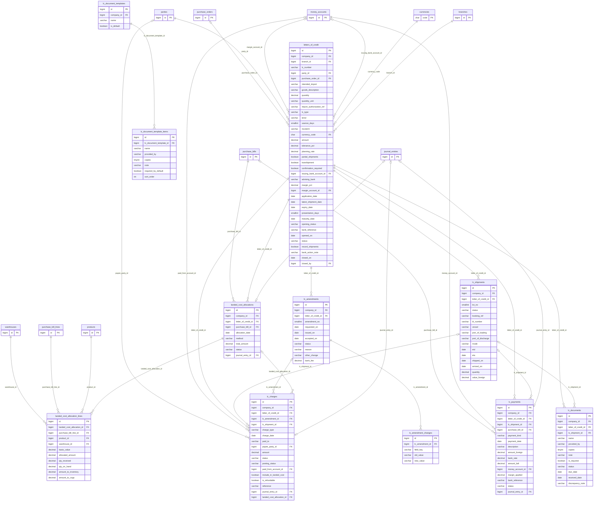

# 04 · Database design

> Status: **Draft for Laravel + Eloquent + MySQL 8.0.** ORM approved 18 Oct 2026 ([00 §6](00-Discovery-and-Decisions.md#6-orm-compatibility-evaluation--decided-eloquent)). Laravel migrations own the schema.
>
> **Generated file.** Sections 5–9 come from `docs/source/schema.py` via `python3 docs/source/build_db.py`. Change the schema there and regenerate; don't hand-edit those sections.

## 1. Scope

The schema covers every entity the designed screens need (see [02-UI-Inventory](02-UI-Inventory.md)): tenancy and access, the chart of accounts and journal, parties, inventory, sales, purchases, cash and bank, income and expenses, and LC management. Shipments are part of the LC model (`lc_shipments`), so there is no separate shipment-management module (CF-22).

Engine: **MySQL 8.0.16+** (CHECK constraints are enforced from 8.0.16), InnoDB, `utf8mb4` / `utf8mb4_0900_ai_ci`, `sql_mode` including `STRICT_ALL_TABLES`, server time zone UTC.

## 2. Conventions

| Topic | Rule |
|---|---|
| Names | `snake_case`; tables plural (`sales_invoices`); FKs `<singular>_id`; booleans `is_`/`has_`/verb (`track_stock`) |
| Keys | `id BIGINT UNSIGNED AUTO_INCREMENT` surrogate PK. Exceptions: `currencies.code` (natural ISO key) and pure junctions (composite PK). Public identifiers in URLs are the numeric id. Human document numbers (`INV-2026-0588`) are unique business keys, never PKs |
| Tenancy | Every business table has `company_id NOT NULL` → `companies(id) ON DELETE RESTRICT`. Business unique keys always include `company_id` (e.g. `UNIQUE(company_id, number)`). Child "line" tables inherit tenancy from their header and carry no `company_id`; they are only accessible through the header |
| Money | Base currency (BDT) amounts `DECIMAL(18,2)`; foreign amounts `DECIMAL(18,2)` + currency code; FX rates `DECIMAL(18,6)`; unit costs `DECIMAL(18,4)`; quantities `DECIMAL(18,3)`; percentages `DECIMAL(7,4)`. **No FLOAT/DOUBLE anywhere** (checked by the build script). PHP uses `brick/math` BigDecimal; JSON carries amounts as strings |
| Enums | `VARCHAR(30)` + `CHECK (col IN (...))` mirrored by PHP 8.1 backed enums. Adding a value is an additive migration; MySQL `ENUM` is avoided because reordering or removing values rewrites the table |
| Time | `DATETIME` in UTC for events (not `TIMESTAMP`, whose range ends 19 Jan 2038; Laravel `timezone` = UTC); `DATE` for business dates (invoice date, voucher date), which are interpreted in the company time zone (Asia/Dhaka) |
| Audit columns | `created_by`, `updated_by` → `users` `ON DELETE SET NULL`; `created_at`, `updated_at` |
| Concurrency | Editable aggregates carry `lock_version INT`; the API exposes it as an `ETag` and requires `If-Match` on update (CF-27) |
| Deletion | Financial rows (journal, documents once posted, stock movements, audit) are **never deleted**. Master data with history is **deactivated**; master data without history may be soft-deleted (`deleted_at`) or hard-deleted |
| FK actions | Default `ON DELETE RESTRICT, ON UPDATE RESTRICT` (surrogate keys never change; MySQL 8.0 also forbids CHECK constraints and stored generated columns on columns used by a cascading action). `CASCADE` only from a draft header to its lines and to pure dependants (template items, denominations, user-owned rows); `SET NULL` only for optional references between master-data rows. Never `SET NULL` on posted financial rows or append-only tables. Users are never hard-deleted (deactivated), so actor columns (`created_by`, `posted_by`, …) are RESTRICT |

## 3. Candidate entities: included, merged or excluded

| Candidate (from the brief) | Decision | Justification |
|---|---|---|
| Companies | **Included** `companies`, `company_settings` | Company switcher, K1–K7 (CF-02) |
| Branches and warehouses | **Included** `branches`, `warehouses` | K1 Locations; D7/D8; report branch filters |
| Users, roles, permissions, assignments | **Included** `users`, `roles`, `permissions`, `role_permissions`, `company_users`, `company_user_branches` | K8–K11; one role per membership |
| Products, categories, units, stock movements | **Included** `products`, `product_categories`, `units`, `stock_groups`, `stock_movements`, `stock_balances` (also holds value and average cost per warehouse, R-02), `product_warehouse_settings` | D1–D14 |
| Customers and suppliers | **Merged** into `parties` (+ `party_groups`, `party_bank_accounts`) | Identical layouts and fields (B/C); one ledger per party. ⚑ DEC-04 |
| Purchase orders and lines | **Included** | F8; LC links to a PO |
| Sales orders and lines | **Excluded** | No sales-order screen exists. Quotation → invoice covers the flow (E10). Can be added later |
| Inventory receipts and issues | **Merged** into documents | A purchase bill is the receipt (F3) and a posted invoice is the issue; both write `stock_movements`. A separate GRN/issue note has no screen (AS-08) |
| Accounts and account groups | **Included** `account_groups`, `ledgers` | H2–H7 |
| Journal entries and lines | **Included** `journal_entries`, `journal_lines` | The single posting store every report reads |
| Vouchers and voucher sequences | **Merged**: vouchers are `journal_entries` with `entry_type` journal/payment/receipt/contra; sequences are `number_sequences` | H8–H13 show vouchers as journal entries with a type |
| Payments and receipts | **Included** as `journal_entries` + `payment_details` + `bill_allocations` | One model serves E7, F5, G6, G7, H10, H11 and I3/I6 |
| Tax configuration | **Included** `tax_rules` | K6 (user-defined only) |
| Bank accounts and bank transactions | **Included** `money_accounts`, `bank_statement_imports`, `bank_statement_lines`, `bank_reconciliations`, `cash_counts` | G1–G13. "Bank transactions" are journal lines on bank ledgers |
| Audit logs | **Included** `audit_logs` | Activity timelines everywhere, H13 audit trail |
| LC applications, amendments, bank charges, import expenses | **Included** `letters_of_credit`, `lc_amendments`, `lc_amendment_changes`, `lc_charges`, `lc_payments`, `lc_documents`, `lc_document_templates(_items)`, `lc_shipments`, `landed_cost_allocations(_lines)` | M1–M8 |
| Cost centres, batches/expiry, cheque books, price lists, UoM conversion | **Excluded (deferred)** | Not designed (GAP-11, GAP-21, AS-05, AS-06, AS-12) |

## 4. Key design patterns

### 4.1 Documents post to one journal
Every business document that affects the books holds a nullable, **unique** `journal_entry_id`, which is filled at posting. The journal entry points back with `source_type` + `source_id`, used for navigation only. Integrity is enforced from the document side, because the document → journal FK is a real foreign key. Reports read only `journal_lines` with `is_posted = 1`; `entry_date` and `is_posted` are copied onto the lines at posting so ledger queries use one index: `(company_id, ledger_id, is_posted, entry_date)`.

### 4.2 Balanced and immutable
A CHECK makes each line either a debit or a credit, never both. The posting service asserts `SUM(debit) = SUM(credit)` and writes the totals to the header; a header CHECK rejects `status='posted'` with unequal totals. Posted entries and lines are never updated (except to set `status='reversed'` on the original) or deleted. A database trigger blocks `UPDATE/DELETE` on posted `journal_lines` as a second line of defence (see 06 §15).

### 4.3 Parties, banks and warehouses own ledgers
Creating a customer creates a ledger under the mapped *Sundry debtors* group (CF-10), with `parties.ledger_id` UNIQUE (1:1). The same applies to `money_accounts.ledger_id`, `warehouses.inventory_ledger_id` and `ie_categories.ledger_id`.

### 4.4 Settlement
`bill_allocations` links the party-ledger line of a receipt, payment, credit note, debit note or advance to the invoice or bill it settles. `sales_invoices.amount_settled` and `balance_due` are a denormalized cache, updated in the same transaction under a row lock; a nightly job compares them with `SUM(bill_allocations)`.

### 4.5 Stock
`stock_movements` is the append-only stock ledger. `stock_balances` (quantity, value and moving average per product and warehouse; AS-03 as revised by R-02) is a cache maintained only by the stock service, inside the posting transaction and under `SELECT … FOR UPDATE`. A nightly job proves that `stock_balances.qty_on_hand` = `SUM(quantity_in − quantity_out)` and `total_value` = `SUM(value_in − value_out)` of the movements.

### 4.6 Numbering
`number_sequences` holds one row per (company, FY, document type). Numbers are taken with `SELECT … FOR UPDATE` in the same transaction as the first save; deleted draft numbers are voided and audited, never reused (DEC-06).

### 4.7 Polymorphic references
Only `attachments`, `audit_logs`, `notifications`, `approval_requests`, `journal_entries.source_*` and `stock_movements.source_*` use type + id pairs (the full list with integrity notes is in [14 §5.5](14-Physical-Schema-and-Migrations.md#55-polymorphic-references-no-fk-by-design)). That's because they attach to many tables; real FKs would mean dozens of nullable columns. The application validates them, and a nightly orphan check reports problems. Financial relationships never rely on polymorphic keys.

## 5. Entity-relationship diagrams

Diagrams are generated from the same definition as the data dictionary (section 6), so every line in a diagram corresponds to a real foreign key. To stay readable they omit three column families that exist on most tables: `company_id` (→ companies), `created_by`/`updated_by` and actor columns such as `posted_by` (→ users). Notation: `||--o{` mandatory one-to-many, `|o--o{` optional one-to-many, `||--o|` one-to-one, `|o--o|` optional one-to-one. Tables from other modules appear as stubs with only their key.

### 5.1 Core overview (entities only)

The backbone: tenancy and access on top; master data (parties, products, warehouses, ledgers) in the middle; documents post to journal entries, which hold the lines every report reads.

```mermaid
erDiagram
    account_groups |o--o{ account_groups : "parent_id"
    account_groups ||--o{ ledgers : "account_group_id"
    branches |o--o{ journal_entries : "branch_id"
    branches ||--o{ letters_of_credit : "branch_id"
    branches ||--o{ purchase_bills : "branch_id"
    branches ||--o{ sales_invoices : "branch_id"
    branches ||--o{ warehouses : "branch_id"
    journal_entries |o--o{ stock_movements : "journal_entry_id"
    journal_entries |o--o| journal_entries : "reverses_entry_id"
    journal_entries |o--o| landed_cost_allocations : "journal_entry_id"
    journal_entries |o--o| lc_charges : "journal_entry_id"
    journal_entries |o--o| lc_payments : "journal_entry_id"
    journal_entries |o--o| purchase_bills : "cancellation_entry_id"
    journal_entries |o--o| purchase_bills : "journal_entry_id"
    journal_entries |o--o| sales_invoices : "cancellation_entry_id"
    journal_entries |o--o| sales_invoices : "journal_entry_id"
    journal_entries ||--o{ journal_lines : "journal_entry_id"
    journal_entries ||--o| payment_details : "journal_entry_id"
    journal_lines ||--o{ bill_allocations : "journal_line_id"
    landed_cost_allocations |o--o{ lc_charges : "landed_cost_allocation_id"
    ledgers |o--o{ parties : "default_purchase_ledger_id"
    ledgers |o--o{ products : "expense_ledger_id"
    ledgers ||--o{ journal_lines : "ledger_id"
    ledgers ||--o{ products : "income_ledger_id"
    ledgers ||--o{ purchase_bill_lines : "debit_ledger_id"
    ledgers ||--o{ sales_invoice_lines : "income_ledger_id"
    ledgers ||--o{ warehouses : "inventory_ledger_id"
    ledgers ||--o| money_accounts : "ledger_id"
    ledgers ||--o| parties : "ledger_id"
    letters_of_credit |o--o{ journal_lines : "letter_of_credit_id"
    letters_of_credit |o--o{ purchase_bills : "letter_of_credit_id"
    letters_of_credit ||--o{ landed_cost_allocations : "letter_of_credit_id"
    letters_of_credit ||--o{ lc_charges : "letter_of_credit_id"
    letters_of_credit ||--o{ lc_payments : "letter_of_credit_id"
    money_accounts |o--o{ lc_charges : "paid_from_account_id"
    money_accounts |o--o{ letters_of_credit : "issuing_bank_account_id"
    money_accounts |o--o{ letters_of_credit : "margin_account_id"
    money_accounts |o--o{ payment_details : "counter_money_account_id"
    money_accounts ||--o{ lc_payments : "money_account_id"
    money_accounts ||--o{ payment_details : "money_account_id"
    parties |o--o{ lc_charges : "payee_party_id"
    parties |o--o{ payment_details : "party_id"
    parties |o--o{ products : "preferred_supplier_id"
    parties ||--o{ letters_of_credit : "party_id"
    parties ||--o{ purchase_bills : "party_id"
    parties ||--o{ sales_invoices : "party_id"
    permissions ||--o{ role_permissions : "permission_id"
    products ||--o{ purchase_bill_lines : "product_id"
    products ||--o{ sales_invoice_lines : "product_id"
    products ||--o{ stock_balances : "product_id"
    products ||--o{ stock_movements : "product_id"
    purchase_bills |o--o{ bill_allocations : "purchase_bill_id"
    purchase_bills |o--o{ lc_payments : "purchase_bill_id"
    purchase_bills ||--o{ landed_cost_allocations : "purchase_bill_id"
    purchase_bills ||--o{ purchase_bill_lines : "purchase_bill_id"
    roles ||--o{ company_users : "role_id"
    roles ||--o{ role_permissions : "role_id"
    sales_invoices |o--o{ bill_allocations : "sales_invoice_id"
    sales_invoices ||--o{ sales_invoice_lines : "sales_invoice_id"
    stock_movements |o--o{ stock_movements : "reverses_movement_id"
    users ||--o{ company_users : "user_id"
    warehouses |o--o{ journal_lines : "warehouse_id"
    warehouses ||--o{ purchase_bills : "warehouse_id"
    warehouses ||--o{ sales_invoices : "warehouse_id"
    warehouses ||--o{ stock_balances : "warehouse_id"
    warehouses ||--o{ stock_movements : "warehouse_id"
```

### 5.2 Platform module

### 5.3 Access module

### 5.4 Accounting module

### 5.5 Parties module

### 5.6 Inventory module

### 5.7 Money module

### 5.8 Sales module

### 5.9 Purchases module

### 5.10 LC module

## 6. Data dictionary

Standard columns are listed in each table: `id` (PK), `company_id` (tenant), `lock_version` (optimistic locking, where editable), `created_by`/`updated_by`, `created_at`/`updated_at`. All FKs are indexed. "Default —" means a value is required on insert.

### 6.1 Platform

#### `currencies`

**Purpose:** ISO 4217 reference list (BDT base, USD/EUR/CNY for imports). Global reference data.  
**Flags:** —  
**Primary key:** (code)

| Column | Type | Null | Default | Keys | FK rule | Meaning / rules |
|---|---|---|---|---|---|---|
| `code` | CHAR(3) | no | — | PK | — | ISO 4217 code, primary key |
| `name` | VARCHAR(60) | no | — | — | — |  |
| `symbol` | VARCHAR(8) | no | — | — | — |  |
| `minor_units` | TINYINT UNSIGNED | no | 2 | — | — | Decimal places |
| `created_at` | DATETIME | yes | NULL | — | — | Set by Laravel |
| `updated_at` | DATETIME | yes | NULL | — | — | Set by Laravel |

#### `users`

**Purpose:** A person who can sign in. Global; membership of companies is in company_users.  
**Flags:** —  
**Primary key:** (id)

| Column | Type | Null | Default | Keys | FK rule | Meaning / rules |
|---|---|---|---|---|---|---|
| `id` | BIGINT UNSIGNED | no | — | PK | — | Primary key, auto-increment |
| `name` | VARCHAR(120) | no | — | — | — |  |
| `email` | VARCHAR(190) | no | — | UQ | — | Login identifier, stored lower-case |
| `phone` | VARCHAR(20) | yes | NULL | — | — |  |
| `password_hash` | VARCHAR(255) | no | — | — | — | Argon2id hash; never returned by the API |
| `status` | VARCHAR(30) | no | 'invited' | — | — | enum: active \| invited \| disabled |
| `email_verified_at` | DATETIME | yes | NULL | — | — |  |
| `two_factor_secret` | TEXT | yes | NULL | — | — | TOTP secret, encrypted with APP_KEY (Laravel encrypted cast) |
| `two_factor_recovery_codes` | TEXT | yes | NULL | — | — | Encrypted JSON array of hashed recovery codes |
| `two_factor_confirmed_at` | DATETIME | yes | NULL | — | — |  |
| `password_changed_at` | DATETIME | yes | NULL | — | — |  |
| `last_login_at` | DATETIME | yes | NULL | — | — |  |
| `failed_login_count` | SMALLINT UNSIGNED | no | 0 | — | — |  |
| `locked_until` | DATETIME | yes | NULL | — | — | Brute-force lockout end |
| `created_at` | DATETIME | yes | NULL | — | — | Set by Laravel |
| `updated_at` | DATETIME | yes | NULL | — | — | Set by Laravel |

- **Unique** (email)
- **Check** `status IN ('active', 'invited', 'disabled')`

#### `companies`

**Purpose:** A business (tenant). All business data hangs off a company.  
**Flags:** optimistic lock  
**Primary key:** (id)

| Column | Type | Null | Default | Keys | FK rule | Meaning / rules |
|---|---|---|---|---|---|---|
| `id` | BIGINT UNSIGNED | no | — | PK | — | Primary key, auto-increment |
| `legal_name` | VARCHAR(190) | no | — | — | — |  |
| `trading_name` | VARCHAR(190) | yes | NULL | — | — |  |
| `business_type` | VARCHAR(30) | no | — | — | — | enum: private_limited \| sole_proprietorship \| partnership \| public_limited |
| `trade_licence_no` | VARCHAR(60) | yes | NULL | — | — |  |
| `tax_registration_no` | VARCHAR(40) | yes | NULL | — | — | BIN/TIN as entered; format to be confirmed |
| `incorporated_on` | DATE | yes | NULL | — | — |  |
| `registered_address` | VARCHAR(255) | yes | NULL | — | — |  |
| `phone` | VARCHAR(30) | yes | NULL | — | — |  |
| `email` | VARCHAR(190) | yes | NULL | — | — |  |
| `website` | VARCHAR(190) | yes | NULL | — | — |  |
| `logo_path` | VARCHAR(255) | yes | NULL | — | — | Storage path of logo image |
| `base_currency_code` | CHAR(3) | no | — | FK → `currencies.code` | ON DELETE RESTRICT / ON UPDATE RESTRICT | Locked once any journal entry exists |
| `fy_start_month` | TINYINT UNSIGNED | no | 7 | — | — | 1-12; July for Bangladesh FY |
| `timezone` | VARCHAR(40) | no | 'Asia/Dhaka' | — | — |  |
| `status` | VARCHAR(30) | no | 'active' | — | — | enum: active \| suspended \| archived |
| `seat_limit` | SMALLINT UNSIGNED | no | 10 | — | — | Users allowed (K8 shows 7 of 10) |
| `lock_version` | INT UNSIGNED | no | 1 | — | — | Optimistic concurrency counter; incremented on every update (If-Match) |
| `created_by` | BIGINT UNSIGNED | yes | NULL | FK → `users.id` | ON DELETE RESTRICT / ON UPDATE RESTRICT | User who created the row |
| `updated_by` | BIGINT UNSIGNED | yes | NULL | FK → `users.id` | ON DELETE RESTRICT / ON UPDATE RESTRICT | User who last changed the row |
| `created_at` | DATETIME | yes | NULL | — | — | Set by Laravel |
| `updated_at` | DATETIME | yes | NULL | — | — | Set by Laravel |

- Index (base_currency_code)
- Index (created_by)
- Index (updated_by)
- **Check** `business_type IN ('private_limited', 'sole_proprietorship', 'partnership', 'public_limited')`
- **Check** `status IN ('active', 'suspended', 'archived')`

**Relationships:**
- `base_currency_code` → `currencies`: one-to-many

#### `branches`

**Purpose:** A company location (head office, depot, outlet). Used for reporting filters and optional user restriction.  
**Flags:** tenant-scoped, optimistic lock  
**Primary key:** (id)

| Column | Type | Null | Default | Keys | FK rule | Meaning / rules |
|---|---|---|---|---|---|---|
| `id` | BIGINT UNSIGNED | no | — | PK | — | Primary key, auto-increment |
| `company_id` | BIGINT UNSIGNED | no | — | FK → `companies.id` | ON DELETE RESTRICT / ON UPDATE RESTRICT | Tenant owner. Every query is scoped by it. |
| `code` | VARCHAR(20) | no | — | — | — |  |
| `name` | VARCHAR(120) | no | — | — | — |  |
| `kind` | VARCHAR(120) | yes | NULL | — | — | Free text, e.g. 'Office, warehouse, retail counter' |
| `address` | VARCHAR(255) | yes | NULL | — | — |  |
| `phone` | VARCHAR(30) | yes | NULL | — | — |  |
| `is_head_office` | BOOLEAN | no | 0 | — | — |  |
| `is_active` | BOOLEAN | no | 1 | — | — |  |
| `lock_version` | INT UNSIGNED | no | 1 | — | — | Optimistic concurrency counter; incremented on every update (If-Match) |
| `created_by` | BIGINT UNSIGNED | yes | NULL | FK → `users.id` | ON DELETE RESTRICT / ON UPDATE RESTRICT | User who created the row |
| `updated_by` | BIGINT UNSIGNED | yes | NULL | FK → `users.id` | ON DELETE RESTRICT / ON UPDATE RESTRICT | User who last changed the row |
| `created_at` | DATETIME | yes | NULL | — | — | Set by Laravel |
| `updated_at` | DATETIME | yes | NULL | — | — | Set by Laravel |

- **Unique** (company_id, code)
- Index (created_by)
- Index (updated_by)

#### `payment_terms`

**Purpose:** Named credit terms (Cash, Net 7, Net 14, Net 15, Net 30, Net 45).  
**Flags:** tenant-scoped  
**Primary key:** (id)

| Column | Type | Null | Default | Keys | FK rule | Meaning / rules |
|---|---|---|---|---|---|---|
| `id` | BIGINT UNSIGNED | no | — | PK | — | Primary key, auto-increment |
| `company_id` | BIGINT UNSIGNED | no | — | FK → `companies.id` | ON DELETE RESTRICT / ON UPDATE RESTRICT | Tenant owner. Every query is scoped by it. |
| `name` | VARCHAR(40) | no | — | — | — |  |
| `days` | SMALLINT UNSIGNED | no | — | — | — | Due date = document date + days |
| `is_default` | BOOLEAN | no | 0 | — | — |  |
| `created_by` | BIGINT UNSIGNED | yes | NULL | FK → `users.id` | ON DELETE RESTRICT / ON UPDATE RESTRICT | User who created the row |
| `updated_by` | BIGINT UNSIGNED | yes | NULL | FK → `users.id` | ON DELETE RESTRICT / ON UPDATE RESTRICT | User who last changed the row |
| `created_at` | DATETIME | yes | NULL | — | — | Set by Laravel |
| `updated_at` | DATETIME | yes | NULL | — | — | Set by Laravel |

- **Unique** (company_id, name)
- Index (created_by)
- Index (updated_by)

#### `company_settings`

**Purpose:** One row per company: preferences, controls, currency display and invoice design (K3, K5, K6, K7, K14, K15).  
**Flags:** tenant-scoped, optimistic lock  
**Primary key:** (id)

| Column | Type | Null | Default | Keys | FK rule | Meaning / rules |
|---|---|---|---|---|---|---|
| `id` | BIGINT UNSIGNED | no | — | PK | — | Primary key, auto-increment |
| `company_id` | BIGINT UNSIGNED | no | — | FK → `companies.id` · UQ | ON DELETE RESTRICT / ON UPDATE RESTRICT | Tenant owner. Every query is scoped by it. |
| `default_warehouse_id` | BIGINT UNSIGNED | yes | NULL | FK → `warehouses.id` | ON DELETE SET NULL / ON UPDATE RESTRICT |  |
| `default_payment_term_id` | BIGINT UNSIGNED | yes | NULL | FK → `payment_terms.id` | ON DELETE SET NULL / ON UPDATE RESTRICT |  |
| `valuation_method` | VARCHAR(30) | no | 'weighted_average' | — | — | enum: weighted_average \| fifo. FIFO reserved for a later phase |
| `invoice_rounding` | VARCHAR(30) | no | 'nearest_1' | — | — | enum: none \| nearest_1 \| nearest_5 |
| `allow_negative_stock` | BOOLEAN | no | 0 | — | — |  |
| `require_approval` | BOOLEAN | no | 1 | — | — |  |
| `backdate_warning_days` | SMALLINT UNSIGNED | no | 7 | — | — |  |
| `prices_include_tax` | BOOLEAN | no | 0 | — | — |  |
| `show_tax_no_on_invoice` | BOOLEAN | no | 0 | — | — |  |
| `symbol_position` | VARCHAR(30) | no | 'before' | — | — | enum: before \| after |
| `table_decimals` | TINYINT UNSIGNED | no | 2 | — | — |  |
| `negative_format` | VARCHAR(30) | no | 'parentheses' | — | — | enum: parentheses \| minus |
| `number_grouping` | VARCHAR(30) | no | 'lakh' | — | — | enum: lakh \| million |
| `date_format` | VARCHAR(20) | no | 'd M Y' | — | — |  |
| `week_start` | VARCHAR(30) | no | 'saturday' | — | — | enum: saturday \| sunday \| monday |
| `print_language` | VARCHAR(30) | no | 'en' | — | — | enum: en \| bn \| both |
| `invoice_template` | VARCHAR(30) | no | 'classic' | — | — | enum: classic \| banded \| minimal |
| `invoice_accent_color` | CHAR(7) | no | '#0b6b5e' | — | — |  |
| `invoice_show_logo` | BOOLEAN | no | 1 | — | — |  |
| `invoice_show_words` | BOOLEAN | no | 1 | — | — |  |
| `invoice_show_bank` | BOOLEAN | no | 1 | — | — |  |
| `invoice_show_signature` | BOOLEAN | no | 1 | — | — |  |
| `invoice_footer_note` | VARCHAR(255) | yes | NULL | — | — |  |
| `require_two_factor` | BOOLEAN | no | 0 | — | — |  |
| `idle_timeout_minutes` | SMALLINT UNSIGNED | yes | 60 | — | — | NULL = never |
| `backup_enabled` | BOOLEAN | no | 1 | — | — |  |
| `backup_retention_days` | SMALLINT UNSIGNED | no | 90 | — | — |  |
| `lock_version` | INT UNSIGNED | no | 1 | — | — | Optimistic concurrency counter; incremented on every update (If-Match) |
| `created_by` | BIGINT UNSIGNED | yes | NULL | FK → `users.id` | ON DELETE RESTRICT / ON UPDATE RESTRICT | User who created the row |
| `updated_by` | BIGINT UNSIGNED | yes | NULL | FK → `users.id` | ON DELETE RESTRICT / ON UPDATE RESTRICT | User who last changed the row |
| `created_at` | DATETIME | yes | NULL | — | — | Set by Laravel |
| `updated_at` | DATETIME | yes | NULL | — | — | Set by Laravel |

- **Unique** (company_id)
- Index (default_warehouse_id)
- Index (default_payment_term_id)
- Index (created_by)
- Index (updated_by)
- **Check** `valuation_method IN ('weighted_average', 'fifo')`
- **Check** `invoice_rounding IN ('none', 'nearest_1', 'nearest_5')`
- **Check** `symbol_position IN ('before', 'after')`
- **Check** `negative_format IN ('parentheses', 'minus')`
- **Check** `number_grouping IN ('lakh', 'million')`
- **Check** `week_start IN ('saturday', 'sunday', 'monday')`
- **Check** `print_language IN ('en', 'bn', 'both')`
- **Check** `invoice_template IN ('classic', 'banded', 'minimal')`

**Relationships:**
- `default_warehouse_id` → `warehouses`: one-to-many (optional)
- `default_payment_term_id` → `payment_terms`: one-to-many (optional)

#### `notification_preferences`

**Purpose:** Per user, company and event: in-app, e-mail and SMS switches (K12).  
**Flags:** tenant-scoped  
**Primary key:** (id)

| Column | Type | Null | Default | Keys | FK rule | Meaning / rules |
|---|---|---|---|---|---|---|
| `id` | BIGINT UNSIGNED | no | — | PK | — | Primary key, auto-increment |
| `company_id` | BIGINT UNSIGNED | no | — | FK → `companies.id` | ON DELETE RESTRICT / ON UPDATE RESTRICT | Tenant owner. Every query is scoped by it. |
| `user_id` | BIGINT UNSIGNED | no | — | FK → `users.id` | ON DELETE CASCADE / ON UPDATE RESTRICT |  |
| `event_key` | VARCHAR(60) | no | — | — | — |  |
| `in_app` | BOOLEAN | no | 1 | — | — |  |
| `email` | BOOLEAN | no | 0 | — | — |  |
| `sms` | BOOLEAN | no | 0 | — | — |  |
| `created_at` | DATETIME | yes | NULL | — | — | Set by Laravel |
| `updated_at` | DATETIME | yes | NULL | — | — | Set by Laravel |

- **Unique** (company_id, user_id, event_key)
- Index (user_id)

**Relationships:**
- `user_id` → `users`: one-to-many

#### `notifications`

**Purpose:** In-app notification feed (L3) including approval requests.  
**Flags:** tenant-scoped  
**Primary key:** (id)

| Column | Type | Null | Default | Keys | FK rule | Meaning / rules |
|---|---|---|---|---|---|---|
| `id` | BIGINT UNSIGNED | no | — | PK | — | Primary key, auto-increment |
| `company_id` | BIGINT UNSIGNED | no | — | FK → `companies.id` | ON DELETE RESTRICT / ON UPDATE RESTRICT | Tenant owner. Every query is scoped by it. |
| `user_id` | BIGINT UNSIGNED | no | — | FK → `users.id` | ON DELETE CASCADE / ON UPDATE RESTRICT |  |
| `event_key` | VARCHAR(60) | no | — | — | — |  |
| `title` | VARCHAR(190) | no | — | — | — |  |
| `body` | VARCHAR(500) | yes | NULL | — | — |  |
| `category` | VARCHAR(30) | no | 'info' | — | — | enum: approvals \| alerts \| info |
| `link_type` | VARCHAR(60) | yes | NULL | — | — |  |
| `link_id` | BIGINT UNSIGNED | yes | NULL | — | — |  |
| `data` | JSON | yes | NULL | — | — |  |
| `read_at` | DATETIME | yes | NULL | — | — |  |
| `created_at` | DATETIME | yes | NULL | — | — | Set by Laravel |
| `updated_at` | DATETIME | yes | NULL | — | — | Set by Laravel |

- Index (company_id, user_id, read_at)
- Index (user_id)
- **Check** `category IN ('approvals', 'alerts', 'info')`

**Relationships:**
- `user_id` → `users`: one-to-many

#### `audit_logs`

**Purpose:** Append-only audit trail of every create/update/post/approve/reverse/cancel/delete and security event.  
**Flags:** append-only  
**Primary key:** (id)

| Column | Type | Null | Default | Keys | FK rule | Meaning / rules |
|---|---|---|---|---|---|---|
| `id` | BIGINT UNSIGNED | no | — | PK | — | Primary key, auto-increment |
| `company_id` | BIGINT UNSIGNED | yes | NULL | FK → `companies.id` | ON DELETE RESTRICT / ON UPDATE RESTRICT | NULL for global security events |
| `user_id` | BIGINT UNSIGNED | yes | NULL | FK → `users.id` | ON DELETE RESTRICT / ON UPDATE RESTRICT |  |
| `action` | VARCHAR(40) | no | — | — | — | created, updated, posted, approved, rejected, reversed, cancelled, deleted, voided_number, login, login_failed, ... |
| `auditable_type` | VARCHAR(60) | no | — | — | — |  |
| `auditable_id` | BIGINT UNSIGNED | yes | NULL | — | — |  |
| `old_values` | JSON | yes | NULL | — | — |  |
| `new_values` | JSON | yes | NULL | — | — |  |
| `ip_address` | VARCHAR(45) | yes | NULL | — | — |  |
| `user_agent` | VARCHAR(255) | yes | NULL | — | — |  |
| `request_id` | CHAR(36) | yes | NULL | — | — |  |
| `created_at` | DATETIME | yes | NULL | — | — | Set by Laravel |

- Index (company_id, auditable_type, auditable_id)
- Index (company_id, created_at)
- Index (user_id)

**Relationships:**
- `user_id` → `users`: one-to-many (optional)

#### `attachments`

**Purpose:** Uploaded file metadata (JPG/PNG/PDF up to 10 MB). Polymorphic owner; files live in private object storage.  
**Flags:** tenant-scoped  
**Primary key:** (id)

| Column | Type | Null | Default | Keys | FK rule | Meaning / rules |
|---|---|---|---|---|---|---|
| `id` | BIGINT UNSIGNED | no | — | PK | — | Primary key, auto-increment |
| `company_id` | BIGINT UNSIGNED | no | — | FK → `companies.id` | ON DELETE RESTRICT / ON UPDATE RESTRICT | Tenant owner. Every query is scoped by it. |
| `attachable_type` | VARCHAR(60) | no | — | — | — |  |
| `attachable_id` | BIGINT UNSIGNED | no | — | — | — |  |
| `original_name` | VARCHAR(255) | no | — | — | — |  |
| `mime_type` | VARCHAR(100) | no | — | — | — |  |
| `size_bytes` | INT UNSIGNED | no | — | — | — |  |
| `storage_disk` | VARCHAR(30) | no | — | — | — |  |
| `storage_path` | VARCHAR(255) | no | — | — | — |  |
| `sha256` | CHAR(64) | no | — | — | — |  |
| `created_by` | BIGINT UNSIGNED | yes | NULL | FK → `users.id` | ON DELETE RESTRICT / ON UPDATE RESTRICT | User who created the row |
| `updated_by` | BIGINT UNSIGNED | yes | NULL | FK → `users.id` | ON DELETE RESTRICT / ON UPDATE RESTRICT | User who last changed the row |
| `created_at` | DATETIME | yes | NULL | — | — | Set by Laravel |
| `updated_at` | DATETIME | yes | NULL | — | — | Set by Laravel |

- Index (company_id, attachable_type, attachable_id)
- Index (created_by)
- Index (updated_by)
- **Check** `size_bytes <= 10485760`

#### `idempotency_keys`

**Purpose:** Replay protection for POST/PUT that create or post documents (Idempotency-Key header).  
**Flags:** —  
**Primary key:** (id)

| Column | Type | Null | Default | Keys | FK rule | Meaning / rules |
|---|---|---|---|---|---|---|
| `id` | BIGINT UNSIGNED | no | — | PK | — | Primary key, auto-increment |
| `company_id` | BIGINT UNSIGNED | yes | NULL | FK → `companies.id` | ON DELETE RESTRICT / ON UPDATE RESTRICT | RESTRICT (feeds a generated column). NULL for requests without company context, e.g. POST /companies (R-21) |
| `user_id` | BIGINT UNSIGNED | no | — | FK → `users.id` | ON DELETE CASCADE / ON UPDATE RESTRICT |  |
| `idempotency_key` | VARCHAR(80) | no | — | — | — |  |
| `method` | VARCHAR(8) | no | — | — | — |  |
| `path` | VARCHAR(255) | no | — | — | — |  |
| `request_hash` | CHAR(64) | no | — | — | — |  |
| `response_status` | SMALLINT UNSIGNED | yes | NULL | — | — |  |
| `response_body` | JSON | yes | NULL | — | — |  |
| `locked_until` | DATETIME | yes | NULL | — | — |  |
| `expires_at` | DATETIME | no | — | — | — |  |
| `scope_company_id` | BIGINT UNSIGNED | no | — | — | — | Generated: 0 when there is no company |
| `created_at` | DATETIME | yes | NULL | — | — | Set by Laravel |
| `updated_at` | DATETIME | yes | NULL | — | — | Set by Laravel |

- **Unique** (scope_company_id, user_id, idempotency_key)
- Index (expires_at)
- Index (company_id)
- Index (user_id)

**Relationships:**
- `user_id` → `users`: one-to-many

#### `company_backups`

**Purpose:** Per-company logical snapshot (automatic daily, manual, before restore, before period lock).  
**Flags:** tenant-scoped  
**Primary key:** (id)

| Column | Type | Null | Default | Keys | FK rule | Meaning / rules |
|---|---|---|---|---|---|---|
| `id` | BIGINT UNSIGNED | no | — | PK | — | Primary key, auto-increment |
| `company_id` | BIGINT UNSIGNED | no | — | FK → `companies.id` | ON DELETE RESTRICT / ON UPDATE RESTRICT | Tenant owner. Every query is scoped by it. |
| `kind` | VARCHAR(30) | no | — | — | — | enum: automatic \| manual \| pre_restore \| pre_lock |
| `status` | VARCHAR(30) | no | — | — | — | enum: running \| complete \| failed \| expired |
| `size_bytes` | BIGINT UNSIGNED | yes | NULL | — | — |  |
| `storage_path` | VARCHAR(255) | yes | NULL | — | — |  |
| `sha256` | CHAR(64) | yes | NULL | — | — |  |
| `started_at` | DATETIME | no | — | — | — |  |
| `finished_at` | DATETIME | yes | NULL | — | — |  |
| `expires_at` | DATETIME | yes | NULL | — | — |  |
| `error` | VARCHAR(500) | yes | NULL | — | — |  |
| `created_by` | BIGINT UNSIGNED | yes | NULL | FK → `users.id` | ON DELETE RESTRICT / ON UPDATE RESTRICT | User who created the row |
| `updated_by` | BIGINT UNSIGNED | yes | NULL | FK → `users.id` | ON DELETE RESTRICT / ON UPDATE RESTRICT | User who last changed the row |
| `created_at` | DATETIME | yes | NULL | — | — | Set by Laravel |
| `updated_at` | DATETIME | yes | NULL | — | — | Set by Laravel |

- Index (company_id, started_at)
- Index (created_by)
- Index (updated_by)
- **Check** `kind IN ('automatic', 'manual', 'pre_restore', 'pre_lock')`
- **Check** `status IN ('running', 'complete', 'failed', 'expired')`

#### `export_jobs`

**Purpose:** Asynchronous export (month-end pack, report exports).  
**Flags:** tenant-scoped  
**Primary key:** (id)

| Column | Type | Null | Default | Keys | FK rule | Meaning / rules |
|---|---|---|---|---|---|---|
| `id` | BIGINT UNSIGNED | no | — | PK | — | Primary key, auto-increment |
| `company_id` | BIGINT UNSIGNED | no | — | FK → `companies.id` | ON DELETE RESTRICT / ON UPDATE RESTRICT | Tenant owner. Every query is scoped by it. |
| `kind` | VARCHAR(30) | no | — | — | — | enum: export_pack \| report |
| `parameters` | JSON | no | — | — | — |  |
| `status` | VARCHAR(30) | no | 'queued' | — | — | enum: queued \| running \| complete \| failed |
| `file_path` | VARCHAR(255) | yes | NULL | — | — |  |
| `finished_at` | DATETIME | yes | NULL | — | — |  |
| `error` | VARCHAR(500) | yes | NULL | — | — |  |
| `created_by` | BIGINT UNSIGNED | yes | NULL | FK → `users.id` | ON DELETE RESTRICT / ON UPDATE RESTRICT | User who created the row |
| `updated_by` | BIGINT UNSIGNED | yes | NULL | FK → `users.id` | ON DELETE RESTRICT / ON UPDATE RESTRICT | User who last changed the row |
| `created_at` | DATETIME | yes | NULL | — | — | Set by Laravel |
| `updated_at` | DATETIME | yes | NULL | — | — | Set by Laravel |

- Index (company_id, status)
- Index (created_by)
- Index (updated_by)
- **Check** `kind IN ('export_pack', 'report')`
- **Check** `status IN ('queued', 'running', 'complete', 'failed')`

### 6.2 Access

#### `roles`

**Purpose:** A named set of permissions inside one company (Owner, Finance manager, Accountant, Sales staff, Store keeper, Viewer, custom).  
**Flags:** tenant-scoped, optimistic lock  
**Primary key:** (id)

| Column | Type | Null | Default | Keys | FK rule | Meaning / rules |
|---|---|---|---|---|---|---|
| `id` | BIGINT UNSIGNED | no | — | PK | — | Primary key, auto-increment |
| `company_id` | BIGINT UNSIGNED | no | — | FK → `companies.id` | ON DELETE RESTRICT / ON UPDATE RESTRICT | Tenant owner. Every query is scoped by it. |
| `name` | VARCHAR(60) | no | — | — | — |  |
| `slug` | VARCHAR(60) | no | — | — | — |  |
| `description` | VARCHAR(255) | yes | NULL | — | — |  |
| `is_system` | BOOLEAN | no | 0 | — | — | Owner role: cannot be edited or deleted |
| `payment_approval_limit` | DECIMAL(18,2) | yes | NULL | — | — | Payments above this need approval; NULL = no limit, allowed only on the system Owner role (R-10) |
| `journal_approval_limit` | DECIMAL(18,2) | yes | NULL | — | — | Journal vouchers above this need approval; NULL = no limit, allowed only on the system Owner role (R-10) |
| `lock_version` | INT UNSIGNED | no | 1 | — | — | Optimistic concurrency counter; incremented on every update (If-Match) |
| `created_by` | BIGINT UNSIGNED | yes | NULL | FK → `users.id` | ON DELETE RESTRICT / ON UPDATE RESTRICT | User who created the row |
| `updated_by` | BIGINT UNSIGNED | yes | NULL | FK → `users.id` | ON DELETE RESTRICT / ON UPDATE RESTRICT | User who last changed the row |
| `created_at` | DATETIME | yes | NULL | — | — | Set by Laravel |
| `updated_at` | DATETIME | yes | NULL | — | — | Set by Laravel |

- **Unique** (company_id, slug)
- Index (created_by)
- Index (updated_by)
- **Check** `is_system = 1 OR (payment_approval_limit IS NOT NULL AND journal_approval_limit IS NOT NULL)`
- **Check** `payment_approval_limit IS NULL OR payment_approval_limit >= 0`
- **Check** `journal_approval_limit IS NULL OR journal_approval_limit >= 0`

#### `permissions`

**Purpose:** Global catalogue of permission keys, e.g. sales.create, accounting.approve, inventory.view_costs.  
**Flags:** —  
**Primary key:** (id)

| Column | Type | Null | Default | Keys | FK rule | Meaning / rules |
|---|---|---|---|---|---|---|
| `id` | BIGINT UNSIGNED | no | — | PK | — | Primary key, auto-increment |
| `key` | VARCHAR(80) | no | — | UQ | — |  |
| `module` | VARCHAR(40) | no | — | — | — |  |
| `action` | VARCHAR(30) | no | — | — | — |  |
| `description` | VARCHAR(255) | no | — | — | — |  |
| `created_at` | DATETIME | yes | NULL | — | — | Set by Laravel |
| `updated_at` | DATETIME | yes | NULL | — | — | Set by Laravel |

- **Unique** (key)

#### `role_permissions`

**Purpose:** Junction: which permissions a role grants (many-to-many roles to permissions).  
**Flags:** junction  
**Primary key:** (role_id, permission_id)

| Column | Type | Null | Default | Keys | FK rule | Meaning / rules |
|---|---|---|---|---|---|---|
| `role_id` | BIGINT UNSIGNED | no | — | PK · FK → `roles.id` | ON DELETE CASCADE / ON UPDATE RESTRICT |  |
| `permission_id` | BIGINT UNSIGNED | no | — | PK · FK → `permissions.id` | ON DELETE CASCADE / ON UPDATE RESTRICT |  |

- Index (permission_id)

**Relationships:**
- `role_id` → `roles`: many-to-many (via junction)
- `permission_id` → `permissions`: many-to-many (via junction)

#### `company_users`

**Purpose:** Membership: a user belongs to a company with exactly one role (junction users to companies with payload).  
**Flags:** tenant-scoped, junction, optimistic lock  
**Primary key:** (id)

| Column | Type | Null | Default | Keys | FK rule | Meaning / rules |
|---|---|---|---|---|---|---|
| `id` | BIGINT UNSIGNED | no | — | PK | — | Primary key, auto-increment |
| `company_id` | BIGINT UNSIGNED | no | — | FK → `companies.id` | ON DELETE RESTRICT / ON UPDATE RESTRICT | Tenant owner. Every query is scoped by it. |
| `user_id` | BIGINT UNSIGNED | no | — | FK → `users.id` | ON DELETE CASCADE / ON UPDATE RESTRICT |  |
| `role_id` | BIGINT UNSIGNED | no | — | FK → `roles.id` | ON DELETE RESTRICT / ON UPDATE RESTRICT |  |
| `status` | VARCHAR(30) | no | 'invited' | — | — | enum: active \| invited \| deactivated |
| `joined_at` | DATETIME | yes | NULL | — | — |  |
| `deactivated_at` | DATETIME | yes | NULL | — | — |  |
| `deactivated_by` | BIGINT UNSIGNED | yes | NULL | FK → `users.id` | ON DELETE RESTRICT / ON UPDATE RESTRICT |  |
| `lock_version` | INT UNSIGNED | no | 1 | — | — | Optimistic concurrency counter; incremented on every update (If-Match) |
| `created_by` | BIGINT UNSIGNED | yes | NULL | FK → `users.id` | ON DELETE RESTRICT / ON UPDATE RESTRICT | User who created the row |
| `updated_by` | BIGINT UNSIGNED | yes | NULL | FK → `users.id` | ON DELETE RESTRICT / ON UPDATE RESTRICT | User who last changed the row |
| `created_at` | DATETIME | yes | NULL | — | — | Set by Laravel |
| `updated_at` | DATETIME | yes | NULL | — | — | Set by Laravel |

- **Unique** (company_id, user_id)
- Index (user_id)
- Index (role_id)
- Index (deactivated_by)
- Index (created_by)
- Index (updated_by)
- **Check** `status IN ('active', 'invited', 'deactivated')`

**Relationships:**
- `user_id` → `users`: many-to-many (via junction)
- `role_id` → `roles`: one-to-many
- `deactivated_by` → `users`: one-to-many (optional)

#### `company_user_branches`

**Purpose:** Optional branch restriction (many-to-many memberships to branches). No rows = all branches.  
**Flags:** junction  
**Primary key:** (company_user_id, branch_id)

| Column | Type | Null | Default | Keys | FK rule | Meaning / rules |
|---|---|---|---|---|---|---|
| `company_user_id` | BIGINT UNSIGNED | no | — | PK · FK → `company_users.id` | ON DELETE CASCADE / ON UPDATE RESTRICT |  |
| `branch_id` | BIGINT UNSIGNED | no | — | PK · FK → `branches.id` | ON DELETE RESTRICT / ON UPDATE RESTRICT | RESTRICT: deleting a branch must not silently widen a restricted user to all branches |

- Index (branch_id)

**Relationships:**
- `company_user_id` → `company_users`: many-to-many (via junction)
- `branch_id` → `branches`: many-to-many (via junction)

#### `user_invitations`

**Purpose:** Pending invitation e-mail (link valid 7 days).  
**Flags:** tenant-scoped  
**Primary key:** (id)

| Column | Type | Null | Default | Keys | FK rule | Meaning / rules |
|---|---|---|---|---|---|---|
| `id` | BIGINT UNSIGNED | no | — | PK | — | Primary key, auto-increment |
| `company_id` | BIGINT UNSIGNED | no | — | FK → `companies.id` | ON DELETE RESTRICT / ON UPDATE RESTRICT | Tenant owner. Every query is scoped by it. |
| `email` | VARCHAR(190) | no | — | — | — |  |
| `name` | VARCHAR(120) | yes | NULL | — | — |  |
| `role_id` | BIGINT UNSIGNED | no | — | FK → `roles.id` | ON DELETE RESTRICT / ON UPDATE RESTRICT |  |
| `token_hash` | CHAR(64) | no | — | UQ | — | SHA-256 of the emailed token |
| `expires_at` | DATETIME | no | — | — | — |  |
| `accepted_at` | DATETIME | yes | NULL | — | — |  |
| `revoked_at` | DATETIME | yes | NULL | — | — |  |
| `created_by` | BIGINT UNSIGNED | yes | NULL | FK → `users.id` | ON DELETE RESTRICT / ON UPDATE RESTRICT | User who created the row |
| `updated_by` | BIGINT UNSIGNED | yes | NULL | FK → `users.id` | ON DELETE RESTRICT / ON UPDATE RESTRICT | User who last changed the row |
| `created_at` | DATETIME | yes | NULL | — | — | Set by Laravel |
| `updated_at` | DATETIME | yes | NULL | — | — | Set by Laravel |

- **Unique** (token_hash)
- Index (company_id, email)
- Index (role_id)
- Index (created_by)
- Index (updated_by)

**Relationships:**
- `role_id` → `roles`: one-to-many

#### `user_invitation_branches`

**Purpose:** Branch restriction chosen on the invitation (R-18); copied to company_user_branches on accept.  
**Flags:** junction  
**Primary key:** (user_invitation_id, branch_id)

| Column | Type | Null | Default | Keys | FK rule | Meaning / rules |
|---|---|---|---|---|---|---|
| `user_invitation_id` | BIGINT UNSIGNED | no | — | PK · FK → `user_invitations.id` | ON DELETE CASCADE / ON UPDATE RESTRICT |  |
| `branch_id` | BIGINT UNSIGNED | no | — | PK · FK → `branches.id` | ON DELETE RESTRICT / ON UPDATE RESTRICT |  |

- Index (branch_id)

**Relationships:**
- `user_invitation_id` → `user_invitations`: many-to-many (via junction)
- `branch_id` → `branches`: many-to-many (via junction)

#### `user_sessions`

**Purpose:** Refresh-token session per device. Enables 'Where you're signed in' and 'Sign out everywhere'.  
**Flags:** —  
**Primary key:** (id)

| Column | Type | Null | Default | Keys | FK rule | Meaning / rules |
|---|---|---|---|---|---|---|
| `id` | BIGINT UNSIGNED | no | — | PK | — | Primary key, auto-increment |
| `user_id` | BIGINT UNSIGNED | no | — | FK → `users.id` | ON DELETE CASCADE / ON UPDATE RESTRICT |  |
| `refresh_token_hash` | CHAR(64) | no | — | UQ | — | SHA-256 of the opaque refresh token |
| `family_id` | CHAR(36) | no | — | — | — | UUID shared by a rotation chain; reuse of an old token revokes the family |
| `replaced_by_id` | BIGINT UNSIGNED | yes | NULL | FK → `user_sessions.id` | ON DELETE SET NULL / ON UPDATE RESTRICT | Next token in the rotation chain |
| `device_label` | VARCHAR(120) | yes | NULL | — | — |  |
| `user_agent` | VARCHAR(255) | yes | NULL | — | — |  |
| `ip_address` | VARCHAR(45) | yes | NULL | — | — |  |
| `last_seen_at` | DATETIME | yes | NULL | — | — |  |
| `expires_at` | DATETIME | no | — | — | — |  |
| `revoked_at` | DATETIME | yes | NULL | — | — |  |
| `revoked_reason` | VARCHAR(60) | yes | NULL | — | — |  |
| `created_at` | DATETIME | yes | NULL | — | — | Set by Laravel |
| `updated_at` | DATETIME | yes | NULL | — | — | Set by Laravel |

- **Unique** (refresh_token_hash)
- Index (user_id, revoked_at)
- Index (family_id)
- Index (replaced_by_id)

**Relationships:**
- `user_id` → `users`: one-to-many
- `replaced_by_id` → `user_sessions`: one-to-many (optional)

#### `password_reset_tokens`

**Purpose:** Single-use password reset tokens (60 minutes).  
**Flags:** —  
**Primary key:** (id)

| Column | Type | Null | Default | Keys | FK rule | Meaning / rules |
|---|---|---|---|---|---|---|
| `id` | BIGINT UNSIGNED | no | — | PK | — | Primary key, auto-increment |
| `user_id` | BIGINT UNSIGNED | no | — | FK → `users.id` | ON DELETE CASCADE / ON UPDATE RESTRICT |  |
| `token_hash` | CHAR(64) | no | — | UQ | — |  |
| `expires_at` | DATETIME | no | — | — | — |  |
| `used_at` | DATETIME | yes | NULL | — | — |  |
| `created_at` | DATETIME | yes | NULL | — | — | Set by Laravel |
| `updated_at` | DATETIME | yes | NULL | — | — | Set by Laravel |

- **Unique** (token_hash)
- Index (user_id)

**Relationships:**
- `user_id` → `users`: one-to-many

#### `user_preferences`

**Purpose:** Per-user appearance settings (K13) and last company used.  
**Flags:** —  
**Primary key:** (id)

| Column | Type | Null | Default | Keys | FK rule | Meaning / rules |
|---|---|---|---|---|---|---|
| `id` | BIGINT UNSIGNED | no | — | PK | — | Primary key, auto-increment |
| `user_id` | BIGINT UNSIGNED | no | — | FK → `users.id` · UQ | ON DELETE CASCADE / ON UPDATE RESTRICT |  |
| `theme` | VARCHAR(30) | no | 'system' | — | — | enum: light \| dark \| system |
| `density` | VARCHAR(30) | no | 'default' | — | — | enum: default \| compact |
| `text_size` | VARCHAR(30) | no | 'm' | — | — | enum: s \| m \| l |
| `reduce_motion` | BOOLEAN | no | 0 | — | — |  |
| `sidebar_collapsed` | BOOLEAN | no | 0 | — | — |  |
| `last_company_id` | BIGINT UNSIGNED | yes | NULL | FK → `companies.id` | ON DELETE SET NULL / ON UPDATE RESTRICT |  |
| `created_at` | DATETIME | yes | NULL | — | — | Set by Laravel |
| `updated_at` | DATETIME | yes | NULL | — | — | Set by Laravel |

- **Unique** (user_id)
- Index (last_company_id)
- **Check** `theme IN ('light', 'dark', 'system')`
- **Check** `density IN ('default', 'compact')`
- **Check** `text_size IN ('s', 'm', 'l')`

**Relationships:**
- `user_id` → `users`: one-to-one
- `last_company_id` → `companies`: one-to-many (optional)

### 6.3 Accounting

#### `fiscal_years`

**Purpose:** Financial year (FY 2026-27 = 1 Jul 2026 - 30 Jun 2027).  
**Flags:** tenant-scoped  
**Primary key:** (id)

| Column | Type | Null | Default | Keys | FK rule | Meaning / rules |
|---|---|---|---|---|---|---|
| `id` | BIGINT UNSIGNED | no | — | PK | — | Primary key, auto-increment |
| `company_id` | BIGINT UNSIGNED | no | — | FK → `companies.id` | ON DELETE RESTRICT / ON UPDATE RESTRICT | Tenant owner. Every query is scoped by it. |
| `name` | VARCHAR(20) | no | — | — | — |  |
| `start_date` | DATE | no | — | — | — |  |
| `end_date` | DATE | no | — | — | — |  |
| `status` | VARCHAR(30) | no | 'open' | — | — | enum: open \| closing \| closed |
| `closed_at` | DATETIME | yes | NULL | — | — |  |
| `closed_by` | BIGINT UNSIGNED | yes | NULL | FK → `users.id` | ON DELETE RESTRICT / ON UPDATE RESTRICT |  |
| `created_by` | BIGINT UNSIGNED | yes | NULL | FK → `users.id` | ON DELETE RESTRICT / ON UPDATE RESTRICT | User who created the row |
| `updated_by` | BIGINT UNSIGNED | yes | NULL | FK → `users.id` | ON DELETE RESTRICT / ON UPDATE RESTRICT | User who last changed the row |
| `created_at` | DATETIME | yes | NULL | — | — | Set by Laravel |
| `updated_at` | DATETIME | yes | NULL | — | — | Set by Laravel |

- **Unique** (company_id, start_date)
- **Unique** (company_id, name)
- Index (closed_by)
- Index (created_by)
- Index (updated_by)
- **Check** `end_date > start_date`
- **Check** `status IN ('open', 'closing', 'closed')`

**Relationships:**
- `closed_by` → `users`: one-to-many (optional)

#### `accounting_periods`

**Purpose:** Monthly posting period. Locked periods reject new, edited or reversed entries dated inside them.  
**Flags:** tenant-scoped  
**Primary key:** (id)

| Column | Type | Null | Default | Keys | FK rule | Meaning / rules |
|---|---|---|---|---|---|---|
| `id` | BIGINT UNSIGNED | no | — | PK | — | Primary key, auto-increment |
| `company_id` | BIGINT UNSIGNED | no | — | FK → `companies.id` | ON DELETE RESTRICT / ON UPDATE RESTRICT | Tenant owner. Every query is scoped by it. |
| `fiscal_year_id` | BIGINT UNSIGNED | no | — | FK → `fiscal_years.id` | ON DELETE CASCADE / ON UPDATE RESTRICT |  |
| `name` | VARCHAR(20) | no | — | — | — |  |
| `start_date` | DATE | no | — | — | — |  |
| `end_date` | DATE | no | — | — | — |  |
| `status` | VARCHAR(30) | no | 'future' | — | — | enum: future \| open \| locked |
| `locked_at` | DATETIME | yes | NULL | — | — |  |
| `locked_by` | BIGINT UNSIGNED | yes | NULL | FK → `users.id` | ON DELETE RESTRICT / ON UPDATE RESTRICT |  |
| `lock_note` | VARCHAR(255) | yes | NULL | — | — |  |
| `created_by` | BIGINT UNSIGNED | yes | NULL | FK → `users.id` | ON DELETE RESTRICT / ON UPDATE RESTRICT | User who created the row |
| `updated_by` | BIGINT UNSIGNED | yes | NULL | FK → `users.id` | ON DELETE RESTRICT / ON UPDATE RESTRICT | User who last changed the row |
| `created_at` | DATETIME | yes | NULL | — | — | Set by Laravel |
| `updated_at` | DATETIME | yes | NULL | — | — | Set by Laravel |

- **Unique** (company_id, start_date)
- Index (company_id, status)
- Index (fiscal_year_id)
- Index (locked_by)
- Index (created_by)
- Index (updated_by)
- **Check** `end_date >= start_date`
- **Check** `status IN ('future', 'open', 'locked')`

**Relationships:**
- `fiscal_year_id` → `fiscal_years`: one-to-many
- `locked_by` → `users`: one-to-many (optional)

#### `account_groups`

**Purpose:** Hierarchical chart-of-accounts groups (Primary > Group > Sub-group). Nature drives reports.  
**Flags:** tenant-scoped, optimistic lock  
**Primary key:** (id)

| Column | Type | Null | Default | Keys | FK rule | Meaning / rules |
|---|---|---|---|---|---|---|
| `id` | BIGINT UNSIGNED | no | — | PK | — | Primary key, auto-increment |
| `company_id` | BIGINT UNSIGNED | no | — | FK → `companies.id` | ON DELETE RESTRICT / ON UPDATE RESTRICT | Tenant owner. Every query is scoped by it. |
| `parent_id` | BIGINT UNSIGNED | yes | NULL | FK → `account_groups.id` | ON DELETE RESTRICT / ON UPDATE RESTRICT | NULL for the five primary groups |
| `code` | VARCHAR(20) | no | — | — | — |  |
| `name` | VARCHAR(120) | no | — | — | — |  |
| `nature` | VARCHAR(30) | no | — | — | — | enum: asset \| liability \| equity \| income \| expense |
| `normal_balance` | VARCHAR(30) | no | — | — | — | enum: debit \| credit |
| `report_section` | VARCHAR(30) | no | — | — | — | enum: balance_sheet \| profit_and_loss |
| `cash_flow_category` | VARCHAR(30) | yes | NULL | — | — | enum: operating \| investing \| financing \| cash. Used by the indirect cash flow |
| `is_system` | BOOLEAN | no | 0 | — | — | Seeded groups cannot be deleted |
| `used_in_cash_vouchers` | BOOLEAN | no | 0 | — | — |  |
| `sort_order` | INT | no | 0 | — | — |  |
| `lock_version` | INT UNSIGNED | no | 1 | — | — | Optimistic concurrency counter; incremented on every update (If-Match) |
| `created_by` | BIGINT UNSIGNED | yes | NULL | FK → `users.id` | ON DELETE RESTRICT / ON UPDATE RESTRICT | User who created the row |
| `updated_by` | BIGINT UNSIGNED | yes | NULL | FK → `users.id` | ON DELETE RESTRICT / ON UPDATE RESTRICT | User who last changed the row |
| `created_at` | DATETIME | yes | NULL | — | — | Set by Laravel |
| `updated_at` | DATETIME | yes | NULL | — | — | Set by Laravel |

- **Unique** (company_id, code)
- Index (parent_id)
- Index (created_by)
- Index (updated_by)
- **Check** `nature IN ('asset', 'liability', 'equity', 'income', 'expense')`
- **Check** `normal_balance IN ('debit', 'credit')`
- **Check** `report_section IN ('balance_sheet', 'profit_and_loss')`
- **Check** `cash_flow_category IN ('operating', 'investing', 'financing', 'cash')`

**Relationships:**
- `parent_id` → `account_groups`: one-to-many (optional)

#### `tax_rules`

**Purpose:** User-defined tax rule (K6). Pluto never assumes rates.  
**Flags:** tenant-scoped, optimistic lock  
**Primary key:** (id)

| Column | Type | Null | Default | Keys | FK rule | Meaning / rules |
|---|---|---|---|---|---|---|
| `id` | BIGINT UNSIGNED | no | — | PK | — | Primary key, auto-increment |
| `company_id` | BIGINT UNSIGNED | no | — | FK → `companies.id` | ON DELETE RESTRICT / ON UPDATE RESTRICT | Tenant owner. Every query is scoped by it. |
| `name` | VARCHAR(80) | no | — | — | — |  |
| `rate` | DECIMAL(7,4) | no | — | — | — | Entered by the user, e.g. 7.5000 |
| `applies_to` | VARCHAR(30) | no | — | — | — | enum: sales \| purchases \| both |
| `ledger_id` | BIGINT UNSIGNED | no | — | FK → `ledgers.id` | ON DELETE RESTRICT / ON UPDATE RESTRICT | Liability or asset ledger where the tax collects |
| `is_recoverable` | BOOLEAN | no | 1 | — | — | Purchases: recoverable input tax posts to the rule's ledger; otherwise it is added to the line cost (R-14) |
| `is_active` | BOOLEAN | no | 1 | — | — | Rules used on any line are deactivated, never deleted |
| `lock_version` | INT UNSIGNED | no | 1 | — | — | Optimistic concurrency counter; incremented on every update (If-Match) |
| `created_by` | BIGINT UNSIGNED | yes | NULL | FK → `users.id` | ON DELETE RESTRICT / ON UPDATE RESTRICT | User who created the row |
| `updated_by` | BIGINT UNSIGNED | yes | NULL | FK → `users.id` | ON DELETE RESTRICT / ON UPDATE RESTRICT | User who last changed the row |
| `created_at` | DATETIME | yes | NULL | — | — | Set by Laravel |
| `updated_at` | DATETIME | yes | NULL | — | — | Set by Laravel |

- **Unique** (company_id, name)
- Index (ledger_id)
- Index (created_by)
- Index (updated_by)
- **Check** `rate >= 0 AND rate <= 100`
- **Check** `applies_to IN ('sales', 'purchases', 'both')`

**Relationships:**
- `ledger_id` → `ledgers`: one-to-many

#### `ledgers`

**Purpose:** A posting account. Customers, suppliers, banks, cash and warehouse inventory each get one.  
**Flags:** tenant-scoped, optimistic lock  
**Primary key:** (id)

| Column | Type | Null | Default | Keys | FK rule | Meaning / rules |
|---|---|---|---|---|---|---|
| `id` | BIGINT UNSIGNED | no | — | PK | — | Primary key, auto-increment |
| `company_id` | BIGINT UNSIGNED | no | — | FK → `companies.id` | ON DELETE RESTRICT / ON UPDATE RESTRICT | Tenant owner. Every query is scoped by it. |
| `account_group_id` | BIGINT UNSIGNED | no | — | FK → `account_groups.id` | ON DELETE RESTRICT / ON UPDATE RESTRICT |  |
| `code` | VARCHAR(20) | no | — | — | — |  |
| `name` | VARCHAR(150) | no | — | — | — |  |
| `description` | VARCHAR(255) | yes | NULL | — | — |  |
| `ledger_kind` | VARCHAR(30) | no | 'general' | — | — | enum: general \| party \| bank \| cash \| inventory \| tax \| system |
| `track_bills` | BOOLEAN | no | 0 | — | — | Bill-by-bill allocation (parties) |
| `show_in_cash_vouchers` | BOOLEAN | no | 0 | — | — |  |
| `is_system` | BOOLEAN | no | 0 | — | — | Mapped system ledger: cannot be deleted or regrouped across natures |
| `is_active` | BOOLEAN | no | 1 | — | — | Ledgers with entries are deactivated, never deleted |
| `lock_version` | INT UNSIGNED | no | 1 | — | — | Optimistic concurrency counter; incremented on every update (If-Match) |
| `created_by` | BIGINT UNSIGNED | yes | NULL | FK → `users.id` | ON DELETE RESTRICT / ON UPDATE RESTRICT | User who created the row |
| `updated_by` | BIGINT UNSIGNED | yes | NULL | FK → `users.id` | ON DELETE RESTRICT / ON UPDATE RESTRICT | User who last changed the row |
| `created_at` | DATETIME | yes | NULL | — | — | Set by Laravel |
| `updated_at` | DATETIME | yes | NULL | — | — | Set by Laravel |

- **Unique** (company_id, code)
- Index (company_id, ledger_kind)
- Index (company_id, name)
- Index (account_group_id)
- Index (created_by)
- Index (updated_by)
- **Check** `ledger_kind IN ('general', 'party', 'bank', 'cash', 'inventory', 'tax', 'system')`

**Relationships:**
- `account_group_id` → `account_groups`: one-to-many

#### `account_mappings`

**Purpose:** Configurable posting rules: maps a posting role (e.g. cogs, sales_returns) to a ledger or group. Replaces hard-coded account IDs.  
**Flags:** tenant-scoped  
**Primary key:** (id)

| Column | Type | Null | Default | Keys | FK rule | Meaning / rules |
|---|---|---|---|---|---|---|
| `id` | BIGINT UNSIGNED | no | — | PK | — | Primary key, auto-increment |
| `company_id` | BIGINT UNSIGNED | no | — | FK → `companies.id` | ON DELETE RESTRICT / ON UPDATE RESTRICT | Tenant owner. Every query is scoped by it. |
| `mapping_key` | VARCHAR(60) | no | — | — | — | See 06 section 3 for the full list |
| `ledger_id` | BIGINT UNSIGNED | yes | NULL | FK → `ledgers.id` | ON DELETE RESTRICT / ON UPDATE RESTRICT |  |
| `account_group_id` | BIGINT UNSIGNED | yes | NULL | FK → `account_groups.id` | ON DELETE RESTRICT / ON UPDATE RESTRICT | For group mappings such as sundry_debtors |
| `created_by` | BIGINT UNSIGNED | yes | NULL | FK → `users.id` | ON DELETE RESTRICT / ON UPDATE RESTRICT | User who created the row |
| `updated_by` | BIGINT UNSIGNED | yes | NULL | FK → `users.id` | ON DELETE RESTRICT / ON UPDATE RESTRICT | User who last changed the row |
| `created_at` | DATETIME | yes | NULL | — | — | Set by Laravel |
| `updated_at` | DATETIME | yes | NULL | — | — | Set by Laravel |

- **Unique** (company_id, mapping_key)
- Index (ledger_id)
- Index (account_group_id)
- Index (created_by)
- Index (updated_by)
- **Check** `(ledger_id IS NULL) <> (account_group_id IS NULL)`

**Relationships:**
- `ledger_id` → `ledgers`: one-to-many (optional)
- `account_group_id` → `account_groups`: one-to-many (optional)

#### `number_sequences`

**Purpose:** Document number series per company, document type and financial year (INV-2026-0588).  
**Flags:** tenant-scoped, optimistic lock  
**Primary key:** (id)

| Column | Type | Null | Default | Keys | FK rule | Meaning / rules |
|---|---|---|---|---|---|---|
| `id` | BIGINT UNSIGNED | no | — | PK | — | Primary key, auto-increment |
| `company_id` | BIGINT UNSIGNED | no | — | FK → `companies.id` | ON DELETE RESTRICT / ON UPDATE RESTRICT | Tenant owner. Every query is scoped by it. |
| `fiscal_year_id` | BIGINT UNSIGNED | yes | NULL | FK → `fiscal_years.id` | ON DELETE RESTRICT / ON UPDATE RESTRICT | NULL for never-reset series (CUS, SUP) |
| `document_type` | VARCHAR(40) | no | — | — | — |  |
| `prefix` | VARCHAR(20) | no | — | — | — |  |
| `next_number` | INT UNSIGNED | no | 1 | — | — |  |
| `padding` | TINYINT UNSIGNED | no | 4 | — | — |  |
| `reset_policy` | VARCHAR(30) | no | 'fiscal_year' | — | — | enum: fiscal_year \| never |
| `fy_scope` | BIGINT UNSIGNED | no | — | — | — | Generated: 0 for never-reset series, so the unique key also covers them (R-15) |
| `lock_version` | INT UNSIGNED | no | 1 | — | — | Optimistic concurrency counter; incremented on every update (If-Match) |
| `created_by` | BIGINT UNSIGNED | yes | NULL | FK → `users.id` | ON DELETE RESTRICT / ON UPDATE RESTRICT | User who created the row |
| `updated_by` | BIGINT UNSIGNED | yes | NULL | FK → `users.id` | ON DELETE RESTRICT / ON UPDATE RESTRICT | User who last changed the row |
| `created_at` | DATETIME | yes | NULL | — | — | Set by Laravel |
| `updated_at` | DATETIME | yes | NULL | — | — | Set by Laravel |

- **Unique** (company_id, fy_scope, document_type)
- Index (fiscal_year_id)
- Index (created_by)
- Index (updated_by)
- **Check** `(reset_policy = 'never') = (fiscal_year_id IS NULL)`
- **Check** `next_number >= 1`
- **Check** `reset_policy IN ('fiscal_year', 'never')`

**Relationships:**
- `fiscal_year_id` → `fiscal_years`: one-to-many (optional)

#### `approval_requests`

**Purpose:** A document waiting for approval because it is above the role limit (L4 drawer).  
**Flags:** tenant-scoped  
**Primary key:** (id)

| Column | Type | Null | Default | Keys | FK rule | Meaning / rules |
|---|---|---|---|---|---|---|
| `id` | BIGINT UNSIGNED | no | — | PK | — | Primary key, auto-increment |
| `company_id` | BIGINT UNSIGNED | no | — | FK → `companies.id` | ON DELETE RESTRICT / ON UPDATE RESTRICT | Tenant owner. Every query is scoped by it. |
| `document_type` | VARCHAR(40) | no | — | — | — |  |
| `document_id` | BIGINT UNSIGNED | no | — | — | — |  |
| `amount` | DECIMAL(18,2) | no | — | — | — |  |
| `required_permission` | VARCHAR(80) | no | — | — | — |  |
| `status` | VARCHAR(30) | no | 'pending' | — | — | enum: pending \| approved \| rejected \| cancelled |
| `requested_by` | BIGINT UNSIGNED | no | — | FK → `users.id` | ON DELETE RESTRICT / ON UPDATE RESTRICT |  |
| `requested_at` | DATETIME | no | — | — | — |  |
| `decided_by` | BIGINT UNSIGNED | yes | NULL | FK → `users.id` | ON DELETE RESTRICT / ON UPDATE RESTRICT |  |
| `decided_at` | DATETIME | yes | NULL | — | — |  |
| `comment` | VARCHAR(500) | yes | NULL | — | — |  |
| `created_by` | BIGINT UNSIGNED | yes | NULL | FK → `users.id` | ON DELETE RESTRICT / ON UPDATE RESTRICT | User who created the row |
| `updated_by` | BIGINT UNSIGNED | yes | NULL | FK → `users.id` | ON DELETE RESTRICT / ON UPDATE RESTRICT | User who last changed the row |
| `created_at` | DATETIME | yes | NULL | — | — | Set by Laravel |
| `updated_at` | DATETIME | yes | NULL | — | — | Set by Laravel |

- Index (company_id, status)
- Index (company_id, document_type, document_id)
- Index (requested_by)
- Index (decided_by)
- Index (created_by)
- Index (updated_by)
- **Check** `status IN ('pending', 'approved', 'rejected', 'cancelled')`

**Relationships:**
- `requested_by` → `users`: one-to-many
- `decided_by` → `users`: one-to-many (optional)

#### `journal_entries`

**Purpose:** Voucher header for every posting: manual vouchers (JV/PV/RV/CV), income/expense entries and system entries generated by documents.  
**Flags:** tenant-scoped, optimistic lock  
**Primary key:** (id)

| Column | Type | Null | Default | Keys | FK rule | Meaning / rules |
|---|---|---|---|---|---|---|
| `id` | BIGINT UNSIGNED | no | — | PK | — | Primary key, auto-increment |
| `company_id` | BIGINT UNSIGNED | no | — | FK → `companies.id` | ON DELETE RESTRICT / ON UPDATE RESTRICT | Tenant owner. Every query is scoped by it. |
| `branch_id` | BIGINT UNSIGNED | yes | NULL | FK → `branches.id` | ON DELETE RESTRICT / ON UPDATE RESTRICT |  |
| `fiscal_year_id` | BIGINT UNSIGNED | no | — | FK → `fiscal_years.id` | ON DELETE RESTRICT / ON UPDATE RESTRICT |  |
| `accounting_period_id` | BIGINT UNSIGNED | no | — | FK → `accounting_periods.id` | ON DELETE RESTRICT / ON UPDATE RESTRICT |  |
| `entry_type` | VARCHAR(30) | no | — | — | — | enum: journal \| payment \| receipt \| contra \| expense \| income \| sales_invoice \| sales_return \| credit_note \| purchase_bill \| purchase_return \| debit_note \| stock_adjustment \| stock_transfer \| lc_charge \| lc_payment \| landed_cost \| cash_count \| opening_balance \| year_end_close \| reversal \| cancellation |
| `voucher_number` | VARCHAR(30) | no | — | — | — |  |
| `entry_date` | DATE | no | — | — | — |  |
| `reference` | VARCHAR(60) | yes | NULL | — | — |  |
| `narration` | VARCHAR(1000) | yes | NULL | — | — |  |
| `status` | VARCHAR(30) | no | 'draft' | — | — | enum: draft \| submitted \| approved \| rejected \| posted \| reversed |
| `total_debit` | DECIMAL(18,2) | no | 0 | — | — |  |
| `total_credit` | DECIMAL(18,2) | no | 0 | — | — |  |
| `source_type` | VARCHAR(40) | yes | NULL | — | — | Originating document type for system entries |
| `source_id` | BIGINT UNSIGNED | yes | NULL | — | — |  |
| `reverses_entry_id` | BIGINT UNSIGNED | yes | NULL | FK → `journal_entries.id` · UQ | ON DELETE RESTRICT / ON UPDATE RESTRICT | Set on a reversing entry |
| `is_system_generated` | BOOLEAN | no | 0 | — | — |  |
| `template_key` | VARCHAR(40) | yes | NULL | — | — |  |
| `submitted_at` | DATETIME | yes | NULL | — | — |  |
| `submitted_by` | BIGINT UNSIGNED | yes | NULL | FK → `users.id` | ON DELETE RESTRICT / ON UPDATE RESTRICT |  |
| `approved_at` | DATETIME | yes | NULL | — | — |  |
| `approved_by` | BIGINT UNSIGNED | yes | NULL | FK → `users.id` | ON DELETE RESTRICT / ON UPDATE RESTRICT |  |
| `posted_at` | DATETIME | yes | NULL | — | — |  |
| `posted_by` | BIGINT UNSIGNED | yes | NULL | FK → `users.id` | ON DELETE RESTRICT / ON UPDATE RESTRICT |  |
| `lock_version` | INT UNSIGNED | no | 1 | — | — | Optimistic concurrency counter; incremented on every update (If-Match) |
| `created_by` | BIGINT UNSIGNED | yes | NULL | FK → `users.id` | ON DELETE RESTRICT / ON UPDATE RESTRICT | User who created the row |
| `updated_by` | BIGINT UNSIGNED | yes | NULL | FK → `users.id` | ON DELETE RESTRICT / ON UPDATE RESTRICT | User who last changed the row |
| `created_at` | DATETIME | yes | NULL | — | — | Set by Laravel |
| `updated_at` | DATETIME | yes | NULL | — | — | Set by Laravel |

- **Unique** (company_id, voucher_number)
- **Unique** (reverses_entry_id)
- Index (company_id, entry_date, status)
- Index (company_id, entry_type, status)
- Index (company_id, source_type, source_id)
- Index (branch_id)
- Index (fiscal_year_id)
- Index (accounting_period_id)
- Index (submitted_by)
- Index (approved_by)
- Index (posted_by)
- Index (created_by)
- Index (updated_by)
- **Check** `status NOT IN ('posted', 'reversed') OR total_debit = total_credit`
- **Check** `total_debit >= 0 AND total_credit >= 0`
- **Check** `entry_type IN ('journal', 'payment', 'receipt', 'contra', 'expense', 'income', 'sales_invoice', 'sales_return', 'credit_note', 'purchase_bill', 'purchase_return', 'debit_note', 'stock_adjustment', 'stock_transfer', 'lc_charge', 'lc_payment', 'landed_cost', 'cash_count', 'opening_balance', 'year_end_close', 'reversal', 'cancellation')`
- **Check** `status IN ('draft', 'submitted', 'approved', 'rejected', 'posted', 'reversed')`

**Relationships:**
- `branch_id` → `branches`: one-to-many (optional)
- `fiscal_year_id` → `fiscal_years`: one-to-many
- `accounting_period_id` → `accounting_periods`: one-to-many
- `reverses_entry_id` → `journal_entries`: one-to-one (optional)
- `submitted_by` → `users`: one-to-many (optional)
- `approved_by` → `users`: one-to-many (optional)
- `posted_by` → `users`: one-to-many (optional)

#### `journal_lines`

**Purpose:** Debit or credit line of a journal entry. Posted lines are immutable.  
**Flags:** tenant-scoped  
**Primary key:** (id)

| Column | Type | Null | Default | Keys | FK rule | Meaning / rules |
|---|---|---|---|---|---|---|
| `id` | BIGINT UNSIGNED | no | — | PK | — | Primary key, auto-increment |
| `company_id` | BIGINT UNSIGNED | no | — | FK → `companies.id` | ON DELETE RESTRICT / ON UPDATE RESTRICT | Tenant owner. Every query is scoped by it. |
| `journal_entry_id` | BIGINT UNSIGNED | no | — | FK → `journal_entries.id` | ON DELETE CASCADE / ON UPDATE RESTRICT | CASCADE only matters for drafts; posted entries are never deleted |
| `line_no` | SMALLINT UNSIGNED | no | — | — | — |  |
| `ledger_id` | BIGINT UNSIGNED | no | — | FK → `ledgers.id` | ON DELETE RESTRICT / ON UPDATE RESTRICT |  |
| `debit` | DECIMAL(18,2) | no | 0 | — | — |  |
| `credit` | DECIMAL(18,2) | no | 0 | — | — |  |
| `line_narration` | VARCHAR(500) | yes | NULL | — | — |  |
| `against_reference` | VARCHAR(60) | yes | NULL | — | — |  |
| `tax_rule_id` | BIGINT UNSIGNED | yes | NULL | FK → `tax_rules.id` | ON DELETE RESTRICT / ON UPDATE RESTRICT | RESTRICT: posted lines are immutable |
| `foreign_currency_code` | CHAR(3) | yes | NULL | FK → `currencies.code` | ON DELETE RESTRICT / ON UPDATE RESTRICT |  |
| `foreign_amount` | DECIMAL(18,2) | yes | NULL | — | — |  |
| `exchange_rate` | DECIMAL(18,6) | yes | NULL | — | — |  |
| `warehouse_id` | BIGINT UNSIGNED | yes | NULL | FK → `warehouses.id` | ON DELETE RESTRICT / ON UPDATE RESTRICT |  |
| `letter_of_credit_id` | BIGINT UNSIGNED | yes | NULL | FK → `letters_of_credit.id` | ON DELETE RESTRICT / ON UPDATE RESTRICT | Tags LC clearing balances |
| `entry_date` | DATE | no | — | — | — | Copy of header date for ledger reports |
| `is_posted` | BOOLEAN | no | 0 | — | — | Copy of header status = posted/reversed |
| `created_at` | DATETIME | yes | NULL | — | — | Set by Laravel |
| `updated_at` | DATETIME | yes | NULL | — | — | Set by Laravel |

- **Unique** (journal_entry_id, line_no)
- Index (company_id, ledger_id, is_posted, entry_date)
- Index (letter_of_credit_id)
- Index (ledger_id)
- Index (tax_rule_id)
- Index (foreign_currency_code)
- Index (warehouse_id)
- **Check** `debit >= 0 AND credit >= 0`
- **Check** `(debit = 0) <> (credit = 0)`

**Relationships:**
- `journal_entry_id` → `journal_entries`: one-to-many
- `ledger_id` → `ledgers`: one-to-many
- `tax_rule_id` → `tax_rules`: one-to-many (optional)
- `foreign_currency_code` → `currencies`: one-to-many (optional)
- `warehouse_id` → `warehouses`: one-to-many (optional)
- `letter_of_credit_id` → `letters_of_credit`: one-to-many (optional)

#### `bill_allocations`

**Purpose:** Applies a settlement line (receipt, payment, credit/debit note, advance) to an invoice or bill.  
**Flags:** tenant-scoped  
**Primary key:** (id)

| Column | Type | Null | Default | Keys | FK rule | Meaning / rules |
|---|---|---|---|---|---|---|
| `id` | BIGINT UNSIGNED | no | — | PK | — | Primary key, auto-increment |
| `company_id` | BIGINT UNSIGNED | no | — | FK → `companies.id` | ON DELETE RESTRICT / ON UPDATE RESTRICT | Tenant owner. Every query is scoped by it. |
| `journal_line_id` | BIGINT UNSIGNED | no | — | FK → `journal_lines.id` | ON DELETE RESTRICT / ON UPDATE RESTRICT | The party-ledger line that settles |
| `sales_invoice_id` | BIGINT UNSIGNED | yes | NULL | FK → `sales_invoices.id` | ON DELETE RESTRICT / ON UPDATE RESTRICT |  |
| `purchase_bill_id` | BIGINT UNSIGNED | yes | NULL | FK → `purchase_bills.id` | ON DELETE RESTRICT / ON UPDATE RESTRICT |  |
| `amount` | DECIMAL(18,2) | no | — | — | — |  |
| `allocated_on` | DATE | no | — | — | — |  |
| `reversed_at` | DATETIME | yes | NULL | — | — | Set when the settling entry is reversed or the document cancelled |
| `created_by` | BIGINT UNSIGNED | yes | NULL | FK → `users.id` | ON DELETE RESTRICT / ON UPDATE RESTRICT | User who created the row |
| `updated_by` | BIGINT UNSIGNED | yes | NULL | FK → `users.id` | ON DELETE RESTRICT / ON UPDATE RESTRICT | User who last changed the row |
| `created_at` | DATETIME | yes | NULL | — | — | Set by Laravel |
| `updated_at` | DATETIME | yes | NULL | — | — | Set by Laravel |

- Index (company_id)
- Index (sales_invoice_id)
- Index (purchase_bill_id)
- Index (journal_line_id)
- Index (created_by)
- Index (updated_by)
- **Check** `amount > 0`
- **Check** `(sales_invoice_id IS NULL) <> (purchase_bill_id IS NULL)`

**Relationships:**
- `journal_line_id` → `journal_lines`: one-to-many
- `sales_invoice_id` → `sales_invoices`: one-to-many (optional)
- `purchase_bill_id` → `purchase_bills`: one-to-many (optional)

### 6.4 Parties

#### `party_groups`

**Purpose:** Customer or supplier group used for filtering and reports (Wholesale, Edible oils, ...).  
**Flags:** tenant-scoped  
**Primary key:** (id)

| Column | Type | Null | Default | Keys | FK rule | Meaning / rules |
|---|---|---|---|---|---|---|
| `id` | BIGINT UNSIGNED | no | — | PK | — | Primary key, auto-increment |
| `company_id` | BIGINT UNSIGNED | no | — | FK → `companies.id` | ON DELETE RESTRICT / ON UPDATE RESTRICT | Tenant owner. Every query is scoped by it. |
| `party_type` | VARCHAR(30) | no | — | — | — | enum: customer \| supplier |
| `name` | VARCHAR(80) | no | — | — | — |  |
| `created_by` | BIGINT UNSIGNED | yes | NULL | FK → `users.id` | ON DELETE RESTRICT / ON UPDATE RESTRICT | User who created the row |
| `updated_by` | BIGINT UNSIGNED | yes | NULL | FK → `users.id` | ON DELETE RESTRICT / ON UPDATE RESTRICT | User who last changed the row |
| `created_at` | DATETIME | yes | NULL | — | — | Set by Laravel |
| `updated_at` | DATETIME | yes | NULL | — | — | Set by Laravel |

- **Unique** (company_id, party_type, name)
- Index (created_by)
- Index (updated_by)
- **Check** `party_type IN ('customer', 'supplier')`

#### `parties`

**Purpose:** Customer, prospect or supplier (local or international). Each has its own control-group ledger.  
**Flags:** tenant-scoped, optimistic lock, soft delete  
**Primary key:** (id)

| Column | Type | Null | Default | Keys | FK rule | Meaning / rules |
|---|---|---|---|---|---|---|
| `id` | BIGINT UNSIGNED | no | — | PK | — | Primary key, auto-increment |
| `company_id` | BIGINT UNSIGNED | no | — | FK → `companies.id` | ON DELETE RESTRICT / ON UPDATE RESTRICT | Tenant owner. Every query is scoped by it. |
| `party_type` | VARCHAR(30) | no | — | — | — | enum: customer \| supplier |
| `code` | VARCHAR(20) | no | — | — | — | CUS-0012 / SUP-0004, generated |
| `name` | VARCHAR(190) | no | — | — | — |  |
| `category` | VARCHAR(30) | yes | NULL | — | — | enum: business \| individual \| walk_in \| manufacturer \| distributor \| service_provider |
| `party_group_id` | BIGINT UNSIGNED | yes | NULL | FK → `party_groups.id` | ON DELETE SET NULL / ON UPDATE RESTRICT |  |
| `contact_person` | VARCHAR(120) | yes | NULL | — | — |  |
| `mobile` | VARCHAR(20) | yes | NULL | — | — | Required for local parties: 01XXXXXXXXX |
| `email` | VARCHAR(190) | yes | NULL | — | — |  |
| `alt_phone` | VARCHAR(20) | yes | NULL | — | — |  |
| `address` | VARCHAR(255) | yes | NULL | — | — |  |
| `district` | VARCHAR(60) | yes | NULL | — | — |  |
| `area` | VARCHAR(80) | yes | NULL | — | — |  |
| `country_code` | CHAR(2) | no | 'BD' | — | — |  |
| `default_currency_code` | CHAR(3) | no | — | FK → `currencies.code` | ON DELETE RESTRICT / ON UPDATE RESTRICT | BDT for local parties |
| `payment_term_id` | BIGINT UNSIGNED | yes | NULL | FK → `payment_terms.id` | ON DELETE SET NULL / ON UPDATE RESTRICT |  |
| `credit_limit` | DECIMAL(18,2) | yes | NULL | — | — | Customers only; warn before exceeding |
| `price_tier` | VARCHAR(30) | no | 'standard' | — | — | enum: standard \| wholesale |
| `default_purchase_ledger_id` | BIGINT UNSIGNED | yes | NULL | FK → `ledgers.id` | ON DELETE SET NULL / ON UPDATE RESTRICT | Suppliers: ledger for non-stock lines |
| `ledger_id` | BIGINT UNSIGNED | no | — | FK → `ledgers.id` · UQ | ON DELETE RESTRICT / ON UPDATE RESTRICT | The party's own ledger (1:1) |
| `tax_registration_no` | VARCHAR(40) | yes | NULL | — | — |  |
| `port_of_loading` | VARCHAR(120) | yes | NULL | — | — | International suppliers |
| `notes` | TEXT | yes | NULL | — | — |  |
| `status` | VARCHAR(30) | no | 'active' | — | — | enum: active \| inactive \| prospect |
| `lock_version` | INT UNSIGNED | no | 1 | — | — | Optimistic concurrency counter; incremented on every update (If-Match) |
| `created_by` | BIGINT UNSIGNED | yes | NULL | FK → `users.id` | ON DELETE RESTRICT / ON UPDATE RESTRICT | User who created the row |
| `updated_by` | BIGINT UNSIGNED | yes | NULL | FK → `users.id` | ON DELETE RESTRICT / ON UPDATE RESTRICT | User who last changed the row |
| `created_at` | DATETIME | yes | NULL | — | — | Set by Laravel |
| `updated_at` | DATETIME | yes | NULL | — | — | Set by Laravel |
| `deleted_at` | DATETIME | yes | NULL | — | — | Soft delete (master data only, never financial rows) |

- **Unique** (company_id, code)
- **Unique** (ledger_id)
- Index (company_id, party_type, status)
- Index (company_id, name)
- Index (company_id, mobile)
- Index (party_group_id)
- Index (default_currency_code)
- Index (payment_term_id)
- Index (default_purchase_ledger_id)
- Index (created_by)
- Index (updated_by)
- **Check** `credit_limit IS NULL OR credit_limit >= 0`
- **Check** `party_type IN ('customer', 'supplier')`
- **Check** `category IN ('business', 'individual', 'walk_in', 'manufacturer', 'distributor', 'service_provider')`
- **Check** `price_tier IN ('standard', 'wholesale')`
- **Check** `status IN ('active', 'inactive', 'prospect')`

**Relationships:**
- `party_group_id` → `party_groups`: one-to-many (optional)
- `default_currency_code` → `currencies`: one-to-many
- `payment_term_id` → `payment_terms`: one-to-many (optional)
- `default_purchase_ledger_id` → `ledgers`: one-to-many (optional)
- `ledger_id` → `ledgers`: one-to-one

#### `party_bank_accounts`

**Purpose:** Bank details of a supplier (pay-to) or advising bank of an international supplier.  
**Flags:** tenant-scoped  
**Primary key:** (id)

| Column | Type | Null | Default | Keys | FK rule | Meaning / rules |
|---|---|---|---|---|---|---|
| `id` | BIGINT UNSIGNED | no | — | PK | — | Primary key, auto-increment |
| `company_id` | BIGINT UNSIGNED | no | — | FK → `companies.id` | ON DELETE RESTRICT / ON UPDATE RESTRICT | Tenant owner. Every query is scoped by it. |
| `party_id` | BIGINT UNSIGNED | no | — | FK → `parties.id` | ON DELETE CASCADE / ON UPDATE RESTRICT |  |
| `bank_name` | VARCHAR(120) | no | — | — | — |  |
| `branch` | VARCHAR(120) | yes | NULL | — | — |  |
| `account_name` | VARCHAR(150) | yes | NULL | — | — |  |
| `account_number` | VARCHAR(40) | no | — | — | — |  |
| `routing_number` | VARCHAR(20) | yes | NULL | — | — |  |
| `swift_code` | VARCHAR(11) | yes | NULL | — | — |  |
| `is_default` | BOOLEAN | no | 0 | — | — |  |
| `created_by` | BIGINT UNSIGNED | yes | NULL | FK → `users.id` | ON DELETE RESTRICT / ON UPDATE RESTRICT | User who created the row |
| `updated_by` | BIGINT UNSIGNED | yes | NULL | FK → `users.id` | ON DELETE RESTRICT / ON UPDATE RESTRICT | User who last changed the row |
| `created_at` | DATETIME | yes | NULL | — | — | Set by Laravel |
| `updated_at` | DATETIME | yes | NULL | — | — | Set by Laravel |

- Index (company_id)
- Index (party_id)
- Index (created_by)
- Index (updated_by)

**Relationships:**
- `party_id` → `parties`: one-to-many

### 6.5 Inventory

#### `units`

**Purpose:** Unit of measure (piece, pack, kg, bag, jar, bottle, case, trip).  
**Flags:** tenant-scoped  
**Primary key:** (id)

| Column | Type | Null | Default | Keys | FK rule | Meaning / rules |
|---|---|---|---|---|---|---|
| `id` | BIGINT UNSIGNED | no | — | PK | — | Primary key, auto-increment |
| `company_id` | BIGINT UNSIGNED | no | — | FK → `companies.id` | ON DELETE RESTRICT / ON UPDATE RESTRICT | Tenant owner. Every query is scoped by it. |
| `name` | VARCHAR(30) | no | — | — | — |  |
| `decimals` | TINYINT UNSIGNED | no | 0 | — | — | Quantity precision allowed |
| `created_by` | BIGINT UNSIGNED | yes | NULL | FK → `users.id` | ON DELETE RESTRICT / ON UPDATE RESTRICT | User who created the row |
| `updated_by` | BIGINT UNSIGNED | yes | NULL | FK → `users.id` | ON DELETE RESTRICT / ON UPDATE RESTRICT | User who last changed the row |
| `created_at` | DATETIME | yes | NULL | — | — | Set by Laravel |
| `updated_at` | DATETIME | yes | NULL | — | — | Set by Laravel |

- **Unique** (company_id, name)
- Index (created_by)
- Index (updated_by)

#### `stock_groups`

**Purpose:** Reporting hierarchy for stock valuation (D6). Does not choose the ledger (see GAP-20).  
**Flags:** tenant-scoped  
**Primary key:** (id)

| Column | Type | Null | Default | Keys | FK rule | Meaning / rules |
|---|---|---|---|---|---|---|
| `id` | BIGINT UNSIGNED | no | — | PK | — | Primary key, auto-increment |
| `company_id` | BIGINT UNSIGNED | no | — | FK → `companies.id` | ON DELETE RESTRICT / ON UPDATE RESTRICT | Tenant owner. Every query is scoped by it. |
| `parent_id` | BIGINT UNSIGNED | yes | NULL | FK → `stock_groups.id` | ON DELETE RESTRICT / ON UPDATE RESTRICT |  |
| `name` | VARCHAR(80) | no | — | — | — |  |
| `sort_order` | INT | no | 0 | — | — |  |
| `created_by` | BIGINT UNSIGNED | yes | NULL | FK → `users.id` | ON DELETE RESTRICT / ON UPDATE RESTRICT | User who created the row |
| `updated_by` | BIGINT UNSIGNED | yes | NULL | FK → `users.id` | ON DELETE RESTRICT / ON UPDATE RESTRICT | User who last changed the row |
| `created_at` | DATETIME | yes | NULL | — | — | Set by Laravel |
| `updated_at` | DATETIME | yes | NULL | — | — | Set by Laravel |

- **Unique** (company_id, name)
- Index (parent_id)
- Index (created_by)
- Index (updated_by)

**Relationships:**
- `parent_id` → `stock_groups`: one-to-many (optional)

#### `product_categories`

**Purpose:** Browsing and pricing categories, two levels (D5).  
**Flags:** tenant-scoped  
**Primary key:** (id)

| Column | Type | Null | Default | Keys | FK rule | Meaning / rules |
|---|---|---|---|---|---|---|
| `id` | BIGINT UNSIGNED | no | — | PK | — | Primary key, auto-increment |
| `company_id` | BIGINT UNSIGNED | no | — | FK → `companies.id` | ON DELETE RESTRICT / ON UPDATE RESTRICT | Tenant owner. Every query is scoped by it. |
| `parent_id` | BIGINT UNSIGNED | yes | NULL | FK → `product_categories.id` | ON DELETE RESTRICT / ON UPDATE RESTRICT |  |
| `name` | VARCHAR(80) | no | — | — | — |  |
| `code_prefix` | VARCHAR(10) | yes | NULL | — | — |  |
| `default_unit_id` | BIGINT UNSIGNED | yes | NULL | FK → `units.id` | ON DELETE SET NULL / ON UPDATE RESTRICT |  |
| `default_stock_group_id` | BIGINT UNSIGNED | yes | NULL | FK → `stock_groups.id` | ON DELETE SET NULL / ON UPDATE RESTRICT |  |
| `sort_order` | INT | no | 0 | — | — |  |
| `created_by` | BIGINT UNSIGNED | yes | NULL | FK → `users.id` | ON DELETE RESTRICT / ON UPDATE RESTRICT | User who created the row |
| `updated_by` | BIGINT UNSIGNED | yes | NULL | FK → `users.id` | ON DELETE RESTRICT / ON UPDATE RESTRICT | User who last changed the row |
| `created_at` | DATETIME | yes | NULL | — | — | Set by Laravel |
| `updated_at` | DATETIME | yes | NULL | — | — | Set by Laravel |

- **Unique** (company_id, name)
- Index (parent_id)
- Index (default_unit_id)
- Index (default_stock_group_id)
- Index (created_by)
- Index (updated_by)

**Relationships:**
- `parent_id` → `product_categories`: one-to-many (optional)
- `default_unit_id` → `units`: one-to-many (optional)
- `default_stock_group_id` → `stock_groups`: one-to-many (optional)

#### `warehouses`

**Purpose:** A place that holds stock (godown, depot, outlet, van). Owns its inventory ledger.  
**Flags:** tenant-scoped, optimistic lock  
**Primary key:** (id)

| Column | Type | Null | Default | Keys | FK rule | Meaning / rules |
|---|---|---|---|---|---|---|
| `id` | BIGINT UNSIGNED | no | — | PK | — | Primary key, auto-increment |
| `company_id` | BIGINT UNSIGNED | no | — | FK → `companies.id` | ON DELETE RESTRICT / ON UPDATE RESTRICT | Tenant owner. Every query is scoped by it. |
| `branch_id` | BIGINT UNSIGNED | no | — | FK → `branches.id` | ON DELETE RESTRICT / ON UPDATE RESTRICT |  |
| `code` | VARCHAR(20) | no | — | — | — |  |
| `name` | VARCHAR(120) | no | — | — | — |  |
| `address` | VARCHAR(255) | yes | NULL | — | — |  |
| `manager_user_id` | BIGINT UNSIGNED | yes | NULL | FK → `users.id` | ON DELETE RESTRICT / ON UPDATE RESTRICT |  |
| `phone` | VARCHAR(30) | yes | NULL | — | — |  |
| `inventory_ledger_id` | BIGINT UNSIGNED | no | — | FK → `ledgers.id` | ON DELETE RESTRICT / ON UPDATE RESTRICT | Inventory ledger, e.g. 1301-01 Inventory, Tejgaon warehouse |
| `is_default_for_sales` | BOOLEAN | no | 0 | — | — |  |
| `status` | VARCHAR(30) | no | 'active' | — | — | enum: active \| planned \| inactive |
| `opens_on` | DATE | yes | NULL | — | — |  |
| `capacity_used_pct` | DECIMAL(7,4) | yes | NULL | — | — |  |
| `lock_version` | INT UNSIGNED | no | 1 | — | — | Optimistic concurrency counter; incremented on every update (If-Match) |
| `created_by` | BIGINT UNSIGNED | yes | NULL | FK → `users.id` | ON DELETE RESTRICT / ON UPDATE RESTRICT | User who created the row |
| `updated_by` | BIGINT UNSIGNED | yes | NULL | FK → `users.id` | ON DELETE RESTRICT / ON UPDATE RESTRICT | User who last changed the row |
| `created_at` | DATETIME | yes | NULL | — | — | Set by Laravel |
| `updated_at` | DATETIME | yes | NULL | — | — | Set by Laravel |

- **Unique** (company_id, code)
- Index (branch_id)
- Index (manager_user_id)
- Index (inventory_ledger_id)
- Index (created_by)
- Index (updated_by)
- **Check** `status IN ('active', 'planned', 'inactive')`

**Relationships:**
- `branch_id` → `branches`: one-to-many
- `manager_user_id` → `users`: one-to-many (optional)
- `inventory_ledger_id` → `ledgers`: one-to-many

#### `products`

**Purpose:** A physical product (stock-tracked) or a service (never stocked).  
**Flags:** tenant-scoped, optimistic lock, soft delete  
**Primary key:** (id)

| Column | Type | Null | Default | Keys | FK rule | Meaning / rules |
|---|---|---|---|---|---|---|
| `id` | BIGINT UNSIGNED | no | — | PK | — | Primary key, auto-increment |
| `company_id` | BIGINT UNSIGNED | no | — | FK → `companies.id` | ON DELETE RESTRICT / ON UPDATE RESTRICT | Tenant owner. Every query is scoped by it. |
| `item_type` | VARCHAR(30) | no | — | — | — | enum: product \| service |
| `code` | VARCHAR(30) | no | — | — | — |  |
| `name` | VARCHAR(190) | no | — | — | — |  |
| `category_id` | BIGINT UNSIGNED | yes | NULL | FK → `product_categories.id` | ON DELETE SET NULL / ON UPDATE RESTRICT |  |
| `stock_group_id` | BIGINT UNSIGNED | yes | NULL | FK → `stock_groups.id` | ON DELETE SET NULL / ON UPDATE RESTRICT |  |
| `unit_id` | BIGINT UNSIGNED | no | — | FK → `units.id` | ON DELETE RESTRICT / ON UPDATE RESTRICT |  |
| `barcode` | VARCHAR(40) | yes | NULL | — | — |  |
| `last_purchase_cost` | DECIMAL(18,4) | yes | NULL | — | — | Informational; valuation uses stock_balances |
| `selling_price` | DECIMAL(18,2) | no | — | — | — |  |
| `wholesale_price` | DECIMAL(18,2) | yes | NULL | — | — |  |
| `tax_rule_id` | BIGINT UNSIGNED | yes | NULL | FK → `tax_rules.id` | ON DELETE SET NULL / ON UPDATE RESTRICT |  |
| `income_ledger_id` | BIGINT UNSIGNED | no | — | FK → `ledgers.id` | ON DELETE RESTRICT / ON UPDATE RESTRICT | Sales income ledger for this item |
| `expense_ledger_id` | BIGINT UNSIGNED | yes | NULL | FK → `ledgers.id` | ON DELETE RESTRICT / ON UPDATE RESTRICT | Services/non-stock purchases |
| `track_stock` | BOOLEAN | no | 1 | — | — | Always 0 for services |
| `preferred_supplier_id` | BIGINT UNSIGNED | yes | NULL | FK → `parties.id` | ON DELETE SET NULL / ON UPDATE RESTRICT |  |
| `is_active` | BOOLEAN | no | 1 | — | — |  |
| `lock_version` | INT UNSIGNED | no | 1 | — | — | Optimistic concurrency counter; incremented on every update (If-Match) |
| `created_by` | BIGINT UNSIGNED | yes | NULL | FK → `users.id` | ON DELETE RESTRICT / ON UPDATE RESTRICT | User who created the row |
| `updated_by` | BIGINT UNSIGNED | yes | NULL | FK → `users.id` | ON DELETE RESTRICT / ON UPDATE RESTRICT | User who last changed the row |
| `created_at` | DATETIME | yes | NULL | — | — | Set by Laravel |
| `updated_at` | DATETIME | yes | NULL | — | — | Set by Laravel |
| `deleted_at` | DATETIME | yes | NULL | — | — | Soft delete (master data only, never financial rows) |

- **Unique** (company_id, code)
- **Unique** (company_id, barcode)
- Index (company_id, item_type, is_active)
- Index (company_id, name)
- Index (category_id)
- Index (stock_group_id)
- Index (unit_id)
- Index (tax_rule_id)
- Index (income_ledger_id)
- Index (expense_ledger_id)
- Index (preferred_supplier_id)
- Index (created_by)
- Index (updated_by)
- **Check** `selling_price >= 0`
- **Check** `item_type = 'product' OR track_stock = 0`
- **Check** `item_type IN ('product', 'service')`

**Relationships:**
- `category_id` → `product_categories`: one-to-many (optional)
- `stock_group_id` → `stock_groups`: one-to-many (optional)
- `unit_id` → `units`: one-to-many
- `tax_rule_id` → `tax_rules`: one-to-many (optional)
- `income_ledger_id` → `ledgers`: one-to-many
- `expense_ledger_id` → `ledgers`: one-to-many (optional)
- `preferred_supplier_id` → `parties`: one-to-many (optional)

#### `product_warehouse_settings`

**Purpose:** Per-warehouse reorder level and reorder quantity.  
**Flags:** tenant-scoped  
**Primary key:** (id)

| Column | Type | Null | Default | Keys | FK rule | Meaning / rules |
|---|---|---|---|---|---|---|
| `id` | BIGINT UNSIGNED | no | — | PK | — | Primary key, auto-increment |
| `company_id` | BIGINT UNSIGNED | no | — | FK → `companies.id` | ON DELETE RESTRICT / ON UPDATE RESTRICT | Tenant owner. Every query is scoped by it. |
| `product_id` | BIGINT UNSIGNED | no | — | FK → `products.id` | ON DELETE CASCADE / ON UPDATE RESTRICT |  |
| `warehouse_id` | BIGINT UNSIGNED | no | — | FK → `warehouses.id` | ON DELETE CASCADE / ON UPDATE RESTRICT |  |
| `reorder_level` | DECIMAL(18,3) | no | 0 | — | — |  |
| `reorder_qty` | DECIMAL(18,3) | no | 0 | — | — |  |
| `created_by` | BIGINT UNSIGNED | yes | NULL | FK → `users.id` | ON DELETE RESTRICT / ON UPDATE RESTRICT | User who created the row |
| `updated_by` | BIGINT UNSIGNED | yes | NULL | FK → `users.id` | ON DELETE RESTRICT / ON UPDATE RESTRICT | User who last changed the row |
| `created_at` | DATETIME | yes | NULL | — | — | Set by Laravel |
| `updated_at` | DATETIME | yes | NULL | — | — | Set by Laravel |

- **Unique** (product_id, warehouse_id)
- Index (company_id)
- Index (warehouse_id)
- Index (created_by)
- Index (updated_by)
- **Check** `reorder_level >= 0 AND reorder_qty >= 0`

**Relationships:**
- `product_id` → `products`: one-to-many
- `warehouse_id` → `warehouses`: one-to-many

#### `stock_balances`

**Purpose:** Quantity, value and moving weighted average cost per product and warehouse (R-02). Maintained only by stock posting, locked FOR UPDATE. Company valuation = SUM over warehouses.  
**Flags:** tenant-scoped  
**Primary key:** (id)

| Column | Type | Null | Default | Keys | FK rule | Meaning / rules |
|---|---|---|---|---|---|---|
| `id` | BIGINT UNSIGNED | no | — | PK | — | Primary key, auto-increment |
| `company_id` | BIGINT UNSIGNED | no | — | FK → `companies.id` | ON DELETE RESTRICT / ON UPDATE RESTRICT | Tenant owner. Every query is scoped by it. |
| `product_id` | BIGINT UNSIGNED | no | — | FK → `products.id` | ON DELETE RESTRICT / ON UPDATE RESTRICT |  |
| `warehouse_id` | BIGINT UNSIGNED | no | — | FK → `warehouses.id` | ON DELETE RESTRICT / ON UPDATE RESTRICT |  |
| `qty_on_hand` | DECIMAL(18,3) | no | 0 | — | — |  |
| `qty_in_transit_out` | DECIMAL(18,3) | no | 0 | — | — |  |
| `total_value` | DECIMAL(18,2) | no | 0 | — | — | Inventory value of qty_on_hand; equals the warehouse ledger's share |
| `avg_unit_cost` | DECIMAL(18,4) | no | 0 | — | — | total_value / qty_on_hand, recomputed on every stock-in (BR-017) |
| `created_at` | DATETIME | yes | NULL | — | — | Set by Laravel |
| `updated_at` | DATETIME | yes | NULL | — | — | Set by Laravel |

- **Unique** (product_id, warehouse_id)
- Index (company_id, warehouse_id)
- Index (warehouse_id)
- **Check** `qty_in_transit_out >= 0`
- **Check** `avg_unit_cost >= 0`

**Relationships:**
- `product_id` → `products`: one-to-many
- `warehouse_id` → `warehouses`: one-to-many

#### `stock_movements`

**Purpose:** Immutable stock ledger: one row per quantity or value change, linked to its source document and journal.  
**Flags:** tenant-scoped, append-only  
**Primary key:** (id)

| Column | Type | Null | Default | Keys | FK rule | Meaning / rules |
|---|---|---|---|---|---|---|
| `id` | BIGINT UNSIGNED | no | — | PK | — | Primary key, auto-increment |
| `company_id` | BIGINT UNSIGNED | no | — | FK → `companies.id` | ON DELETE RESTRICT / ON UPDATE RESTRICT | Tenant owner. Every query is scoped by it. |
| `product_id` | BIGINT UNSIGNED | no | — | FK → `products.id` | ON DELETE RESTRICT / ON UPDATE RESTRICT |  |
| `warehouse_id` | BIGINT UNSIGNED | no | — | FK → `warehouses.id` | ON DELETE RESTRICT / ON UPDATE RESTRICT |  |
| `movement_type` | VARCHAR(30) | no | — | — | — | enum: opening \| purchase_in \| sale_out \| sales_return_in \| purchase_return_out \| adjustment_in \| adjustment_out \| transfer_out \| transfer_in \| landed_cost \| reversal |
| `moved_on` | DATE | no | — | — | — |  |
| `quantity_in` | DECIMAL(18,3) | no | 0 | — | — |  |
| `quantity_out` | DECIMAL(18,3) | no | 0 | — | — |  |
| `unit_cost` | DECIMAL(18,4) | no | — | — | — |  |
| `value_in` | DECIMAL(18,2) | no | 0 | — | — |  |
| `value_out` | DECIMAL(18,2) | no | 0 | — | — |  |
| `qty_balance_after` | DECIMAL(18,3) | no | — | — | — | Warehouse quantity after this movement |
| `avg_cost_after` | DECIMAL(18,4) | no | — | — | — | Warehouse average cost after this movement |
| `source_type` | VARCHAR(40) | no | — | — | — |  |
| `source_id` | BIGINT UNSIGNED | no | — | — | — |  |
| `source_line_id` | BIGINT UNSIGNED | yes | NULL | — | — |  |
| `journal_entry_id` | BIGINT UNSIGNED | yes | NULL | FK → `journal_entries.id` | ON DELETE RESTRICT / ON UPDATE RESTRICT |  |
| `reverses_movement_id` | BIGINT UNSIGNED | yes | NULL | FK → `stock_movements.id` | ON DELETE RESTRICT / ON UPDATE RESTRICT |  |
| `created_by` | BIGINT UNSIGNED | yes | NULL | FK → `users.id` | ON DELETE RESTRICT / ON UPDATE RESTRICT | User who created the row |
| `updated_by` | BIGINT UNSIGNED | yes | NULL | FK → `users.id` | ON DELETE RESTRICT / ON UPDATE RESTRICT | User who last changed the row |
| `created_at` | DATETIME | yes | NULL | — | — | Set by Laravel |

- Index (company_id, product_id, warehouse_id, moved_on)
- Index (company_id, source_type, source_id)
- Index (product_id)
- Index (warehouse_id)
- Index (journal_entry_id)
- Index (reverses_movement_id)
- Index (created_by)
- Index (updated_by)
- **Check** `quantity_in >= 0 AND quantity_out >= 0`
- **Check** `NOT (quantity_in > 0 AND quantity_out > 0)`
- **Check** `movement_type IN ('opening', 'purchase_in', 'sale_out', 'sales_return_in', 'purchase_return_out', 'adjustment_in', 'adjustment_out', 'transfer_out', 'transfer_in', 'landed_cost', 'reversal')`

**Relationships:**
- `product_id` → `products`: one-to-many
- `warehouse_id` → `warehouses`: one-to-many
- `journal_entry_id` → `journal_entries`: one-to-many (optional)
- `reverses_movement_id` → `stock_movements`: one-to-many (optional)

#### `stock_adjustments`

**Purpose:** Count correction, damage, expiry, theft or samples (D10). Posts value difference.  
**Flags:** tenant-scoped, optimistic lock  
**Primary key:** (id)

| Column | Type | Null | Default | Keys | FK rule | Meaning / rules |
|---|---|---|---|---|---|---|
| `id` | BIGINT UNSIGNED | no | — | PK | — | Primary key, auto-increment |
| `company_id` | BIGINT UNSIGNED | no | — | FK → `companies.id` | ON DELETE RESTRICT / ON UPDATE RESTRICT | Tenant owner. Every query is scoped by it. |
| `number` | VARCHAR(30) | no | — | — | — |  |
| `adjustment_date` | DATE | no | — | — | — |  |
| `warehouse_id` | BIGINT UNSIGNED | no | — | FK → `warehouses.id` | ON DELETE RESTRICT / ON UPDATE RESTRICT |  |
| `reason` | VARCHAR(30) | no | — | — | — | enum: count_difference \| damaged \| expired \| theft_or_loss \| free_samples |
| `notes` | TEXT | yes | NULL | — | — |  |
| `status` | VARCHAR(30) | no | 'draft' | — | — | enum: draft \| posted \| reversed |
| `net_value` | DECIMAL(18,2) | no | 0 | — | — |  |
| `journal_entry_id` | BIGINT UNSIGNED | yes | NULL | FK → `journal_entries.id` · UQ | ON DELETE RESTRICT / ON UPDATE RESTRICT |  |
| `posted_at` | DATETIME | yes | NULL | — | — |  |
| `posted_by` | BIGINT UNSIGNED | yes | NULL | FK → `users.id` | ON DELETE RESTRICT / ON UPDATE RESTRICT |  |
| `lock_version` | INT UNSIGNED | no | 1 | — | — | Optimistic concurrency counter; incremented on every update (If-Match) |
| `created_by` | BIGINT UNSIGNED | yes | NULL | FK → `users.id` | ON DELETE RESTRICT / ON UPDATE RESTRICT | User who created the row |
| `updated_by` | BIGINT UNSIGNED | yes | NULL | FK → `users.id` | ON DELETE RESTRICT / ON UPDATE RESTRICT | User who last changed the row |
| `created_at` | DATETIME | yes | NULL | — | — | Set by Laravel |
| `updated_at` | DATETIME | yes | NULL | — | — | Set by Laravel |

- **Unique** (company_id, number)
- **Unique** (journal_entry_id)
- Index (warehouse_id)
- Index (posted_by)
- Index (created_by)
- Index (updated_by)
- **Check** `reason IN ('count_difference', 'damaged', 'expired', 'theft_or_loss', 'free_samples')`
- **Check** `status IN ('draft', 'posted', 'reversed')`

**Relationships:**
- `warehouse_id` → `warehouses`: one-to-many
- `journal_entry_id` → `journal_entries`: one-to-one (optional)
- `posted_by` → `users`: one-to-many (optional)

#### `stock_adjustment_lines`

**Purpose:** Counted vs system quantity per product.  
**Flags:** —  
**Primary key:** (id)

| Column | Type | Null | Default | Keys | FK rule | Meaning / rules |
|---|---|---|---|---|---|---|
| `id` | BIGINT UNSIGNED | no | — | PK | — | Primary key, auto-increment |
| `stock_adjustment_id` | BIGINT UNSIGNED | no | — | FK → `stock_adjustments.id` | ON DELETE CASCADE / ON UPDATE RESTRICT |  |
| `line_no` | SMALLINT UNSIGNED | no | — | — | — |  |
| `product_id` | BIGINT UNSIGNED | no | — | FK → `products.id` | ON DELETE RESTRICT / ON UPDATE RESTRICT |  |
| `system_qty` | DECIMAL(18,3) | no | — | — | — |  |
| `counted_qty` | DECIMAL(18,3) | no | — | — | — |  |
| `difference_qty` | DECIMAL(18,3) | no | — | — | — | counted - system (signed) |
| `unit_cost` | DECIMAL(18,4) | no | — | — | — |  |
| `value` | DECIMAL(18,2) | no | — | — | — | Signed |
| `created_at` | DATETIME | yes | NULL | — | — | Set by Laravel |
| `updated_at` | DATETIME | yes | NULL | — | — | Set by Laravel |

- **Unique** (stock_adjustment_id, line_no)
- Index (product_id)

**Relationships:**
- `stock_adjustment_id` → `stock_adjustments`: one-to-many
- `product_id` → `products`: one-to-many

#### `stock_transfers`

**Purpose:** Move quantity between warehouses: Draft > Dispatched > Received (D11).  
**Flags:** tenant-scoped, optimistic lock  
**Primary key:** (id)

| Column | Type | Null | Default | Keys | FK rule | Meaning / rules |
|---|---|---|---|---|---|---|
| `id` | BIGINT UNSIGNED | no | — | PK | — | Primary key, auto-increment |
| `company_id` | BIGINT UNSIGNED | no | — | FK → `companies.id` | ON DELETE RESTRICT / ON UPDATE RESTRICT | Tenant owner. Every query is scoped by it. |
| `number` | VARCHAR(30) | no | — | — | — |  |
| `from_warehouse_id` | BIGINT UNSIGNED | no | — | FK → `warehouses.id` | ON DELETE RESTRICT / ON UPDATE RESTRICT |  |
| `to_warehouse_id` | BIGINT UNSIGNED | no | — | FK → `warehouses.id` | ON DELETE RESTRICT / ON UPDATE RESTRICT |  |
| `dispatch_date` | DATE | yes | NULL | — | — |  |
| `received_date` | DATE | yes | NULL | — | — |  |
| `vehicle` | VARCHAR(60) | yes | NULL | — | — |  |
| `driver` | VARCHAR(120) | yes | NULL | — | — |  |
| `notes` | TEXT | yes | NULL | — | — |  |
| `status` | VARCHAR(30) | no | 'draft' | — | — | enum: draft \| dispatched \| received \| cancelled |
| `dispatch_entry_id` | BIGINT UNSIGNED | yes | NULL | FK → `journal_entries.id` · UQ | ON DELETE RESTRICT / ON UPDATE RESTRICT | Only when warehouses use different inventory ledgers |
| `receive_entry_id` | BIGINT UNSIGNED | yes | NULL | FK → `journal_entries.id` · UQ | ON DELETE RESTRICT / ON UPDATE RESTRICT |  |
| `lock_version` | INT UNSIGNED | no | 1 | — | — | Optimistic concurrency counter; incremented on every update (If-Match) |
| `created_by` | BIGINT UNSIGNED | yes | NULL | FK → `users.id` | ON DELETE RESTRICT / ON UPDATE RESTRICT | User who created the row |
| `updated_by` | BIGINT UNSIGNED | yes | NULL | FK → `users.id` | ON DELETE RESTRICT / ON UPDATE RESTRICT | User who last changed the row |
| `created_at` | DATETIME | yes | NULL | — | — | Set by Laravel |
| `updated_at` | DATETIME | yes | NULL | — | — | Set by Laravel |

- **Unique** (company_id, number)
- **Unique** (dispatch_entry_id)
- **Unique** (receive_entry_id)
- Index (from_warehouse_id)
- Index (to_warehouse_id)
- Index (created_by)
- Index (updated_by)
- **Check** `from_warehouse_id <> to_warehouse_id`
- **Check** `status IN ('draft', 'dispatched', 'received', 'cancelled')`

**Relationships:**
- `from_warehouse_id` → `warehouses`: one-to-many
- `to_warehouse_id` → `warehouses`: one-to-many
- `dispatch_entry_id` → `journal_entries`: one-to-one (optional)
- `receive_entry_id` → `journal_entries`: one-to-one (optional)

#### `stock_transfer_lines`

**Purpose:** Products and quantities in a transfer.  
**Flags:** —  
**Primary key:** (id)

| Column | Type | Null | Default | Keys | FK rule | Meaning / rules |
|---|---|---|---|---|---|---|
| `id` | BIGINT UNSIGNED | no | — | PK | — | Primary key, auto-increment |
| `stock_transfer_id` | BIGINT UNSIGNED | no | — | FK → `stock_transfers.id` | ON DELETE CASCADE / ON UPDATE RESTRICT |  |
| `line_no` | SMALLINT UNSIGNED | no | — | — | — |  |
| `product_id` | BIGINT UNSIGNED | no | — | FK → `products.id` | ON DELETE RESTRICT / ON UPDATE RESTRICT |  |
| `quantity` | DECIMAL(18,3) | no | — | — | — |  |
| `unit_cost` | DECIMAL(18,4) | yes | NULL | — | — | Average cost frozen at dispatch |
| `received_quantity` | DECIMAL(18,3) | yes | NULL | — | — |  |
| `created_at` | DATETIME | yes | NULL | — | — | Set by Laravel |
| `updated_at` | DATETIME | yes | NULL | — | — | Set by Laravel |

- **Unique** (stock_transfer_id, line_no)
- Index (product_id)
- **Check** `quantity > 0`

**Relationships:**
- `stock_transfer_id` → `stock_transfers`: one-to-many
- `product_id` → `products`: one-to-many

### 6.6 Money

#### `money_accounts`

**Purpose:** Cash, bank, mobile-wallet or card account; 1:1 with its ledger.  
**Flags:** tenant-scoped, optimistic lock  
**Primary key:** (id)

| Column | Type | Null | Default | Keys | FK rule | Meaning / rules |
|---|---|---|---|---|---|---|
| `id` | BIGINT UNSIGNED | no | — | PK | — | Primary key, auto-increment |
| `company_id` | BIGINT UNSIGNED | no | — | FK → `companies.id` | ON DELETE RESTRICT / ON UPDATE RESTRICT | Tenant owner. Every query is scoped by it. |
| `ledger_id` | BIGINT UNSIGNED | no | — | FK → `ledgers.id` · UQ | ON DELETE RESTRICT / ON UPDATE RESTRICT |  |
| `account_type` | VARCHAR(30) | no | — | — | — | enum: cash \| bank \| wallet \| card \| cash_credit. cash_credit = bank CC/overdraft; its ledger sits under current liabilities (R-13) |
| `name` | VARCHAR(120) | no | — | — | — |  |
| `overdraft_limit` | DECIMAL(18,2) | yes | NULL | — | — | Bank or cash-credit limit; payments may take the balance down to minus this (BR-031) |
| `bank_name` | VARCHAR(120) | yes | NULL | — | — |  |
| `branch_name` | VARCHAR(120) | yes | NULL | — | — |  |
| `account_name` | VARCHAR(150) | yes | NULL | — | — |  |
| `account_number` | VARCHAR(40) | yes | NULL | — | — |  |
| `routing_number` | CHAR(9) | yes | NULL | — | — |  |
| `currency_code` | CHAR(3) | no | — | FK → `currencies.code` | ON DELETE RESTRICT / ON UPDATE RESTRICT |  |
| `custodian_user_id` | BIGINT UNSIGNED | yes | NULL | FK → `users.id` | ON DELETE RESTRICT / ON UPDATE RESTRICT |  |
| `use_for_receipts` | BOOLEAN | no | 1 | — | — |  |
| `use_for_payments` | BOOLEAN | no | 1 | — | — |  |
| `show_on_invoices` | BOOLEAN | no | 0 | — | — |  |
| `last_reconciled_on` | DATE | yes | NULL | — | — |  |
| `is_active` | BOOLEAN | no | 1 | — | — |  |
| `lock_version` | INT UNSIGNED | no | 1 | — | — | Optimistic concurrency counter; incremented on every update (If-Match) |
| `created_by` | BIGINT UNSIGNED | yes | NULL | FK → `users.id` | ON DELETE RESTRICT / ON UPDATE RESTRICT | User who created the row |
| `updated_by` | BIGINT UNSIGNED | yes | NULL | FK → `users.id` | ON DELETE RESTRICT / ON UPDATE RESTRICT | User who last changed the row |
| `created_at` | DATETIME | yes | NULL | — | — | Set by Laravel |
| `updated_at` | DATETIME | yes | NULL | — | — | Set by Laravel |

- **Unique** (ledger_id)
- Index (company_id, account_type)
- Index (currency_code)
- Index (custodian_user_id)
- Index (created_by)
- Index (updated_by)
- **Check** `overdraft_limit IS NULL OR overdraft_limit >= 0`
- **Check** `account_type IN ('cash', 'bank', 'wallet', 'card', 'cash_credit')`

**Relationships:**
- `ledger_id` → `ledgers`: one-to-one
- `currency_code` → `currencies`: one-to-many
- `custodian_user_id` → `users`: one-to-many (optional)

#### `payment_details`

**Purpose:** Cash/bank detail of a receipt, payment, contra, income or expense entry (1:1 with journal_entries).  
**Flags:** tenant-scoped  
**Primary key:** (id)

| Column | Type | Null | Default | Keys | FK rule | Meaning / rules |
|---|---|---|---|---|---|---|
| `id` | BIGINT UNSIGNED | no | — | PK | — | Primary key, auto-increment |
| `company_id` | BIGINT UNSIGNED | no | — | FK → `companies.id` | ON DELETE RESTRICT / ON UPDATE RESTRICT | Tenant owner. Every query is scoped by it. |
| `journal_entry_id` | BIGINT UNSIGNED | no | — | FK → `journal_entries.id` · UQ | ON DELETE CASCADE / ON UPDATE RESTRICT |  |
| `direction` | VARCHAR(30) | no | — | — | — | enum: in \| out \| transfer |
| `party_id` | BIGINT UNSIGNED | yes | NULL | FK → `parties.id` | ON DELETE RESTRICT / ON UPDATE RESTRICT |  |
| `payee_text` | VARCHAR(150) | yes | NULL | — | — | Payer/payee when not a party |
| `money_account_id` | BIGINT UNSIGNED | no | — | FK → `money_accounts.id` | ON DELETE RESTRICT / ON UPDATE RESTRICT |  |
| `counter_money_account_id` | BIGINT UNSIGNED | yes | NULL | FK → `money_accounts.id` | ON DELETE RESTRICT / ON UPDATE RESTRICT | Transfers |
| `method` | VARCHAR(30) | no | — | — | — | enum: cash \| cheque \| bank_transfer \| beftn \| rtgs \| npsb \| bkash \| nagad \| card |
| `cheque_number` | VARCHAR(20) | yes | NULL | — | — |  |
| `cheque_date` | DATE | yes | NULL | — | — |  |
| `drawn_on` | VARCHAR(120) | yes | NULL | — | — |  |
| `transaction_reference` | VARCHAR(60) | yes | NULL | — | — |  |
| `amount` | DECIMAL(18,2) | no | — | — | — |  |
| `bank_charge` | DECIMAL(18,2) | no | 0 | — | — |  |
| `handed_to` | VARCHAR(120) | yes | NULL | — | — |  |
| `unapplied_amount` | DECIMAL(18,2) | no | 0 | — | — | Advance left on the party ledger |
| `created_by` | BIGINT UNSIGNED | yes | NULL | FK → `users.id` | ON DELETE RESTRICT / ON UPDATE RESTRICT | User who created the row |
| `updated_by` | BIGINT UNSIGNED | yes | NULL | FK → `users.id` | ON DELETE RESTRICT / ON UPDATE RESTRICT | User who last changed the row |
| `created_at` | DATETIME | yes | NULL | — | — | Set by Laravel |
| `updated_at` | DATETIME | yes | NULL | — | — | Set by Laravel |

- **Unique** (journal_entry_id)
- Index (company_id, money_account_id)
- Index (party_id)
- Index (money_account_id)
- Index (counter_money_account_id)
- Index (created_by)
- Index (updated_by)
- **Check** `amount > 0`
- **Check** `bank_charge >= 0`
- **Check** `direction IN ('in', 'out', 'transfer')`
- **Check** `method IN ('cash', 'cheque', 'bank_transfer', 'beftn', 'rtgs', 'npsb', 'bkash', 'nagad', 'card')`

**Relationships:**
- `journal_entry_id` → `journal_entries`: one-to-one
- `party_id` → `parties`: one-to-many (optional)
- `money_account_id` → `money_accounts`: one-to-many
- `counter_money_account_id` → `money_accounts`: one-to-many (optional)

#### `ie_categories`

**Purpose:** Income or expense category with its own ledger and optional monthly budget (I7).  
**Flags:** tenant-scoped  
**Primary key:** (id)

| Column | Type | Null | Default | Keys | FK rule | Meaning / rules |
|---|---|---|---|---|---|---|
| `id` | BIGINT UNSIGNED | no | — | PK | — | Primary key, auto-increment |
| `company_id` | BIGINT UNSIGNED | no | — | FK → `companies.id` | ON DELETE RESTRICT / ON UPDATE RESTRICT | Tenant owner. Every query is scoped by it. |
| `kind` | VARCHAR(30) | no | — | — | — | enum: income \| expense |
| `name` | VARCHAR(80) | no | — | — | — |  |
| `description` | VARCHAR(255) | yes | NULL | — | — |  |
| `ledger_id` | BIGINT UNSIGNED | no | — | FK → `ledgers.id` · UQ | ON DELETE RESTRICT / ON UPDATE RESTRICT |  |
| `monthly_budget` | DECIMAL(18,2) | yes | NULL | — | — |  |
| `warn_at_percent` | DECIMAL(7,4) | no | 90 | — | — |  |
| `is_active` | BOOLEAN | no | 1 | — | — |  |
| `created_by` | BIGINT UNSIGNED | yes | NULL | FK → `users.id` | ON DELETE RESTRICT / ON UPDATE RESTRICT | User who created the row |
| `updated_by` | BIGINT UNSIGNED | yes | NULL | FK → `users.id` | ON DELETE RESTRICT / ON UPDATE RESTRICT | User who last changed the row |
| `created_at` | DATETIME | yes | NULL | — | — | Set by Laravel |
| `updated_at` | DATETIME | yes | NULL | — | — | Set by Laravel |

- **Unique** (company_id, kind, name)
- **Unique** (ledger_id)
- Index (created_by)
- Index (updated_by)
- **Check** `kind IN ('income', 'expense')`

**Relationships:**
- `ledger_id` → `ledgers`: one-to-one

#### `recurring_templates`

**Purpose:** Repeating expense/income/journal; each run creates a draft for confirmation (never auto-posts).  
**Flags:** tenant-scoped, optimistic lock  
**Primary key:** (id)

| Column | Type | Null | Default | Keys | FK rule | Meaning / rules |
|---|---|---|---|---|---|---|
| `id` | BIGINT UNSIGNED | no | — | PK | — | Primary key, auto-increment |
| `company_id` | BIGINT UNSIGNED | no | — | FK → `companies.id` | ON DELETE RESTRICT / ON UPDATE RESTRICT | Tenant owner. Every query is scoped by it. |
| `kind` | VARCHAR(30) | no | — | — | — | enum: expense \| income \| journal |
| `frequency` | VARCHAR(30) | no | — | — | — | enum: weekly \| monthly \| quarterly \| yearly |
| `next_run_on` | DATE | no | — | — | — |  |
| `ends_type` | VARCHAR(30) | no | — | — | — | enum: never \| after_count \| on_date |
| `ends_after_count` | SMALLINT UNSIGNED | yes | NULL | — | — |  |
| `ends_on` | DATE | yes | NULL | — | — |  |
| `occurrences_done` | SMALLINT UNSIGNED | no | 0 | — | — |  |
| `payload` | JSON | no | — | — | — | Validated draft body |
| `last_entry_id` | BIGINT UNSIGNED | yes | NULL | FK → `journal_entries.id` | ON DELETE SET NULL / ON UPDATE RESTRICT |  |
| `is_active` | BOOLEAN | no | 1 | — | — |  |
| `lock_version` | INT UNSIGNED | no | 1 | — | — | Optimistic concurrency counter; incremented on every update (If-Match) |
| `created_by` | BIGINT UNSIGNED | yes | NULL | FK → `users.id` | ON DELETE RESTRICT / ON UPDATE RESTRICT | User who created the row |
| `updated_by` | BIGINT UNSIGNED | yes | NULL | FK → `users.id` | ON DELETE RESTRICT / ON UPDATE RESTRICT | User who last changed the row |
| `created_at` | DATETIME | yes | NULL | — | — | Set by Laravel |
| `updated_at` | DATETIME | yes | NULL | — | — | Set by Laravel |

- Index (company_id, is_active, next_run_on)
- Index (last_entry_id)
- Index (created_by)
- Index (updated_by)
- **Check** `kind IN ('expense', 'income', 'journal')`
- **Check** `frequency IN ('weekly', 'monthly', 'quarterly', 'yearly')`
- **Check** `ends_type IN ('never', 'after_count', 'on_date')`

**Relationships:**
- `last_entry_id` → `journal_entries`: one-to-many (optional)

#### `cash_counts`

**Purpose:** Physical cash count by denomination (G2); a difference posts to Cash short/over.  
**Flags:** tenant-scoped  
**Primary key:** (id)

| Column | Type | Null | Default | Keys | FK rule | Meaning / rules |
|---|---|---|---|---|---|---|
| `id` | BIGINT UNSIGNED | no | — | PK | — | Primary key, auto-increment |
| `company_id` | BIGINT UNSIGNED | no | — | FK → `companies.id` | ON DELETE RESTRICT / ON UPDATE RESTRICT | Tenant owner. Every query is scoped by it. |
| `money_account_id` | BIGINT UNSIGNED | no | — | FK → `money_accounts.id` | ON DELETE RESTRICT / ON UPDATE RESTRICT |  |
| `counted_at` | DATETIME | no | — | — | — |  |
| `counted_by` | BIGINT UNSIGNED | no | — | FK → `users.id` | ON DELETE RESTRICT / ON UPDATE RESTRICT |  |
| `book_balance` | DECIMAL(18,2) | no | — | — | — |  |
| `counted_total` | DECIMAL(18,2) | no | — | — | — |  |
| `difference` | DECIMAL(18,2) | no | — | — | — | counted - book |
| `note` | VARCHAR(255) | yes | NULL | — | — |  |
| `status` | VARCHAR(30) | no | 'recorded' | — | — | enum: recorded \| adjusted \| reversed |
| `adjustment_entry_id` | BIGINT UNSIGNED | yes | NULL | FK → `journal_entries.id` · UQ | ON DELETE RESTRICT / ON UPDATE RESTRICT |  |
| `created_by` | BIGINT UNSIGNED | yes | NULL | FK → `users.id` | ON DELETE RESTRICT / ON UPDATE RESTRICT | User who created the row |
| `updated_by` | BIGINT UNSIGNED | yes | NULL | FK → `users.id` | ON DELETE RESTRICT / ON UPDATE RESTRICT | User who last changed the row |
| `created_at` | DATETIME | yes | NULL | — | — | Set by Laravel |
| `updated_at` | DATETIME | yes | NULL | — | — | Set by Laravel |

- **Unique** (adjustment_entry_id)
- Index (company_id)
- Index (money_account_id)
- Index (counted_by)
- Index (created_by)
- Index (updated_by)
- **Check** `status IN ('recorded', 'adjusted', 'reversed')`

**Relationships:**
- `money_account_id` → `money_accounts`: one-to-many
- `counted_by` → `users`: one-to-many
- `adjustment_entry_id` → `journal_entries`: one-to-one (optional)

#### `cash_count_denominations`

**Purpose:** Note/coin lines of a cash count.  
**Flags:** —  
**Primary key:** (id)

| Column | Type | Null | Default | Keys | FK rule | Meaning / rules |
|---|---|---|---|---|---|---|
| `id` | BIGINT UNSIGNED | no | — | PK | — | Primary key, auto-increment |
| `cash_count_id` | BIGINT UNSIGNED | no | — | FK → `cash_counts.id` | ON DELETE CASCADE / ON UPDATE RESTRICT |  |
| `denomination` | DECIMAL(18,2) | no | — | — | — |  |
| `count` | INT UNSIGNED | no | — | — | — |  |
| `value` | DECIMAL(18,2) | no | — | — | — |  |
| `created_at` | DATETIME | yes | NULL | — | — | Set by Laravel |
| `updated_at` | DATETIME | yes | NULL | — | — | Set by Laravel |

- **Unique** (cash_count_id, denomination)

**Relationships:**
- `cash_count_id` → `cash_counts`: one-to-many

#### `bank_reconciliations`

**Purpose:** One reconciliation session per bank account and statement date.  
**Flags:** tenant-scoped, optimistic lock  
**Primary key:** (id)

| Column | Type | Null | Default | Keys | FK rule | Meaning / rules |
|---|---|---|---|---|---|---|
| `id` | BIGINT UNSIGNED | no | — | PK | — | Primary key, auto-increment |
| `company_id` | BIGINT UNSIGNED | no | — | FK → `companies.id` | ON DELETE RESTRICT / ON UPDATE RESTRICT | Tenant owner. Every query is scoped by it. |
| `money_account_id` | BIGINT UNSIGNED | no | — | FK → `money_accounts.id` | ON DELETE RESTRICT / ON UPDATE RESTRICT |  |
| `statement_date` | DATE | no | — | — | — |  |
| `statement_balance` | DECIMAL(18,2) | no | — | — | — |  |
| `book_balance` | DECIMAL(18,2) | no | — | — | — |  |
| `difference` | DECIMAL(18,2) | no | — | — | — |  |
| `status` | VARCHAR(30) | no | 'in_progress' | — | — | enum: in_progress \| finished |
| `finished_at` | DATETIME | yes | NULL | — | — |  |
| `finished_by` | BIGINT UNSIGNED | yes | NULL | FK → `users.id` | ON DELETE RESTRICT / ON UPDATE RESTRICT |  |
| `lock_version` | INT UNSIGNED | no | 1 | — | — | Optimistic concurrency counter; incremented on every update (If-Match) |
| `created_by` | BIGINT UNSIGNED | yes | NULL | FK → `users.id` | ON DELETE RESTRICT / ON UPDATE RESTRICT | User who created the row |
| `updated_by` | BIGINT UNSIGNED | yes | NULL | FK → `users.id` | ON DELETE RESTRICT / ON UPDATE RESTRICT | User who last changed the row |
| `created_at` | DATETIME | yes | NULL | — | — | Set by Laravel |
| `updated_at` | DATETIME | yes | NULL | — | — | Set by Laravel |

- **Unique** (money_account_id, statement_date)
- Index (company_id)
- Index (finished_by)
- Index (created_by)
- Index (updated_by)
- **Check** `status <> 'finished' OR difference = 0`
- **Check** `status IN ('in_progress', 'finished')`

**Relationships:**
- `money_account_id` → `money_accounts`: one-to-many
- `finished_by` → `users`: one-to-many (optional)

#### `bank_statement_imports`

**Purpose:** An imported CSV/Excel statement file.  
**Flags:** tenant-scoped  
**Primary key:** (id)

| Column | Type | Null | Default | Keys | FK rule | Meaning / rules |
|---|---|---|---|---|---|---|
| `id` | BIGINT UNSIGNED | no | — | PK | — | Primary key, auto-increment |
| `company_id` | BIGINT UNSIGNED | no | — | FK → `companies.id` | ON DELETE RESTRICT / ON UPDATE RESTRICT | Tenant owner. Every query is scoped by it. |
| `money_account_id` | BIGINT UNSIGNED | no | — | FK → `money_accounts.id` | ON DELETE RESTRICT / ON UPDATE RESTRICT |  |
| `original_name` | VARCHAR(255) | no | — | — | — |  |
| `file_path` | VARCHAR(255) | no | — | — | — |  |
| `period_from` | DATE | no | — | — | — |  |
| `period_to` | DATE | no | — | — | — |  |
| `line_count` | INT UNSIGNED | no | — | — | — |  |
| `file_sha256` | CHAR(64) | no | — | — | — | Rejects re-import of the same file |
| `status` | VARCHAR(30) | no | 'to_match' | — | — | enum: to_match \| reconciled |
| `created_by` | BIGINT UNSIGNED | yes | NULL | FK → `users.id` | ON DELETE RESTRICT / ON UPDATE RESTRICT | User who created the row |
| `updated_by` | BIGINT UNSIGNED | yes | NULL | FK → `users.id` | ON DELETE RESTRICT / ON UPDATE RESTRICT | User who last changed the row |
| `created_at` | DATETIME | yes | NULL | — | — | Set by Laravel |
| `updated_at` | DATETIME | yes | NULL | — | — | Set by Laravel |

- **Unique** (money_account_id, file_sha256)
- Index (company_id)
- Index (created_by)
- Index (updated_by)
- **Check** `status IN ('to_match', 'reconciled')`

**Relationships:**
- `money_account_id` → `money_accounts`: one-to-many

#### `bank_statement_lines`

**Purpose:** A statement line and how it was matched to the books.  
**Flags:** tenant-scoped  
**Primary key:** (id)

| Column | Type | Null | Default | Keys | FK rule | Meaning / rules |
|---|---|---|---|---|---|---|
| `id` | BIGINT UNSIGNED | no | — | PK | — | Primary key, auto-increment |
| `company_id` | BIGINT UNSIGNED | no | — | FK → `companies.id` | ON DELETE RESTRICT / ON UPDATE RESTRICT | Tenant owner. Every query is scoped by it. |
| `bank_statement_import_id` | BIGINT UNSIGNED | no | — | FK → `bank_statement_imports.id` | ON DELETE CASCADE / ON UPDATE RESTRICT |  |
| `money_account_id` | BIGINT UNSIGNED | no | — | FK → `money_accounts.id` | ON DELETE RESTRICT / ON UPDATE RESTRICT |  |
| `line_no` | INT UNSIGNED | no | — | — | — |  |
| `txn_date` | DATE | no | — | — | — |  |
| `description` | VARCHAR(255) | no | — | — | — |  |
| `bank_reference` | VARCHAR(80) | yes | NULL | — | — |  |
| `amount` | DECIMAL(18,2) | no | — | — | — | Signed: + money in, - money out |
| `status` | VARCHAR(30) | no | 'unmatched' | — | — | enum: unmatched \| matched \| created \| paired \| ignored |
| `matched_journal_line_id` | BIGINT UNSIGNED | yes | NULL | FK → `journal_lines.id` · UQ | ON DELETE RESTRICT / ON UPDATE RESTRICT |  |
| `paired_line_id` | BIGINT UNSIGNED | yes | NULL | FK → `bank_statement_lines.id` | ON DELETE RESTRICT / ON UPDATE RESTRICT |  |
| `bank_reconciliation_id` | BIGINT UNSIGNED | yes | NULL | FK → `bank_reconciliations.id` | ON DELETE RESTRICT / ON UPDATE RESTRICT |  |
| `matched_by` | BIGINT UNSIGNED | yes | NULL | FK → `users.id` | ON DELETE RESTRICT / ON UPDATE RESTRICT |  |
| `matched_at` | DATETIME | yes | NULL | — | — |  |
| `created_at` | DATETIME | yes | NULL | — | — | Set by Laravel |
| `updated_at` | DATETIME | yes | NULL | — | — | Set by Laravel |

- **Unique** (bank_statement_import_id, line_no)
- **Unique** (matched_journal_line_id)
- Index (company_id, money_account_id, status)
- Index (money_account_id)
- Index (paired_line_id)
- Index (bank_reconciliation_id)
- Index (matched_by)
- **Check** `status IN ('unmatched', 'matched', 'created', 'paired', 'ignored')`

**Relationships:**
- `bank_statement_import_id` → `bank_statement_imports`: one-to-many
- `money_account_id` → `money_accounts`: one-to-many
- `matched_journal_line_id` → `journal_lines`: one-to-one (optional)
- `paired_line_id` → `bank_statement_lines`: one-to-many (optional)
- `bank_reconciliation_id` → `bank_reconciliations`: one-to-many (optional)
- `matched_by` → `users`: one-to-many (optional)

### 6.7 Sales

#### `quotations`

**Purpose:** Offer to a customer or prospect (E10). Never posts.  
**Flags:** tenant-scoped, optimistic lock  
**Primary key:** (id)

| Column | Type | Null | Default | Keys | FK rule | Meaning / rules |
|---|---|---|---|---|---|---|
| `id` | BIGINT UNSIGNED | no | — | PK | — | Primary key, auto-increment |
| `company_id` | BIGINT UNSIGNED | no | — | FK → `companies.id` | ON DELETE RESTRICT / ON UPDATE RESTRICT | Tenant owner. Every query is scoped by it. |
| `branch_id` | BIGINT UNSIGNED | no | — | FK → `branches.id` | ON DELETE RESTRICT / ON UPDATE RESTRICT |  |
| `number` | VARCHAR(30) | no | — | — | — | QT number, reserved at first save, never reused |
| `party_id` | BIGINT UNSIGNED | no | — | FK → `parties.id` | ON DELETE RESTRICT / ON UPDATE RESTRICT | Customer or prospect |
| `party_snapshot` | JSON | yes | NULL | — | — | Name, address, phone, tax no. frozen at posting/sending for reprints (R-30) |
| `quotation_date` | DATE | no | — | — | — |  |
| `valid_until` | DATE | no | — | — | — |  |
| `warehouse_id` | BIGINT UNSIGNED | yes | NULL | FK → `warehouses.id` | ON DELETE RESTRICT / ON UPDATE RESTRICT |  |
| `payment_term_id` | BIGINT UNSIGNED | yes | NULL | FK → `payment_terms.id` | ON DELETE RESTRICT / ON UPDATE RESTRICT |  |
| `notes` | TEXT | yes | NULL | — | — |  |
| `internal_note` | TEXT | yes | NULL | — | — |  |
| `subtotal` | DECIMAL(18,2) | no | 0 | — | — | Sum of quantity x price before discount |
| `discount_total` | DECIMAL(18,2) | no | 0 | — | — |  |
| `tax_total` | DECIMAL(18,2) | no | 0 | — | — |  |
| `rounding_adjustment` | DECIMAL(18,2) | no | 0 | — | — |  |
| `total` | DECIMAL(18,2) | no | 0 | — | — | Base currency (BDT) |
| `status` | VARCHAR(30) | no | 'draft' | — | — | enum: draft \| sent \| accepted \| declined \| expired \| converted |
| `sent_at` | DATETIME | yes | NULL | — | — |  |
| `lock_version` | INT UNSIGNED | no | 1 | — | — | Optimistic concurrency counter; incremented on every update (If-Match) |
| `created_by` | BIGINT UNSIGNED | yes | NULL | FK → `users.id` | ON DELETE RESTRICT / ON UPDATE RESTRICT | User who created the row |
| `updated_by` | BIGINT UNSIGNED | yes | NULL | FK → `users.id` | ON DELETE RESTRICT / ON UPDATE RESTRICT | User who last changed the row |
| `created_at` | DATETIME | yes | NULL | — | — | Set by Laravel |
| `updated_at` | DATETIME | yes | NULL | — | — | Set by Laravel |

- **Unique** (company_id, number)
- Index (company_id, status, valid_until)
- Index (branch_id)
- Index (party_id)
- Index (warehouse_id)
- Index (payment_term_id)
- Index (created_by)
- Index (updated_by)
- **Check** `status IN ('draft', 'sent', 'accepted', 'declined', 'expired', 'converted')`

**Relationships:**
- `branch_id` → `branches`: one-to-many
- `party_id` → `parties`: one-to-many
- `warehouse_id` → `warehouses`: one-to-many (optional)
- `payment_term_id` → `payment_terms`: one-to-many (optional)

#### `quotation_lines`

**Purpose:** Items quoted.  
**Flags:** —  
**Primary key:** (id)

| Column | Type | Null | Default | Keys | FK rule | Meaning / rules |
|---|---|---|---|---|---|---|
| `id` | BIGINT UNSIGNED | no | — | PK | — | Primary key, auto-increment |
| `quotation_id` | BIGINT UNSIGNED | no | — | FK → `quotations.id` | ON DELETE CASCADE / ON UPDATE RESTRICT |  |
| `line_no` | SMALLINT UNSIGNED | no | — | — | — |  |
| `product_id` | BIGINT UNSIGNED | no | — | FK → `products.id` | ON DELETE RESTRICT / ON UPDATE RESTRICT |  |
| `product_code` | VARCHAR(30) | no | — | — | — | Snapshot at save (R-30) |
| `product_name` | VARCHAR(190) | no | — | — | — | Snapshot at save |
| `unit_name` | VARCHAR(30) | no | — | — | — | Snapshot at save |
| `description` | VARCHAR(255) | yes | NULL | — | — |  |
| `quantity` | DECIMAL(18,3) | no | — | — | — |  |
| `unit_price` | DECIMAL(18,2) | no | — | — | — |  |
| `discount_pct` | DECIMAL(7,4) | no | 0 | — | — |  |
| `discount_amount` | DECIMAL(18,2) | no | 0 | — | — |  |
| `tax_rule_id` | BIGINT UNSIGNED | yes | NULL | FK → `tax_rules.id` | ON DELETE RESTRICT / ON UPDATE RESTRICT | RESTRICT: posted lines are immutable |
| `tax_rate` | DECIMAL(7,4) | no | 0 | — | — | Snapshot at save |
| `tax_amount` | DECIMAL(18,2) | no | 0 | — | — |  |
| `net_amount` | DECIMAL(18,2) | no | — | — | — | qty x price - discount |
| `line_total` | DECIMAL(18,2) | no | — | — | — | net + tax |
| `created_at` | DATETIME | yes | NULL | — | — | Set by Laravel |
| `updated_at` | DATETIME | yes | NULL | — | — | Set by Laravel |

- **Unique** (quotation_id, line_no)
- Index (product_id)
- Index (tax_rule_id)
- **Check** `quantity > 0`

**Relationships:**
- `quotation_id` → `quotations`: one-to-many
- `product_id` → `products`: one-to-many
- `tax_rule_id` → `tax_rules`: one-to-many (optional)

#### `sales_invoices`

**Purpose:** Sales invoice (E3-E6). Posting moves stock out and creates its journal entry.  
**Flags:** tenant-scoped, optimistic lock  
**Primary key:** (id)

| Column | Type | Null | Default | Keys | FK rule | Meaning / rules |
|---|---|---|---|---|---|---|
| `id` | BIGINT UNSIGNED | no | — | PK | — | Primary key, auto-increment |
| `company_id` | BIGINT UNSIGNED | no | — | FK → `companies.id` | ON DELETE RESTRICT / ON UPDATE RESTRICT | Tenant owner. Every query is scoped by it. |
| `branch_id` | BIGINT UNSIGNED | no | — | FK → `branches.id` | ON DELETE RESTRICT / ON UPDATE RESTRICT |  |
| `number` | VARCHAR(30) | no | — | — | — | INV number, reserved at first save, never reused |
| `party_id` | BIGINT UNSIGNED | no | — | FK → `parties.id` | ON DELETE RESTRICT / ON UPDATE RESTRICT | Customer |
| `party_snapshot` | JSON | yes | NULL | — | — | Name, address, phone, tax no. frozen at posting/sending for reprints (R-30) |
| `customer_po_ref` | VARCHAR(60) | yes | NULL | — | — |  |
| `invoice_date` | DATE | no | — | — | — |  |
| `due_date` | DATE | no | — | — | — |  |
| `payment_term_id` | BIGINT UNSIGNED | yes | NULL | FK → `payment_terms.id` | ON DELETE RESTRICT / ON UPDATE RESTRICT |  |
| `warehouse_id` | BIGINT UNSIGNED | no | — | FK → `warehouses.id` | ON DELETE RESTRICT / ON UPDATE RESTRICT | Dispatch from |
| `quotation_id` | BIGINT UNSIGNED | yes | NULL | FK → `quotations.id` | ON DELETE RESTRICT / ON UPDATE RESTRICT | Created from quotation |
| `notes` | TEXT | yes | NULL | — | — |  |
| `internal_note` | TEXT | yes | NULL | — | — |  |
| `subtotal` | DECIMAL(18,2) | no | 0 | — | — | Sum of quantity x price before discount |
| `discount_total` | DECIMAL(18,2) | no | 0 | — | — |  |
| `tax_total` | DECIMAL(18,2) | no | 0 | — | — |  |
| `rounding_adjustment` | DECIMAL(18,2) | no | 0 | — | — |  |
| `total` | DECIMAL(18,2) | no | 0 | — | — | Base currency (BDT) |
| `amount_settled` | DECIMAL(18,2) | no | 0 | — | — | Sum of live bill_allocations |
| `balance_due` | DECIMAL(18,2) | no | 0 | — | — |  |
| `status` | VARCHAR(30) | no | 'draft' | — | — | enum: draft \| posted \| cancelled |
| `payment_status` | VARCHAR(30) | no | 'unpaid' | — | — | enum: unpaid \| part_paid \| paid |
| `journal_entry_id` | BIGINT UNSIGNED | yes | NULL | FK → `journal_entries.id` · UQ | ON DELETE RESTRICT / ON UPDATE RESTRICT |  |
| `cancellation_entry_id` | BIGINT UNSIGNED | yes | NULL | FK → `journal_entries.id` · UQ | ON DELETE RESTRICT / ON UPDATE RESTRICT |  |
| `cancel_reason` | VARCHAR(60) | yes | NULL | — | — |  |
| `cancelled_at` | DATETIME | yes | NULL | — | — |  |
| `cancelled_by` | BIGINT UNSIGNED | yes | NULL | FK → `users.id` | ON DELETE RESTRICT / ON UPDATE RESTRICT |  |
| `challan_no` | VARCHAR(30) | yes | NULL | — | — |  |
| `vehicle_no` | VARCHAR(40) | yes | NULL | — | — |  |
| `delivered_at` | DATETIME | yes | NULL | — | — |  |
| `posted_at` | DATETIME | yes | NULL | — | — |  |
| `posted_by` | BIGINT UNSIGNED | yes | NULL | FK → `users.id` | ON DELETE RESTRICT / ON UPDATE RESTRICT |  |
| `lock_version` | INT UNSIGNED | no | 1 | — | — | Optimistic concurrency counter; incremented on every update (If-Match) |
| `created_by` | BIGINT UNSIGNED | yes | NULL | FK → `users.id` | ON DELETE RESTRICT / ON UPDATE RESTRICT | User who created the row |
| `updated_by` | BIGINT UNSIGNED | yes | NULL | FK → `users.id` | ON DELETE RESTRICT / ON UPDATE RESTRICT | User who last changed the row |
| `created_at` | DATETIME | yes | NULL | — | — | Set by Laravel |
| `updated_at` | DATETIME | yes | NULL | — | — | Set by Laravel |

- **Unique** (company_id, number)
- **Unique** (journal_entry_id)
- **Unique** (cancellation_entry_id)
- Index (company_id, status, due_date)
- Index (company_id, invoice_date)
- Index (party_id, payment_status)
- Index (branch_id)
- Index (payment_term_id)
- Index (warehouse_id)
- Index (quotation_id)
- Index (cancelled_by)
- Index (posted_by)
- Index (created_by)
- Index (updated_by)
- **Check** `due_date >= invoice_date`
- **Check** `balance_due >= 0`
- **Check** `total >= 0`
- **Check** `status IN ('draft', 'posted', 'cancelled')`
- **Check** `payment_status IN ('unpaid', 'part_paid', 'paid')`

**Relationships:**
- `branch_id` → `branches`: one-to-many
- `party_id` → `parties`: one-to-many
- `payment_term_id` → `payment_terms`: one-to-many (optional)
- `warehouse_id` → `warehouses`: one-to-many
- `quotation_id` → `quotations`: one-to-many (optional)
- `journal_entry_id` → `journal_entries`: one-to-one (optional)
- `cancellation_entry_id` → `journal_entries`: one-to-one (optional)
- `cancelled_by` → `users`: one-to-many (optional)
- `posted_by` → `users`: one-to-many (optional)

#### `sales_invoice_lines`

**Purpose:** Invoice line with price, discount, tax and the cost snapshot used for COGS.  
**Flags:** —  
**Primary key:** (id)

| Column | Type | Null | Default | Keys | FK rule | Meaning / rules |
|---|---|---|---|---|---|---|
| `id` | BIGINT UNSIGNED | no | — | PK | — | Primary key, auto-increment |
| `sales_invoice_id` | BIGINT UNSIGNED | no | — | FK → `sales_invoices.id` | ON DELETE CASCADE / ON UPDATE RESTRICT |  |
| `line_no` | SMALLINT UNSIGNED | no | — | — | — |  |
| `product_id` | BIGINT UNSIGNED | no | — | FK → `products.id` | ON DELETE RESTRICT / ON UPDATE RESTRICT |  |
| `product_code` | VARCHAR(30) | no | — | — | — | Snapshot at save (R-30) |
| `product_name` | VARCHAR(190) | no | — | — | — | Snapshot at save |
| `unit_name` | VARCHAR(30) | no | — | — | — | Snapshot at save |
| `description` | VARCHAR(255) | yes | NULL | — | — |  |
| `quantity` | DECIMAL(18,3) | no | — | — | — |  |
| `unit_price` | DECIMAL(18,2) | no | — | — | — |  |
| `discount_pct` | DECIMAL(7,4) | no | 0 | — | — |  |
| `discount_amount` | DECIMAL(18,2) | no | 0 | — | — |  |
| `tax_rule_id` | BIGINT UNSIGNED | yes | NULL | FK → `tax_rules.id` | ON DELETE RESTRICT / ON UPDATE RESTRICT | RESTRICT: posted lines are immutable |
| `tax_rate` | DECIMAL(7,4) | no | 0 | — | — | Snapshot at save |
| `tax_amount` | DECIMAL(18,2) | no | 0 | — | — |  |
| `net_amount` | DECIMAL(18,2) | no | — | — | — | qty x price - discount |
| `line_total` | DECIMAL(18,2) | no | — | — | — | net + tax |
| `income_ledger_id` | BIGINT UNSIGNED | no | — | FK → `ledgers.id` | ON DELETE RESTRICT / ON UPDATE RESTRICT | Snapshot of product income ledger |
| `unit_cost` | DECIMAL(18,4) | yes | NULL | — | — | Average cost at posting (stocked items) |
| `cost_amount` | DECIMAL(18,2) | yes | NULL | — | — |  |
| `returned_quantity` | DECIMAL(18,3) | no | 0 | — | — |  |
| `created_at` | DATETIME | yes | NULL | — | — | Set by Laravel |
| `updated_at` | DATETIME | yes | NULL | — | — | Set by Laravel |

- **Unique** (sales_invoice_id, line_no)
- Index (product_id)
- Index (tax_rule_id)
- Index (income_ledger_id)
- **Check** `quantity > 0`
- **Check** `unit_price >= 0`
- **Check** `returned_quantity <= quantity`

**Relationships:**
- `sales_invoice_id` → `sales_invoices`: one-to-many
- `product_id` → `products`: one-to-many
- `tax_rule_id` → `tax_rules`: one-to-many (optional)
- `income_ledger_id` → `ledgers`: one-to-many

#### `sales_returns`

**Purpose:** Goods coming back from a customer against an invoice (E8).  
**Flags:** tenant-scoped, optimistic lock  
**Primary key:** (id)

| Column | Type | Null | Default | Keys | FK rule | Meaning / rules |
|---|---|---|---|---|---|---|
| `id` | BIGINT UNSIGNED | no | — | PK | — | Primary key, auto-increment |
| `company_id` | BIGINT UNSIGNED | no | — | FK → `companies.id` | ON DELETE RESTRICT / ON UPDATE RESTRICT | Tenant owner. Every query is scoped by it. |
| `branch_id` | BIGINT UNSIGNED | no | — | FK → `branches.id` | ON DELETE RESTRICT / ON UPDATE RESTRICT |  |
| `number` | VARCHAR(30) | no | — | — | — | SR number, reserved at first save, never reused |
| `party_id` | BIGINT UNSIGNED | no | — | FK → `parties.id` | ON DELETE RESTRICT / ON UPDATE RESTRICT | Customer of the original invoice |
| `party_snapshot` | JSON | yes | NULL | — | — | Name, address, phone, tax no. frozen at posting/sending for reprints (R-30) |
| `sales_invoice_id` | BIGINT UNSIGNED | no | — | FK → `sales_invoices.id` | ON DELETE RESTRICT / ON UPDATE RESTRICT |  |
| `return_date` | DATE | no | — | — | — |  |
| `warehouse_id` | BIGINT UNSIGNED | no | — | FK → `warehouses.id` | ON DELETE RESTRICT / ON UPDATE RESTRICT |  |
| `stock_action` | VARCHAR(30) | no | — | — | — | enum: restock \| write_off |
| `notes` | TEXT | yes | NULL | — | — |  |
| `total` | DECIMAL(18,2) | no | 0 | — | — |  |
| `status` | VARCHAR(30) | no | 'draft' | — | — | enum: draft \| posted \| cancelled |
| `journal_entry_id` | BIGINT UNSIGNED | yes | NULL | FK → `journal_entries.id` · UQ | ON DELETE RESTRICT / ON UPDATE RESTRICT | Stock part (restock only) |
| `posted_at` | DATETIME | yes | NULL | — | — |  |
| `lock_version` | INT UNSIGNED | no | 1 | — | — | Optimistic concurrency counter; incremented on every update (If-Match) |
| `created_by` | BIGINT UNSIGNED | yes | NULL | FK → `users.id` | ON DELETE RESTRICT / ON UPDATE RESTRICT | User who created the row |
| `updated_by` | BIGINT UNSIGNED | yes | NULL | FK → `users.id` | ON DELETE RESTRICT / ON UPDATE RESTRICT | User who last changed the row |
| `created_at` | DATETIME | yes | NULL | — | — | Set by Laravel |
| `updated_at` | DATETIME | yes | NULL | — | — | Set by Laravel |

- **Unique** (company_id, number)
- **Unique** (journal_entry_id)
- Index (branch_id)
- Index (party_id)
- Index (sales_invoice_id)
- Index (warehouse_id)
- Index (created_by)
- Index (updated_by)
- **Check** `stock_action IN ('restock', 'write_off')`
- **Check** `status IN ('draft', 'posted', 'cancelled')`

**Relationships:**
- `branch_id` → `branches`: one-to-many
- `party_id` → `parties`: one-to-many
- `sales_invoice_id` → `sales_invoices`: one-to-many
- `warehouse_id` → `warehouses`: one-to-many
- `journal_entry_id` → `journal_entries`: one-to-one (optional)

#### `sales_return_lines`

**Purpose:** Returned quantity per original invoice line.  
**Flags:** —  
**Primary key:** (id)

| Column | Type | Null | Default | Keys | FK rule | Meaning / rules |
|---|---|---|---|---|---|---|
| `id` | BIGINT UNSIGNED | no | — | PK | — | Primary key, auto-increment |
| `sales_return_id` | BIGINT UNSIGNED | no | — | FK → `sales_returns.id` | ON DELETE CASCADE / ON UPDATE RESTRICT |  |
| `line_no` | SMALLINT UNSIGNED | no | — | — | — |  |
| `sales_invoice_line_id` | BIGINT UNSIGNED | no | — | FK → `sales_invoice_lines.id` | ON DELETE RESTRICT / ON UPDATE RESTRICT |  |
| `product_id` | BIGINT UNSIGNED | no | — | FK → `products.id` | ON DELETE RESTRICT / ON UPDATE RESTRICT |  |
| `quantity` | DECIMAL(18,3) | no | — | — | — |  |
| `unit_price` | DECIMAL(18,2) | no | — | — | — |  |
| `value` | DECIMAL(18,2) | no | — | — | — |  |
| `unit_cost` | DECIMAL(18,4) | yes | NULL | — | — |  |
| `reason` | VARCHAR(30) | no | — | — | — | enum: expired \| damaged_in_transit \| leaking \| wrong_item \| not_needed |
| `created_at` | DATETIME | yes | NULL | — | — | Set by Laravel |
| `updated_at` | DATETIME | yes | NULL | — | — | Set by Laravel |

- **Unique** (sales_return_id, line_no)
- Index (sales_invoice_line_id)
- Index (product_id)
- **Check** `quantity > 0`
- **Check** `reason IN ('expired', 'damaged_in_transit', 'leaking', 'wrong_item', 'not_needed')`

**Relationships:**
- `sales_return_id` → `sales_returns`: one-to-many
- `sales_invoice_line_id` → `sales_invoice_lines`: one-to-many
- `product_id` → `products`: one-to-many

#### `credit_notes`

**Purpose:** Reduces what a customer owes (E9): applied to an invoice, kept as credit, or refunded.  
**Flags:** tenant-scoped, optimistic lock  
**Primary key:** (id)

| Column | Type | Null | Default | Keys | FK rule | Meaning / rules |
|---|---|---|---|---|---|---|
| `id` | BIGINT UNSIGNED | no | — | PK | — | Primary key, auto-increment |
| `company_id` | BIGINT UNSIGNED | no | — | FK → `companies.id` | ON DELETE RESTRICT / ON UPDATE RESTRICT | Tenant owner. Every query is scoped by it. |
| `branch_id` | BIGINT UNSIGNED | no | — | FK → `branches.id` | ON DELETE RESTRICT / ON UPDATE RESTRICT |  |
| `number` | VARCHAR(30) | no | — | — | — | CN number, reserved at first save, never reused |
| `party_id` | BIGINT UNSIGNED | no | — | FK → `parties.id` | ON DELETE RESTRICT / ON UPDATE RESTRICT | Customer |
| `party_snapshot` | JSON | yes | NULL | — | — | Name, address, phone, tax no. frozen at posting/sending for reprints (R-30) |
| `sales_return_id` | BIGINT UNSIGNED | yes | NULL | FK → `sales_returns.id` · UQ | ON DELETE RESTRICT / ON UPDATE RESTRICT |  |
| `sales_invoice_id` | BIGINT UNSIGNED | yes | NULL | FK → `sales_invoices.id` | ON DELETE RESTRICT / ON UPDATE RESTRICT | Invoice it was created against |
| `note_date` | DATE | no | — | — | — |  |
| `reason` | VARCHAR(30) | no | — | — | — | enum: goods_returned \| price_correction \| damaged_on_delivery \| goodwill |
| `amount` | DECIMAL(18,2) | no | — | — | — |  |
| `usage` | VARCHAR(30) | no | — | — | — | enum: apply \| credit \| refund |
| `status` | VARCHAR(30) | no | 'draft' | — | — | enum: draft \| posted \| cancelled |
| `journal_entry_id` | BIGINT UNSIGNED | yes | NULL | FK → `journal_entries.id` · UQ | ON DELETE RESTRICT / ON UPDATE RESTRICT |  |
| `posted_at` | DATETIME | yes | NULL | — | — |  |
| `lock_version` | INT UNSIGNED | no | 1 | — | — | Optimistic concurrency counter; incremented on every update (If-Match) |
| `created_by` | BIGINT UNSIGNED | yes | NULL | FK → `users.id` | ON DELETE RESTRICT / ON UPDATE RESTRICT | User who created the row |
| `updated_by` | BIGINT UNSIGNED | yes | NULL | FK → `users.id` | ON DELETE RESTRICT / ON UPDATE RESTRICT | User who last changed the row |
| `created_at` | DATETIME | yes | NULL | — | — | Set by Laravel |
| `updated_at` | DATETIME | yes | NULL | — | — | Set by Laravel |

- **Unique** (company_id, number)
- **Unique** (journal_entry_id)
- **Unique** (sales_return_id)
- Index (branch_id)
- Index (party_id)
- Index (sales_invoice_id)
- Index (created_by)
- Index (updated_by)
- **Check** `amount > 0`
- **Check** `reason IN ('goods_returned', 'price_correction', 'damaged_on_delivery', 'goodwill')`
- **Check** `usage IN ('apply', 'credit', 'refund')`
- **Check** `status IN ('draft', 'posted', 'cancelled')`

**Relationships:**
- `branch_id` → `branches`: one-to-many
- `party_id` → `parties`: one-to-many
- `sales_return_id` → `sales_returns`: one-to-one (optional)
- `sales_invoice_id` → `sales_invoices`: one-to-many (optional)
- `journal_entry_id` → `journal_entries`: one-to-one (optional)

### 6.8 Purchases

#### `purchase_orders`

**Purpose:** Order to a supplier (F8), local (BDT) or import (foreign currency). Never posts.  
**Flags:** tenant-scoped, optimistic lock  
**Primary key:** (id)

| Column | Type | Null | Default | Keys | FK rule | Meaning / rules |
|---|---|---|---|---|---|---|
| `id` | BIGINT UNSIGNED | no | — | PK | — | Primary key, auto-increment |
| `company_id` | BIGINT UNSIGNED | no | — | FK → `companies.id` | ON DELETE RESTRICT / ON UPDATE RESTRICT | Tenant owner. Every query is scoped by it. |
| `branch_id` | BIGINT UNSIGNED | no | — | FK → `branches.id` | ON DELETE RESTRICT / ON UPDATE RESTRICT |  |
| `number` | VARCHAR(30) | no | — | — | — | PO number, reserved at first save, never reused |
| `party_id` | BIGINT UNSIGNED | no | — | FK → `parties.id` | ON DELETE RESTRICT / ON UPDATE RESTRICT | Supplier |
| `party_snapshot` | JSON | yes | NULL | — | — | Name, address, phone, tax no. frozen at posting/sending for reprints (R-30) |
| `order_date` | DATE | no | — | — | — |  |
| `expected_date` | DATE | yes | NULL | — | — |  |
| `warehouse_id` | BIGINT UNSIGNED | no | — | FK → `warehouses.id` | ON DELETE RESTRICT / ON UPDATE RESTRICT | Deliver to |
| `payment_term_id` | BIGINT UNSIGNED | yes | NULL | FK → `payment_terms.id` | ON DELETE RESTRICT / ON UPDATE RESTRICT |  |
| `currency_code` | CHAR(3) | no | — | FK → `currencies.code` | ON DELETE RESTRICT / ON UPDATE RESTRICT |  |
| `exchange_rate` | DECIMAL(18,6) | no | 1 | — | — | Planning rate for foreign POs |
| `source_note` | VARCHAR(120) | yes | NULL | — | — |  |
| `notes` | TEXT | yes | NULL | — | — |  |
| `internal_note` | TEXT | yes | NULL | — | — |  |
| `subtotal` | DECIMAL(18,2) | no | 0 | — | — | Sum of quantity x price before discount |
| `discount_total` | DECIMAL(18,2) | no | 0 | — | — |  |
| `tax_total` | DECIMAL(18,2) | no | 0 | — | — |  |
| `rounding_adjustment` | DECIMAL(18,2) | no | 0 | — | — |  |
| `total` | DECIMAL(18,2) | no | 0 | — | — | Base currency (BDT) |
| `total_foreign` | DECIMAL(18,2) | yes | NULL | — | — |  |
| `status` | VARCHAR(30) | no | 'draft' | — | — | enum: draft \| sent \| partly_received \| received \| closed \| cancelled |
| `lock_version` | INT UNSIGNED | no | 1 | — | — | Optimistic concurrency counter; incremented on every update (If-Match) |
| `created_by` | BIGINT UNSIGNED | yes | NULL | FK → `users.id` | ON DELETE RESTRICT / ON UPDATE RESTRICT | User who created the row |
| `updated_by` | BIGINT UNSIGNED | yes | NULL | FK → `users.id` | ON DELETE RESTRICT / ON UPDATE RESTRICT | User who last changed the row |
| `created_at` | DATETIME | yes | NULL | — | — | Set by Laravel |
| `updated_at` | DATETIME | yes | NULL | — | — | Set by Laravel |

- **Unique** (company_id, number)
- Index (company_id, status)
- Index (branch_id)
- Index (party_id)
- Index (warehouse_id)
- Index (payment_term_id)
- Index (currency_code)
- Index (created_by)
- Index (updated_by)
- **Check** `status IN ('draft', 'sent', 'partly_received', 'received', 'closed', 'cancelled')`

**Relationships:**
- `branch_id` → `branches`: one-to-many
- `party_id` → `parties`: one-to-many
- `warehouse_id` → `warehouses`: one-to-many
- `payment_term_id` → `payment_terms`: one-to-many (optional)
- `currency_code` → `currencies`: one-to-many

#### `purchase_order_lines`

**Purpose:** Items ordered and quantity received so far.  
**Flags:** —  
**Primary key:** (id)

| Column | Type | Null | Default | Keys | FK rule | Meaning / rules |
|---|---|---|---|---|---|---|
| `id` | BIGINT UNSIGNED | no | — | PK | — | Primary key, auto-increment |
| `purchase_order_id` | BIGINT UNSIGNED | no | — | FK → `purchase_orders.id` | ON DELETE CASCADE / ON UPDATE RESTRICT |  |
| `line_no` | SMALLINT UNSIGNED | no | — | — | — |  |
| `product_id` | BIGINT UNSIGNED | no | — | FK → `products.id` | ON DELETE RESTRICT / ON UPDATE RESTRICT |  |
| `product_code` | VARCHAR(30) | no | — | — | — | Snapshot at save (R-30) |
| `product_name` | VARCHAR(190) | no | — | — | — | Snapshot at save |
| `unit_name` | VARCHAR(30) | no | — | — | — | Snapshot at save |
| `description` | VARCHAR(255) | yes | NULL | — | — |  |
| `quantity` | DECIMAL(18,3) | no | — | — | — |  |
| `unit_cost` | DECIMAL(18,4) | no | — | — | — | In PO currency |
| `discount_pct` | DECIMAL(7,4) | no | 0 | — | — |  |
| `discount_amount` | DECIMAL(18,2) | no | 0 | — | — |  |
| `tax_rule_id` | BIGINT UNSIGNED | yes | NULL | FK → `tax_rules.id` | ON DELETE RESTRICT / ON UPDATE RESTRICT | RESTRICT: posted lines are immutable |
| `tax_rate` | DECIMAL(7,4) | no | 0 | — | — | Snapshot at save |
| `tax_amount` | DECIMAL(18,2) | no | 0 | — | — |  |
| `net_amount` | DECIMAL(18,2) | no | — | — | — | qty x price - discount |
| `line_total` | DECIMAL(18,2) | no | — | — | — | net + tax |
| `received_quantity` | DECIMAL(18,3) | no | 0 | — | — |  |
| `created_at` | DATETIME | yes | NULL | — | — | Set by Laravel |
| `updated_at` | DATETIME | yes | NULL | — | — | Set by Laravel |

- **Unique** (purchase_order_id, line_no)
- Index (product_id)
- Index (tax_rule_id)
- **Check** `quantity > 0`
- **Check** `received_quantity >= 0`

**Relationships:**
- `purchase_order_id` → `purchase_orders`: one-to-many
- `product_id` → `products`: one-to-many
- `tax_rule_id` → `tax_rules`: one-to-many (optional)

#### `purchase_bills`

**Purpose:** Supplier bill (F3/F4) = goods receipt. Import mode links an LC and lot and carries a foreign currency.  
**Flags:** tenant-scoped, optimistic lock  
**Primary key:** (id)

| Column | Type | Null | Default | Keys | FK rule | Meaning / rules |
|---|---|---|---|---|---|---|
| `id` | BIGINT UNSIGNED | no | — | PK | — | Primary key, auto-increment |
| `company_id` | BIGINT UNSIGNED | no | — | FK → `companies.id` | ON DELETE RESTRICT / ON UPDATE RESTRICT | Tenant owner. Every query is scoped by it. |
| `branch_id` | BIGINT UNSIGNED | no | — | FK → `branches.id` | ON DELETE RESTRICT / ON UPDATE RESTRICT |  |
| `number` | VARCHAR(30) | no | — | — | — | BILL number, reserved at first save, never reused |
| `party_id` | BIGINT UNSIGNED | no | — | FK → `parties.id` | ON DELETE RESTRICT / ON UPDATE RESTRICT | Supplier |
| `party_snapshot` | JSON | yes | NULL | — | — | Name, address, phone, tax no. frozen at posting/sending for reprints (R-30) |
| `supplier_bill_no` | VARCHAR(60) | no | — | — | — | Required; unique per supplier |
| `bill_date` | DATE | no | — | — | — |  |
| `due_date` | DATE | no | — | — | — |  |
| `payment_term_id` | BIGINT UNSIGNED | yes | NULL | FK → `payment_terms.id` | ON DELETE RESTRICT / ON UPDATE RESTRICT |  |
| `warehouse_id` | BIGINT UNSIGNED | no | — | FK → `warehouses.id` | ON DELETE RESTRICT / ON UPDATE RESTRICT | Receive into |
| `purchase_order_id` | BIGINT UNSIGNED | yes | NULL | FK → `purchase_orders.id` | ON DELETE RESTRICT / ON UPDATE RESTRICT |  |
| `letter_of_credit_id` | BIGINT UNSIGNED | yes | NULL | FK → `letters_of_credit.id` | ON DELETE RESTRICT / ON UPDATE RESTRICT |  |
| `lc_shipment_id` | BIGINT UNSIGNED | yes | NULL | FK → `lc_shipments.id` | ON DELETE RESTRICT / ON UPDATE RESTRICT |  |
| `currency_code` | CHAR(3) | no | — | FK → `currencies.code` | ON DELETE RESTRICT / ON UPDATE RESTRICT |  |
| `exchange_rate` | DECIMAL(18,6) | no | 1 | — | — | BDT per unit; 1 for BDT bills |
| `notes` | TEXT | yes | NULL | — | — |  |
| `internal_note` | TEXT | yes | NULL | — | — |  |
| `received_by_user_id` | BIGINT UNSIGNED | yes | NULL | FK → `users.id` | ON DELETE RESTRICT / ON UPDATE RESTRICT |  |
| `receipt_condition_note` | VARCHAR(255) | yes | NULL | — | — |  |
| `subtotal` | DECIMAL(18,2) | no | 0 | — | — | Sum of quantity x price before discount |
| `discount_total` | DECIMAL(18,2) | no | 0 | — | — |  |
| `tax_total` | DECIMAL(18,2) | no | 0 | — | — |  |
| `rounding_adjustment` | DECIMAL(18,2) | no | 0 | — | — |  |
| `total` | DECIMAL(18,2) | no | 0 | — | — | Base currency (BDT) |
| `total_foreign` | DECIMAL(18,2) | yes | NULL | — | — |  |
| `amount_settled` | DECIMAL(18,2) | no | 0 | — | — |  |
| `balance_due` | DECIMAL(18,2) | no | 0 | — | — |  |
| `status` | VARCHAR(30) | no | 'draft' | — | — | enum: draft \| posted \| cancelled |
| `payment_status` | VARCHAR(30) | no | 'unpaid' | — | — | enum: unpaid \| part_paid \| paid |
| `journal_entry_id` | BIGINT UNSIGNED | yes | NULL | FK → `journal_entries.id` · UQ | ON DELETE RESTRICT / ON UPDATE RESTRICT |  |
| `cancellation_entry_id` | BIGINT UNSIGNED | yes | NULL | FK → `journal_entries.id` · UQ | ON DELETE RESTRICT / ON UPDATE RESTRICT |  |
| `cancel_reason` | VARCHAR(60) | yes | NULL | — | — |  |
| `cancelled_at` | DATETIME | yes | NULL | — | — |  |
| `cancelled_by` | BIGINT UNSIGNED | yes | NULL | FK → `users.id` | ON DELETE RESTRICT / ON UPDATE RESTRICT |  |
| `posted_at` | DATETIME | yes | NULL | — | — |  |
| `posted_by` | BIGINT UNSIGNED | yes | NULL | FK → `users.id` | ON DELETE RESTRICT / ON UPDATE RESTRICT |  |
| `lock_version` | INT UNSIGNED | no | 1 | — | — | Optimistic concurrency counter; incremented on every update (If-Match) |
| `created_by` | BIGINT UNSIGNED | yes | NULL | FK → `users.id` | ON DELETE RESTRICT / ON UPDATE RESTRICT | User who created the row |
| `updated_by` | BIGINT UNSIGNED | yes | NULL | FK → `users.id` | ON DELETE RESTRICT / ON UPDATE RESTRICT | User who last changed the row |
| `created_at` | DATETIME | yes | NULL | — | — | Set by Laravel |
| `updated_at` | DATETIME | yes | NULL | — | — | Set by Laravel |

- **Unique** (company_id, number)
- **Unique** (company_id, party_id, supplier_bill_no)
- **Unique** (journal_entry_id)
- **Unique** (cancellation_entry_id)
- Index (company_id, status, due_date)
- Index (company_id, bill_date)
- Index (party_id, payment_status)
- Index (branch_id)
- Index (payment_term_id)
- Index (warehouse_id)
- Index (purchase_order_id)
- Index (letter_of_credit_id)
- Index (lc_shipment_id)
- Index (currency_code)
- Index (received_by_user_id)
- Index (cancelled_by)
- Index (posted_by)
- Index (created_by)
- Index (updated_by)
- **Check** `due_date >= bill_date`
- **Check** `exchange_rate > 0`
- **Check** `balance_due >= 0`
- **Check** `status IN ('draft', 'posted', 'cancelled')`
- **Check** `payment_status IN ('unpaid', 'part_paid', 'paid')`

**Relationships:**
- `branch_id` → `branches`: one-to-many
- `party_id` → `parties`: one-to-many
- `payment_term_id` → `payment_terms`: one-to-many (optional)
- `warehouse_id` → `warehouses`: one-to-many
- `purchase_order_id` → `purchase_orders`: one-to-many (optional)
- `letter_of_credit_id` → `letters_of_credit`: one-to-many (optional)
- `lc_shipment_id` → `lc_shipments`: one-to-many (optional)
- `currency_code` → `currencies`: one-to-many
- `received_by_user_id` → `users`: one-to-many (optional)
- `journal_entry_id` → `journal_entries`: one-to-one (optional)
- `cancellation_entry_id` → `journal_entries`: one-to-one (optional)
- `cancelled_by` → `users`: one-to-many (optional)
- `posted_by` → `users`: one-to-many (optional)

#### `purchase_bill_lines`

**Purpose:** Bill line: stocked product (debits inventory) or non-stock/service (debits expense ledger).  
**Flags:** —  
**Primary key:** (id)

| Column | Type | Null | Default | Keys | FK rule | Meaning / rules |
|---|---|---|---|---|---|---|
| `id` | BIGINT UNSIGNED | no | — | PK | — | Primary key, auto-increment |
| `purchase_bill_id` | BIGINT UNSIGNED | no | — | FK → `purchase_bills.id` | ON DELETE CASCADE / ON UPDATE RESTRICT |  |
| `line_no` | SMALLINT UNSIGNED | no | — | — | — |  |
| `product_id` | BIGINT UNSIGNED | no | — | FK → `products.id` | ON DELETE RESTRICT / ON UPDATE RESTRICT |  |
| `product_code` | VARCHAR(30) | no | — | — | — | Snapshot at save (R-30) |
| `product_name` | VARCHAR(190) | no | — | — | — | Snapshot at save |
| `unit_name` | VARCHAR(30) | no | — | — | — | Snapshot at save |
| `description` | VARCHAR(255) | yes | NULL | — | — |  |
| `quantity` | DECIMAL(18,3) | no | — | — | — |  |
| `unit_cost` | DECIMAL(18,4) | no | — | — | — | In bill currency |
| `discount_pct` | DECIMAL(7,4) | no | 0 | — | — |  |
| `discount_amount` | DECIMAL(18,2) | no | 0 | — | — |  |
| `tax_rule_id` | BIGINT UNSIGNED | yes | NULL | FK → `tax_rules.id` | ON DELETE RESTRICT / ON UPDATE RESTRICT | RESTRICT: posted lines are immutable |
| `tax_rate` | DECIMAL(7,4) | no | 0 | — | — | Snapshot at save |
| `tax_amount` | DECIMAL(18,2) | no | 0 | — | — |  |
| `net_amount` | DECIMAL(18,2) | no | — | — | — | qty x price - discount |
| `line_total` | DECIMAL(18,2) | no | — | — | — | net + tax |
| `base_net_amount` | DECIMAL(18,2) | no | — | — | — | net_amount x exchange_rate, BDT |
| `debit_ledger_id` | BIGINT UNSIGNED | no | — | FK → `ledgers.id` | ON DELETE RESTRICT / ON UPDATE RESTRICT | Inventory or expense ledger snapshot |
| `purchase_order_line_id` | BIGINT UNSIGNED | yes | NULL | FK → `purchase_order_lines.id` | ON DELETE RESTRICT / ON UPDATE RESTRICT |  |
| `landed_cost_amount` | DECIMAL(18,2) | no | 0 | — | — |  |
| `returned_quantity` | DECIMAL(18,3) | no | 0 | — | — |  |
| `created_at` | DATETIME | yes | NULL | — | — | Set by Laravel |
| `updated_at` | DATETIME | yes | NULL | — | — | Set by Laravel |

- **Unique** (purchase_bill_id, line_no)
- Index (product_id)
- Index (tax_rule_id)
- Index (debit_ledger_id)
- Index (purchase_order_line_id)
- **Check** `quantity > 0`
- **Check** `unit_cost >= 0`
- **Check** `returned_quantity <= quantity`

**Relationships:**
- `purchase_bill_id` → `purchase_bills`: one-to-many
- `product_id` → `products`: one-to-many
- `tax_rule_id` → `tax_rules`: one-to-many (optional)
- `debit_ledger_id` → `ledgers`: one-to-many
- `purchase_order_line_id` → `purchase_order_lines`: one-to-many (optional)

#### `purchase_returns`

**Purpose:** Goods going back to a supplier (F6).  
**Flags:** tenant-scoped, optimistic lock  
**Primary key:** (id)

| Column | Type | Null | Default | Keys | FK rule | Meaning / rules |
|---|---|---|---|---|---|---|
| `id` | BIGINT UNSIGNED | no | — | PK | — | Primary key, auto-increment |
| `company_id` | BIGINT UNSIGNED | no | — | FK → `companies.id` | ON DELETE RESTRICT / ON UPDATE RESTRICT | Tenant owner. Every query is scoped by it. |
| `branch_id` | BIGINT UNSIGNED | no | — | FK → `branches.id` | ON DELETE RESTRICT / ON UPDATE RESTRICT |  |
| `number` | VARCHAR(30) | no | — | — | — | PR number, reserved at first save, never reused |
| `party_id` | BIGINT UNSIGNED | no | — | FK → `parties.id` | ON DELETE RESTRICT / ON UPDATE RESTRICT | Supplier of the original bill |
| `party_snapshot` | JSON | yes | NULL | — | — | Name, address, phone, tax no. frozen at posting/sending for reprints (R-30) |
| `purchase_bill_id` | BIGINT UNSIGNED | no | — | FK → `purchase_bills.id` | ON DELETE RESTRICT / ON UPDATE RESTRICT |  |
| `return_date` | DATE | no | — | — | — |  |
| `warehouse_id` | BIGINT UNSIGNED | no | — | FK → `warehouses.id` | ON DELETE RESTRICT / ON UPDATE RESTRICT |  |
| `stock_action` | VARCHAR(30) | no | — | — | — | enum: send_back \| already_disposed |
| `notes` | TEXT | yes | NULL | — | — |  |
| `total` | DECIMAL(18,2) | no | 0 | — | — |  |
| `status` | VARCHAR(30) | no | 'draft' | — | — | enum: draft \| posted \| cancelled |
| `journal_entry_id` | BIGINT UNSIGNED | yes | NULL | FK → `journal_entries.id` · UQ | ON DELETE RESTRICT / ON UPDATE RESTRICT |  |
| `posted_at` | DATETIME | yes | NULL | — | — |  |
| `lock_version` | INT UNSIGNED | no | 1 | — | — | Optimistic concurrency counter; incremented on every update (If-Match) |
| `created_by` | BIGINT UNSIGNED | yes | NULL | FK → `users.id` | ON DELETE RESTRICT / ON UPDATE RESTRICT | User who created the row |
| `updated_by` | BIGINT UNSIGNED | yes | NULL | FK → `users.id` | ON DELETE RESTRICT / ON UPDATE RESTRICT | User who last changed the row |
| `created_at` | DATETIME | yes | NULL | — | — | Set by Laravel |
| `updated_at` | DATETIME | yes | NULL | — | — | Set by Laravel |

- **Unique** (company_id, number)
- **Unique** (journal_entry_id)
- Index (branch_id)
- Index (party_id)
- Index (purchase_bill_id)
- Index (warehouse_id)
- Index (created_by)
- Index (updated_by)
- **Check** `stock_action IN ('send_back', 'already_disposed')`
- **Check** `status IN ('draft', 'posted', 'cancelled')`

**Relationships:**
- `branch_id` → `branches`: one-to-many
- `party_id` → `parties`: one-to-many
- `purchase_bill_id` → `purchase_bills`: one-to-many
- `warehouse_id` → `warehouses`: one-to-many
- `journal_entry_id` → `journal_entries`: one-to-one (optional)

#### `purchase_return_lines`

**Purpose:** Returned quantity per original bill line.  
**Flags:** —  
**Primary key:** (id)

| Column | Type | Null | Default | Keys | FK rule | Meaning / rules |
|---|---|---|---|---|---|---|
| `id` | BIGINT UNSIGNED | no | — | PK | — | Primary key, auto-increment |
| `purchase_return_id` | BIGINT UNSIGNED | no | — | FK → `purchase_returns.id` | ON DELETE CASCADE / ON UPDATE RESTRICT |  |
| `line_no` | SMALLINT UNSIGNED | no | — | — | — |  |
| `purchase_bill_line_id` | BIGINT UNSIGNED | no | — | FK → `purchase_bill_lines.id` | ON DELETE RESTRICT / ON UPDATE RESTRICT |  |
| `product_id` | BIGINT UNSIGNED | no | — | FK → `products.id` | ON DELETE RESTRICT / ON UPDATE RESTRICT |  |
| `quantity` | DECIMAL(18,3) | no | — | — | — |  |
| `unit_cost` | DECIMAL(18,4) | no | — | — | — | Original bill cost in BDT |
| `value` | DECIMAL(18,2) | no | — | — | — |  |
| `reason` | VARCHAR(30) | no | — | — | — | enum: leaking \| broken \| short_supply \| stale_stock \| torn_packs \| quality_claim |
| `created_at` | DATETIME | yes | NULL | — | — | Set by Laravel |
| `updated_at` | DATETIME | yes | NULL | — | — | Set by Laravel |

- **Unique** (purchase_return_id, line_no)
- Index (purchase_bill_line_id)
- Index (product_id)
- **Check** `quantity > 0`
- **Check** `reason IN ('leaking', 'broken', 'short_supply', 'stale_stock', 'torn_packs', 'quality_claim')`

**Relationships:**
- `purchase_return_id` → `purchase_returns`: one-to-many
- `purchase_bill_line_id` → `purchase_bill_lines`: one-to-many
- `product_id` → `products`: one-to-many

#### `debit_notes`

**Purpose:** Reduces what you owe a supplier (F7).  
**Flags:** tenant-scoped, optimistic lock  
**Primary key:** (id)

| Column | Type | Null | Default | Keys | FK rule | Meaning / rules |
|---|---|---|---|---|---|---|
| `id` | BIGINT UNSIGNED | no | — | PK | — | Primary key, auto-increment |
| `company_id` | BIGINT UNSIGNED | no | — | FK → `companies.id` | ON DELETE RESTRICT / ON UPDATE RESTRICT | Tenant owner. Every query is scoped by it. |
| `branch_id` | BIGINT UNSIGNED | no | — | FK → `branches.id` | ON DELETE RESTRICT / ON UPDATE RESTRICT |  |
| `number` | VARCHAR(30) | no | — | — | — | DN number, reserved at first save, never reused |
| `party_id` | BIGINT UNSIGNED | no | — | FK → `parties.id` | ON DELETE RESTRICT / ON UPDATE RESTRICT | Supplier |
| `party_snapshot` | JSON | yes | NULL | — | — | Name, address, phone, tax no. frozen at posting/sending for reprints (R-30) |
| `purchase_return_id` | BIGINT UNSIGNED | yes | NULL | FK → `purchase_returns.id` · UQ | ON DELETE RESTRICT / ON UPDATE RESTRICT |  |
| `purchase_bill_id` | BIGINT UNSIGNED | yes | NULL | FK → `purchase_bills.id` | ON DELETE RESTRICT / ON UPDATE RESTRICT |  |
| `note_date` | DATE | no | — | — | — |  |
| `reason` | VARCHAR(30) | no | — | — | — | enum: goods_returned \| short_supply \| price_difference \| quality_claim |
| `amount` | DECIMAL(18,2) | no | — | — | — |  |
| `usage` | VARCHAR(30) | no | — | — | — | enum: apply \| credit \| refund |
| `status` | VARCHAR(30) | no | 'draft' | — | — | enum: draft \| posted \| cancelled |
| `journal_entry_id` | BIGINT UNSIGNED | yes | NULL | FK → `journal_entries.id` · UQ | ON DELETE RESTRICT / ON UPDATE RESTRICT |  |
| `posted_at` | DATETIME | yes | NULL | — | — |  |
| `lock_version` | INT UNSIGNED | no | 1 | — | — | Optimistic concurrency counter; incremented on every update (If-Match) |
| `created_by` | BIGINT UNSIGNED | yes | NULL | FK → `users.id` | ON DELETE RESTRICT / ON UPDATE RESTRICT | User who created the row |
| `updated_by` | BIGINT UNSIGNED | yes | NULL | FK → `users.id` | ON DELETE RESTRICT / ON UPDATE RESTRICT | User who last changed the row |
| `created_at` | DATETIME | yes | NULL | — | — | Set by Laravel |
| `updated_at` | DATETIME | yes | NULL | — | — | Set by Laravel |

- **Unique** (company_id, number)
- **Unique** (journal_entry_id)
- **Unique** (purchase_return_id)
- Index (branch_id)
- Index (party_id)
- Index (purchase_bill_id)
- Index (created_by)
- Index (updated_by)
- **Check** `amount > 0`
- **Check** `reason IN ('goods_returned', 'short_supply', 'price_difference', 'quality_claim')`
- **Check** `usage IN ('apply', 'credit', 'refund')`
- **Check** `status IN ('draft', 'posted', 'cancelled')`

**Relationships:**
- `branch_id` → `branches`: one-to-many
- `party_id` → `parties`: one-to-many
- `purchase_return_id` → `purchase_returns`: one-to-one (optional)
- `purchase_bill_id` → `purchase_bills`: one-to-many (optional)
- `journal_entry_id` → `journal_entries`: one-to-one (optional)

### 6.9 LC

#### `letters_of_credit`

**Purpose:** Import letter of credit (M3/M4). Shipment lots, documents, amendments, charges and payments hang off it.  
**Flags:** tenant-scoped, optimistic lock  
**Primary key:** (id)

| Column | Type | Null | Default | Keys | FK rule | Meaning / rules |
|---|---|---|---|---|---|---|
| `id` | BIGINT UNSIGNED | no | — | PK | — | Primary key, auto-increment |
| `company_id` | BIGINT UNSIGNED | no | — | FK → `companies.id` | ON DELETE RESTRICT / ON UPDATE RESTRICT | Tenant owner. Every query is scoped by it. |
| `branch_id` | BIGINT UNSIGNED | no | — | FK → `branches.id` | ON DELETE RESTRICT / ON UPDATE RESTRICT |  |
| `lc_number` | VARCHAR(30) | no | — | — | — | Internal LC-2026-022 |
| `party_id` | BIGINT UNSIGNED | no | — | FK → `parties.id` | ON DELETE RESTRICT / ON UPDATE RESTRICT | Beneficiary (supplier) |
| `purchase_order_id` | BIGINT UNSIGNED | yes | NULL | FK → `purchase_orders.id` | ON DELETE RESTRICT / ON UPDATE RESTRICT |  |
| `intended_import` | VARCHAR(255) | yes | NULL | — | — | When not yet linked to a PO |
| `goods_description` | VARCHAR(500) | no | — | — | — |  |
| `quantity` | DECIMAL(18,3) | yes | NULL | — | — |  |
| `quantity_unit` | VARCHAR(20) | yes | NULL | — | — |  |
| `import_authorization_ref` | VARCHAR(60) | yes | NULL | — | — |  |
| `lc_type` | VARCHAR(30) | no | 'irrevocable' | — | — | enum: irrevocable \| irrevocable_transferable \| standby |
| `tenor` | VARCHAR(30) | no | 'sight' | — | — | enum: sight \| usance |
| `usance_days` | SMALLINT UNSIGNED | yes | NULL | — | — |  |
| `incoterm` | VARCHAR(40) | no | — | — | — |  |
| `currency_code` | CHAR(3) | no | — | FK → `currencies.code` | ON DELETE RESTRICT / ON UPDATE RESTRICT |  |
| `amount` | DECIMAL(18,2) | no | — | — | — | LC amount in LC currency |
| `tolerance_pct` | DECIMAL(7,4) | no | 0 | — | — |  |
| `planning_rate` | DECIMAL(18,6) | no | — | — | — | BDT per unit of LC currency, estimate only |
| `partial_shipments` | BOOLEAN | no | 0 | — | — |  |
| `transhipment` | BOOLEAN | no | 0 | — | — |  |
| `confirmation_required` | BOOLEAN | no | 0 | — | — |  |
| `issuing_bank_account_id` | BIGINT UNSIGNED | yes | NULL | FK → `money_accounts.id` | ON DELETE RESTRICT / ON UPDATE RESTRICT | Our bank that issues the LC; required once submitted (BR-039) |
| `advising_bank` | VARCHAR(190) | yes | NULL | — | — |  |
| `margin_pct` | DECIMAL(7,4) | no | 0 | — | — |  |
| `margin_account_id` | BIGINT UNSIGNED | yes | NULL | FK → `money_accounts.id` | ON DELETE RESTRICT / ON UPDATE RESTRICT |  |
| `application_date` | DATE | yes | NULL | — | — |  |
| `latest_shipment_date` | DATE | yes | NULL | — | — |  |
| `expiry_date` | DATE | yes | NULL | — | — | Required once submitted (BR-039) |
| `presentation_days` | SMALLINT UNSIGNED | no | 21 | — | — |  |
| `maturity_date` | DATE | yes | NULL | — | — | Usance LCs |
| `opening_status` | VARCHAR(30) | no | 'not_applied' | — | — | enum: not_applied \| submitted \| opened \| refused |
| `bank_reference` | VARCHAR(60) | yes | NULL | — | — | Required once opened |
| `opened_on` | DATE | yes | NULL | — | — |  |
| `status` | VARCHAR(30) | no | 'draft' | — | — | enum: draft \| awaiting_bank \| opened \| partly_shipped \| documents_presented \| payment_due \| closed \| cancelled \| expired |
| `record_shipments` | BOOLEAN | no | 1 | — | — |  |
| `bank_action_note` | VARCHAR(255) | yes | NULL | — | — |  |
| `closed_on` | DATE | yes | NULL | — | — |  |
| `closed_by` | BIGINT UNSIGNED | yes | NULL | FK → `users.id` | ON DELETE RESTRICT / ON UPDATE RESTRICT |  |
| `lock_version` | INT UNSIGNED | no | 1 | — | — | Optimistic concurrency counter; incremented on every update (If-Match) |
| `created_by` | BIGINT UNSIGNED | yes | NULL | FK → `users.id` | ON DELETE RESTRICT / ON UPDATE RESTRICT | User who created the row |
| `updated_by` | BIGINT UNSIGNED | yes | NULL | FK → `users.id` | ON DELETE RESTRICT / ON UPDATE RESTRICT | User who last changed the row |
| `created_at` | DATETIME | yes | NULL | — | — | Set by Laravel |
| `updated_at` | DATETIME | yes | NULL | — | — | Set by Laravel |

- **Unique** (company_id, lc_number)
- Index (company_id, status, expiry_date)
- Index (branch_id)
- Index (party_id)
- Index (purchase_order_id)
- Index (currency_code)
- Index (issuing_bank_account_id)
- Index (margin_account_id)
- Index (closed_by)
- Index (created_by)
- Index (updated_by)
- **Check** `amount > 0`
- **Check** `tolerance_pct >= 0`
- **Check** `tenor = 'sight' OR usance_days IS NOT NULL`
- **Check** `status = 'draft' OR (issuing_bank_account_id IS NOT NULL AND expiry_date IS NOT NULL)`
- **Check** `lc_type IN ('irrevocable', 'irrevocable_transferable', 'standby')`
- **Check** `tenor IN ('sight', 'usance')`
- **Check** `opening_status IN ('not_applied', 'submitted', 'opened', 'refused')`
- **Check** `status IN ('draft', 'awaiting_bank', 'opened', 'partly_shipped', 'documents_presented', 'payment_due', 'closed', 'cancelled', 'expired')`

**Relationships:**
- `branch_id` → `branches`: one-to-many
- `party_id` → `parties`: one-to-many
- `purchase_order_id` → `purchase_orders`: one-to-many (optional)
- `currency_code` → `currencies`: one-to-many
- `issuing_bank_account_id` → `money_accounts`: one-to-many (optional)
- `margin_account_id` → `money_accounts`: one-to-many (optional)
- `closed_by` → `users`: one-to-many (optional)

#### `lc_shipments`

**Purpose:** Shipment lot of an LC (lives inside LC Details; not a separate module).  
**Flags:** tenant-scoped, optimistic lock  
**Primary key:** (id)

| Column | Type | Null | Default | Keys | FK rule | Meaning / rules |
|---|---|---|---|---|---|---|
| `id` | BIGINT UNSIGNED | no | — | PK | — | Primary key, auto-increment |
| `company_id` | BIGINT UNSIGNED | no | — | FK → `companies.id` | ON DELETE RESTRICT / ON UPDATE RESTRICT | Tenant owner. Every query is scoped by it. |
| `letter_of_credit_id` | BIGINT UNSIGNED | no | — | FK → `letters_of_credit.id` | ON DELETE CASCADE / ON UPDATE RESTRICT |  |
| `lot_no` | SMALLINT UNSIGNED | no | — | — | — |  |
| `status` | VARCHAR(30) | no | 'not_shipped' | — | — | enum: not_shipped \| booking_confirmed \| at_sea \| arrived \| arrived_cleared \| not_shipped_expired |
| `booking_ref` | VARCHAR(60) | yes | NULL | — | — |  |
| `bl_number` | VARCHAR(60) | yes | NULL | — | — |  |
| `vessel` | VARCHAR(120) | yes | NULL | — | — |  |
| `port_of_loading` | VARCHAR(120) | yes | NULL | — | — |  |
| `port_of_discharge` | VARCHAR(120) | yes | NULL | — | — |  |
| `mode` | VARCHAR(30) | no | 'sea' | — | — | enum: sea \| air \| road |
| `etd` | DATE | yes | NULL | — | — |  |
| `eta` | DATE | yes | NULL | — | — |  |
| `shipped_on` | DATE | yes | NULL | — | — |  |
| `arrived_on` | DATE | yes | NULL | — | — |  |
| `quantity` | DECIMAL(18,3) | yes | NULL | — | — |  |
| `value_foreign` | DECIMAL(18,2) | yes | NULL | — | — |  |
| `lock_version` | INT UNSIGNED | no | 1 | — | — | Optimistic concurrency counter; incremented on every update (If-Match) |
| `created_by` | BIGINT UNSIGNED | yes | NULL | FK → `users.id` | ON DELETE RESTRICT / ON UPDATE RESTRICT | User who created the row |
| `updated_by` | BIGINT UNSIGNED | yes | NULL | FK → `users.id` | ON DELETE RESTRICT / ON UPDATE RESTRICT | User who last changed the row |
| `created_at` | DATETIME | yes | NULL | — | — | Set by Laravel |
| `updated_at` | DATETIME | yes | NULL | — | — | Set by Laravel |

- **Unique** (letter_of_credit_id, lot_no)
- Index (company_id)
- Index (created_by)
- Index (updated_by)
- **Check** `status IN ('not_shipped', 'booking_confirmed', 'at_sea', 'arrived', 'arrived_cleared', 'not_shipped_expired')`
- **Check** `mode IN ('sea', 'air', 'road')`

**Relationships:**
- `letter_of_credit_id` → `letters_of_credit`: one-to-many

#### `lc_document_templates`

**Purpose:** Named checklist template (Default import checklist, Agricultural goods, ...).  
**Flags:** tenant-scoped  
**Primary key:** (id)

| Column | Type | Null | Default | Keys | FK rule | Meaning / rules |
|---|---|---|---|---|---|---|
| `id` | BIGINT UNSIGNED | no | — | PK | — | Primary key, auto-increment |
| `company_id` | BIGINT UNSIGNED | no | — | FK → `companies.id` | ON DELETE RESTRICT / ON UPDATE RESTRICT | Tenant owner. Every query is scoped by it. |
| `name` | VARCHAR(80) | no | — | — | — |  |
| `is_default` | BOOLEAN | no | 0 | — | — |  |
| `created_by` | BIGINT UNSIGNED | yes | NULL | FK → `users.id` | ON DELETE RESTRICT / ON UPDATE RESTRICT | User who created the row |
| `updated_by` | BIGINT UNSIGNED | yes | NULL | FK → `users.id` | ON DELETE RESTRICT / ON UPDATE RESTRICT | User who last changed the row |
| `created_at` | DATETIME | yes | NULL | — | — | Set by Laravel |
| `updated_at` | DATETIME | yes | NULL | — | — | Set by Laravel |

- **Unique** (company_id, name)
- Index (created_by)
- Index (updated_by)

#### `lc_document_template_items`

**Purpose:** Document line of a template.  
**Flags:** —  
**Primary key:** (id)

| Column | Type | Null | Default | Keys | FK rule | Meaning / rules |
|---|---|---|---|---|---|---|
| `id` | BIGINT UNSIGNED | no | — | PK | — | Primary key, auto-increment |
| `lc_document_template_id` | BIGINT UNSIGNED | no | — | FK → `lc_document_templates.id` | ON DELETE CASCADE / ON UPDATE RESTRICT |  |
| `name` | VARCHAR(120) | no | — | — | — |  |
| `provided_by` | VARCHAR(80) | no | — | — | — |  |
| `copies` | TINYINT UNSIGNED | no | 1 | — | — |  |
| `note` | VARCHAR(255) | yes | NULL | — | — |  |
| `required_by_default` | BOOLEAN | no | 1 | — | — |  |
| `sort_order` | INT | no | 0 | — | — |  |
| `created_at` | DATETIME | yes | NULL | — | — | Set by Laravel |
| `updated_at` | DATETIME | yes | NULL | — | — | Set by Laravel |

- Index (lc_document_template_id)

**Relationships:**
- `lc_document_template_id` → `lc_document_templates`: one-to-many

#### `lc_documents`

**Purpose:** Required document of one LC and its status (scans in attachments).  
**Flags:** tenant-scoped, optimistic lock  
**Primary key:** (id)

| Column | Type | Null | Default | Keys | FK rule | Meaning / rules |
|---|---|---|---|---|---|---|
| `id` | BIGINT UNSIGNED | no | — | PK | — | Primary key, auto-increment |
| `company_id` | BIGINT UNSIGNED | no | — | FK → `companies.id` | ON DELETE RESTRICT / ON UPDATE RESTRICT | Tenant owner. Every query is scoped by it. |
| `letter_of_credit_id` | BIGINT UNSIGNED | no | — | FK → `letters_of_credit.id` | ON DELETE CASCADE / ON UPDATE RESTRICT |  |
| `lc_shipment_id` | BIGINT UNSIGNED | yes | NULL | FK → `lc_shipments.id` | ON DELETE SET NULL / ON UPDATE RESTRICT |  |
| `name` | VARCHAR(120) | no | — | — | — |  |
| `provided_by` | VARCHAR(80) | no | — | — | — |  |
| `copies` | TINYINT UNSIGNED | no | 1 | — | — |  |
| `note` | VARCHAR(255) | yes | NULL | — | — |  |
| `is_required` | BOOLEAN | no | 1 | — | — |  |
| `status` | VARCHAR(30) | no | 'not_yet_due' | — | — | enum: not_yet_due \| pending \| received \| missing \| discrepant \| not_required |
| `due_date` | DATE | yes | NULL | — | — |  |
| `received_date` | DATE | yes | NULL | — | — |  |
| `discrepancy_note` | VARCHAR(500) | yes | NULL | — | — |  |
| `lock_version` | INT UNSIGNED | no | 1 | — | — | Optimistic concurrency counter; incremented on every update (If-Match) |
| `created_by` | BIGINT UNSIGNED | yes | NULL | FK → `users.id` | ON DELETE RESTRICT / ON UPDATE RESTRICT | User who created the row |
| `updated_by` | BIGINT UNSIGNED | yes | NULL | FK → `users.id` | ON DELETE RESTRICT / ON UPDATE RESTRICT | User who last changed the row |
| `created_at` | DATETIME | yes | NULL | — | — | Set by Laravel |
| `updated_at` | DATETIME | yes | NULL | — | — | Set by Laravel |

- Index (company_id)
- Index (letter_of_credit_id, status)
- Index (lc_shipment_id)
- Index (created_by)
- Index (updated_by)
- **Check** `status IN ('not_yet_due', 'pending', 'received', 'missing', 'discrepant', 'not_required')`

**Relationships:**
- `letter_of_credit_id` → `letters_of_credit`: one-to-many
- `lc_shipment_id` → `lc_shipments`: one-to-many (optional)

#### `lc_amendments`

**Purpose:** Bank amendment to LC terms (requested > issued > accepted/refused).  
**Flags:** tenant-scoped, optimistic lock  
**Primary key:** (id)

| Column | Type | Null | Default | Keys | FK rule | Meaning / rules |
|---|---|---|---|---|---|---|
| `id` | BIGINT UNSIGNED | no | — | PK | — | Primary key, auto-increment |
| `company_id` | BIGINT UNSIGNED | no | — | FK → `companies.id` | ON DELETE RESTRICT / ON UPDATE RESTRICT | Tenant owner. Every query is scoped by it. |
| `letter_of_credit_id` | BIGINT UNSIGNED | no | — | FK → `letters_of_credit.id` | ON DELETE CASCADE / ON UPDATE RESTRICT |  |
| `amendment_no` | SMALLINT UNSIGNED | no | — | — | — |  |
| `requested_on` | DATE | no | — | — | — |  |
| `issued_on` | DATE | yes | NULL | — | — |  |
| `accepted_on` | DATE | yes | NULL | — | — |  |
| `status` | VARCHAR(30) | no | 'requested' | — | — | enum: requested \| issued \| accepted \| refused |
| `reason` | VARCHAR(500) | yes | NULL | — | — |  |
| `other_change` | VARCHAR(255) | yes | NULL | — | — |  |
| `bank_fee` | DECIMAL(18,2) | no | 0 | — | — |  |
| `lock_version` | INT UNSIGNED | no | 1 | — | — | Optimistic concurrency counter; incremented on every update (If-Match) |
| `created_by` | BIGINT UNSIGNED | yes | NULL | FK → `users.id` | ON DELETE RESTRICT / ON UPDATE RESTRICT | User who created the row |
| `updated_by` | BIGINT UNSIGNED | yes | NULL | FK → `users.id` | ON DELETE RESTRICT / ON UPDATE RESTRICT | User who last changed the row |
| `created_at` | DATETIME | yes | NULL | — | — | Set by Laravel |
| `updated_at` | DATETIME | yes | NULL | — | — | Set by Laravel |

- **Unique** (letter_of_credit_id, amendment_no)
- Index (company_id)
- Index (created_by)
- Index (updated_by)
- **Check** `status IN ('requested', 'issued', 'accepted', 'refused')`

**Relationships:**
- `letter_of_credit_id` → `letters_of_credit`: one-to-many

#### `lc_amendment_changes`

**Purpose:** Field-level before/after of an amendment. Accepted changes update the LC.  
**Flags:** —  
**Primary key:** (id)

| Column | Type | Null | Default | Keys | FK rule | Meaning / rules |
|---|---|---|---|---|---|---|
| `id` | BIGINT UNSIGNED | no | — | PK | — | Primary key, auto-increment |
| `lc_amendment_id` | BIGINT UNSIGNED | no | — | FK → `lc_amendments.id` | ON DELETE CASCADE / ON UPDATE RESTRICT |  |
| `field_key` | VARCHAR(30) | no | — | — | — | enum: expiry_date \| latest_shipment_date \| amount \| tolerance_pct \| other |
| `old_value` | VARCHAR(120) | yes | NULL | — | — |  |
| `new_value` | VARCHAR(120) | no | — | — | — |  |
| `created_at` | DATETIME | yes | NULL | — | — | Set by Laravel |
| `updated_at` | DATETIME | yes | NULL | — | — | Set by Laravel |

- Index (lc_amendment_id)
- **Check** `field_key IN ('expiry_date', 'latest_shipment_date', 'amount', 'tolerance_pct', 'other')`

**Relationships:**
- `lc_amendment_id` → `lc_amendments`: one-to-many

#### `landed_cost_allocations`

**Purpose:** Spreads LC charges and import expenses over the goods of an import bill.  
**Flags:** tenant-scoped, optimistic lock  
**Primary key:** (id)

| Column | Type | Null | Default | Keys | FK rule | Meaning / rules |
|---|---|---|---|---|---|---|
| `id` | BIGINT UNSIGNED | no | — | PK | — | Primary key, auto-increment |
| `company_id` | BIGINT UNSIGNED | no | — | FK → `companies.id` | ON DELETE RESTRICT / ON UPDATE RESTRICT | Tenant owner. Every query is scoped by it. |
| `letter_of_credit_id` | BIGINT UNSIGNED | no | — | FK → `letters_of_credit.id` | ON DELETE RESTRICT / ON UPDATE RESTRICT |  |
| `purchase_bill_id` | BIGINT UNSIGNED | no | — | FK → `purchase_bills.id` | ON DELETE RESTRICT / ON UPDATE RESTRICT |  |
| `allocation_date` | DATE | no | — | — | — |  |
| `method` | VARCHAR(30) | no | 'value' | — | — | enum: value \| quantity |
| `total_amount` | DECIMAL(18,2) | no | — | — | — |  |
| `status` | VARCHAR(30) | no | 'draft' | — | — | enum: draft \| posted \| reversed |
| `journal_entry_id` | BIGINT UNSIGNED | yes | NULL | FK → `journal_entries.id` · UQ | ON DELETE RESTRICT / ON UPDATE RESTRICT |  |
| `lock_version` | INT UNSIGNED | no | 1 | — | — | Optimistic concurrency counter; incremented on every update (If-Match) |
| `created_by` | BIGINT UNSIGNED | yes | NULL | FK → `users.id` | ON DELETE RESTRICT / ON UPDATE RESTRICT | User who created the row |
| `updated_by` | BIGINT UNSIGNED | yes | NULL | FK → `users.id` | ON DELETE RESTRICT / ON UPDATE RESTRICT | User who last changed the row |
| `created_at` | DATETIME | yes | NULL | — | — | Set by Laravel |
| `updated_at` | DATETIME | yes | NULL | — | — | Set by Laravel |

- **Unique** (journal_entry_id)
- Index (company_id)
- Index (letter_of_credit_id)
- Index (purchase_bill_id)
- Index (created_by)
- Index (updated_by)
- **Check** `total_amount > 0`
- **Check** `method IN ('value', 'quantity')`
- **Check** `status IN ('draft', 'posted', 'reversed')`

**Relationships:**
- `letter_of_credit_id` → `letters_of_credit`: one-to-many
- `purchase_bill_id` → `purchase_bills`: one-to-many
- `journal_entry_id` → `journal_entries`: one-to-one (optional)

#### `landed_cost_allocation_lines`

**Purpose:** Share of a landed-cost allocation per bill line; split between stock on hand and COGS.  
**Flags:** —  
**Primary key:** (id)

| Column | Type | Null | Default | Keys | FK rule | Meaning / rules |
|---|---|---|---|---|---|---|
| `id` | BIGINT UNSIGNED | no | — | PK | — | Primary key, auto-increment |
| `landed_cost_allocation_id` | BIGINT UNSIGNED | no | — | FK → `landed_cost_allocations.id` | ON DELETE CASCADE / ON UPDATE RESTRICT |  |
| `purchase_bill_line_id` | BIGINT UNSIGNED | no | — | FK → `purchase_bill_lines.id` | ON DELETE RESTRICT / ON UPDATE RESTRICT |  |
| `product_id` | BIGINT UNSIGNED | no | — | FK → `products.id` | ON DELETE RESTRICT / ON UPDATE RESTRICT |  |
| `warehouse_id` | BIGINT UNSIGNED | no | — | FK → `warehouses.id` | ON DELETE RESTRICT / ON UPDATE RESTRICT |  |
| `basis_value` | DECIMAL(18,2) | no | — | — | — |  |
| `allocated_amount` | DECIMAL(18,2) | no | — | — | — |  |
| `qty_received` | DECIMAL(18,3) | no | — | — | — |  |
| `qty_on_hand` | DECIMAL(18,3) | no | — | — | — |  |
| `amount_to_inventory` | DECIMAL(18,2) | no | — | — | — |  |
| `amount_to_cogs` | DECIMAL(18,2) | no | — | — | — |  |
| `created_at` | DATETIME | yes | NULL | — | — | Set by Laravel |
| `updated_at` | DATETIME | yes | NULL | — | — | Set by Laravel |

- Index (landed_cost_allocation_id)
- Index (purchase_bill_line_id)
- Index (product_id)
- Index (warehouse_id)
- **Check** `amount_to_inventory + amount_to_cogs = allocated_amount`

**Relationships:**
- `landed_cost_allocation_id` → `landed_cost_allocations`: one-to-many
- `purchase_bill_line_id` → `purchase_bill_lines`: one-to-many
- `product_id` → `products`: one-to-many
- `warehouse_id` → `warehouses`: one-to-many

#### `lc_charges`

**Purpose:** Bank charge or import expense of an LC (opening commission, insurance, C&F, port, duties as assessed, margin deposit, ...).  
**Flags:** tenant-scoped, optimistic lock  
**Primary key:** (id)

| Column | Type | Null | Default | Keys | FK rule | Meaning / rules |
|---|---|---|---|---|---|---|
| `id` | BIGINT UNSIGNED | no | — | PK | — | Primary key, auto-increment |
| `company_id` | BIGINT UNSIGNED | no | — | FK → `companies.id` | ON DELETE RESTRICT / ON UPDATE RESTRICT | Tenant owner. Every query is scoped by it. |
| `letter_of_credit_id` | BIGINT UNSIGNED | no | — | FK → `letters_of_credit.id` | ON DELETE RESTRICT / ON UPDATE RESTRICT |  |
| `lc_amendment_id` | BIGINT UNSIGNED | yes | NULL | FK → `lc_amendments.id` | ON DELETE RESTRICT / ON UPDATE RESTRICT |  |
| `lc_shipment_id` | BIGINT UNSIGNED | yes | NULL | FK → `lc_shipments.id` | ON DELETE RESTRICT / ON UPDATE RESTRICT |  |
| `charge_type` | VARCHAR(30) | no | — | — | — | enum: margin_deposit \| opening_commission \| amendment_fee \| swift_postage \| stamp_documentation \| acceptance_commission \| discrepancy_fee \| marine_insurance \| cf_agent_fee \| port_handling \| customs_duty_taxes \| inland_transport \| other |
| `charge_date` | DATE | no | — | — | — |  |
| `paid_to` | VARCHAR(150) | yes | NULL | — | — |  |
| `payee_party_id` | BIGINT UNSIGNED | yes | NULL | FK → `parties.id` | ON DELETE RESTRICT / ON UPDATE RESTRICT | When payable to a supplier ledger (C&F agent) |
| `amount` | DECIMAL(18,2) | no | — | — | — | BDT |
| `status` | VARCHAR(30) | no | 'unpaid' | — | — | enum: unpaid \| paid |
| `posting_status` | VARCHAR(30) | no | 'posted' | — | — | enum: draft \| posted \| reversed. Reversed through POST /lc-charges/{id}/reverse (R-03) |
| `paid_from_account_id` | BIGINT UNSIGNED | yes | NULL | FK → `money_accounts.id` | ON DELETE RESTRICT / ON UPDATE RESTRICT |  |
| `include_in_landed_cost` | BOOLEAN | no | 1 | — | — |  |
| `is_refundable` | BOOLEAN | no | 0 | — | — | Margin deposit: asset, never landed cost |
| `reference` | VARCHAR(60) | yes | NULL | — | — |  |
| `journal_entry_id` | BIGINT UNSIGNED | yes | NULL | FK → `journal_entries.id` · UQ | ON DELETE RESTRICT / ON UPDATE RESTRICT |  |
| `landed_cost_allocation_id` | BIGINT UNSIGNED | yes | NULL | FK → `landed_cost_allocations.id` | ON DELETE SET NULL / ON UPDATE RESTRICT |  |
| `lock_version` | INT UNSIGNED | no | 1 | — | — | Optimistic concurrency counter; incremented on every update (If-Match) |
| `created_by` | BIGINT UNSIGNED | yes | NULL | FK → `users.id` | ON DELETE RESTRICT / ON UPDATE RESTRICT | User who created the row |
| `updated_by` | BIGINT UNSIGNED | yes | NULL | FK → `users.id` | ON DELETE RESTRICT / ON UPDATE RESTRICT | User who last changed the row |
| `created_at` | DATETIME | yes | NULL | — | — | Set by Laravel |
| `updated_at` | DATETIME | yes | NULL | — | — | Set by Laravel |

- **Unique** (journal_entry_id)
- Index (company_id)
- Index (letter_of_credit_id, status)
- Index (lc_amendment_id)
- Index (lc_shipment_id)
- Index (payee_party_id)
- Index (paid_from_account_id)
- Index (landed_cost_allocation_id)
- Index (created_by)
- Index (updated_by)
- **Check** `amount > 0`
- **Check** `NOT (is_refundable = 1 AND include_in_landed_cost = 1)`
- **Check** `charge_type IN ('margin_deposit', 'opening_commission', 'amendment_fee', 'swift_postage', 'stamp_documentation', 'acceptance_commission', 'discrepancy_fee', 'marine_insurance', 'cf_agent_fee', 'port_handling', 'customs_duty_taxes', 'inland_transport', 'other')`
- **Check** `status IN ('unpaid', 'paid')`
- **Check** `posting_status IN ('draft', 'posted', 'reversed')`

**Relationships:**
- `letter_of_credit_id` → `letters_of_credit`: one-to-many
- `lc_amendment_id` → `lc_amendments`: one-to-many (optional)
- `lc_shipment_id` → `lc_shipments`: one-to-many (optional)
- `payee_party_id` → `parties`: one-to-many (optional)
- `paid_from_account_id` → `money_accounts`: one-to-many (optional)
- `journal_entry_id` → `journal_entries`: one-to-one (optional)
- `landed_cost_allocation_id` → `landed_cost_allocations`: one-to-many (optional)

#### `lc_payments`

**Purpose:** Payment to the beneficiary through the bank, at the bank's rate (sight or usance maturity).  
**Flags:** tenant-scoped, optimistic lock  
**Primary key:** (id)

| Column | Type | Null | Default | Keys | FK rule | Meaning / rules |
|---|---|---|---|---|---|---|
| `id` | BIGINT UNSIGNED | no | — | PK | — | Primary key, auto-increment |
| `company_id` | BIGINT UNSIGNED | no | — | FK → `companies.id` | ON DELETE RESTRICT / ON UPDATE RESTRICT | Tenant owner. Every query is scoped by it. |
| `letter_of_credit_id` | BIGINT UNSIGNED | no | — | FK → `letters_of_credit.id` | ON DELETE RESTRICT / ON UPDATE RESTRICT |  |
| `lc_shipment_id` | BIGINT UNSIGNED | yes | NULL | FK → `lc_shipments.id` | ON DELETE RESTRICT / ON UPDATE RESTRICT |  |
| `purchase_bill_id` | BIGINT UNSIGNED | yes | NULL | FK → `purchase_bills.id` | ON DELETE RESTRICT / ON UPDATE RESTRICT |  |
| `payment_kind` | VARCHAR(30) | no | 'sight_payment' | — | — | enum: sight_payment \| usance_acceptance \| usance_settlement. Usance: acceptance books the bank liability, settlement pays it at maturity |
| `payment_date` | DATE | no | — | — | — |  |
| `description` | VARCHAR(150) | yes | NULL | — | — |  |
| `amount_foreign` | DECIMAL(18,2) | no | — | — | — |  |
| `bank_rate` | DECIMAL(18,6) | no | — | — | — |  |
| `amount_bdt` | DECIMAL(18,2) | no | — | — | — | amount_foreign x bank_rate, rounded |
| `money_account_id` | BIGINT UNSIGNED | no | — | FK → `money_accounts.id` | ON DELETE RESTRICT / ON UPDATE RESTRICT | Debited from |
| `margin_applied` | DECIMAL(18,2) | no | 0 | — | — |  |
| `bank_reference` | VARCHAR(60) | yes | NULL | — | — |  |
| `status` | VARCHAR(30) | no | 'draft' | — | — | enum: draft \| posted \| reversed |
| `journal_entry_id` | BIGINT UNSIGNED | yes | NULL | FK → `journal_entries.id` · UQ | ON DELETE RESTRICT / ON UPDATE RESTRICT |  |
| `lock_version` | INT UNSIGNED | no | 1 | — | — | Optimistic concurrency counter; incremented on every update (If-Match) |
| `created_by` | BIGINT UNSIGNED | yes | NULL | FK → `users.id` | ON DELETE RESTRICT / ON UPDATE RESTRICT | User who created the row |
| `updated_by` | BIGINT UNSIGNED | yes | NULL | FK → `users.id` | ON DELETE RESTRICT / ON UPDATE RESTRICT | User who last changed the row |
| `created_at` | DATETIME | yes | NULL | — | — | Set by Laravel |
| `updated_at` | DATETIME | yes | NULL | — | — | Set by Laravel |

- **Unique** (journal_entry_id)
- Index (company_id)
- Index (letter_of_credit_id)
- Index (lc_shipment_id)
- Index (purchase_bill_id)
- Index (money_account_id)
- Index (created_by)
- Index (updated_by)
- **Check** `amount_foreign > 0`
- **Check** `bank_rate > 0`
- **Check** `margin_applied >= 0`
- **Check** `payment_kind IN ('sight_payment', 'usance_acceptance', 'usance_settlement')`
- **Check** `status IN ('draft', 'posted', 'reversed')`

**Relationships:**
- `letter_of_credit_id` → `letters_of_credit`: one-to-many
- `lc_shipment_id` → `lc_shipments`: one-to-many (optional)
- `purchase_bill_id` → `purchase_bills`: one-to-many (optional)
- `money_account_id` → `money_accounts`: one-to-many
- `journal_entry_id` → `journal_entries`: one-to-one (optional)

_Total: 83 application tables._

## 7. Relationship matrix

Every foreign key except the uniform `company_id`, `created_by` and `updated_by` columns (on all tenant tables: many rows to one company/user, RESTRICT and SET NULL respectively).

| # | Child table | FK column | Parent table | Cardinality (parent : child) | Required | On delete |
|---|---|---|---|---|---|---|
| 1 | `companies` | `base_currency_code` | `currencies` | one-to-many | yes | RESTRICT |
| 2 | `fiscal_years` | `closed_by` | `users` | one-to-many (optional) | no | RESTRICT |
| 3 | `accounting_periods` | `fiscal_year_id` | `fiscal_years` | one-to-many | yes | CASCADE |
| 4 | `accounting_periods` | `locked_by` | `users` | one-to-many (optional) | no | RESTRICT |
| 5 | `role_permissions` | `role_id` | `roles` | many-to-many (via junction) | yes | CASCADE |
| 6 | `role_permissions` | `permission_id` | `permissions` | many-to-many (via junction) | yes | CASCADE |
| 7 | `company_users` | `user_id` | `users` | many-to-many (via junction) | yes | CASCADE |
| 8 | `company_users` | `role_id` | `roles` | one-to-many | yes | RESTRICT |
| 9 | `company_users` | `deactivated_by` | `users` | one-to-many (optional) | no | RESTRICT |
| 10 | `company_user_branches` | `company_user_id` | `company_users` | many-to-many (via junction) | yes | CASCADE |
| 11 | `company_user_branches` | `branch_id` | `branches` | many-to-many (via junction) | yes | RESTRICT |
| 12 | `user_invitations` | `role_id` | `roles` | one-to-many | yes | RESTRICT |
| 13 | `user_invitation_branches` | `user_invitation_id` | `user_invitations` | many-to-many (via junction) | yes | CASCADE |
| 14 | `user_invitation_branches` | `branch_id` | `branches` | many-to-many (via junction) | yes | RESTRICT |
| 15 | `user_sessions` | `user_id` | `users` | one-to-many | yes | CASCADE |
| 16 | `user_sessions` | `replaced_by_id` | `user_sessions` | one-to-many (optional) | no | SET NULL |
| 17 | `password_reset_tokens` | `user_id` | `users` | one-to-many | yes | CASCADE |
| 18 | `user_preferences` | `user_id` | `users` | one-to-one | yes | CASCADE |
| 19 | `user_preferences` | `last_company_id` | `companies` | one-to-many (optional) | no | SET NULL |
| 20 | `account_groups` | `parent_id` | `account_groups` | one-to-many (optional) | no | RESTRICT |
| 21 | `tax_rules` | `ledger_id` | `ledgers` | one-to-many | yes | RESTRICT |
| 22 | `ledgers` | `account_group_id` | `account_groups` | one-to-many | yes | RESTRICT |
| 23 | `account_mappings` | `ledger_id` | `ledgers` | one-to-many (optional) | no | RESTRICT |
| 24 | `account_mappings` | `account_group_id` | `account_groups` | one-to-many (optional) | no | RESTRICT |
| 25 | `number_sequences` | `fiscal_year_id` | `fiscal_years` | one-to-many (optional) | no | RESTRICT |
| 26 | `company_settings` | `default_warehouse_id` | `warehouses` | one-to-many (optional) | no | SET NULL |
| 27 | `company_settings` | `default_payment_term_id` | `payment_terms` | one-to-many (optional) | no | SET NULL |
| 28 | `notification_preferences` | `user_id` | `users` | one-to-many | yes | CASCADE |
| 29 | `notifications` | `user_id` | `users` | one-to-many | yes | CASCADE |
| 30 | `audit_logs` | `user_id` | `users` | one-to-many (optional) | no | RESTRICT |
| 31 | `idempotency_keys` | `user_id` | `users` | one-to-many | yes | CASCADE |
| 32 | `approval_requests` | `requested_by` | `users` | one-to-many | yes | RESTRICT |
| 33 | `approval_requests` | `decided_by` | `users` | one-to-many (optional) | no | RESTRICT |
| 34 | `parties` | `party_group_id` | `party_groups` | one-to-many (optional) | no | SET NULL |
| 35 | `parties` | `default_currency_code` | `currencies` | one-to-many | yes | RESTRICT |
| 36 | `parties` | `payment_term_id` | `payment_terms` | one-to-many (optional) | no | SET NULL |
| 37 | `parties` | `default_purchase_ledger_id` | `ledgers` | one-to-many (optional) | no | SET NULL |
| 38 | `parties` | `ledger_id` | `ledgers` | one-to-one | yes | RESTRICT |
| 39 | `party_bank_accounts` | `party_id` | `parties` | one-to-many | yes | CASCADE |
| 40 | `stock_groups` | `parent_id` | `stock_groups` | one-to-many (optional) | no | RESTRICT |
| 41 | `product_categories` | `parent_id` | `product_categories` | one-to-many (optional) | no | RESTRICT |
| 42 | `product_categories` | `default_unit_id` | `units` | one-to-many (optional) | no | SET NULL |
| 43 | `product_categories` | `default_stock_group_id` | `stock_groups` | one-to-many (optional) | no | SET NULL |
| 44 | `warehouses` | `branch_id` | `branches` | one-to-many | yes | RESTRICT |
| 45 | `warehouses` | `manager_user_id` | `users` | one-to-many (optional) | no | RESTRICT |
| 46 | `warehouses` | `inventory_ledger_id` | `ledgers` | one-to-many | yes | RESTRICT |
| 47 | `products` | `category_id` | `product_categories` | one-to-many (optional) | no | SET NULL |
| 48 | `products` | `stock_group_id` | `stock_groups` | one-to-many (optional) | no | SET NULL |
| 49 | `products` | `unit_id` | `units` | one-to-many | yes | RESTRICT |
| 50 | `products` | `tax_rule_id` | `tax_rules` | one-to-many (optional) | no | SET NULL |
| 51 | `products` | `income_ledger_id` | `ledgers` | one-to-many | yes | RESTRICT |
| 52 | `products` | `expense_ledger_id` | `ledgers` | one-to-many (optional) | no | RESTRICT |
| 53 | `products` | `preferred_supplier_id` | `parties` | one-to-many (optional) | no | SET NULL |
| 54 | `product_warehouse_settings` | `product_id` | `products` | one-to-many | yes | CASCADE |
| 55 | `product_warehouse_settings` | `warehouse_id` | `warehouses` | one-to-many | yes | CASCADE |
| 56 | `stock_balances` | `product_id` | `products` | one-to-many | yes | RESTRICT |
| 57 | `stock_balances` | `warehouse_id` | `warehouses` | one-to-many | yes | RESTRICT |
| 58 | `stock_movements` | `product_id` | `products` | one-to-many | yes | RESTRICT |
| 59 | `stock_movements` | `warehouse_id` | `warehouses` | one-to-many | yes | RESTRICT |
| 60 | `stock_movements` | `journal_entry_id` | `journal_entries` | one-to-many (optional) | no | RESTRICT |
| 61 | `stock_movements` | `reverses_movement_id` | `stock_movements` | one-to-many (optional) | no | RESTRICT |
| 62 | `stock_adjustments` | `warehouse_id` | `warehouses` | one-to-many | yes | RESTRICT |
| 63 | `stock_adjustments` | `journal_entry_id` | `journal_entries` | one-to-one (optional) | no | RESTRICT |
| 64 | `stock_adjustments` | `posted_by` | `users` | one-to-many (optional) | no | RESTRICT |
| 65 | `stock_adjustment_lines` | `stock_adjustment_id` | `stock_adjustments` | one-to-many | yes | CASCADE |
| 66 | `stock_adjustment_lines` | `product_id` | `products` | one-to-many | yes | RESTRICT |
| 67 | `stock_transfers` | `from_warehouse_id` | `warehouses` | one-to-many | yes | RESTRICT |
| 68 | `stock_transfers` | `to_warehouse_id` | `warehouses` | one-to-many | yes | RESTRICT |
| 69 | `stock_transfers` | `dispatch_entry_id` | `journal_entries` | one-to-one (optional) | no | RESTRICT |
| 70 | `stock_transfers` | `receive_entry_id` | `journal_entries` | one-to-one (optional) | no | RESTRICT |
| 71 | `stock_transfer_lines` | `stock_transfer_id` | `stock_transfers` | one-to-many | yes | CASCADE |
| 72 | `stock_transfer_lines` | `product_id` | `products` | one-to-many | yes | RESTRICT |
| 73 | `journal_entries` | `branch_id` | `branches` | one-to-many (optional) | no | RESTRICT |
| 74 | `journal_entries` | `fiscal_year_id` | `fiscal_years` | one-to-many | yes | RESTRICT |
| 75 | `journal_entries` | `accounting_period_id` | `accounting_periods` | one-to-many | yes | RESTRICT |
| 76 | `journal_entries` | `reverses_entry_id` | `journal_entries` | one-to-one (optional) | no | RESTRICT |
| 77 | `journal_entries` | `submitted_by` | `users` | one-to-many (optional) | no | RESTRICT |
| 78 | `journal_entries` | `approved_by` | `users` | one-to-many (optional) | no | RESTRICT |
| 79 | `journal_entries` | `posted_by` | `users` | one-to-many (optional) | no | RESTRICT |
| 80 | `journal_lines` | `journal_entry_id` | `journal_entries` | one-to-many | yes | CASCADE |
| 81 | `journal_lines` | `ledger_id` | `ledgers` | one-to-many | yes | RESTRICT |
| 82 | `journal_lines` | `tax_rule_id` | `tax_rules` | one-to-many (optional) | no | RESTRICT |
| 83 | `journal_lines` | `foreign_currency_code` | `currencies` | one-to-many (optional) | no | RESTRICT |
| 84 | `journal_lines` | `warehouse_id` | `warehouses` | one-to-many (optional) | no | RESTRICT |
| 85 | `journal_lines` | `letter_of_credit_id` | `letters_of_credit` | one-to-many (optional) | no | RESTRICT |
| 86 | `bill_allocations` | `journal_line_id` | `journal_lines` | one-to-many | yes | RESTRICT |
| 87 | `bill_allocations` | `sales_invoice_id` | `sales_invoices` | one-to-many (optional) | no | RESTRICT |
| 88 | `bill_allocations` | `purchase_bill_id` | `purchase_bills` | one-to-many (optional) | no | RESTRICT |
| 89 | `money_accounts` | `ledger_id` | `ledgers` | one-to-one | yes | RESTRICT |
| 90 | `money_accounts` | `currency_code` | `currencies` | one-to-many | yes | RESTRICT |
| 91 | `money_accounts` | `custodian_user_id` | `users` | one-to-many (optional) | no | RESTRICT |
| 92 | `payment_details` | `journal_entry_id` | `journal_entries` | one-to-one | yes | CASCADE |
| 93 | `payment_details` | `party_id` | `parties` | one-to-many (optional) | no | RESTRICT |
| 94 | `payment_details` | `money_account_id` | `money_accounts` | one-to-many | yes | RESTRICT |
| 95 | `payment_details` | `counter_money_account_id` | `money_accounts` | one-to-many (optional) | no | RESTRICT |
| 96 | `ie_categories` | `ledger_id` | `ledgers` | one-to-one | yes | RESTRICT |
| 97 | `recurring_templates` | `last_entry_id` | `journal_entries` | one-to-many (optional) | no | SET NULL |
| 98 | `cash_counts` | `money_account_id` | `money_accounts` | one-to-many | yes | RESTRICT |
| 99 | `cash_counts` | `counted_by` | `users` | one-to-many | yes | RESTRICT |
| 100 | `cash_counts` | `adjustment_entry_id` | `journal_entries` | one-to-one (optional) | no | RESTRICT |
| 101 | `cash_count_denominations` | `cash_count_id` | `cash_counts` | one-to-many | yes | CASCADE |
| 102 | `bank_reconciliations` | `money_account_id` | `money_accounts` | one-to-many | yes | RESTRICT |
| 103 | `bank_reconciliations` | `finished_by` | `users` | one-to-many (optional) | no | RESTRICT |
| 104 | `bank_statement_imports` | `money_account_id` | `money_accounts` | one-to-many | yes | RESTRICT |
| 105 | `bank_statement_lines` | `bank_statement_import_id` | `bank_statement_imports` | one-to-many | yes | CASCADE |
| 106 | `bank_statement_lines` | `money_account_id` | `money_accounts` | one-to-many | yes | RESTRICT |
| 107 | `bank_statement_lines` | `matched_journal_line_id` | `journal_lines` | one-to-one (optional) | no | RESTRICT |
| 108 | `bank_statement_lines` | `paired_line_id` | `bank_statement_lines` | one-to-many (optional) | no | RESTRICT |
| 109 | `bank_statement_lines` | `bank_reconciliation_id` | `bank_reconciliations` | one-to-many (optional) | no | RESTRICT |
| 110 | `bank_statement_lines` | `matched_by` | `users` | one-to-many (optional) | no | RESTRICT |
| 111 | `quotations` | `branch_id` | `branches` | one-to-many | yes | RESTRICT |
| 112 | `quotations` | `party_id` | `parties` | one-to-many | yes | RESTRICT |
| 113 | `quotations` | `warehouse_id` | `warehouses` | one-to-many (optional) | no | RESTRICT |
| 114 | `quotations` | `payment_term_id` | `payment_terms` | one-to-many (optional) | no | RESTRICT |
| 115 | `quotation_lines` | `quotation_id` | `quotations` | one-to-many | yes | CASCADE |
| 116 | `quotation_lines` | `product_id` | `products` | one-to-many | yes | RESTRICT |
| 117 | `quotation_lines` | `tax_rule_id` | `tax_rules` | one-to-many (optional) | no | RESTRICT |
| 118 | `sales_invoices` | `branch_id` | `branches` | one-to-many | yes | RESTRICT |
| 119 | `sales_invoices` | `party_id` | `parties` | one-to-many | yes | RESTRICT |
| 120 | `sales_invoices` | `payment_term_id` | `payment_terms` | one-to-many (optional) | no | RESTRICT |
| 121 | `sales_invoices` | `warehouse_id` | `warehouses` | one-to-many | yes | RESTRICT |
| 122 | `sales_invoices` | `quotation_id` | `quotations` | one-to-many (optional) | no | RESTRICT |
| 123 | `sales_invoices` | `journal_entry_id` | `journal_entries` | one-to-one (optional) | no | RESTRICT |
| 124 | `sales_invoices` | `cancellation_entry_id` | `journal_entries` | one-to-one (optional) | no | RESTRICT |
| 125 | `sales_invoices` | `cancelled_by` | `users` | one-to-many (optional) | no | RESTRICT |
| 126 | `sales_invoices` | `posted_by` | `users` | one-to-many (optional) | no | RESTRICT |
| 127 | `sales_invoice_lines` | `sales_invoice_id` | `sales_invoices` | one-to-many | yes | CASCADE |
| 128 | `sales_invoice_lines` | `product_id` | `products` | one-to-many | yes | RESTRICT |
| 129 | `sales_invoice_lines` | `tax_rule_id` | `tax_rules` | one-to-many (optional) | no | RESTRICT |
| 130 | `sales_invoice_lines` | `income_ledger_id` | `ledgers` | one-to-many | yes | RESTRICT |
| 131 | `sales_returns` | `branch_id` | `branches` | one-to-many | yes | RESTRICT |
| 132 | `sales_returns` | `party_id` | `parties` | one-to-many | yes | RESTRICT |
| 133 | `sales_returns` | `sales_invoice_id` | `sales_invoices` | one-to-many | yes | RESTRICT |
| 134 | `sales_returns` | `warehouse_id` | `warehouses` | one-to-many | yes | RESTRICT |
| 135 | `sales_returns` | `journal_entry_id` | `journal_entries` | one-to-one (optional) | no | RESTRICT |
| 136 | `sales_return_lines` | `sales_return_id` | `sales_returns` | one-to-many | yes | CASCADE |
| 137 | `sales_return_lines` | `sales_invoice_line_id` | `sales_invoice_lines` | one-to-many | yes | RESTRICT |
| 138 | `sales_return_lines` | `product_id` | `products` | one-to-many | yes | RESTRICT |
| 139 | `credit_notes` | `branch_id` | `branches` | one-to-many | yes | RESTRICT |
| 140 | `credit_notes` | `party_id` | `parties` | one-to-many | yes | RESTRICT |
| 141 | `credit_notes` | `sales_return_id` | `sales_returns` | one-to-one (optional) | no | RESTRICT |
| 142 | `credit_notes` | `sales_invoice_id` | `sales_invoices` | one-to-many (optional) | no | RESTRICT |
| 143 | `credit_notes` | `journal_entry_id` | `journal_entries` | one-to-one (optional) | no | RESTRICT |
| 144 | `purchase_orders` | `branch_id` | `branches` | one-to-many | yes | RESTRICT |
| 145 | `purchase_orders` | `party_id` | `parties` | one-to-many | yes | RESTRICT |
| 146 | `purchase_orders` | `warehouse_id` | `warehouses` | one-to-many | yes | RESTRICT |
| 147 | `purchase_orders` | `payment_term_id` | `payment_terms` | one-to-many (optional) | no | RESTRICT |
| 148 | `purchase_orders` | `currency_code` | `currencies` | one-to-many | yes | RESTRICT |
| 149 | `purchase_order_lines` | `purchase_order_id` | `purchase_orders` | one-to-many | yes | CASCADE |
| 150 | `purchase_order_lines` | `product_id` | `products` | one-to-many | yes | RESTRICT |
| 151 | `purchase_order_lines` | `tax_rule_id` | `tax_rules` | one-to-many (optional) | no | RESTRICT |
| 152 | `letters_of_credit` | `branch_id` | `branches` | one-to-many | yes | RESTRICT |
| 153 | `letters_of_credit` | `party_id` | `parties` | one-to-many | yes | RESTRICT |
| 154 | `letters_of_credit` | `purchase_order_id` | `purchase_orders` | one-to-many (optional) | no | RESTRICT |
| 155 | `letters_of_credit` | `currency_code` | `currencies` | one-to-many | yes | RESTRICT |
| 156 | `letters_of_credit` | `issuing_bank_account_id` | `money_accounts` | one-to-many (optional) | no | RESTRICT |
| 157 | `letters_of_credit` | `margin_account_id` | `money_accounts` | one-to-many (optional) | no | RESTRICT |
| 158 | `letters_of_credit` | `closed_by` | `users` | one-to-many (optional) | no | RESTRICT |
| 159 | `lc_shipments` | `letter_of_credit_id` | `letters_of_credit` | one-to-many | yes | CASCADE |
| 160 | `purchase_bills` | `branch_id` | `branches` | one-to-many | yes | RESTRICT |
| 161 | `purchase_bills` | `party_id` | `parties` | one-to-many | yes | RESTRICT |
| 162 | `purchase_bills` | `payment_term_id` | `payment_terms` | one-to-many (optional) | no | RESTRICT |
| 163 | `purchase_bills` | `warehouse_id` | `warehouses` | one-to-many | yes | RESTRICT |
| 164 | `purchase_bills` | `purchase_order_id` | `purchase_orders` | one-to-many (optional) | no | RESTRICT |
| 165 | `purchase_bills` | `letter_of_credit_id` | `letters_of_credit` | one-to-many (optional) | no | RESTRICT |
| 166 | `purchase_bills` | `lc_shipment_id` | `lc_shipments` | one-to-many (optional) | no | RESTRICT |
| 167 | `purchase_bills` | `currency_code` | `currencies` | one-to-many | yes | RESTRICT |
| 168 | `purchase_bills` | `received_by_user_id` | `users` | one-to-many (optional) | no | RESTRICT |
| 169 | `purchase_bills` | `journal_entry_id` | `journal_entries` | one-to-one (optional) | no | RESTRICT |
| 170 | `purchase_bills` | `cancellation_entry_id` | `journal_entries` | one-to-one (optional) | no | RESTRICT |
| 171 | `purchase_bills` | `cancelled_by` | `users` | one-to-many (optional) | no | RESTRICT |
| 172 | `purchase_bills` | `posted_by` | `users` | one-to-many (optional) | no | RESTRICT |
| 173 | `purchase_bill_lines` | `purchase_bill_id` | `purchase_bills` | one-to-many | yes | CASCADE |
| 174 | `purchase_bill_lines` | `product_id` | `products` | one-to-many | yes | RESTRICT |
| 175 | `purchase_bill_lines` | `tax_rule_id` | `tax_rules` | one-to-many (optional) | no | RESTRICT |
| 176 | `purchase_bill_lines` | `debit_ledger_id` | `ledgers` | one-to-many | yes | RESTRICT |
| 177 | `purchase_bill_lines` | `purchase_order_line_id` | `purchase_order_lines` | one-to-many (optional) | no | RESTRICT |
| 178 | `purchase_returns` | `branch_id` | `branches` | one-to-many | yes | RESTRICT |
| 179 | `purchase_returns` | `party_id` | `parties` | one-to-many | yes | RESTRICT |
| 180 | `purchase_returns` | `purchase_bill_id` | `purchase_bills` | one-to-many | yes | RESTRICT |
| 181 | `purchase_returns` | `warehouse_id` | `warehouses` | one-to-many | yes | RESTRICT |
| 182 | `purchase_returns` | `journal_entry_id` | `journal_entries` | one-to-one (optional) | no | RESTRICT |
| 183 | `purchase_return_lines` | `purchase_return_id` | `purchase_returns` | one-to-many | yes | CASCADE |
| 184 | `purchase_return_lines` | `purchase_bill_line_id` | `purchase_bill_lines` | one-to-many | yes | RESTRICT |
| 185 | `purchase_return_lines` | `product_id` | `products` | one-to-many | yes | RESTRICT |
| 186 | `debit_notes` | `branch_id` | `branches` | one-to-many | yes | RESTRICT |
| 187 | `debit_notes` | `party_id` | `parties` | one-to-many | yes | RESTRICT |
| 188 | `debit_notes` | `purchase_return_id` | `purchase_returns` | one-to-one (optional) | no | RESTRICT |
| 189 | `debit_notes` | `purchase_bill_id` | `purchase_bills` | one-to-many (optional) | no | RESTRICT |
| 190 | `debit_notes` | `journal_entry_id` | `journal_entries` | one-to-one (optional) | no | RESTRICT |
| 191 | `lc_document_template_items` | `lc_document_template_id` | `lc_document_templates` | one-to-many | yes | CASCADE |
| 192 | `lc_documents` | `letter_of_credit_id` | `letters_of_credit` | one-to-many | yes | CASCADE |
| 193 | `lc_documents` | `lc_shipment_id` | `lc_shipments` | one-to-many (optional) | no | SET NULL |
| 194 | `lc_amendments` | `letter_of_credit_id` | `letters_of_credit` | one-to-many | yes | CASCADE |
| 195 | `lc_amendment_changes` | `lc_amendment_id` | `lc_amendments` | one-to-many | yes | CASCADE |
| 196 | `landed_cost_allocations` | `letter_of_credit_id` | `letters_of_credit` | one-to-many | yes | RESTRICT |
| 197 | `landed_cost_allocations` | `purchase_bill_id` | `purchase_bills` | one-to-many | yes | RESTRICT |
| 198 | `landed_cost_allocations` | `journal_entry_id` | `journal_entries` | one-to-one (optional) | no | RESTRICT |
| 199 | `landed_cost_allocation_lines` | `landed_cost_allocation_id` | `landed_cost_allocations` | one-to-many | yes | CASCADE |
| 200 | `landed_cost_allocation_lines` | `purchase_bill_line_id` | `purchase_bill_lines` | one-to-many | yes | RESTRICT |
| 201 | `landed_cost_allocation_lines` | `product_id` | `products` | one-to-many | yes | RESTRICT |
| 202 | `landed_cost_allocation_lines` | `warehouse_id` | `warehouses` | one-to-many | yes | RESTRICT |
| 203 | `lc_charges` | `letter_of_credit_id` | `letters_of_credit` | one-to-many | yes | RESTRICT |
| 204 | `lc_charges` | `lc_amendment_id` | `lc_amendments` | one-to-many (optional) | no | RESTRICT |
| 205 | `lc_charges` | `lc_shipment_id` | `lc_shipments` | one-to-many (optional) | no | RESTRICT |
| 206 | `lc_charges` | `payee_party_id` | `parties` | one-to-many (optional) | no | RESTRICT |
| 207 | `lc_charges` | `paid_from_account_id` | `money_accounts` | one-to-many (optional) | no | RESTRICT |
| 208 | `lc_charges` | `journal_entry_id` | `journal_entries` | one-to-one (optional) | no | RESTRICT |
| 209 | `lc_charges` | `landed_cost_allocation_id` | `landed_cost_allocations` | one-to-many (optional) | no | SET NULL |
| 210 | `lc_payments` | `letter_of_credit_id` | `letters_of_credit` | one-to-many | yes | RESTRICT |
| 211 | `lc_payments` | `lc_shipment_id` | `lc_shipments` | one-to-many (optional) | no | RESTRICT |
| 212 | `lc_payments` | `purchase_bill_id` | `purchase_bills` | one-to-many (optional) | no | RESTRICT |
| 213 | `lc_payments` | `money_account_id` | `money_accounts` | one-to-many | yes | RESTRICT |
| 214 | `lc_payments` | `journal_entry_id` | `journal_entries` | one-to-one (optional) | no | RESTRICT |

**Many-to-many relationships** are only ever implemented through junction tables:

- `roles` ⇄ `permissions` via **`role_permissions`**
- `companies` ⇄ `users` via **`company_users`** (payload: `roles`)
- `company_users` ⇄ `branches` via **`company_user_branches`**
- `user_invitations` ⇄ `branches` via **`user_invitation_branches`**

## 8. Foreign-key dependency list

For each table, the tables it references (must exist first). Self-references are noted separately and are created in the same migration.

| Table | Depends on | Self-reference |
|---|---|---|
| `currencies` | — | — |
| `users` | — | — |
| `companies` | `currencies`, `users` | — |
| `branches` | `companies`, `users` | — |
| `payment_terms` | `companies`, `users` | — |
| `fiscal_years` | `companies`, `users` | — |
| `accounting_periods` | `companies`, `fiscal_years`, `users` | — |
| `roles` | `companies`, `users` | — |
| `permissions` | — | — |
| `role_permissions` | `permissions`, `roles` | — |
| `company_users` | `companies`, `roles`, `users` | — |
| `company_user_branches` | `branches`, `company_users` | — |
| `user_invitations` | `companies`, `roles`, `users` | — |
| `user_invitation_branches` | `branches`, `user_invitations` | — |
| `user_sessions` | `users` | replaced_by_id |
| `password_reset_tokens` | `users` | — |
| `user_preferences` | `companies`, `users` | — |
| `account_groups` | `companies`, `users` | parent_id |
| `tax_rules` | `companies`, `ledgers`, `users` | — |
| `ledgers` | `account_groups`, `companies`, `users` | — |
| `account_mappings` | `account_groups`, `companies`, `ledgers`, `users` | — |
| `number_sequences` | `companies`, `fiscal_years`, `users` | — |
| `company_settings` | `companies`, `payment_terms`, `users`, `warehouses` | — |
| `notification_preferences` | `companies`, `users` | — |
| `notifications` | `companies`, `users` | — |
| `audit_logs` | `companies`, `users` | — |
| `attachments` | `companies`, `users` | — |
| `idempotency_keys` | `companies`, `users` | — |
| `approval_requests` | `companies`, `users` | — |
| `company_backups` | `companies`, `users` | — |
| `export_jobs` | `companies`, `users` | — |
| `party_groups` | `companies`, `users` | — |
| `parties` | `companies`, `currencies`, `ledgers`, `party_groups`, `payment_terms`, `users` | — |
| `party_bank_accounts` | `companies`, `parties`, `users` | — |
| `units` | `companies`, `users` | — |
| `stock_groups` | `companies`, `users` | parent_id |
| `product_categories` | `companies`, `stock_groups`, `units`, `users` | parent_id |
| `warehouses` | `branches`, `companies`, `ledgers`, `users` | — |
| `products` | `companies`, `ledgers`, `parties`, `product_categories`, `stock_groups`, `tax_rules`, `units`, `users` | — |
| `product_warehouse_settings` | `companies`, `products`, `users`, `warehouses` | — |
| `stock_balances` | `companies`, `products`, `warehouses` | — |
| `stock_movements` | `companies`, `journal_entries`, `products`, `users`, `warehouses` | reverses_movement_id |
| `stock_adjustments` | `companies`, `journal_entries`, `users`, `warehouses` | — |
| `stock_adjustment_lines` | `products`, `stock_adjustments` | — |
| `stock_transfers` | `companies`, `journal_entries`, `users`, `warehouses` | — |
| `stock_transfer_lines` | `products`, `stock_transfers` | — |
| `journal_entries` | `accounting_periods`, `branches`, `companies`, `fiscal_years`, `users` | reverses_entry_id |
| `journal_lines` | `companies`, `currencies`, `journal_entries`, `ledgers`, `letters_of_credit`, `tax_rules`, `warehouses` | — |
| `bill_allocations` | `companies`, `journal_lines`, `purchase_bills`, `sales_invoices`, `users` | — |
| `money_accounts` | `companies`, `currencies`, `ledgers`, `users` | — |
| `payment_details` | `companies`, `journal_entries`, `money_accounts`, `parties`, `users` | — |
| `ie_categories` | `companies`, `ledgers`, `users` | — |
| `recurring_templates` | `companies`, `journal_entries`, `users` | — |
| `cash_counts` | `companies`, `journal_entries`, `money_accounts`, `users` | — |
| `cash_count_denominations` | `cash_counts` | — |
| `bank_reconciliations` | `companies`, `money_accounts`, `users` | — |
| `bank_statement_imports` | `companies`, `money_accounts`, `users` | — |
| `bank_statement_lines` | `bank_reconciliations`, `bank_statement_imports`, `companies`, `journal_lines`, `money_accounts`, `users` | paired_line_id |
| `quotations` | `branches`, `companies`, `parties`, `payment_terms`, `users`, `warehouses` | — |
| `quotation_lines` | `products`, `quotations`, `tax_rules` | — |
| `sales_invoices` | `branches`, `companies`, `journal_entries`, `parties`, `payment_terms`, `quotations`, `users`, `warehouses` | — |
| `sales_invoice_lines` | `ledgers`, `products`, `sales_invoices`, `tax_rules` | — |
| `sales_returns` | `branches`, `companies`, `journal_entries`, `parties`, `sales_invoices`, `users`, `warehouses` | — |
| `sales_return_lines` | `products`, `sales_invoice_lines`, `sales_returns` | — |
| `credit_notes` | `branches`, `companies`, `journal_entries`, `parties`, `sales_invoices`, `sales_returns`, `users` | — |
| `purchase_orders` | `branches`, `companies`, `currencies`, `parties`, `payment_terms`, `users`, `warehouses` | — |
| `purchase_order_lines` | `products`, `purchase_orders`, `tax_rules` | — |
| `letters_of_credit` | `branches`, `companies`, `currencies`, `money_accounts`, `parties`, `purchase_orders`, `users` | — |
| `lc_shipments` | `companies`, `letters_of_credit`, `users` | — |
| `purchase_bills` | `branches`, `companies`, `currencies`, `journal_entries`, `lc_shipments`, `letters_of_credit`, `parties`, `payment_terms`, `purchase_orders`, `users`, `warehouses` | — |
| `purchase_bill_lines` | `ledgers`, `products`, `purchase_bills`, `purchase_order_lines`, `tax_rules` | — |
| `purchase_returns` | `branches`, `companies`, `journal_entries`, `parties`, `purchase_bills`, `users`, `warehouses` | — |
| `purchase_return_lines` | `products`, `purchase_bill_lines`, `purchase_returns` | — |
| `debit_notes` | `branches`, `companies`, `journal_entries`, `parties`, `purchase_bills`, `purchase_returns`, `users` | — |
| `lc_document_templates` | `companies`, `users` | — |
| `lc_document_template_items` | `lc_document_templates` | — |
| `lc_documents` | `companies`, `lc_shipments`, `letters_of_credit`, `users` | — |
| `lc_amendments` | `companies`, `letters_of_credit`, `users` | — |
| `lc_amendment_changes` | `lc_amendments` | — |
| `landed_cost_allocations` | `companies`, `journal_entries`, `letters_of_credit`, `purchase_bills`, `users` | — |
| `landed_cost_allocation_lines` | `landed_cost_allocations`, `products`, `purchase_bill_lines`, `warehouses` | — |
| `lc_charges` | `companies`, `journal_entries`, `landed_cost_allocations`, `lc_amendments`, `lc_shipments`, `letters_of_credit`, `money_accounts`, `parties`, `users` | — |
| `lc_payments` | `companies`, `journal_entries`, `lc_shipments`, `letters_of_credit`, `money_accounts`, `purchase_bills`, `users` | — |

## 9. Migration order

Computed by topological sort of section 8, so every referenced table is created first. Tables in the same level are independent of each other. Laravel file names use a date prefix plus a level-ordered sequence, e.g. `2026_10_18_000100_create_currencies_table.php`. Each migration creates one table with all of its columns, indexes, CHECKs and FKs; no migration needs a later ALTER to close a cycle, because the graph has none. The generated files, constraint names and verification are in [14 · Physical schema and migrations](14-Physical-Schema-and-Migrations.md).

**Level 0**

1. `currencies`
2. `permissions`
3. `users`

**Level 1**

4. `companies`
5. `password_reset_tokens`
6. `user_sessions`

**Level 2**

7. `account_groups`
8. `approval_requests`
9. `attachments`
10. `audit_logs`
11. `branches`
12. `company_backups`
13. `export_jobs`
14. `fiscal_years`
15. `idempotency_keys`
16. `lc_document_templates`
17. `notification_preferences`
18. `notifications`
19. `party_groups`
20. `payment_terms`
21. `roles`
22. `stock_groups`
23. `units`
24. `user_preferences`

**Level 3**

25. `accounting_periods`
26. `company_users`
27. `lc_document_template_items`
28. `ledgers`
29. `number_sequences`
30. `product_categories`
31. `role_permissions`
32. `user_invitations`

**Level 4**

33. `account_mappings`
34. `company_user_branches`
35. `ie_categories`
36. `journal_entries`
37. `money_accounts`
38. `parties`
39. `tax_rules`
40. `user_invitation_branches`
41. `warehouses`

**Level 5**

42. `bank_reconciliations`
43. `bank_statement_imports`
44. `cash_counts`
45. `company_settings`
46. `party_bank_accounts`
47. `payment_details`
48. `products`
49. `purchase_orders`
50. `quotations`
51. `recurring_templates`
52. `stock_adjustments`
53. `stock_transfers`

**Level 6**

54. `cash_count_denominations`
55. `letters_of_credit`
56. `product_warehouse_settings`
57. `purchase_order_lines`
58. `quotation_lines`
59. `sales_invoices`
60. `stock_adjustment_lines`
61. `stock_balances`
62. `stock_movements`
63. `stock_transfer_lines`

**Level 7**

64. `journal_lines`
65. `lc_amendments`
66. `lc_shipments`
67. `sales_invoice_lines`
68. `sales_returns`

**Level 8**

69. `bank_statement_lines`
70. `credit_notes`
71. `lc_amendment_changes`
72. `lc_documents`
73. `purchase_bills`
74. `sales_return_lines`

**Level 9**

75. `bill_allocations`
76. `landed_cost_allocations`
77. `lc_payments`
78. `purchase_bill_lines`
79. `purchase_returns`

**Level 10**

80. `debit_notes`
81. `landed_cost_allocation_lines`
82. `lc_charges`
83. `purchase_return_lines`

## 10. Index and uniqueness recommendations

The per-table indexes are listed in section 6. The reasoning behind them:

| Access path (screen) | Index | Why |
|---|---|---|
| Ledger detail, GL, trial balance, statements (H7, H15–H19) | `journal_lines (company_id, ledger_id, is_posted, entry_date)` | Range scan of one ledger's posted lines by date; TB = GROUP BY ledger over the same index |
| Voucher list, day book (H8, J1) | `journal_entries (company_id, entry_date, status)`, `(company_id, entry_type, status)` | Filter by date range, type tab and status |
| Invoice/bill lists by tab (E2, F2) | `sales_invoices (company_id, status, due_date)`, `(company_id, invoice_date)` | Overdue = posted, unpaid, due_date < today |
| Party open documents (B4, E7 allocation) | `sales_invoices (party_id, payment_status)` | Oldest-first allocation list |
| Aging (A5, A6, J6, J7, B7, C7) | Same as above + `bill_allocations (sales_invoice_id)` | Balance per document |
| Stock card, movements (D4, D9) | `stock_movements (company_id, product_id, warehouse_id, moved_on)` | Running balance per product/warehouse |
| Low stock (D12, A8) | `stock_balances (product_id, warehouse_id)` UQ + `product_warehouse_settings (product_id, warehouse_id)` UQ | Join on the same pair |
| LC dashboard and expiry (M1, M8) | `letters_of_credit (company_id, status, expiry_date)` | Active LCs expiring within N days |
| Reconciliation (G10) | `bank_statement_lines (company_id, money_account_id, status)` | "To match" filter |
| Global search (L1) | `parties (company_id, name)`, `(company_id, mobile)`, `products (company_id, name)`, barcode UQ, document number UQs | Prefix search on names; exact on numbers/barcodes. MySQL FULLTEXT on `parties.name`, `products.name` is an optional later optimisation |
| Login | `users (email)` UQ | |
| Refresh rotation | `user_sessions (refresh_token_hash)` UQ, `(family_id)` | Reuse detection revokes the family |
| Idempotency | `idempotency_keys (company_id, user_id, idempotency_key)` UQ | Duplicate-submit protection |

**Business uniqueness rules** enforced in the database:
`(company_id, number)` on every document, `(company_id, voucher_number)` on journal entries, `(company_id, party_id, supplier_bill_no)` (duplicate supplier bill), `(company_id, code)` on parties, products, ledgers, groups, warehouses and branches, `(company_id, barcode)`, `ledger_id` UNIQUE on parties, money_accounts and ie_categories (1:1), `journal_entry_id` UNIQUE on each document (one posting per document, which blocks double posting), `journal_entries.reverses_entry_id` UNIQUE (an entry can be reversed only once), `bank_statement_lines.matched_journal_line_id` UNIQUE (one book line matches one statement line), `bank_statement_imports (money_account_id, file_sha256)` (no re-import), `(company_id, fy_scope, document_type)` on number sequences (`fy_scope` = 0 for never-reset series).

## 11. Seed and reference data strategy

Seeders are idempotent: they `upsert` by natural key, so they can run on every deploy. There are three layers:

### 11.1 Global reference data (`ReferenceDataSeeder`, every environment)
- `currencies`: BDT (৳, 2), USD, EUR, CNY, INR, GBP, SGD, JPY.
- `permissions`: `{module}.{action}` for modules `dashboard, sales, purchases, parties, inventory, banking, lc, accounting, reports, settings` × actions `view, create, edit, approve, delete`, plus `inventory.view_costs`, `reports.export`, `accounting.lock_period`, `accounting.close_year`, `banking.reconcile`, `settings.users`, `settings.roles`, `settings.backup`, `settings.restore`. Income and expenses fall under `banking`. LC gets its own module (the K11 matrix has no LC row; see GAP-23 in 02).

### 11.2 Company bootstrap (`CompanyProvisioner` service, run when a company is created, inside one transaction)
1. `company_settings` with defaults; `payment_terms`: Cash (0), Net 7, Net 14, Net 15 (default), Net 30, Net 45.
2. `fiscal_years` for the current FY (1 Jul – 30 Jun) and 12 `accounting_periods` (current month `open`, later months `future`).
3. Roles from templates, using the K11 matrix exactly: Owner (system, all permissions), Finance manager (payments limit ৳ 5,00,000), Accountant (journal limit ৳ 1,00,000, payment limit ৳ 50,000), Sales staff, Store keeper (no `inventory.view_costs`), Viewer.
4. The default chart of accounts below, with `account_mappings`.
5. `number_sequences` for the FY, one per document type:

| document_type | Prefix | Example | Reset |
|---|---|---|---|
| sales_invoice | INV-{FY}- | INV-2026-0588 | FY |
| quotation | QT-{FY}- | QT-2026-0044 | FY |
| sales_return | SR-{FY}- | SR-2026-0020 | FY |
| credit_note | CN-{FY}- | CN-2026-0032 | FY |
| purchase_order | PO-{FY}- | PO-2026-0121 | FY |
| purchase_bill | BILL-{FY}- | BILL-2026-0234 | FY |
| purchase_return | PR-{FY}- | PR-2026-0009 | FY |
| debit_note | DN-{FY}- | DN-2026-0010 | FY |
| receipt | RV-{FY}- | RV-2026-0922 | FY |
| payment | PV-{FY}- | PV-2026-0464 | FY |
| journal | JV-{FY}- | JV-2026-0423 | FY |
| contra | CV-{FY}- | CV-2026-0063 | FY |
| expense | EXP-{FY}- | EXP-2026-0143 | FY |
| income | INC-{FY}- | INC-2026-0088 | FY |
| stock_adjustment | ADJ-{FY}- | ADJ-2026-0042 | FY |
| stock_transfer | TRF-{FY}- | TRF-2026-0118 | FY |
| letter_of_credit | LC-{FY}- | LC-2026-022 (padding 3) | FY |
| challan | DC-{FY}- | DC-2026-0412 | FY |
| system_journal | SJ-{FY}- | SJ-2026-0001 | FY |
| customer | CUS- | CUS-0187 | never |
| supplier | SUP- | SUP-0065 | never |

`{FY}` is the calendar year in which the FY starts. Under DEC-06 a number is consumed at first save.

### 11.3 Default chart of accounts (seeded per company; editable afterwards)
It reproduces the designed H2 chart and adds the ledgers needed by posting rules that the design lacked (GAP-04, marked ✚).

| Code | Name | Type | Nature | Mapping key |
|---|---|---|---|---|
| 1 | Assets | Primary | Asset | |
| 11 | Current assets | Group | Asset | |
| 1100 | Cash and bank | Group | Asset | `cash_bank_group` |
| 1101-01 | Cash in hand | Ledger (cash) | Asset | |
| 1201 | Sundry debtors | Group | Asset | `sundry_debtors_group` |
| 1301 | Inventory | Group | Asset | `inventory_group` |
| 1301-01 | Inventory, main warehouse | Ledger (inventory) | Asset | default for first warehouse |
| 1401 | Advances and deposits | Ledger | Asset | |
| 1402 ✚ | Tax receivable | Ledger (tax) | Asset | |
| 1403 ✚ | LC margin deposits | Ledger | Asset | `lc_margin` |
| 1404 ✚ | Import goods in transit (LC) | Ledger | Asset | `goods_in_transit` |
| 1405 ✚ | Stock in transit (between warehouses) | Ledger | Asset | `stock_in_transit` |
| 12 | Fixed assets | Group | Asset | |
| 1501–1503 | Delivery vans; Furniture and fixtures; Office equipment | Ledger | Asset | |
| 1509 | Accumulated depreciation | Ledger | Asset (contra) | |
| 2 | Liabilities | Primary | Liability | |
| 21 | Current liabilities | Group | Liability | |
| 2101 | Sundry creditors | Group | Liability | `sundry_creditors_group` |
| 2201 | Salaries payable | Ledger | Liability | |
| 2202 | Accrued expenses | Ledger | Liability | |
| 2205 ✚ | Tax payable | Ledger (tax) | Liability | |
| 2301 | Bank cash credit | Ledger | Liability | |
| 2302 ✚ | LC acceptance liability | Ledger | Liability | `lc_acceptance` |
| 9999 ✚ | Suspense | Ledger (system) | Liability | `suspense` |
| 22 | Long-term liabilities | Group | Liability | |
| 3 | Equity | Primary | Equity | |
| 3101 | Share capital | Ledger | Equity | |
| 3201 | Retained earnings | Ledger (system) | Equity | `retained_earnings` |
| 3301 ✚ | Opening balance adjustment | Ledger (system) | Equity | `opening_balance_adjustment` |
| 4 | Income | Primary | Income | |
| 41 | Sales | Group | Income | |
| 4101 | Sales, wholesale | Ledger | Income | `sales_default` |
| 4102 | Sales, retail counter | Ledger | Income | |
| 4109 | Sales returns | Ledger | Income (contra) | `sales_returns` |
| 4110 ✚ | Discount allowed | Ledger | Income (contra) | `discount_allowed` (used only when "post discounts separately" is on) |
| 42 | Other income | Group | Income | |
| 4201 | Delivery income | Ledger | Income | |
| 4302–4304 | Interest received; Scrap and carton sales; Commission received | Ledger | Income | |
| 4305 ✚ | Discount received | Ledger | Income | `discount_received` |
| 5 | Cost of sales | Primary | Expense | |
| 5001 | Cost of goods sold | Ledger (system) | Expense | `cogs` |
| 5002 ✚ | Stock shortage, damage and gains | Ledger (system) | Expense | `stock_adjustment` |
| 5101 ✚ | Purchases, non-stock items | Ledger | Expense | `purchases_non_stock` |
| 5109 ✚ | Purchase returns, non-stock items | Ledger | Expense (contra) | `purchase_returns_non_stock` |
| 6 | Expenses | Primary | Expense | |
| 61 | Operating expenses | Group | Expense | |
| 6001, 6101, 6105, 6110, 6199, 6201 | Salaries and wages; Rent; Transport and delivery; Electricity and utilities; Other expenses; Marketing and promotion | Ledger | Expense | linked to `ie_categories` |
| 6198 ✚ | Cash short and over | Ledger (system) | Expense | `cash_short_over` |
| 62 | Depreciation and finance | Group | Expense | |
| 6501 | Depreciation | Ledger | Expense | |
| 6601 | Interest on loans | Ledger | Expense | |
| 6603 ✚ | Exchange gain or loss | Ledger (system) | Expense | `fx_gain_loss` |
| 6702 | Bank charges | Ledger (system) | Expense | `bank_charges` |
| 6799 ✚ | Rounding off | Ledger (system) | Expense | `rounding` |

Bank, customer and supplier ledgers are created when you add a money account or party, as sub-codes: 1102-NN banks, 1103-NN wallets, 1201-NNN customers, 2101-NNN suppliers. Mapping keys are documented with their posting rules in [06 §3](06-Accounting-and-Business-Rules.md#3-configurable-account-mappings).

### 11.4 Demo data (`DemoCompanySeeder`, local and staging only)
This builds the "Meghna Traders Ltd." dataset from the design (3 warehouses, about 15 products, 8 customers, 8 suppliers, 5 LCs). Demo data is created **through the domain services** (post bill → post invoice), never by inserting journal lines directly. That way it also acts as a smoke test of the posting rules. It is never run in production; the seeder refuses if `APP_ENV=production`.

## 12. Backup and migration rollback strategy

**Backups** (details in [11-Deployment-and-Operations](11-Deployment-and-Operations.md)):
- **Physical**: nightly full backup (Percona XtraBackup or a managed snapshot), plus continuous **binary logs** for point-in-time recovery. Target RPO 15 minutes, RTO 4 hours (NFR-030/031).
- **Logical, per company** (`company_backups`, K15): a consistent `REPEATABLE READ` export of one company's rows (`--single-transaction` semantics). It excludes credentials, sessions, reset tokens, idempotency keys and the audit log, and restore never rewrites `audit_logs` (R-11, 11 §8). It is used for company restore and the auditor pack. Restore runs in maintenance mode for that company only, takes a `pre_restore` snapshot first, and is Owner-only.
- Monthly restore drill into staging, with the trial balance compared against production.

**Migrations:**
1. Migrations are **forward-only in production**. Every migration still implements `down()`, which is used in development, CI and staging rehearsal.
2. Use **expand → migrate → contract** for changes to live tables. Add the nullable column or new table, deploy code that writes both, backfill in batches, then remove the old column in a later release. A destructive step never shares a release with the code change that needs it.
3. MySQL DDL is not transactional. A failed migration is rolled back by **restoring the pre-deploy snapshot**, which is taken automatically by the deploy pipeline immediately before `php artisan migrate --force`, or by a hand-written corrective migration.
4. Large-table changes (`journal_lines`, `stock_movements`, `audit_logs`) use `ALGORITHM=INPLACE, LOCK=NONE` where MySQL supports it, or gh-ost/pt-online-schema-change.
5. CI runs `migrate:fresh --seed`, then the full test suite, then `migrate:rollback` all the way down and `migrate` again, to prove `down()` works.

