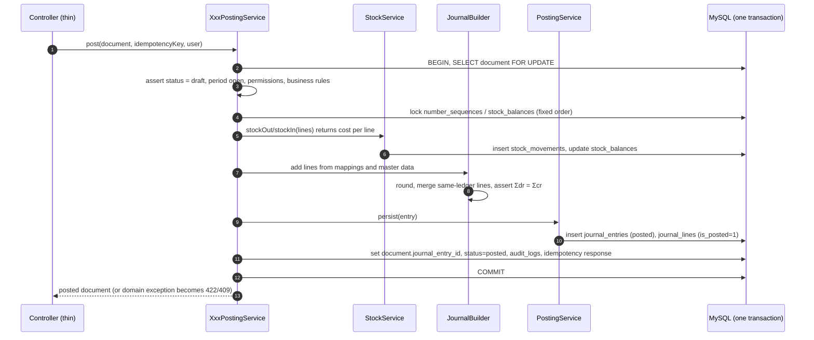

# 06 · Accounting and business rules

> Status: draft for review by the product owner **and a qualified accountant**. Rule IDs (BR-xxx) are defined in [01 §8](01-SRS.md#8-business-rules); tests in [09](09-Testing-Strategy.md).
> No account IDs are hard-coded. Every ledger below is resolved through `account_mappings` (§3) or from the master record (party, product, warehouse, money account, category, tax rule).

## 1. Principles

1. **One posting engine.** Every document that affects the books calls a *posting service*. The service builds a `JournalEntry` through `JournalBuilder`, then the `PostingService` validates and persists it. No controller or UI computes debits or credits.
2. **Double entry, always balanced.** Each line is a debit or a credit greater than zero (BR-002), and every entry balances (BR-001). This is enforced three times: in the builder, in a DB CHECK on the posted header, and by the nightly trial-balance job.
3. **Perpetual inventory at moving weighted average.** Stock-in raises the Inventory ledger of the receiving warehouse; stock-out credits it at the current average cost and debits COGS (BR-016, BR-017).
4. **Accrual basis.** Revenue is recognised when an invoice posts; expenses when a bill or expense posts; cash moves separately through receipts and payments.
5. **Immutability.** A posted entry is never edited or deleted. Corrections are made by reversal, cancellation or a credit/debit note (BR-003). The only change allowed on a posted row is status `posted → reversed` on the original, made by the reversal service.
6. **Atomicity.** Document status, stock movements, journal entry and number sequence are written in one DB transaction (NFR-040).
7. **Idempotency.** One document posts once (BR-009). A repeated request replays the response (BR-050).
8. **Periods.** The entry date must be in an open period (BR-004). Reports read posted lines only (BR-005).
9. **Decimal arithmetic.** `brick/math` BigDecimal with scale 2 for money, 4 for unit cost, 6 for rates. Rounding is HALF_UP at line level; totals are sums of rounded lines (BR-010).

## 2. Document states

| Document | States and transitions | Posts at | Notes |
|---|---|---|---|
| Sales invoice, purchase bill | `draft → posted → cancelled` | `posted` | Payment status (`unpaid/part_paid/paid`) is derived from allocations; "overdue" = posted, not paid, due_date < today |
| Quotation, purchase order | `draft → sent → accepted/declined/expired → converted` (PO: `sent → partly_received → received → closed`, or `cancelled`) | never | BR-056 |
| Sales/purchase return | `draft → posted (→ cancelled)` | `posted` | Creates a draft credit/debit note |
| Credit/debit note | `draft → posted (→ cancelled)` | `posted` | Usage: apply / credit / refund |
| Voucher (JV, PV, RV, CV, EXP, INC) | `draft → [submitted → approved | rejected] → posted → reversed` | `posted` | Approval only when the amount is above the role limit (BR-007); `rejected` returns to editable |
| Stock adjustment | `draft → posted → reversed` | `posted` | |
| Stock transfer | `draft → dispatched → received`, or `cancelled` | dispatch and receive (only when ledgers differ) | |
| LC | see §12.1 | charges, payments, landed cost, closure | |
| Accounting period | `future → open → locked` (unlock allowed with reason) | — | BR-033 |
| Financial year | `open → closing → closed` | year-end entry | BR-034 |

"Approved" is a transient state: once approved, a voucher posts immediately in the same transaction (the design's audit trail shows approved and posted two minutes apart). It stays visible in the audit trail.

## 3. Configurable account mappings

`account_mappings` (company-level, edited in K16) map each posting role to a ledger or group. The required nature is checked on save (TC-ACC-024).

| Mapping key | Required nature | Used for | Default seed |
|---|---|---|---|
| `sundry_debtors_group` | Asset group | Parent group of new customer ledgers | 1201 |
| `sundry_creditors_group` | Liability group | Parent of new supplier ledgers | 2101 |
| `cash_bank_group` | Asset group | Parent of money-account ledgers | 1100 |
| `inventory_group` | Asset group | Parent of warehouse inventory ledgers | 1301 |
| `sales_default` | Income | Product income ledger when none is set | 4101 |
| `sales_returns` | Income (contra) | Credit notes for returned goods | 4109 |
| `discount_allowed` | Income (contra) or Expense | Only if "post discounts separately" is on | 4110 |
| `discount_received` | Income | Bill-level discounts on **non-stock** bills | 4305 |
| `cogs` | Expense | Cost of goods sold | 5001 |
| `stock_adjustment` | Expense | Shortage, damage, expiry, samples; gains reduce it | 5002 |
| `purchases_non_stock` | Expense | Bill lines with no product ledger | 5101 |
| `purchase_returns_non_stock` | Expense (contra) | Debit notes on non-stock lines | 5109 |
| `stock_in_transit` | Asset | Transfers between warehouses with different ledgers | 1405 |
| `goods_in_transit` | Asset | LC charges awaiting landed-cost allocation | 1404 |
| `lc_margin` | Asset | LC margin deposits | 1403 |
| `lc_acceptance` | Liability | Usance LC acceptance liability | 2302 |
| `fx_gain_loss` | Expense (or Income) | Exchange differences | 6603 |
| `bank_charges` | Expense | Bank fees not capitalised | 6702 |
| `rounding` | Expense | Invoice/bill rounding | 6799 |
| `cash_short_over` | Expense | Cash-count differences | 6198 |
| `opening_balance_adjustment` | Equity | Contra for opening balances | 3301 |
| `retained_earnings` | Equity | FY close | 3201 |
| `suspense` | Liability | Only for imports of unbalanced legacy data; must be zero (health check) | 9999 |

Ledgers that come from master data: the **party's** own ledger; the **product's** income ledger (and expense ledger for services or non-stock items); the **warehouse's** inventory ledger; the **money account's** ledger; the **category's** ledger; the **tax rule's** ledger.

## 4. The posting engine

The sequence: the controller hands over; the service locks the document and checks it is still a draft in an open period; it locks the sequence and stock rows in a fixed order, takes the stock out or in at average cost, builds and checks a balanced journal, saves it as posted, links it to the document, writes the audit and idempotency records, and commits. Any failure rolls back everything.

**Voucher numbers (review R-06).** A document's primary entry uses the document's own number (INV, BILL, RV…). Every other system-generated entry (cancellation, reversal of a system entry, opening_balance, lc_charge, lc_payment, landed_cost, stock_transfer, cash_count, year_end_close) takes the next `system_journal` number (`SJ-2026-0001`). A manual reversal takes the next `JV` number. `journal_entries (company_id, voucher_number)` stays unique.

**Rejection conditions common to every posting** (each a 422 or 409 with a code): document not in a postable state (`not_draft`, `already_posted`); date in a locked or future-FY period (`period_locked`); inactive party, product, ledger or account (`inactive_reference`); a reference from another company (404); a mapping missing (`mapping_missing`); an unbalanced entry (`unbalanced_entry`, which should be impossible and is logged as a bug); concurrent version change (`version_conflict`); missing permission (403).

## 5. Sales invoice (E3 → post)

| Item | Rule |
|---|---|
| Business event | Goods or services sold on credit or cash terms |
| Validation | BR-013 (customer active, warehouse, ≥ 1 line, qty > 0, price ≥ 0, due ≥ date); BR-014 stock for stocked lines; BR-004 period; warnings BR-015 (credit limit, overdue) |
| Calculation | Per line: gross = qty × price; discount = round(gross × disc% ÷ 100); net = gross − discount; tax = round(net × rate ÷ 100) when a tax rule is attached; line total = net + tax. Document: subtotal = Σgross, discount_total = Σdiscount, tax_total = Σtax, rounding per setting (BR-012), total = Σline totals + rounding |
| Debit | Customer ledger: **total** |
| Credit | Each line's income ledger: **net** (lines with the same ledger are merged); tax rule ledger: **tax**; rounding ledger: rounding (debit if negative) |
| Debit / credit (cost) | For each stocked line: Dr **COGS**, Cr **warehouse inventory**, each = qty × average cost at posting (BR-016); unit cost stored on the line |
| Inventory | `sale_out` movement per stocked line; `stock_balances` falls; average cost unchanged |
| Reports | Sales and P&L revenue up; COGS up (gross margin); receivables and aging up; stock valuation down |
| Reject when | insufficient stock (unless negative stock allowed), inactive customer or product, locked period, already posted |

**Worked example (design E5, INV-2026-0587, Karim Distributors):**
lines: 40 jars soybean oil @ 940; 12 bags rice @ 2,340; 120 tea @ 255; 96 soap @ 220; 6 kg lentils @ 125; 2 delivery trips @ 150 (service). No discount or tax.

| Ledger | Dr (৳) | Cr (৳) | How |
|---|---|---|---|
| 1201-012 Karim Distributors | 1,18,450.00 | | invoice total |
| 4101 Sales, wholesale | | 1,18,150.00 | five stocked lines' net (37,600 + 28,080 + 30,600 + 21,120 + 750) |
| 4201 Delivery income | | 300.00 | service line's own income ledger |
| 5001 Cost of goods sold | 1,04,264.00 | | 40×845 + 12×2,150 + 120×218 + 96×186 + 6×108 |
| 1301-01 Inventory, Tejgaon warehouse | | 1,04,264.00 | same |
| **Total** | **2,22,714.00** | **2,22,714.00** | balanced, matching the design's ledger-entries tab |

**Discount treatment:** default **net presentation**. Sales are credited net of line discount, as in the design (AS-07). If the company turns on "post discounts separately" (a K16 option), then Cr income = gross and Dr `discount_allowed` = discount.

**Cash sale:** an invoice with "Cash" terms and a "paid now" receipt posts the invoice and an RV in one transaction (two entries), so the receivables history stays complete.

## 6. Customer receipt (E7, G6 "a customer", H11 with party lines)

| Item | Rule |
|---|---|
| Event | Money received from a customer |
| Validation | amount > 0; money account active and `use_for_receipts`; cheque fields when method = cheque; allocations per BR-020/021; period open; backdated confirmation BR-053 |
| Debit | Money account ledger: amount |
| Credit | Customer ledger: amount |
| Bank charge deducted by bank (optional) | Dr bank_charges, and Cr customer for the gross (the money account receives net) |
| Allocation | `bill_allocations` link the customer credit line to invoices, oldest due first unless overridden; `amount_settled`, `balance_due`, `payment_status` updated under lock. The unallocated remainder stays as a credit on the customer ledger (advance) and can be allocated later from E7/B4 |
| Reports | Cash/bank book up; receivables down; aging recalculated; no P&L effect |
| Reject when | allocation exceeds a balance or the amount, an invoice of another customer, money account inactive, locked period |

Example (RV-2026-0922): Dr 1102-01 Sonali Bank ৳ 2,74,700 / Cr 1201-012 Karim Distributors ৳ 2,74,700; allocation INV-2026-0509 ৳ 2,74,700, which becomes paid.

## 7. Sales return and credit note (E8 → E9)

**Return (stock part, posted with the return):**
- *Restock*: `sales_return_in` movement at the **original line unit cost** (BR-017 applies: returned value is added at that cost). Dr **warehouse inventory**, Cr **COGS** = qty × original unit cost.
- *Write off* (expired, damaged): no stock movement, no entry; the cost already sits in COGS. The reason is recorded for the return report.
- Validation: BR-022 returnable quantity; BR-021 same customer.

**Credit note (financial part):**
| Item | Rule |
|---|---|
| Debit | `sales_returns` (4109) with the returned net amount; tax rule ledger for any tax on the returned lines |
| Credit | Customer ledger: credit-note amount |
| Usage `apply` | Allocation from the credit line to the original invoice (≤ invoice balance, BR-023) |
| Usage `credit` | Left unallocated as customer credit |
| Usage `refund` | Also posts a PV: Dr customer, Cr money account |
| Price correction / goodwill (no return) | Same entry with no stock part; Dr `sales_returns` (or a "Sales allowances" ledger if the company maps one) |
| Reports | Net sales down (returns shown separately in E11/E12); receivables down; for restock, inventory up and COGS down |

Example (SR-2026-0020 / CN-2026-0032, written off): Dr 4109 Sales returns ৳ 3,060 / Cr 1201-007 Rahman Super Shop ৳ 3,060; applied to INV-2026-0505 (balance from ৳ 92,500 down to ৳ 89,440).

## 8. Purchase bill (F3 → post)

| Item | Rule |
|---|---|
| Event | Supplier's bill received with the goods (the bill is the receipt, AS-08) |
| Validation | BR-018 supplier bill number required and unique per supplier; supplier active; warehouse; qty > 0; cost ≥ 0; period open; foreign currency needs exchange_rate > 0 |
| Calculation | As §5, in bill currency. Base amounts = foreign × exchange_rate, rounded per line. Header-level supplier discount or rounding on stock lines is **apportioned to the stock lines by value**, so it lowers their cost |
| Debit | Stocked line: **warehouse inventory** (base net); non-stock or service line: the product's expense ledger, else the supplier's default purchase ledger, else `purchases_non_stock`; input tax on a rule with `is_recoverable = 1`: tax rule ledger; non-recoverable tax: added to the line's inventory or expense debit |
| Credit | Supplier ledger: base total (`foreign_amount` and rate recorded on the line for foreign bills) |
| Inventory | `purchase_in` movement; average cost recalculated (BR-017): new avg = (old total value + line base net) ÷ (old qty + line qty); when old qty ≤ 0, new avg = incoming unit cost |
| PO | `purchase_order_lines.received_quantity` += qty; PO status moves to partly_received/received |
| Reports | Inventory and payables up; no P&L effect for stock lines; expense up for non-stock lines |
| Reject when | duplicate supplier bill number, inactive supplier or product, locked period, PO of another supplier |

Example (design F4, BILL-2026-0224): 740 jars @ 846.00 = 6,26,040.00, less supplier rounding discount 40.00, apportioned to the line → Dr 1301-02 Inventory, Narayanganj depot ৳ 6,26,000 / Cr 2101-004 Bengal Edible Oils ৳ 6,26,000. Incoming unit cost = 845.9459.

**Average-cost example (TC-PUR-003):** on hand 100 units, value 80,000.00 (avg 800.0000); receive 50 @ 860 = 43,000 → new value 1,23,000.00, qty 150, avg **820.0000**.

## 9. Supplier payment (F5, G7 "a supplier", H10)

| Item | Rule |
|---|---|
| Debit | Supplier ledger: amount (plus the bank charge to `bank_charges`, if any) |
| Credit | Money account: amount + bank charge |
| Validation | BR-031 the account cannot go below zero; BR-020/021 allocations; BR-007 above the role's payment limit → `submitted`, approval required (posts on approval); BR-008 no self-approval |
| Allocation | As §6, to bills |
| Foreign bills | Paid in BDT at the bank's rate; see FX §12.5 |
| Reports | Payables down; bank book down |

Example (design H14, PV-2026-0465): Dr 2101-019 Rupsha Transport ৳ 1,46,000; Dr 6702 Bank charges ৳ 50 (cheque fee) / Cr 1102-01 Sonali Bank ৳ 1,46,050. This is above the Accountant's ৳ 50,000 limit, so it waits for approval (design L4).

## 10. Purchase return and debit note (F6 → F7)  ⚑ resolves GAP-03

**Return (stock part):** `purchase_return_out` at the **original bill line's base unit cost**. Dr **supplier**, Cr **warehouse inventory** = qty × original unit cost. If current average cost differs, the average is recomputed with the outgoing value (value leaves at bill cost, so the remaining stock's average shifts slightly; this is correct under moving average). Validation: BR-022; BR-014 stock must be on hand (unless already disposed).

**Debit note (financial part):**
- For a **goods return**, the stock entry above *is* the debit-note journal (one entry: Dr supplier / Cr inventory). The debit note document carries the amount and usage, and points to that entry. No separate "Purchase returns" ledger is used for stock (this departs from the design's posting preview, by design decision ⚑).
- For **price difference, short supply or a quality claim with no stock movement**: if the goods are still in stock, Dr supplier / Cr inventory (this reduces cost: a revaluation movement `landed_cost` with negative value); if sold, Dr supplier / Cr COGS; for non-stock lines, Cr `purchase_returns_non_stock`.
- Usage `apply` → allocation to the bill; `credit` → stays on the supplier ledger; `refund` → when money arrives, a receipt Dr bank / Cr supplier.

Example (PR-2026-0009, 6 leaking jars, assuming no header rounding): Dr 2101-004 Bengal Edible Oils ৳ 5,076.00 / Cr 1301-02 Inventory, Narayanganj ৳ 5,076.00 (6 × 846.00); applied to BILL-2026-0224 (balance from ৳ 3,86,000 to ৳ 3,80,924).

## 11. Inventory

### 11.1 Valuation method
**Moving weighted average per product and warehouse** (CF-08, AS-03 revised by review R-02, DEC-05). Quantity, value and average live together in one `stock_balances` row per product and warehouse, so each warehouse's stock value always equals what was posted to that warehouse's inventory ledger.
- *Effect on COGS:* each sale is charged the average at that moment, which smooths price swings. In rising prices, COGS is a little higher than FIFO and ending inventory a little lower.
- *Effect on reports:* stock valuation (D13) = Σ over warehouses of `stock_balances.total_value` = the inventory group balance (and each warehouse's value = its own inventory ledger) in the trial balance, provided every stock-affecting event posts a matching journal. The nightly job checks this.
- *Back-dated stock documents:* a stock document dated earlier than later movements of the same product does **not** rewrite later costs (no retroactive re-costing). The system warns (BR-053) and posts at the current average. This deliberate simplification is documented for the accountant. A "re-cost from date" utility is a later-phase option.
- *FIFO* (offered in K3) is deferred. It would need cost layers (`stock_cost_layers`) and changes COGS per sale; the setting stays locked to weighted average in v1.

### 11.2 Opening stock
Product creation with opening quantities, or a "Stock opening" import: `opening` movement; Dr warehouse inventory, Cr `opening_balance_adjustment`; dated FY start (BR-028).

### 11.3 Stock adjustment (D10)
Difference qty = counted − system (system re-read at posting).
- Shortage: `adjustment_out` at average cost; Dr `stock_adjustment`, Cr warehouse inventory.
- Gain: `adjustment_in` at average cost; Dr warehouse inventory, Cr `stock_adjustment`.
- Example (TC-INV-002): counted 16 jars, system 18, average 845.00 → Dr 5002 ৳ 1,690.00 / Cr 1301-01 ৳ 1,690.00.
- Reject: counted < 0; system quantity changed since the draft (the user must recount); locked period.
- Reversal posts the mirror entry and movements (permission `inventory.approve`).

### 11.4 Stock transfer (D11)  ⚑ resolves GAP-02
- Dispatch: `transfer_out` at the source (qty_in_transit_out increases). Receive: `transfer_in` at the destination at the source average frozen at dispatch; the incoming value is averaged into the destination (BR-017).
- If both warehouses use the **same** inventory ledger, no journal is posted.
- If they use **different** ledgers: at dispatch Dr `stock_in_transit` / Cr source inventory; at receive Dr destination inventory / Cr `stock_in_transit`. **Total stock value is unchanged** either way, which keeps the design's statement true for the total.
- Short receipt (received < dispatched): the difference is posted like an adjustment shortage at the destination on receipt, with reason "transit loss".
- Reject: from = to; qty > available at dispatch; cancel after receive.

## 12. Import LC and landed cost  ⚑ resolves GAP-05/06/17

### 12.1 LC state machine (BR-040)

```mermaid
stateDiagram-v2
    [*] --> draft
    draft --> awaiting_bank: submit (BR-039)
    draft --> cancelled: cancel
    awaiting_bank --> opened: mark_opened (bank ref + date)
    awaiting_bank --> draft: mark_refused
    awaiting_bank --> cancelled: cancel
    opened --> partly_shipped: first lot shipped (partial allowed)
    opened --> documents_presented: documents_presented
    partly_shipped --> documents_presented: documents_presented
    documents_presented --> payment_due: accepted (usance) or due (sight)
    documents_presented --> closed: paid in full and checks pass
    payment_due --> closed: paid and checks pass (BR-046)
    opened --> expired: expiry date passed (scheduler)
    partly_shipped --> expired: expiry passed with unused amount
    expired --> closed: margin released and settled
    closed --> opened: reopen (bank sends late item; reason, audit)
    cancelled --> [*]
    closed --> [*]
```

An LC starts as a draft and goes to the bank on submit. Opening needs the bank reference; refusal sends it back to draft. Shipment and document presentation advance it; it closes when the supplier is paid and the checks pass, or it expires on its expiry date. A closed LC can be reopened with a reason; cancelled and closed LCs are read-only.

### 12.2 Margin deposit (BR-044)
- On deposit: Dr `lc_margin` (tagged with `letter_of_credit_id` on the journal line) / Cr margin money account.
- Applied at payment: Cr `lc_margin` within the payment entry (§12.4).
- Released at closure, cancellation or expiry: Dr money account / Cr `lc_margin` for the remaining tagged balance.
- A margin deposit is never landed cost (DB CHECK on `lc_charges`).

### 12.3 Bank charges and import expenses (lc_charges)
| Charge | `include_in_landed_cost` default | Debit when recorded | Credit |
|---|---|---|---|
| Opening commission, amendment fee, SWIFT, stamp, acceptance commission, discrepancy fee | yes | `goods_in_transit` (tagged LC) | money account if paid (bank debit), else payee party (C&F agent or insurer as supplier) or accrued expenses |
| Marine insurance, C&F agent, port and handling, customs duties and taxes (as assessed, BR-047), inland transport | yes | `goods_in_transit` | as above |
| Any charge with landed cost switched off | no | `bank_charges` (bank fees) or the matching expense ledger | as above |

Recoverable import VAT/AT is **not** landed cost when the business can claim it as input credit. It is debited to the tax receivable ledger of a tax rule instead. ⚑ This needs confirmation (§14).

### 12.4 Payment to the beneficiary (sight)
`amount_bdt = round(amount_foreign × bank_rate, 2)` (BR-042); the cumulative foreign amount paid must be ≤ LC amount × (1 + tolerance).
- Dr **supplier ledger** amount_bdt, recording foreign amount and rate on the line; this is an advance until the import bill exists.
- Cr `lc_margin` margin_applied; Cr money account (amount_bdt − margin_applied).
- Example (LC-2026-019): US$ 38,400 × 122.10 = ৳ 46,88,640.00; margin ৳ 9,33,120 → Dr Straits Edible Oils 46,88,640 / Cr 1403 9,33,120 / Cr 1102-01 Sonali Bank 37,55,520.

### 12.5 Import bill and exchange difference (BR-043)
- The goods are received with a purchase bill in **import mode** (F3: currency USD, rate, LC and lot). Rate rule: the rate of the LC payment(s) already made, weighted by foreign amount; when nothing is paid yet, the rate entered (default planning rate). Posting follows §8: Dr warehouse inventory, Cr supplier at base value.
- **Settlement:** allocating an LC payment (advance) or a later payment to the bill settles foreign amounts. For each allocation, `fx = foreign_settled × (payment_rate − bill_rate)`. A positive difference (paid more taka) gives Dr `fx_gain_loss` / Cr supplier; a negative one gives the reverse. The supplier's taka balance then nets to zero when the foreign balance is zero.
- Example: bill booked US$ 38,400 at planning rate 121.50 = ৳ 46,65,600; paid at 122.10 = ৳ 46,88,640 → **FX loss ৳ 23,040.00**: Dr 6603 / Cr supplier (TC-LC-006).
- Because the bill rate defaults to the payment rate when payment came first, most sight LCs show no FX line; the rule matters when goods arrive before payment, and for usance LCs.

### 12.6 Usance LC
- Acceptance (documents accepted, bank undertakes to pay at maturity; `payment_kind = usance_acceptance`): Dr supplier / Cr `lc_acceptance` at the acceptance rate. This settles the supplier; FX per §12.5 against the bill.
- Settlement at maturity (`usance_settlement`): Dr `lc_acceptance` (carrying amount) / Cr margin and money account (at maturity rate); difference → `fx_gain_loss`.
- Acceptance commission is an LC charge (§12.3). Interest on usance, if any, is an expense charge (not landed cost) ⚑ confirm.

### 12.7 Landed-cost allocation (BR-045)
Run from M4 or M7 after the import bill is posted, for that bill and the LC's unallocated capitalised charges (`goods_in_transit` tagged balance).
1. Basis per bill line: base net value (method `value`, default) or quantity (method `quantity`).
2. allocated_i = round(total × basis_i ÷ Σbasis); the last line takes the rounding remainder, so Σ = total exactly.
3. For each line, the share for stock **still on hand** (`qty_on_hand` of that product in that warehouse, capped at qty received) is `amount_to_inventory`; the rest is `amount_to_cogs`.
4. Entry: Dr warehouse inventory (Σ to inventory) + Dr `cogs` (Σ to COGS) / Cr `goods_in_transit` (total, tagged LC).
5. Stock: a `landed_cost` movement with value_in = amount_to_inventory and quantity 0 raises `stock_balances.total_value` of the receiving warehouse, so its average cost rises.
6. Charges arriving later trigger a new allocation run.
- Example (TC-LC-008): charges ৳ 2,40,000 over 20,000 kg, of which 40% is already sold → Dr Inventory ৳ 1,44,000, Dr COGS ৳ 96,000 / Cr 1404 ৳ 2,40,000; landed cost +৳ 12.00/kg.

### 12.8 Amendments (BR-041)
No posting until accepted, except the bank fee (an LC charge). Accepted changes update the LC fields; amount changes change outstanding commitment, not the books.

### 12.9 Closure (BR-046)
Checks: supplier foreign balance zero (or LC expired); no unpaid charges; no missing or discrepant documents; tagged `goods_in_transit` balance zero (all allocated, or expensed with an override reason: Dr matching expense / Cr 1404); margin released (§12.2). Then status becomes `closed` and the LC is read-only.

### 12.10 LC reports
Register, active/expired, outstanding commitments (amount − paid at planning rate), upcoming expiry, document completion, amendment history, charges and payments, import cost summary. They read LC tables plus journal lines tagged with `letter_of_credit_id`, so the cost summary always agrees with the ledgers.

## 13. Cash, bank, income and expense

| Event | Debit | Credit | Rules |
|---|---|---|---|
| Money received (other income, G6/I3) | Money account | Category or income ledger | BR-054, BR-065 |
| Money received (owner or loan) | Money account | Capital or loan ledger | |
| Money paid (expense, G7/I6) | Category or expense ledger (+ tax receivable if recoverable tax rule) | Money account | BR-031, BR-054 |
| Bank or cash transfer (contra, G8/G9/H12) | Destination account | Source account | BR-031 |
| Bank charge on transfer | `bank_charges` | Source account | |
| Bank charge or interest found in reconciliation | `bank_charges` / money account | money account / interest income | G10 "Record charge" |
| Cash count difference (G2) | `cash_short_over` (shortage) or cash (excess) | cash or `cash_short_over` | BR-058 approval |
| Recurring expense run | — (draft only) | — | BR-048 |

Expense budgets (I7) are informational. Warnings at `warn_at_percent` of the monthly budget never block.

## 14. Tax and discount treatment, and Bangladesh items needing confirmation

**Implemented generically:** user-defined tax rules (name, rate, applies to, ledger). Output tax: Cr the rule's ledger (liability). Input tax: Dr the rule's ledger (asset) when it is recoverable. Prices entered exclusive or inclusive of tax (K6). For inclusive prices: net = round(line amount × 100 ÷ (100 + rate)), tax = line amount − net. The P&L shows "Income tax: no tax rule set up", per the design.

**Not implemented and not assumed** (⚑ confirm with a qualified Bangladeshi tax adviser against current NBR rules before production, NFR-070):

| Item | Question to confirm |
|---|---|
| VAT registration and invoice format | Are clients VAT-registered? Must invoices follow Mushak-6.3 fields (BIN of buyer and seller, VAT amount per line, serial rules)? |
| VAT returns and registers | Are Mushak 6.1/6.2 purchase and sales registers, or Mushak 9.1 return data, required as system outputs? |
| Standard, reduced, truncated or fixed VAT rates and exemptions | Which apply to the products sold (grocery items are often exempt or reduced)? Rates must be entered by the user, never seeded |
| Supplementary duty (SD) | Applies to any items? Is it calculated before VAT? |
| VAT deduction at source (VDS) and TDS/AIT on supplier payments | Must supplier payments withhold and post VDS/TDS to payable ledgers, with certificates? |
| Import duties: CD, RD, SD, VAT, AIT, AT at customs | Which parts are recoverable input (VAT, AT, AIT as advance tax) and which are landed cost? (Currently the user enters "Customs duty and taxes (as assessed)" as one landed-cost charge) |
| LC-related regulation | Are import registration (IRC), LCA/IMP form references or Bangladesh Bank reporting needed beyond the optional "Import authorization reference"? |
| Invoice numbering | Is a gapless sequential series legally required? (Affects DEC-06) |
| Record retention | Statutory period for books and VAT records (the 8-year default may need changing) |
| Financial statements | Are the statements expected to follow IFRS-for-SMEs/BFRS presentation? (Current statements are management accounts, "unaudited") |

## 15. Reversals, cancellations, corrections and audit trail

| Situation | Mechanism | Effect |
|---|---|---|
| Wrong manual voucher | `POST /vouchers/{id}/reverse`: new entry (type `reversal`), every line swapped, dated today or a chosen open date; original status `reversed`; `reverses_entry_id` links them; allocations of the original are marked `reversed_at` | Both entries stay visible; net effect zero |
| Wrong invoice or bill | Cancel: a cancellation entry reverses the journal; stock movements are reversed (`reversal` movements) at the **original** costs; allocated payments become advances; reason required | Document `cancelled`; number kept |
| Partial error in a posted invoice | Credit note (price correction) or return | Original untouched |
| System entries | Cannot be reversed directly (409 `use_document_cancel`) | Integrity of document ↔ journal |
| Draft mistakes | Edit or delete the draft; the deleted number is voided and logged (BR-006) | No book impact |
| Error in a locked period | Correcting entry dated in the open period, referencing the original in narration | Locked period never changes |
| Posted-voucher "delete" in design H13 | Hidden for posted vouchers (GAP-07) | — |

**Audit trail:** each step writes `audit_logs` (action, user, IP, request id, old and new JSON). A MySQL trigger rejects UPDATE/DELETE on `journal_lines` where `is_posted = 1`, and UPDATE on posted `journal_entries` other than `status → reversed`. These are defence in depth beneath the service rules.

## 16. Opening balances, period close and year-end

- **Opening balances** (parties, ledgers, banks, stock): `opening_balance` entries dated the FY start, each against `opening_balance_adjustment` (BR-028). After all openings are in, 3301 should equal the opening equity; the H1 health check shows its balance, and the accountant reclassifies it to capital and retained earnings with a JV.
- **Month close:** reconcile banks → review drafts and pending approvals → accruals/depreciation JVs → TB check (suspense = 0) → lock the period (BR-033). Locking queues a `pre_lock` backup.
- **Year-end close** (BR-034): after the FY end with all periods locked, a `year_end_close` entry dated the last day zeroes every income and expense ledger against `retained_earnings`. The next FY's sequences are created. Balance-sheet ledgers carry forward naturally, because ledgers are continuous and no opening entries are needed. The closing entry can be reversed only by an Owner, reopening the FY with an audit reason.

## 17. Reporting rules

| Report | Construction |
|---|---|
| Trial balance (H15) | Σ posted lines per ledger up to `as_of`; debit balance in Dr, credit in Cr; group level rolls up by `account_groups` |
| Profit and loss (H16) | Income and expense ledgers in the period, grouped: Revenue (41 net of 4109), Cost of sales (5), Gross profit, Operating expenses (61), Operating profit, Other income (42), Depreciation and finance (62), Profit before tax, tax (only if rules exist), Net profit. Comparison: the same dates one year earlier |
| Balance sheet (H17) | Asset, liability and equity ledgers at `as_of` plus "Profit for the period" (FY to date P&L) until year-end close. Check: assets = equity + liabilities |
| Cash flow (H18, indirect) | Net profit + non-cash (depreciation group lines) ± changes in working-capital groups (inventory, receivables, advances, creditors, accruals), plus investing (fixed-asset groups) and financing (loans, capital) by `cash_flow_category`. Check: closing = cash and bank group balance |
| General ledger and books (H19, G11, G12) | Opening + lines + running balance |
| Aging (J6/J7, B7/C7, A5/A6) | Open document balances (total − live allocations) bucketed by days past due: not due, 1–30, 31–60, 61–90, 90+; unallocated advances shown separately |
| Sales/purchase reports (E11/F9) | Posted invoices/bills, net of returns and notes, grouped by party, product category or month; gross margin = net sales − COGS of those invoices |
| Stock valuation (D13) | Σ (qty on hand × avg cost) as of a date, reconstructed from `stock_movements`, which hold average cost after each movement |
| Drafts | Never included; the TB side panel lists them (design) |

## 18. Consolidated rejection matrix

| Code | Raised by | Condition |
|---|---|---|
| `period_locked` | all postings, edits, reversals | date in a locked period or outside an open FY (BR-004) |
| `insufficient_stock` | invoice, purchase return, transfer dispatch, adjustment reversal, bill cancel | qty > on hand and negative stock off (BR-014) |
| `insufficient_funds` | payment, contra, expense, LC charge paid, refund | money account would go below zero (BR-031) |
| `unbalanced_entry` | JV | Σdr ≠ Σcr (BR-001) |
| `allocation_exceeds_balance` | receipts, payments, notes | BR-020 |
| `foreign_document` | allocations, returns, notes | different party or company (BR-021, BR-037) |
| `return_qty_exceeds` | returns | BR-022 |
| `duplicate_supplier_bill` | bill | BR-018 |
| `exceeds_tolerance` | LC payment | BR-042 |
| `invalid_transition` | LC, documents | BR-040, state tables §2 |
| `approval_required` (202, not an error) | payments, JVs above limit | BR-007 |
| `self_approval_forbidden` | approvals | BR-008 |
| `already_posted` / `already_reversed` | post / reverse | BR-009 |
| `backdated_confirmation_required` | postings | BR-053 |
| `mapping_missing` / `nature_mismatch` | postings / K16 | §3 |
| `lines_unhandled` / `difference_not_zero` | reconciliation finish | BR-032 |
