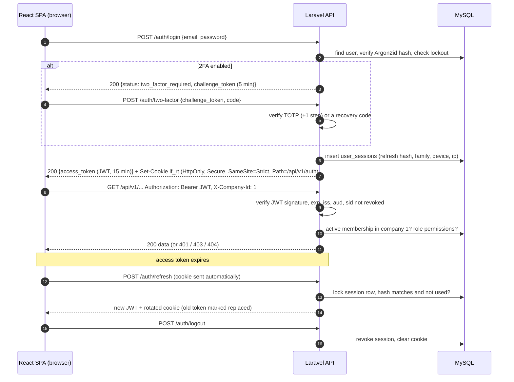
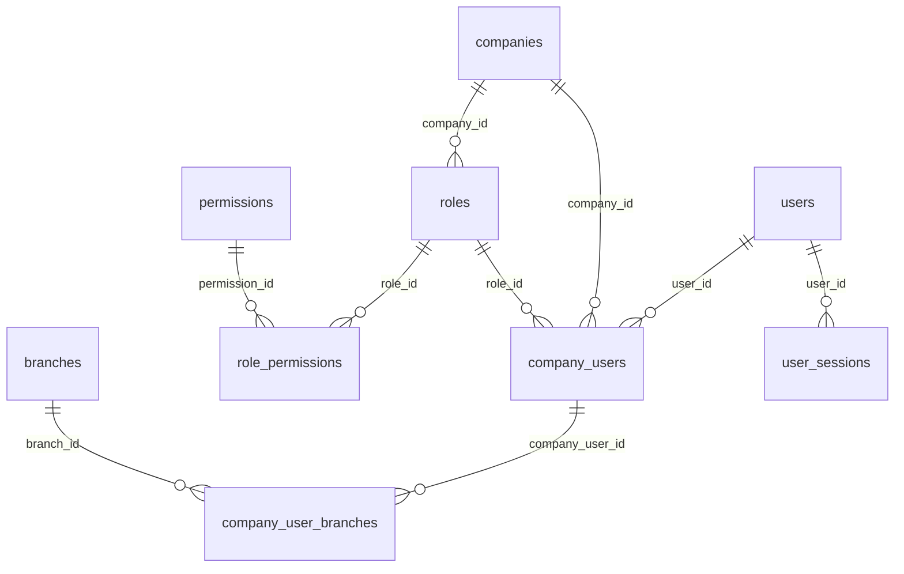

# 07 · Authentication and authorization

> Status: draft. ⚑ DEC-02 (JWT package and token storage) awaits approval. The ORM is decided (Eloquent, DEC-01). Stack: Laravel 11/12 with `php-open-source-saver/jwt-auth` (a maintained fork of `tymon/jwt-auth`).

## 1. Overview

The SPA signs in once and keeps a short-lived access token in memory. Every API call carries it plus the active company header; the API checks the token, then the company membership and permission. When the token expires, the browser silently swaps its HttpOnly refresh cookie for a new token, and the cookie rotates each time. Sign-out revokes the session.

## 2. Login and logout
- `POST /auth/login`: e-mail is lower-cased; the password is checked with `Hash::check` (Argon2id: `memory=65536, time=4, threads=1`; tune to about 250 ms on production hardware). Error messages are generic ("E-mail or password is incorrect"), with constant-time comparison and a dummy hash for unknown e-mails to avoid timing leaks.
- On success: `failed_login_count = 0`, `last_login_at` set, audit `login`. Sessions are listed in K14 ("Where you're signed in").
- `POST /auth/logout`: authenticated by the refresh cookie alone (OpenAPI security `refreshCookie`), so it also works after the access token has expired (R-36). It revokes the current `user_sessions` row, clears the cookie (`Max-Age=0`) and always answers 204. The access token carries `sid`, so the session-revocation check (§4) makes any copy of it unusable immediately.
- `POST /me/sessions/revoke-others` and `DELETE /me/sessions/{id}`: revoke other devices (K14).

## 3. Tokens

### 3.1 Access token (JWT)
- Algorithm **ES256** (ECDSA P-256), using a private key held only by the API servers. The public key is used for verification; key ids (`kid`) support rotation (§12). HS256 with a ≥ 256-bit secret is an acceptable fallback, with the secret only in server environment.
- Lifetime **15 minutes**. Never stored in `localStorage` or `sessionStorage`; held in a JavaScript module variable, so it is lost on reload and restored via refresh.

| Claim | Value | Validation |
|---|---|---|
| `iss` | `https://api.ledgerflow.example` | exact match |
| `aud` | `ledgerflow-spa` | exact match |
| `sub` | user id | user exists and `status = active` |
| `sid` | user_sessions id | session not revoked (checked against a cache, 60 s TTL, invalidated on revoke) |
| `iat`, `nbf`, `exp` | epoch seconds | `nbf ≤ now < exp` with 30 s leeway |
| `jti` | UUID | unique; recorded only if a denylist is needed |
| `amr` | `["pwd"]` or `["pwd","otp"]` | used to enforce company `require_two_factor` |
| `pwv` | password version (hash of `password_changed_at`) | must match the user's current value, so a password change kills old tokens (BR-061) |

**What the JWT is not:** it carries **no company id, role or permissions**. A valid token proves only *who* the caller is. *What* they may do is resolved on every request from the database: membership, role, permissions and branch restriction (§6). Changing a role therefore takes effect on the next request.

### 3.2 Refresh token
- An opaque 256-bit random value, stored hashed (SHA-256) in `user_sessions.refresh_token_hash`. Sliding lifetime of 14 days, capped by the company's idle timeout (K14 "Sign out after inactivity": 30 min / 1 h / 4 h / never).
- Cookie `lf_rt`: `HttpOnly; Secure; SameSite=Strict; Path=/api/v1/auth`. JavaScript can't read it; it is sent only to the auth endpoints.
- **Rotation:** each refresh issues a new token and marks the old row `replaced_by_id`. If an already-rotated token is presented (a sign of theft), the whole `family_id` is revoked, the user is notified ("New sign-in" / "suspicious refresh") and must sign in again.
- **CSRF:** refresh and logout are cookie-authenticated, so they also require the header `X-Requested-With: XMLHttpRequest` and an `Origin` check against the allow-list. SameSite=Strict already blocks cross-site sends; the header is defence in depth. All other endpoints use the Bearer header, which browsers never send cross-site, so they are not CSRF-exposed.

### 3.3 Storage trade-offs (why this design)

| Option | XSS exposure | CSRF exposure | Survives reload | Verdict |
|---|---|---|---|---|
| JWT in `localStorage` | **High**: any injected script can steal a long-lived token | none | yes | Rejected |
| JWT in an HttpOnly cookie for every API call | low (no read) | needs CSRF tokens on every write | yes | Acceptable, but adds CSRF plumbing to every endpoint |
| **Access JWT in memory + refresh in an HttpOnly SameSite=Strict cookie (chosen)** | low: an attacker with XSS can act during the session but can't exfiltrate a long-lived credential | minimal (only the auth endpoints, protected as above) | yes, via refresh | **Chosen** |
| Laravel Sanctum SPA cookie session (alternative) | low | Laravel CSRF built in | yes | Simpler; not JWT (would change DEC-02) |

XSS is still the main threat, so CSP (§10), output encoding (React escapes by default; `dangerouslySetInnerHTML` is banned by lint) and dependency hygiene matter more than token storage.

## 4. Token validation middleware (order)
1. `ForceJson`, `RequestId` (generate or accept `X-Request-Id`), rate limiter.
2. `auth:api`: JWT signature, `iss`, `aud`, time claims; `sub` active; `sid` not revoked; `pwv` current.
3. `RequireTwoFactorIfCompanyDemands`: if the company has `require_two_factor` and `amr` lacks `otp`, return 403 `two_factor_required`.
4. `ResolveCompany`: read `X-Company-Id`; load the **active** membership (`company_users.status = active`) or return 403 `not_a_member`; bind `CurrentCompany` and `CurrentMembership` in the container; set the tenant context for global scopes.
5. Route `can:` / policy checks (§6).

## 5. Password policy, reset and 2FA
- Minimum 10 characters, maximum 200; checked against a breached-password list (`Password::uncompromised()`, k-anonymity); no forced composition rules (NIST 800-63B).
- Reset: `POST /auth/password/forgot` always returns 202. The token is 256-bit, stored hashed, single-use, valid 60 minutes. On reset: `password_changed_at` is updated (which changes `pwv`), **all sessions revoked**, and the user is notified by e-mail.
- Change password (K14): requires the current password; revokes other sessions.
- **TOTP 2FA** (RFC 6238, 30 s, 6 digits, ±1 step): the secret is encrypted with `APP_KEY` (Laravel `encrypted` cast). Enrolment returns an `otpauth://` URI and QR; it is confirmed by the first code; 10 single-use recovery codes are shown once, stored hashed. "Require 2-step for everyone" (Owner) forces enrolment at next sign-in.

## 6. Role-based access control

### 6.1 Model
`permissions` (global catalogue, `module.action`) ← `role_permissions` → `roles` (per company) ← `company_users` (one role per membership) → `users`. The six seeded roles reproduce the K11 matrix ([01 §4.2](01-SRS.md#42-role-permission-matrix-default-templates-editable-in-k11)). The Owner role is a system role, always complete and not editable (BR-060).

A user joins a company through exactly one membership row, which carries one role; a role belongs to a company and grants many permissions through `role_permissions`. An optional set of branches narrows what the membership sees. Sessions belong to the user, not the company. Every line above is a real foreign key in [04](04-Database-Design.md).

### 6.2 Permission checks
- Permissions are resolved per request from `CurrentMembership → role → permissions`, cached per (role id, role `lock_version`) for 5 minutes, so editing a role invalidates the cache instantly.
- **Laravel Gates/Policies** check them: route middleware `can:sales.create` for coarse checks; policies (`SalesInvoicePolicy::post`) for object-level checks: the record belongs to the current company (it can't otherwise be loaded, see §7), the branch restriction, and state-specific rules (e.g. a self-approval ban).
- Field-level: `inventory.view_costs` controls whether API Resources include cost, value and margin fields (BR-052). The frontend hides them too, but the API is authoritative.
- Approval: payments and journals above the role's `payment_approval_limit` / `journal_approval_limit` become `submitted`. Approvers need the module's `approve` permission and must not be the submitter (BR-007, BR-008).
- **Contextual permissions (R-09).** A few endpoints serve several modules, so the permission depends on the request, not the route. The route declares `auth.self` (active member) and a policy applies the mapped permission, published in OpenAPI as `x-permission-mode: contextual` with an `x-permission-map`:
  - `/vouchers…` by entry type: journals need `accounting.*`; payment, receipt and contra need `banking.*` or `accounting.*`.
  - `/approvals/{id}/approve|reject`: the request's own `required_permission` (e.g. `purchases.approve`), never the submitter (BR-008).
  - `/allocations`: `sales.*` for customer documents, `purchases.*` for supplier documents.
  - `/attachments` and `/audit-logs`: the view/edit permission of the module that owns the record.

  Permission tests (TC-AUTH-008) are generated from `x-permission` and from `x-permission-map`.
- The SPA receives `permissions[]` from `GET /me` only to **show or hide** UI. The server re-checks everything.

## 7. Company and branch data isolation
1. Every tenant model uses a `BelongsToCompany` trait. A **global scope** adds `where company_id = CurrentCompany::id()`, and `creating` sets `company_id` automatically. Queries without a bound company throw, so tenant data is never read without a scope.
2. Route-model binding resolves through the scope. Another company's id therefore gives **404** (not 403), with no existence leak (BR-037).
3. Every FK received in a request body (`party_id`, `warehouse_id`, `ledger_id`…) is validated with `Rule::exists(...)->where('company_id', current)`.
4. Raw SQL (reports) must take `company_id` as the first predicate. A PHPStan rule and code review enforce it, and a test suite runs every report with two seeded companies and asserts no cross-company leakage.
5. **Branch restriction** (optional, DEC-11): when `company_user_branches` has rows, a second scope filters branch-bearing documents (`branch_id IN (...)`), and creates require one of those branches (BR-038).
6. Background jobs carry `company_id` explicitly and bind the context before running.

## 8. Session revocation
| Trigger | Effect |
|---|---|
| Logout | Current session revoked |
| Sign out (one device) or everywhere else (K14) | Selected sessions revoked |
| Password change or reset | All sessions (or all others) revoked, `pwv` changes |
| User deactivated (K10) or membership removed | All sessions revoked (BR-061); membership status blocks company access immediately even before the token expires |
| Refresh token reuse | Family revoked |
| Idle timeout | Refresh refused after inactivity; the SPA shows "Signed out after inactivity" |

## 9. Rate limiting and brute-force protection
| Limiter | Limit | Response |
|---|---|---|
| `login` per (ip + e-mail) | 5 / minute | 429 |
| `login` per ip | 20 / minute | 429 |
| Failed sign-ins per source (R-12) | 5 failures in 15 min from one (account, IP /24 or device cookie) → that source is blocked for 15 min, doubling on repeat | 429 + `Retry-After`; other sources can still sign in |
| Account-wide lock (R-12) | 50 failures in 1 hour across all sources → `locked_until` set, unlock link e-mailed | 401 `invalid_credentials` (same answer as a wrong password, so the response never reveals that the account exists or is locked) |
| `two-factor` per challenge | 5 attempts, then the challenge is invalidated | 429 |
| `password/forgot` per ip and per e-mail | 3 / 15 min | 202 always (silent) |
| API per user | 120 / minute | 429 + Retry-After |
| Exports per user | 30 / minute | 429 |

Limits are stored in Redis, so they work across API nodes.

## 10. Transport and browser security
HTTPS only, with HSTS (`max-age=31536000; includeSubDomains`). CORS allows only the SPA origin(s), credentials true for the auth paths, and exposes the `ETag`, `X-Request-Id` and `Retry-After` headers. CSP: `default-src 'self'; script-src 'self'; style-src 'self' https://fonts.googleapis.com; font-src 'self' https://fonts.gstatic.com; img-src 'self' data: blob: <storage-domain>; connect-src 'self' <api-origin>; frame-ancestors 'none'`. Also `X-Content-Type-Options: nosniff`, `Referrer-Policy: strict-origin-when-cross-origin`, and `Permissions-Policy` minimal.

## 11. Audit logging
Security events in `audit_logs`: `login`, `login_failed`, `two_factor_failed`, `logout`, `refresh_reuse_detected`, `password_changed`, `password_reset`, `two_factor_enabled/disabled`, `session_revoked`, `role_changed`, `permissions_changed`, `member_deactivated/reactivated`, `invitation_sent/accepted/revoked`, `restore_requested/completed`, `period_locked/unlocked`, `settings_changed`. Each records the user, company, IP, user agent, request id, and old/new values (never passwords, secrets or tokens).

## 12. Secret and key management
| Secret | Where | Rotation |
|---|---|---|
| `APP_KEY` (encryption of 2FA secrets and encrypted casts) | Server environment or secret manager | Planned rotation with `APP_PREVIOUS_KEYS` (Laravel 11+) |
| JWT signing keys (ES256 private, with `kid`) | Secret manager, mounted read-only | Every 90 days: publish the new key, sign with new, accept old until the max token age passes |
| DB credentials | Secret manager; least-privilege user (no `SUPER`, no DDL at runtime; a separate migration user) | 90 days |
| Mail, SMS and object-storage keys | Secret manager | per provider |

**Never in the frontend:** the React build contains only *public* configuration (`VITE_API_BASE_URL`, `VITE_APP_ENV`, `VITE_SENTRY_DSN` public DSN). The CI secret scanner (gitleaks) runs on the repo and on the built `dist/` (TC-NFR-010). `.env` files are git-ignored; `.env.example` holds placeholders only.

