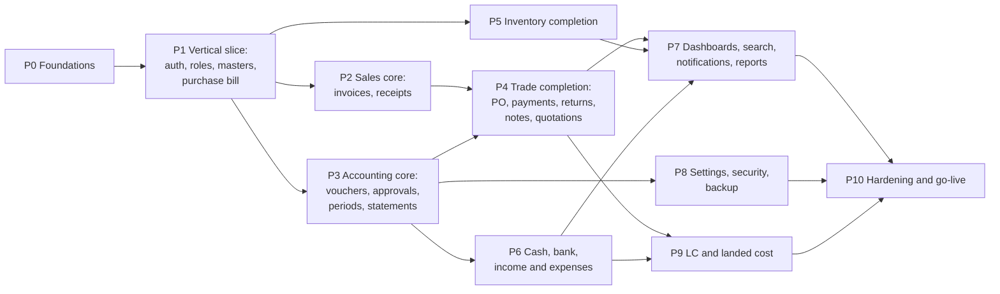

# 10 · Development roadmap

> ✅ ORM decided: Eloquent (DEC-01, 18 Oct 2026). ⚑ **Phase 1 still waits on JWT and token storage (DEC-02) and the first-slice choice (DEC-08).** Phase 0 can start now.
> Test IDs refer to [09](09-Testing-Strategy.md); pages to [02](02-UI-Inventory.md); endpoints to [05](05-API-Specification.md).

## 1. Phase dependency diagram



P0 sets up the repositories and pipelines. P1 proves the whole stack end to end with one real transaction. Sales and the accounting core build on it in parallel, and everything else layers on top. LC comes after purchases and banking because it reuses both. P10 hardens the full system for go-live.

**Why the purchase bill is the first transaction (DEC-08):** it is the smallest real business transaction that exercises every layer: auth, company scope, permissions, number sequences, Form Request validation, a domain posting service, stock-in with weighted average cost, a balanced journal entry, period checks, idempotency, optimistic locking, audit, and the React form, list and detail pages. It needs no prior stock, unlike a sales invoice, so the slice stands alone. The next phase (sales) then consumes the stock it creates.

## 2. Phases

### P0 · Foundations (about 1 week)
| | |
|---|---|
| Objective | Repositories, tooling, CI, local environment, design-system token pipeline |
| Prerequisites | Git hosting chosen |
| Files | `/backend` (Laravel skeleton), `/frontend` (Vite React TS), `/docs` (this package), `docker-compose.yml` (mysql:8.0, redis:7, mailpit, minio), `.github/workflows/ci.yml` (or equivalent), `.editorconfig`, `backend/phpstan.neon`, `backend/pint.json`, `frontend/eslint.config.js`, `frontend/.stylelintrc`, `frontend/src/design-system/tokens/*` |
| Migrations | Laravel defaults only (`jobs`, `failed_jobs`, `cache`) |
| APIs | `GET /api/health` (liveness), `GET /api/ready` (DB and Redis) |
| Frontend | Empty app shell rendering tokens in light and dark themes; Storybook with Button/Field |
| Tests | CI runs PHPUnit, PHPStan L8, Pint, ESLint, Vitest, openapi lint (docs build), `build_db.py` and `build_docs.py` checks |
| Acceptance | `docker compose up` gives a working local stack; CI green on an empty feature |
| Definition of done | README setup works on a clean machine; branch protection on `main` |
| Depends on | — |

### P1 · Vertical slice (about 3 weeks)
| | |
|---|---|
| Objective | Sign in → choose company → create supplier, product, warehouse → create, post and view a purchase bill → see the stock and the journal |
| Prerequisites | P0; DEC-02 and DEC-08 approved (DEC-01 ✅ Eloquent) |
| Migrations | Levels 0–5 of [04 §9](04-Database-Design.md#9-migration-order) needed by the slice: `currencies, permissions, users, companies, password_reset_tokens, user_sessions, user_preferences, branches, payment_terms, fiscal_years, accounting_periods, roles, role_permissions, company_users, account_groups, tax_rules, ledgers, account_mappings, number_sequences, audit_logs, idempotency_keys, party_groups, parties, units, stock_groups, product_categories, warehouses, company_settings, products, product_warehouse_settings, stock_balances, journal_entries, journal_lines, stock_movements, purchase_bills, purchase_bill_lines`. **Expand rule:** FK columns pointing to tables not built yet (`purchase_bills.purchase_order_id`, `letter_of_credit_id`, `lc_shipment_id`; `purchase_bill_lines.purchase_order_line_id`; `journal_lines.letter_of_credit_id`) are added by additive migrations in P4/P9 |
| Seeders | `ReferenceDataSeeder` (currencies, permissions), `CompanyProvisioner` (roles from the K11 matrix, COA and mappings, FY and periods, sequences), `DemoCompanySeeder` (partial) |
| APIs | `POST /auth/login`, `/auth/two-factor` (stub returns not enabled), `/auth/refresh`, `/auth/logout`, `GET /me`; `GET /fiscal-years`; `GET/POST /parties` (supplier), `GET/PATCH /parties/{id}`; `GET/POST /products`, `GET/PATCH /products/{id}`; `GET /units`, `GET /product-categories`, `GET /warehouses`, `POST /warehouses`; `GET /tax-rules`, `GET /payment-terms`; `POST /purchase-bills/calculate`, `GET/POST /purchase-bills`, `GET/PUT/DELETE /purchase-bills/{id}`, `POST /purchase-bills/{id}/post`; `GET /stock-movements`; `GET /ledgers/{id}/entries`; `GET /audit-logs` |
| Backend files | `app/Domain/Shared/{Money,Quantity,Rate,DocumentNumberService,AuditLogger}.php`; `app/Domain/Accounting/{JournalBuilder,PostingService,AccountMapper,PeriodGuard}.php`; `app/Domain/Inventory/{StockService,AverageCostCalculator}.php`; `app/Domain/Purchases/{DocumentCalculator,PurchaseBillService,PurchaseBillPostingService}.php`; `app/Domain/Parties/PartyService.php` (creates the ledger); `app/Http/Middleware/{ResolveCompany,Idempotency,ETag,RequestId}.php`; Form Requests, Resources, Policies and Controllers for the above; `app/Models/*` with `BelongsToCompany`; `database/triggers/posted_lines_immutable.sql` |
| Frontend files | `api/client.ts`, `api/generated/schema.d.ts`, `app/providers/{Auth,Company}Provider.tsx`, `app/shell/*` (sidebar and top bar per design), `features/auth/SignIn.tsx`, `features/parties/{PartyList,PartyForm,PartyDetail}.tsx` (supplier mode), `features/inventory/{ProductList,ProductForm}.tsx`, `features/documents/*` (line grid, totals panel driven by `/calculate`, post dialog), `features/purchases/{BillList,BillEditor,BillDetail}.tsx`; design-system components used: Field, Input, Select, DateInput, Button, DataTable, Pagination, Tabs, Card, Badge, Banner, Toast, Dialog, Amount, PageHeader, Sidebar, Topbar |
| Pages connected | S1, S0 (partial), C1, C2, C4 (partial), D1, D2, F2, F3, F4 (Bill and Ledger entries tabs), D9 (filtered) |
| Tests | TC-AUTH-001, 002, 003, 005, 006, 007, 008 (slice routes), 009, 017; TC-ACC-001, 002, 003, 004, 012 (bill), 019, 020, 023; TC-PUR-001, 002, 003, 004, 005; TC-INV-001, 005; TC-CON-003, 004, 005 (bill-only variant); TC-DB-001…006; TC-FE-001, 002 (bill editor), 003; TC-NFR-004 (slice routes), 008 (slice routes) |
| Acceptance | A Store keeper can view F2 but gets 403 on post; an Accountant posts BILL-2026-0001; stock and average cost are correct; Dr Inventory / Cr Supplier balanced; a duplicate supplier bill number is rejected; double-click posts once; another company's bill returns 404; everything is visible in the audit log |
| Definition of done | All listed tests green in CI on MySQL 8.0; OpenAPI routes for the slice implemented with no contract diffs; UI matches the design for the connected pages (visual review against artboards F2, F3, F4, C2, D2); docs updated if anything changed |
| Depends on | P0 |

### P2 · Sales core (about 3 weeks)
| | |
|---|---|
| Objective | Customers, invoices (create, preview, post, cancel), customer receipts with allocation, customer ledger and statement |
| Migrations | `sales_invoices`, `sales_invoice_lines`, `quotations`, `quotation_lines` (needed by the FK), `money_accounts`, `payment_details`, `bill_allocations` |
| APIs | Sales tag: calculate, invoices CRUD/post/cancel/pdf/send, bulk-post (duplicate is client-side, E3 prefilled); `/customer-receipts` (+ list), `/allocations`; `/parties/{id}/open-documents`, `/ledger`, `/statement`, `/transactions`; `/money-accounts` (list, create minimal) |
| Pages | B1–B8, E2, E3, E4, E5, E6, E7, dialogs Post/Cancel/Delete, L6 |
| Tests | TC-SAL-001…009, 012, 013, 015, 016, 017; TC-CON-001, 002; TC-E2E-001 |
| Acceptance | Design journey "Bill a customer" works end to end with correct COGS and ledgers |
| Depends on | P1 |

### P3 · Accounting core and statements (about 3 weeks)
| | |
|---|---|
| Objective | Chart of accounts, ledgers, JV/PV/RV/CV vouchers with approval, reversal, period locking, TB, P&L, BS, GL, day book |
| Migrations | `approval_requests`, `notifications` |
| APIs | Accounting tag; approvals; `/accounting-periods/{id}/lock|unlock`; reports TB/P&L/BS/GL; `/account-mappings` |
| Pages | H1–H19, K16, L3 (approvals tab), L4, K4 (periods) |
| Tests | TC-ACC-005…018, 021, 022, 024; TC-E2E-004 (partial) |
| Depends on | P1 (P2 for receipts allocation in H11) |

### P4 · Trade completion (about 3 weeks)
POs (with additive FK migrations on bills), supplier payments, sales and purchase returns, credit and debit notes, quotations, sales and purchase reports. Pages E1, E8–E12, F1, F5–F10. Tests TC-SAL-010, 011, 014; TC-PUR-006…010; TC-E2E-002, 003. Depends on P2 and P3.

### P5 · Inventory completion (about 2 weeks)
Categories, stock groups, units and warehouses UI; product details; adjustments; transfers; low stock; valuation; summary. Migrations: `stock_adjustments(_lines)`, `stock_transfers(_lines)`. Pages D3–D14. Tests TC-INV-002…007. Depends on P1.

### P6 · Cash, bank, income and expenses (about 3 weeks)
Money accounts, cash and bank books, transfers, cash counts, statement import and reconciliation, income/expense categories and entries, recurring drafts, attachments. Migrations: `cash_counts(_denominations)`, `bank_statement_imports`, `bank_statement_lines`, `bank_reconciliations`, `ie_categories`, `recurring_templates`, `attachments`. Pages G1–G13, I1–I9. Tests TC-BNK-001…009. Depends on P3.

### P7 · Dashboards, search, notifications, reports (about 2 weeks)
A1–A8, L1, L2, L3, J1, J6, J7, H18 cash flow, exports (`export_jobs`). Tests TC-E2E-007, TC-NFR-001…003. Depends on P4, P5 and P6.

### P8 · Settings, users, security and backup (about 2 weeks)
K1–K15 complete: invitations, roles editor, 2FA, sessions, invoice design, tax rules, numbering, currency formats, notification preferences, backups, restore, export pack. Migrations: `user_invitations`, `company_user_branches`, `notification_preferences`, `company_backups`. Tests TC-AUTH-004, 010…016, 018; TC-NFR-006; TC-E2E-005. Depends on P3.

### P9 · LC management and landed cost (about 3 weeks)
M1–M8 and dialogs; import mode of F3; additive FK migrations (`purchase_bills.letter_of_credit_id`, `lc_shipment_id`, `journal_lines.letter_of_credit_id`). Migrations: all LC tables. Tests TC-LC-001…011, TC-E2E-006. Depends on P4 and P6.

### P10 · Hardening and go-live (about 2 weeks)
Performance (k6), security (ZAP, dependency audit, pen-test), accessibility audit (axe + manual), restore drill, data migration/opening-balance import tools, UAT with the owner's data, runbooks. Tests TC-NFR-001…011, full E2E. Exit: no Sev-1/2 defects; accountant sign-off on posting rules (06) and tax items (06 §14).

## 3. Exact first steps (P0 → P1)

> These are the planned commands. They have **not** been run in this documentation session. Pin exact versions when you run them.

```bash
# repository
git init ledgerflow-erp && cd ledgerflow-erp
mkdir docs && cp -r <this package>/docs/* docs/ && cp <this package>/README.md .

# backend (Laravel + Eloquent, DEC-01 approved)
composer create-project laravel/laravel backend "^11.0"
cd backend
composer require php-open-source-saver/jwt-auth brick/math spatie/laravel-data
composer require --dev larastan/larastan laravel/pint pestphp/pest league/openapi-psr7-validator qossmic/deptrac
php artisan install:api                      # api routes file
php artisan vendor:publish --provider="PHPOpenSourceSaver\JWTAuth\Providers\LaravelServiceProvider"
php artisan jwt:secret                       # or configure ES256 keys (07 §3.1)
cp .env.example .env && php artisan key:generate
php artisan make:migration create_currencies_table   # ...one per table, in 04 §9 order
php artisan make:seeder ReferenceDataSeeder
cd ..

# frontend
npm create vite@latest frontend -- --template react-ts
cd frontend
npm i react-router-dom @tanstack/react-query react-hook-form zod @hookform/resolvers zustand
npm i -D vitest @testing-library/react @testing-library/user-event jsdom msw openapi-typescript \
        @playwright/test eslint stylelint vitest-axe
npx openapi-typescript ../docs/openapi.yaml -o src/api/generated/schema.d.ts
cd ..

# local stack
docker compose up -d mysql redis mailpit minio
cd backend && php artisan migrate --seed && php artisan test
```

First pull requests, in order: (1) docker-compose and CI; (2) Money/Quantity value objects with unit tests (TC-ACC-019, 020); (3) migrations levels 0–2 and reference seeders; (4) auth (login, refresh, logout, me) with TC-AUTH tests; (5) `ResolveCompany`, permissions and policies; (6) company provisioning (COA, roles, sequences); (7) parties and products; (8) the purchase-bill calculate, create and post services; (9) the React shell and sign-in; (10) supplier and product pages; (11) bill editor, list and detail; (12) slice E2E.

## 4. Release checklist (every phase)
- [ ] All phase tests green; the `BooksAreConsistent` trait passes in every feature test
- [ ] `build_db.py` and `build_docs.py` pass; `openapi.yaml` regenerated, and the contract test is clean
- [ ] New migrations reviewed for the expand/contract rule; `down()` tested
- [ ] Pages compared with their artboards in both themes and at 4 breakpoints
- [ ] Permissions tested for all six roles; cross-company isolation tested
- [ ] Audit entries present for new mutations
- [ ] Docs updated (02/04/05/06 where behaviour changed)
