# 14 · Physical schema and migrations

> **Status: final baseline schema for MySQL 8.0, 18 Oct 2026.** Generated by `docs/source/build_schema_doc.py` from `docs/source/schema.py`, the same definition that produces [04 · Database design](04-Database-Design.md). ORM: Laravel Eloquent (DEC-01, approved), so the deliverable is Laravel migrations. Prisma is not used. No frontend pages were built.

**What was produced**

| Artefact | Path | Contents |
|---|---|---|
| Laravel migrations | `backend/database/migrations/` | 83 anonymous-class migrations, one table each, in dependency order (`2026_10_18_000100_create_currencies_table.php` … `2026_10_18_008300_create_purchase_return_lines_table.php`) |
| Schema contract | `backend/database/schema-contract.json` | Expected `information_schema` view of every table: columns, types, nullability, defaults, keys, FKs, CHECK names |
| MySQL contract test | `backend/tests/Feature/Database/SchemaContractTest.php` | Runs the migrations on MySQL 8.0 and compares the live schema with the contract; probes CHECK, UNIQUE and FK enforcement |
| Reference DDL | `docs/schema/ledgerflow-mysql8.sql` | Plain `CREATE TABLE` statements equivalent to the migrations, for DBA review and CI diffing (deploy with `php artisan migrate`, not this file) |
| ER diagram source | `docs/schema/ledgerflow-er.mmd` | Mermaid source of the full diagram in §4 |
| Verification tools | `docs/source/validate_schema.py`, `docs/source/migration_harness/` | MySQL 8.0 rule validator; strict Laravel schema-builder harness and comparer |

## 1. Summary

| Measure | Count |
|---|---|
| Tables | 83 |
| Columns | 1322 |
| Foreign keys | 385 |
| Unique keys | 84 |
| Secondary indexes | 330 |
| CHECK constraints (incl. enum checks) | 148 |
| Migration levels (topological) | 11 |
| Junction (many-to-many) tables | 4 |
| Polymorphic references (no FK by design) | 7 |
| Tenant-scoped tables (`company_id`) | 59 |

## 2. Changes made while finalizing

Corrections from [13 · Review issues](13-Review-Issues.md) that touch the schema were applied, plus five defects found by this verification (S-01…S-05). Every change is in `schema.py`, so 04, the migrations and this document agree.

| Ref | Change | Tables |
|---|---|---|
| R-01 | Every FK is `ON UPDATE RESTRICT` (was CASCADE). Keeps CHECKs and generated columns on FK columns legal in MySQL 8.0 (errors 3823/3104) | all |
| R-02 ⚑ | Moving average per product **and warehouse**: `product_costs` merged into `stock_balances` (adds `total_value`, `avg_unit_cost`), so each warehouse's stock value equals its inventory ledger. BR-016/017, AS-03, DEC-05, 06 §11 updated. Owner may revert | stock_balances, (product_costs removed) |
| R-03 | `lc_charges.posting_status` (draft/posted/reversed); `cash_counts.status` gains `reversed`; reversals link through `journal_entries.reverses_entry_id` (UNIQUE) | lc_charges, cash_counts |
| R-06 | `system_journal` number series `SJ-{FY}-` for system entries without their own document number | number_sequences (data), 04 §11.2, 06 §4 |
| R-10 | CHECK: only the system Owner role may have NULL (unlimited) approval limits; limits ≥ 0 | roles |
| R-13 ⚑ | `money_accounts.account_type` gains `cash_credit`; new `overdraft_limit`; BR-031 reworded | money_accounts |
| R-14 | `tax_rules.is_recoverable` | tax_rules |
| R-15 | `number_sequences.fiscal_year_id` nullable for never-reset series; generated `fy_scope` keeps the unique key effective; CHECK ties `reset_policy` to it | number_sequences |
| R-18 | Invitation branch restriction as a junction (not JSON) so it has real FKs | user_invitation_branches (new) |
| R-19 | `cash_counts.note` | cash_counts |
| R-21 | `idempotency_keys.company_id` nullable (company creation); generated `scope_company_id` in the unique key | idempotency_keys |
| R-29 | Balance CHECK covers `reversed` entries too | journal_entries |
| R-30 | Snapshots: `product_code`, `product_name`, `unit_name` on document lines; `party_snapshot` JSON on every document header | 8 headers, 4 line tables |
| R-39 | `password_reset_tokens` no longer flagged append-only (`used_at` is updated) | password_reset_tokens |
| S-01 | `TIMESTAMP` → `DATETIME` (UTC) for every instant: `TIMESTAMP` overflows on 19 Jan 2038, inside the retention period of 2026 books | all |
| S-02 | Deleting a tax rule nulled `tax_rule_id` on **posted** invoice, bill and journal lines (SET NULL). Now RESTRICT; tax rules are deactivated | journal_lines, 4 line tables |
| S-03 | Deleting a user nulled actor columns on posted and append-only rows (`created_by`, `posted_by`, audit `user_id`, 19 columns + all audit columns). Users are never hard-deleted, so all actor FKs are RESTRICT | all |
| S-04 | Deleting a branch removed a user's branch restriction (CASCADE), silently widening access to all branches. Now RESTRICT | company_user_branches |
| S-05 | Missing one-to-one keys: a journal entry could be linked to two LC charges, cash counts or transfers. Added UNIQUE on `lc_charges.journal_entry_id`, `cash_counts.adjustment_entry_id`, `stock_transfers.dispatch_entry_id`/`receive_entry_id`; `lc_amendment_id`/`lc_shipment_id` on charges RESTRICT; extra CHECKs (`margin_applied ≥ 0`, `overdraft_limit ≥ 0`, `qty_in_transit_out ≥ 0`, `avg_unit_cost ≥ 0`, `next_number ≥ 1`) | lc_charges, cash_counts, stock_transfers, lc_payments, stock_balances |

⚑ = applied as the recommended option of an issue that still needs owner confirmation. Each is a small, isolated change if the owner chooses the alternative.

## 3. Verification

### 3.1 Schema rules (MySQL 8.0 and project conventions)

`validate_schema.py` checks the definition before any SQL exists. A rule passes only with zero failures.

| Rule | Check | Items checked | Result |
|---|---|---|---|
| V01 | Every table has a primary key | 83 | ✅ pass |
| V02 | Every FK references an existing primary or unique key | 385 | ✅ pass |
| V03 | FK column type equals referenced column type exactly (incl. UNSIGNED, CHAR length) | 385 | ✅ pass |
| V04 | ON DELETE SET NULL only on nullable columns; self-references nullable | 385 | ✅ pass |
| V05 | No CHECK constraint uses a column whose FK has a CASCADE/SET NULL action (MySQL error 3823) | 148 | ✅ pass |
| V06 | Stored generated columns: base-column FKs have no cascading action | 2 | ✅ pass |
| V07 | CHECK expressions reference only existing, non-AUTO_INCREMENT columns | 148 | ✅ pass |
| V08 | Identifiers ≤ 64 chars; FK and CHECK names unique schema-wide; index names unique per table | 2352 | ✅ pass |
| V09 | Every FK column is the leftmost column of an index (no implicit InnoDB index) | 385 | ✅ pass |
| V10 | No redundant index (left prefix of another key) | 330 | ✅ pass |
| V11 | Index key length ≤ 3072 bytes (utf8mb4, DYNAMIC rows); no TEXT/JSON keys | 497 | ✅ pass |
| V12 | Maximum row size < 65,535 bytes | 83 | ✅ pass |
| V13 | Decimal precision by class: money (18,2), quantity (18,3), unit cost (18,4), FX rate (18,6), percent (7,4); no FLOAT/DOUBLE | 151 | ✅ pass |
| V14 | Every BIGINT *_id column has a FK, or is declared polymorphic | 7 | ✅ pass |
| V15 | Defaults are valid for their type; enum defaults and values fit | 229 | ✅ pass |
| V16 | Reserved-word columns are always back-quoted in generated SQL (credit_notes.usage, debit_notes.usage, permissions.key) | 3 | ✅ pass |
| V17 | Document → journal-entry links are one-to-one (UNIQUE), which blocks double posting | 16 | ✅ pass |
| V18 | Financial and append-only tables (26) are never changed by a delete elsewhere: no SET NULL; CASCADE only from their own header | 166 | ✅ pass |
| V19 | ON UPDATE RESTRICT on every FK (surrogate keys are immutable) | 385 | ✅ pass |
| V20 | Dependency graph is acyclic (11 migration levels; self-references created in the same migration) | 83 | ✅ pass |
| V21 | Every non-tenant table is global reference data or a dependant (CASCADE) of a tenant or global row | 20 | ✅ pass |
| V22 | Every tenant table has an index or unique key led by company_id | 59 | ✅ pass |
| V23 | Junction tables have a composite primary or unique key | 4 | ✅ pass |
| V24 | Append-only tables have no updated_at | 2 | ✅ pass |

Decimal columns by precision class (V13):

| Type | Used for | Columns |
|---|---|---|
| `DECIMAL(18,2)` | money (base or foreign currency) | 97 |
| `DECIMAL(18,3)` | quantity | 25 |
| `DECIMAL(18,4)` | unit cost | 11 |
| `DECIMAL(18,6)` | exchange rate | 5 |
| `DECIMAL(7,4)` | percentage | 13 |

Unique keys that contain a nullable column (MySQL allows many NULLs; each is intended to mean "optional, but at most one"):

- products (company_id, barcode) — nullable: barcode
- stock_adjustments (journal_entry_id) — nullable: journal_entry_id
- stock_transfers (dispatch_entry_id) — nullable: dispatch_entry_id
- stock_transfers (receive_entry_id) — nullable: receive_entry_id
- journal_entries (reverses_entry_id) — nullable: reverses_entry_id
- cash_counts (adjustment_entry_id) — nullable: adjustment_entry_id
- bank_statement_lines (matched_journal_line_id) — nullable: matched_journal_line_id
- sales_invoices (journal_entry_id) — nullable: journal_entry_id
- sales_invoices (cancellation_entry_id) — nullable: cancellation_entry_id
- sales_returns (journal_entry_id) — nullable: journal_entry_id
- credit_notes (journal_entry_id) — nullable: journal_entry_id
- credit_notes (sales_return_id) — nullable: sales_return_id
- purchase_bills (journal_entry_id) — nullable: journal_entry_id
- purchase_bills (cancellation_entry_id) — nullable: cancellation_entry_id
- purchase_returns (journal_entry_id) — nullable: journal_entry_id
- debit_notes (journal_entry_id) — nullable: journal_entry_id
- debit_notes (purchase_return_id) — nullable: purchase_return_id
- landed_cost_allocations (journal_entry_id) — nullable: journal_entry_id
- lc_charges (journal_entry_id) — nullable: journal_entry_id
- lc_payments (journal_entry_id) — nullable: journal_entry_id

### 3.2 Migrations

Executed in this workspace with PHP 8.3.6:

| Step | Result |
|---|---|
| `php -l` on all 83 migrations | ✅ no syntax errors |
| Harness: every `up()` in filename order, then every `down()` in reverse. Each FK target must already exist; each drop must leave no dangling FK; only real Laravel schema-builder methods are accepted | ✅ `harness: migrated=83 rolled_back=83 files=83` |
| Built model vs contract (from `schema.py`): every column's type, nullability, default and generation, every key, FK action and CHECK | ✅ `compared tables=83, columns=1322, primary=83, unique=84, index=330, foreign=385, check=148 differences=0` |
| Negative tests: a migration renamed to run before its parent; a non-Laravel method (`->varchar()`); a money column changed to `decimal(15,2)` | ✅ all three detected (order error, API error, 1 difference) |

**Not yet run against a MySQL server.** This workspace cannot install MySQL or Laravel (package registries are blocked). The contract test (§8) does that run and is the acceptance gate for task P1 in the roadmap. The parts that only a live server can prove are: MySQL's own parsing of the CHECK and generated-column SQL, error 3823/3104 behaviour, and Laravel's exact DDL output.

## 4. Entity-relationship diagram (all tables)

Every table and every foreign key except the uniform `company_id` (tenant) and `created_by`/`updated_by` (actor) columns, which would draw 171 identical lines to `companies` and `users`. They are listed in §5.2. Notation: `||--o{` mandatory one-to-many, `|o--o{` optional one-to-many, `||--o|` / `|o--o|` one-to-one. Labels are the FK column. Per-module diagrams with attributes are in [04 §5](04-Database-Design.md#5-entity-relationship-diagrams). At this size the overview is best read zoomed: `docs/schema/ledgerflow-er.svg` is the rendered vector file.

```mermaid
erDiagram
    export_jobs
    company_backups
    attachments
    currencies ||--o{ companies : "base_currency_code"
    users |o--o{ fiscal_years : "closed_by"
    fiscal_years ||--o{ accounting_periods : "fiscal_year_id"
    users |o--o{ accounting_periods : "locked_by"
    roles ||--o{ role_permissions : "role_id"
    permissions ||--o{ role_permissions : "permission_id"
    users ||--o{ company_users : "user_id"
    roles ||--o{ company_users : "role_id"
    users |o--o{ company_users : "deactivated_by"
    company_users ||--o{ company_user_branches : "company_user_id"
    branches ||--o{ company_user_branches : "branch_id"
    roles ||--o{ user_invitations : "role_id"
    user_invitations ||--o{ user_invitation_branches : "user_invitation_id"
    branches ||--o{ user_invitation_branches : "branch_id"
    users ||--o{ user_sessions : "user_id"
    user_sessions |o--o{ user_sessions : "replaced_by_id"
    users ||--o{ password_reset_tokens : "user_id"
    users ||--o| user_preferences : "user_id"
    companies |o--o{ user_preferences : "last_company_id"
    account_groups |o--o{ account_groups : "parent_id"
    ledgers ||--o{ tax_rules : "ledger_id"
    account_groups ||--o{ ledgers : "account_group_id"
    ledgers |o--o{ account_mappings : "ledger_id"
    account_groups |o--o{ account_mappings : "account_group_id"
    fiscal_years |o--o{ number_sequences : "fiscal_year_id"
    warehouses |o--o{ company_settings : "default_warehouse_id"
    payment_terms |o--o{ company_settings : "default_payment_term_id"
    users ||--o{ notification_preferences : "user_id"
    users ||--o{ notifications : "user_id"
    users |o--o{ audit_logs : "user_id"
    users ||--o{ idempotency_keys : "user_id"
    users ||--o{ approval_requests : "requested_by"
    users |o--o{ approval_requests : "decided_by"
    party_groups |o--o{ parties : "party_group_id"
    currencies ||--o{ parties : "default_currency_code"
    payment_terms |o--o{ parties : "payment_term_id"
    ledgers |o--o{ parties : "default_purchase_ledger_id"
    ledgers ||--o| parties : "ledger_id"
    parties ||--o{ party_bank_accounts : "party_id"
    stock_groups |o--o{ stock_groups : "parent_id"
    product_categories |o--o{ product_categories : "parent_id"
    units |o--o{ product_categories : "default_unit_id"
    stock_groups |o--o{ product_categories : "default_stock_group_id"
    branches ||--o{ warehouses : "branch_id"
    users |o--o{ warehouses : "manager_user_id"
    ledgers ||--o{ warehouses : "inventory_ledger_id"
    product_categories |o--o{ products : "category_id"
    stock_groups |o--o{ products : "stock_group_id"
    units ||--o{ products : "unit_id"
    tax_rules |o--o{ products : "tax_rule_id"
    ledgers ||--o{ products : "income_ledger_id"
    ledgers |o--o{ products : "expense_ledger_id"
    parties |o--o{ products : "preferred_supplier_id"
    products ||--o{ product_warehouse_settings : "product_id"
    warehouses ||--o{ product_warehouse_settings : "warehouse_id"
    products ||--o{ stock_balances : "product_id"
    warehouses ||--o{ stock_balances : "warehouse_id"
    products ||--o{ stock_movements : "product_id"
    warehouses ||--o{ stock_movements : "warehouse_id"
    journal_entries |o--o{ stock_movements : "journal_entry_id"
    stock_movements |o--o{ stock_movements : "reverses_movement_id"
    warehouses ||--o{ stock_adjustments : "warehouse_id"
    journal_entries |o--o| stock_adjustments : "journal_entry_id"
    users |o--o{ stock_adjustments : "posted_by"
    stock_adjustments ||--o{ stock_adjustment_lines : "stock_adjustment_id"
    products ||--o{ stock_adjustment_lines : "product_id"
    warehouses ||--o{ stock_transfers : "from_warehouse_id"
    warehouses ||--o{ stock_transfers : "to_warehouse_id"
    journal_entries |o--o| stock_transfers : "dispatch_entry_id"
    journal_entries |o--o| stock_transfers : "receive_entry_id"
    stock_transfers ||--o{ stock_transfer_lines : "stock_transfer_id"
    products ||--o{ stock_transfer_lines : "product_id"
    branches |o--o{ journal_entries : "branch_id"
    fiscal_years ||--o{ journal_entries : "fiscal_year_id"
    accounting_periods ||--o{ journal_entries : "accounting_period_id"
    journal_entries |o--o| journal_entries : "reverses_entry_id"
    users |o--o{ journal_entries : "submitted_by"
    users |o--o{ journal_entries : "approved_by"
    users |o--o{ journal_entries : "posted_by"
    journal_entries ||--o{ journal_lines : "journal_entry_id"
    ledgers ||--o{ journal_lines : "ledger_id"
    tax_rules |o--o{ journal_lines : "tax_rule_id"
    currencies |o--o{ journal_lines : "foreign_currency_code"
    warehouses |o--o{ journal_lines : "warehouse_id"
    letters_of_credit |o--o{ journal_lines : "letter_of_credit_id"
    journal_lines ||--o{ bill_allocations : "journal_line_id"
    sales_invoices |o--o{ bill_allocations : "sales_invoice_id"
    purchase_bills |o--o{ bill_allocations : "purchase_bill_id"
    ledgers ||--o| money_accounts : "ledger_id"
    currencies ||--o{ money_accounts : "currency_code"
    users |o--o{ money_accounts : "custodian_user_id"
    journal_entries ||--o| payment_details : "journal_entry_id"
    parties |o--o{ payment_details : "party_id"
    money_accounts ||--o{ payment_details : "money_account_id"
    money_accounts |o--o{ payment_details : "counter_money_account_id"
    ledgers ||--o| ie_categories : "ledger_id"
    journal_entries |o--o{ recurring_templates : "last_entry_id"
    money_accounts ||--o{ cash_counts : "money_account_id"
    users ||--o{ cash_counts : "counted_by"
    journal_entries |o--o| cash_counts : "adjustment_entry_id"
    cash_counts ||--o{ cash_count_denominations : "cash_count_id"
    money_accounts ||--o{ bank_reconciliations : "money_account_id"
    users |o--o{ bank_reconciliations : "finished_by"
    money_accounts ||--o{ bank_statement_imports : "money_account_id"
    bank_statement_imports ||--o{ bank_statement_lines : "bank_statement_import_id"
    money_accounts ||--o{ bank_statement_lines : "money_account_id"
    journal_lines |o--o| bank_statement_lines : "matched_journal_line_id"
    bank_statement_lines |o--o{ bank_statement_lines : "paired_line_id"
    bank_reconciliations |o--o{ bank_statement_lines : "bank_reconciliation_id"
    users |o--o{ bank_statement_lines : "matched_by"
    branches ||--o{ quotations : "branch_id"
    parties ||--o{ quotations : "party_id"
    warehouses |o--o{ quotations : "warehouse_id"
    payment_terms |o--o{ quotations : "payment_term_id"
    quotations ||--o{ quotation_lines : "quotation_id"
    products ||--o{ quotation_lines : "product_id"
    tax_rules |o--o{ quotation_lines : "tax_rule_id"
    branches ||--o{ sales_invoices : "branch_id"
    parties ||--o{ sales_invoices : "party_id"
    payment_terms |o--o{ sales_invoices : "payment_term_id"
    warehouses ||--o{ sales_invoices : "warehouse_id"
    quotations |o--o{ sales_invoices : "quotation_id"
    journal_entries |o--o| sales_invoices : "journal_entry_id"
    journal_entries |o--o| sales_invoices : "cancellation_entry_id"
    users |o--o{ sales_invoices : "cancelled_by"
    users |o--o{ sales_invoices : "posted_by"
    sales_invoices ||--o{ sales_invoice_lines : "sales_invoice_id"
    products ||--o{ sales_invoice_lines : "product_id"
    tax_rules |o--o{ sales_invoice_lines : "tax_rule_id"
    ledgers ||--o{ sales_invoice_lines : "income_ledger_id"
    branches ||--o{ sales_returns : "branch_id"
    parties ||--o{ sales_returns : "party_id"
    sales_invoices ||--o{ sales_returns : "sales_invoice_id"
    warehouses ||--o{ sales_returns : "warehouse_id"
    journal_entries |o--o| sales_returns : "journal_entry_id"
    sales_returns ||--o{ sales_return_lines : "sales_return_id"
    sales_invoice_lines ||--o{ sales_return_lines : "sales_invoice_line_id"
    products ||--o{ sales_return_lines : "product_id"
    branches ||--o{ credit_notes : "branch_id"
    parties ||--o{ credit_notes : "party_id"
    sales_returns |o--o| credit_notes : "sales_return_id"
    sales_invoices |o--o{ credit_notes : "sales_invoice_id"
    journal_entries |o--o| credit_notes : "journal_entry_id"
    branches ||--o{ purchase_orders : "branch_id"
    parties ||--o{ purchase_orders : "party_id"
    warehouses ||--o{ purchase_orders : "warehouse_id"
    payment_terms |o--o{ purchase_orders : "payment_term_id"
    currencies ||--o{ purchase_orders : "currency_code"
    purchase_orders ||--o{ purchase_order_lines : "purchase_order_id"
    products ||--o{ purchase_order_lines : "product_id"
    tax_rules |o--o{ purchase_order_lines : "tax_rule_id"
    branches ||--o{ letters_of_credit : "branch_id"
    parties ||--o{ letters_of_credit : "party_id"
    purchase_orders |o--o{ letters_of_credit : "purchase_order_id"
    currencies ||--o{ letters_of_credit : "currency_code"
    money_accounts |o--o{ letters_of_credit : "issuing_bank_account_id"
    money_accounts |o--o{ letters_of_credit : "margin_account_id"
    users |o--o{ letters_of_credit : "closed_by"
    letters_of_credit ||--o{ lc_shipments : "letter_of_credit_id"
    branches ||--o{ purchase_bills : "branch_id"
    parties ||--o{ purchase_bills : "party_id"
    payment_terms |o--o{ purchase_bills : "payment_term_id"
    warehouses ||--o{ purchase_bills : "warehouse_id"
    purchase_orders |o--o{ purchase_bills : "purchase_order_id"
    letters_of_credit |o--o{ purchase_bills : "letter_of_credit_id"
    lc_shipments |o--o{ purchase_bills : "lc_shipment_id"
    currencies ||--o{ purchase_bills : "currency_code"
    users |o--o{ purchase_bills : "received_by_user_id"
    journal_entries |o--o| purchase_bills : "journal_entry_id"
    journal_entries |o--o| purchase_bills : "cancellation_entry_id"
    users |o--o{ purchase_bills : "cancelled_by"
    users |o--o{ purchase_bills : "posted_by"
    purchase_bills ||--o{ purchase_bill_lines : "purchase_bill_id"
    products ||--o{ purchase_bill_lines : "product_id"
    tax_rules |o--o{ purchase_bill_lines : "tax_rule_id"
    ledgers ||--o{ purchase_bill_lines : "debit_ledger_id"
    purchase_order_lines |o--o{ purchase_bill_lines : "purchase_order_line_id"
    branches ||--o{ purchase_returns : "branch_id"
    parties ||--o{ purchase_returns : "party_id"
    purchase_bills ||--o{ purchase_returns : "purchase_bill_id"
    warehouses ||--o{ purchase_returns : "warehouse_id"
    journal_entries |o--o| purchase_returns : "journal_entry_id"
    purchase_returns ||--o{ purchase_return_lines : "purchase_return_id"
    purchase_bill_lines ||--o{ purchase_return_lines : "purchase_bill_line_id"
    products ||--o{ purchase_return_lines : "product_id"
    branches ||--o{ debit_notes : "branch_id"
    parties ||--o{ debit_notes : "party_id"
    purchase_returns |o--o| debit_notes : "purchase_return_id"
    purchase_bills |o--o{ debit_notes : "purchase_bill_id"
    journal_entries |o--o| debit_notes : "journal_entry_id"
    lc_document_templates ||--o{ lc_document_template_items : "lc_document_template_id"
    letters_of_credit ||--o{ lc_documents : "letter_of_credit_id"
    lc_shipments |o--o{ lc_documents : "lc_shipment_id"
    letters_of_credit ||--o{ lc_amendments : "letter_of_credit_id"
    lc_amendments ||--o{ lc_amendment_changes : "lc_amendment_id"
    letters_of_credit ||--o{ landed_cost_allocations : "letter_of_credit_id"
    purchase_bills ||--o{ landed_cost_allocations : "purchase_bill_id"
    journal_entries |o--o| landed_cost_allocations : "journal_entry_id"
    landed_cost_allocations ||--o{ landed_cost_allocation_lines : "landed_cost_allocation_id"
    purchase_bill_lines ||--o{ landed_cost_allocation_lines : "purchase_bill_line_id"
    products ||--o{ landed_cost_allocation_lines : "product_id"
    warehouses ||--o{ landed_cost_allocation_lines : "warehouse_id"
    letters_of_credit ||--o{ lc_charges : "letter_of_credit_id"
    lc_amendments |o--o{ lc_charges : "lc_amendment_id"
    lc_shipments |o--o{ lc_charges : "lc_shipment_id"
    parties |o--o{ lc_charges : "payee_party_id"
    money_accounts |o--o{ lc_charges : "paid_from_account_id"
    journal_entries |o--o| lc_charges : "journal_entry_id"
    landed_cost_allocations |o--o{ lc_charges : "landed_cost_allocation_id"
    letters_of_credit ||--o{ lc_payments : "letter_of_credit_id"
    lc_shipments |o--o{ lc_payments : "lc_shipment_id"
    purchase_bills |o--o{ lc_payments : "purchase_bill_id"
    money_accounts ||--o{ lc_payments : "money_account_id"
    journal_entries |o--o| lc_payments : "journal_entry_id"
```



## 5. Relationship catalogue

All 385 foreign keys. Cardinality reads parent → child: `1` exactly one, `0..1` optional, `0..*` many. Every FK is `ON UPDATE RESTRICT` and is the leftmost column of an index.

### 5.1 Specific relationships (214)


#### Platform

| # | Child column | Parent | Cardinality (parent : child) | On delete | Constraint | Meaning |
|---|---|---|---|---|---|---|
| 1 | `companies.base_currency_code` | `currencies.code` | 1 : 0..* | RESTRICT | `companies_base_currency_code_foreign` | Locked once any journal entry exists |
| 65 | `company_settings.default_warehouse_id` | `warehouses.id` | 0..1 : 0..* | SET NULL | `company_settings_default_warehouse_id_foreign` | company_settings → warehouses |
| 66 | `company_settings.default_payment_term_id` | `payment_terms.id` | 0..1 : 0..* | SET NULL | `company_settings_default_payment_term_id_foreign` | company_settings → payment_terms |
| 70 | `notification_preferences.user_id` | `users.id` | 1 : 0..* | CASCADE | `notification_preferences_user_id_foreign` | notification_preferences → users |
| 72 | `notifications.user_id` | `users.id` | 1 : 0..* | CASCADE | `notifications_user_id_foreign` | notifications → users |
| 74 | `audit_logs.user_id` | `users.id` | 0..1 : 0..* | RESTRICT | `audit_logs_user_id_foreign` | audit_logs → users |
| 79 | `idempotency_keys.user_id` | `users.id` | 1 : 0..* | CASCADE | `idempotency_keys_user_id_foreign` | idempotency_keys → users |

#### Access

| # | Child column | Parent | Cardinality (parent : child) | On delete | Constraint | Meaning |
|---|---|---|---|---|---|---|
| 22 | `role_permissions.role_id` | `roles.id` | 1 : 0..* | CASCADE | `role_permissions_role_id_foreign` | role_permissions → roles |
| 23 | `role_permissions.permission_id` | `permissions.id` | 1 : 0..* | CASCADE | `role_permissions_permission_id_foreign` | role_permissions → permissions |
| 25 | `company_users.user_id` | `users.id` | 1 : 0..* | CASCADE | `company_users_user_id_foreign` | company_users → users |
| 26 | `company_users.role_id` | `roles.id` | 1 : 0..* | RESTRICT | `company_users_role_id_foreign` | company_users → roles |
| 27 | `company_users.deactivated_by` | `users.id` | 0..1 : 0..* | RESTRICT | `company_users_deactivated_by_foreign` | company_users → users |
| 30 | `company_user_branches.company_user_id` | `company_users.id` | 1 : 0..* | CASCADE | `company_user_branches_company_user_id_foreign` | company_user_branches → company_users |
| 31 | `company_user_branches.branch_id` | `branches.id` | 1 : 0..* | RESTRICT | `company_user_branches_branch_id_foreign` | RESTRICT: deleting a branch must not silently widen a restricted user to all branches |
| 33 | `user_invitations.role_id` | `roles.id` | 1 : 0..* | RESTRICT | `user_invitations_role_id_foreign` | user_invitations → roles |
| 36 | `user_invitation_branches.user_invitation_id` | `user_invitations.id` | 1 : 0..* | CASCADE | `user_invitation_branches_user_invitation_id_foreign` | user_invitation_branches → user_invitations |
| 37 | `user_invitation_branches.branch_id` | `branches.id` | 1 : 0..* | RESTRICT | `user_invitation_branches_branch_id_foreign` | user_invitation_branches → branches |
| 38 | `user_sessions.user_id` | `users.id` | 1 : 0..* | CASCADE | `user_sessions_user_id_foreign` | user_sessions → users |
| 39 | `user_sessions.replaced_by_id` | `user_sessions.id` | 0..1 : 0..* | SET NULL | `user_sessions_replaced_by_id_foreign` | Next token in the rotation chain |
| 40 | `password_reset_tokens.user_id` | `users.id` | 1 : 0..* | CASCADE | `password_reset_tokens_user_id_foreign` | password_reset_tokens → users |
| 41 | `user_preferences.user_id` | `users.id` | 1 : 0..1 | CASCADE | `user_preferences_user_id_foreign` | user_preferences → users |
| 42 | `user_preferences.last_company_id` | `companies.id` | 0..1 : 0..* | SET NULL | `user_preferences_last_company_id_foreign` | user_preferences → companies |

#### Accounting

| # | Child column | Parent | Cardinality (parent : child) | On delete | Constraint | Meaning |
|---|---|---|---|---|---|---|
| 11 | `fiscal_years.closed_by` | `users.id` | 0..1 : 0..* | RESTRICT | `fiscal_years_closed_by_foreign` | fiscal_years → users |
| 15 | `accounting_periods.fiscal_year_id` | `fiscal_years.id` | 1 : 0..* | CASCADE | `accounting_periods_fiscal_year_id_foreign` | accounting_periods → fiscal_years |
| 16 | `accounting_periods.locked_by` | `users.id` | 0..1 : 0..* | RESTRICT | `accounting_periods_locked_by_foreign` | accounting_periods → users |
| 44 | `account_groups.parent_id` | `account_groups.id` | 0..1 : 0..* | RESTRICT | `account_groups_parent_id_foreign` | NULL for the five primary groups |
| 48 | `tax_rules.ledger_id` | `ledgers.id` | 1 : 0..* | RESTRICT | `tax_rules_ledger_id_foreign` | Liability or asset ledger where the tax collects |
| 52 | `ledgers.account_group_id` | `account_groups.id` | 1 : 0..* | RESTRICT | `ledgers_account_group_id_foreign` | ledgers → account_groups |
| 56 | `account_mappings.ledger_id` | `ledgers.id` | 0..1 : 0..* | RESTRICT | `account_mappings_ledger_id_foreign` | account_mappings → ledgers |
| 57 | `account_mappings.account_group_id` | `account_groups.id` | 0..1 : 0..* | RESTRICT | `account_mappings_account_group_id_foreign` | For group mappings such as sundry_debtors |
| 61 | `number_sequences.fiscal_year_id` | `fiscal_years.id` | 0..1 : 0..* | RESTRICT | `number_sequences_fiscal_year_id_foreign` | NULL for never-reset series (CUS, SUP) |
| 81 | `approval_requests.requested_by` | `users.id` | 1 : 0..* | RESTRICT | `approval_requests_requested_by_foreign` | approval_requests → users |
| 82 | `approval_requests.decided_by` | `users.id` | 0..1 : 0..* | RESTRICT | `approval_requests_decided_by_foreign` | approval_requests → users |
| 168 | `journal_entries.branch_id` | `branches.id` | 0..1 : 0..* | RESTRICT | `journal_entries_branch_id_foreign` | journal_entries → branches |
| 169 | `journal_entries.fiscal_year_id` | `fiscal_years.id` | 1 : 0..* | RESTRICT | `journal_entries_fiscal_year_id_foreign` | journal_entries → fiscal_years |
| 170 | `journal_entries.accounting_period_id` | `accounting_periods.id` | 1 : 0..* | RESTRICT | `journal_entries_accounting_period_id_foreign` | journal_entries → accounting_periods |
| 171 | `journal_entries.reverses_entry_id` | `journal_entries.id` | 0..1 : 0..1 | RESTRICT | `journal_entries_reverses_entry_id_foreign` | Set on a reversing entry |
| 172 | `journal_entries.submitted_by` | `users.id` | 0..1 : 0..* | RESTRICT | `journal_entries_submitted_by_foreign` | journal_entries → users |
| 173 | `journal_entries.approved_by` | `users.id` | 0..1 : 0..* | RESTRICT | `journal_entries_approved_by_foreign` | journal_entries → users |
| 174 | `journal_entries.posted_by` | `users.id` | 0..1 : 0..* | RESTRICT | `journal_entries_posted_by_foreign` | journal_entries → users |
| 178 | `journal_lines.journal_entry_id` | `journal_entries.id` | 1 : 0..* | CASCADE | `journal_lines_journal_entry_id_foreign` | CASCADE only matters for drafts; posted entries are never deleted |
| 179 | `journal_lines.ledger_id` | `ledgers.id` | 1 : 0..* | RESTRICT | `journal_lines_ledger_id_foreign` | journal_lines → ledgers |
| 180 | `journal_lines.tax_rule_id` | `tax_rules.id` | 0..1 : 0..* | RESTRICT | `journal_lines_tax_rule_id_foreign` | RESTRICT: posted lines are immutable |
| 181 | `journal_lines.foreign_currency_code` | `currencies.code` | 0..1 : 0..* | RESTRICT | `journal_lines_foreign_currency_code_foreign` | journal_lines → currencies |
| 182 | `journal_lines.warehouse_id` | `warehouses.id` | 0..1 : 0..* | RESTRICT | `journal_lines_warehouse_id_foreign` | journal_lines → warehouses |
| 183 | `journal_lines.letter_of_credit_id` | `letters_of_credit.id` | 0..1 : 0..* | RESTRICT | `journal_lines_letter_of_credit_id_foreign` | Tags LC clearing balances |
| 185 | `bill_allocations.journal_line_id` | `journal_lines.id` | 1 : 0..* | RESTRICT | `bill_allocations_journal_line_id_foreign` | The party-ledger line that settles |
| 186 | `bill_allocations.sales_invoice_id` | `sales_invoices.id` | 0..1 : 0..* | RESTRICT | `bill_allocations_sales_invoice_id_foreign` | bill_allocations → sales_invoices |
| 187 | `bill_allocations.purchase_bill_id` | `purchase_bills.id` | 0..1 : 0..* | RESTRICT | `bill_allocations_purchase_bill_id_foreign` | bill_allocations → purchase_bills |

#### Parties

| # | Child column | Parent | Cardinality (parent : child) | On delete | Constraint | Meaning |
|---|---|---|---|---|---|---|
| 95 | `parties.party_group_id` | `party_groups.id` | 0..1 : 0..* | SET NULL | `parties_party_group_id_foreign` | parties → party_groups |
| 96 | `parties.default_currency_code` | `currencies.code` | 1 : 0..* | RESTRICT | `parties_default_currency_code_foreign` | BDT for local parties |
| 97 | `parties.payment_term_id` | `payment_terms.id` | 0..1 : 0..* | SET NULL | `parties_payment_term_id_foreign` | parties → payment_terms |
| 98 | `parties.default_purchase_ledger_id` | `ledgers.id` | 0..1 : 0..* | SET NULL | `parties_default_purchase_ledger_id_foreign` | Suppliers: ledger for non-stock lines |
| 99 | `parties.ledger_id` | `ledgers.id` | 1 : 0..1 | RESTRICT | `parties_ledger_id_foreign` | The party's own ledger (1:1) |
| 103 | `party_bank_accounts.party_id` | `parties.id` | 1 : 0..* | CASCADE | `party_bank_accounts_party_id_foreign` | party_bank_accounts → parties |

#### Inventory

| # | Child column | Parent | Cardinality (parent : child) | On delete | Constraint | Meaning |
|---|---|---|---|---|---|---|
| 110 | `stock_groups.parent_id` | `stock_groups.id` | 0..1 : 0..* | RESTRICT | `stock_groups_parent_id_foreign` | stock_groups → stock_groups |
| 114 | `product_categories.parent_id` | `product_categories.id` | 0..1 : 0..* | RESTRICT | `product_categories_parent_id_foreign` | product_categories → product_categories |
| 115 | `product_categories.default_unit_id` | `units.id` | 0..1 : 0..* | SET NULL | `product_categories_default_unit_id_foreign` | product_categories → units |
| 116 | `product_categories.default_stock_group_id` | `stock_groups.id` | 0..1 : 0..* | SET NULL | `product_categories_default_stock_group_id_foreign` | product_categories → stock_groups |
| 120 | `warehouses.branch_id` | `branches.id` | 1 : 0..* | RESTRICT | `warehouses_branch_id_foreign` | warehouses → branches |
| 121 | `warehouses.manager_user_id` | `users.id` | 0..1 : 0..* | RESTRICT | `warehouses_manager_user_id_foreign` | warehouses → users |
| 122 | `warehouses.inventory_ledger_id` | `ledgers.id` | 1 : 0..* | RESTRICT | `warehouses_inventory_ledger_id_foreign` | Inventory ledger, e.g. 1301-01 Inventory, Tejgaon warehouse |
| 126 | `products.category_id` | `product_categories.id` | 0..1 : 0..* | SET NULL | `products_category_id_foreign` | products → product_categories |
| 127 | `products.stock_group_id` | `stock_groups.id` | 0..1 : 0..* | SET NULL | `products_stock_group_id_foreign` | products → stock_groups |
| 128 | `products.unit_id` | `units.id` | 1 : 0..* | RESTRICT | `products_unit_id_foreign` | products → units |
| 129 | `products.tax_rule_id` | `tax_rules.id` | 0..1 : 0..* | SET NULL | `products_tax_rule_id_foreign` | products → tax_rules |
| 130 | `products.income_ledger_id` | `ledgers.id` | 1 : 0..* | RESTRICT | `products_income_ledger_id_foreign` | Sales income ledger for this item |
| 131 | `products.expense_ledger_id` | `ledgers.id` | 0..1 : 0..* | RESTRICT | `products_expense_ledger_id_foreign` | Services/non-stock purchases |
| 132 | `products.preferred_supplier_id` | `parties.id` | 0..1 : 0..* | SET NULL | `products_preferred_supplier_id_foreign` | products → parties |
| 136 | `product_warehouse_settings.product_id` | `products.id` | 1 : 0..* | CASCADE | `product_warehouse_settings_product_id_foreign` | product_warehouse_settings → products |
| 137 | `product_warehouse_settings.warehouse_id` | `warehouses.id` | 1 : 0..* | CASCADE | `product_warehouse_settings_warehouse_id_foreign` | product_warehouse_settings → warehouses |
| 141 | `stock_balances.product_id` | `products.id` | 1 : 0..* | RESTRICT | `stock_balances_product_id_foreign` | stock_balances → products |
| 142 | `stock_balances.warehouse_id` | `warehouses.id` | 1 : 0..* | RESTRICT | `stock_balances_warehouse_id_foreign` | stock_balances → warehouses |
| 144 | `stock_movements.product_id` | `products.id` | 1 : 0..* | RESTRICT | `stock_movements_product_id_foreign` | stock_movements → products |
| 145 | `stock_movements.warehouse_id` | `warehouses.id` | 1 : 0..* | RESTRICT | `stock_movements_warehouse_id_foreign` | stock_movements → warehouses |
| 146 | `stock_movements.journal_entry_id` | `journal_entries.id` | 0..1 : 0..* | RESTRICT | `stock_movements_journal_entry_id_foreign` | stock_movements → journal_entries |
| 147 | `stock_movements.reverses_movement_id` | `stock_movements.id` | 0..1 : 0..* | RESTRICT | `stock_movements_reverses_movement_id_foreign` | stock_movements → stock_movements |
| 151 | `stock_adjustments.warehouse_id` | `warehouses.id` | 1 : 0..* | RESTRICT | `stock_adjustments_warehouse_id_foreign` | stock_adjustments → warehouses |
| 152 | `stock_adjustments.journal_entry_id` | `journal_entries.id` | 0..1 : 0..1 | RESTRICT | `stock_adjustments_journal_entry_id_foreign` | stock_adjustments → journal_entries |
| 153 | `stock_adjustments.posted_by` | `users.id` | 0..1 : 0..* | RESTRICT | `stock_adjustments_posted_by_foreign` | stock_adjustments → users |
| 156 | `stock_adjustment_lines.stock_adjustment_id` | `stock_adjustments.id` | 1 : 0..* | CASCADE | `stock_adjustment_lines_stock_adjustment_id_foreign` | stock_adjustment_lines → stock_adjustments |
| 157 | `stock_adjustment_lines.product_id` | `products.id` | 1 : 0..* | RESTRICT | `stock_adjustment_lines_product_id_foreign` | stock_adjustment_lines → products |
| 159 | `stock_transfers.from_warehouse_id` | `warehouses.id` | 1 : 0..* | RESTRICT | `stock_transfers_from_warehouse_id_foreign` | stock_transfers → warehouses |
| 160 | `stock_transfers.to_warehouse_id` | `warehouses.id` | 1 : 0..* | RESTRICT | `stock_transfers_to_warehouse_id_foreign` | stock_transfers → warehouses |
| 161 | `stock_transfers.dispatch_entry_id` | `journal_entries.id` | 0..1 : 0..1 | RESTRICT | `stock_transfers_dispatch_entry_id_foreign` | Only when warehouses use different inventory ledgers |
| 162 | `stock_transfers.receive_entry_id` | `journal_entries.id` | 0..1 : 0..1 | RESTRICT | `stock_transfers_receive_entry_id_foreign` | stock_transfers → journal_entries |
| 165 | `stock_transfer_lines.stock_transfer_id` | `stock_transfers.id` | 1 : 0..* | CASCADE | `stock_transfer_lines_stock_transfer_id_foreign` | stock_transfer_lines → stock_transfers |
| 166 | `stock_transfer_lines.product_id` | `products.id` | 1 : 0..* | RESTRICT | `stock_transfer_lines_product_id_foreign` | stock_transfer_lines → products |

#### Money

| # | Child column | Parent | Cardinality (parent : child) | On delete | Constraint | Meaning |
|---|---|---|---|---|---|---|
| 191 | `money_accounts.ledger_id` | `ledgers.id` | 1 : 0..1 | RESTRICT | `money_accounts_ledger_id_foreign` | money_accounts → ledgers |
| 192 | `money_accounts.currency_code` | `currencies.code` | 1 : 0..* | RESTRICT | `money_accounts_currency_code_foreign` | money_accounts → currencies |
| 193 | `money_accounts.custodian_user_id` | `users.id` | 0..1 : 0..* | RESTRICT | `money_accounts_custodian_user_id_foreign` | money_accounts → users |
| 197 | `payment_details.journal_entry_id` | `journal_entries.id` | 1 : 0..1 | CASCADE | `payment_details_journal_entry_id_foreign` | payment_details → journal_entries |
| 198 | `payment_details.party_id` | `parties.id` | 0..1 : 0..* | RESTRICT | `payment_details_party_id_foreign` | payment_details → parties |
| 199 | `payment_details.money_account_id` | `money_accounts.id` | 1 : 0..* | RESTRICT | `payment_details_money_account_id_foreign` | payment_details → money_accounts |
| 200 | `payment_details.counter_money_account_id` | `money_accounts.id` | 0..1 : 0..* | RESTRICT | `payment_details_counter_money_account_id_foreign` | Transfers |
| 204 | `ie_categories.ledger_id` | `ledgers.id` | 1 : 0..1 | RESTRICT | `ie_categories_ledger_id_foreign` | ie_categories → ledgers |
| 208 | `recurring_templates.last_entry_id` | `journal_entries.id` | 0..1 : 0..* | SET NULL | `recurring_templates_last_entry_id_foreign` | recurring_templates → journal_entries |
| 212 | `cash_counts.money_account_id` | `money_accounts.id` | 1 : 0..* | RESTRICT | `cash_counts_money_account_id_foreign` | cash_counts → money_accounts |
| 213 | `cash_counts.counted_by` | `users.id` | 1 : 0..* | RESTRICT | `cash_counts_counted_by_foreign` | cash_counts → users |
| 214 | `cash_counts.adjustment_entry_id` | `journal_entries.id` | 0..1 : 0..1 | RESTRICT | `cash_counts_adjustment_entry_id_foreign` | cash_counts → journal_entries |
| 217 | `cash_count_denominations.cash_count_id` | `cash_counts.id` | 1 : 0..* | CASCADE | `cash_count_denominations_cash_count_id_foreign` | cash_count_denominations → cash_counts |
| 219 | `bank_reconciliations.money_account_id` | `money_accounts.id` | 1 : 0..* | RESTRICT | `bank_reconciliations_money_account_id_foreign` | bank_reconciliations → money_accounts |
| 220 | `bank_reconciliations.finished_by` | `users.id` | 0..1 : 0..* | RESTRICT | `bank_reconciliations_finished_by_foreign` | bank_reconciliations → users |
| 224 | `bank_statement_imports.money_account_id` | `money_accounts.id` | 1 : 0..* | RESTRICT | `bank_statement_imports_money_account_id_foreign` | bank_statement_imports → money_accounts |
| 228 | `bank_statement_lines.bank_statement_import_id` | `bank_statement_imports.id` | 1 : 0..* | CASCADE | `bank_statement_lines_bank_statement_import_id_foreign` | bank_statement_lines → bank_statement_imports |
| 229 | `bank_statement_lines.money_account_id` | `money_accounts.id` | 1 : 0..* | RESTRICT | `bank_statement_lines_money_account_id_foreign` | bank_statement_lines → money_accounts |
| 230 | `bank_statement_lines.matched_journal_line_id` | `journal_lines.id` | 0..1 : 0..1 | RESTRICT | `bank_statement_lines_matched_journal_line_id_foreign` | bank_statement_lines → journal_lines |
| 231 | `bank_statement_lines.paired_line_id` | `bank_statement_lines.id` | 0..1 : 0..* | RESTRICT | `bank_statement_lines_paired_line_id_foreign` | bank_statement_lines → bank_statement_lines |
| 232 | `bank_statement_lines.bank_reconciliation_id` | `bank_reconciliations.id` | 0..1 : 0..* | RESTRICT | `bank_statement_lines_bank_reconciliation_id_foreign` | bank_statement_lines → bank_reconciliations |
| 233 | `bank_statement_lines.matched_by` | `users.id` | 0..1 : 0..* | RESTRICT | `bank_statement_lines_matched_by_foreign` | bank_statement_lines → users |

#### Sales

| # | Child column | Parent | Cardinality (parent : child) | On delete | Constraint | Meaning |
|---|---|---|---|---|---|---|
| 235 | `quotations.branch_id` | `branches.id` | 1 : 0..* | RESTRICT | `quotations_branch_id_foreign` | quotations → branches |
| 236 | `quotations.party_id` | `parties.id` | 1 : 0..* | RESTRICT | `quotations_party_id_foreign` | Customer or prospect |
| 237 | `quotations.warehouse_id` | `warehouses.id` | 0..1 : 0..* | RESTRICT | `quotations_warehouse_id_foreign` | quotations → warehouses |
| 238 | `quotations.payment_term_id` | `payment_terms.id` | 0..1 : 0..* | RESTRICT | `quotations_payment_term_id_foreign` | quotations → payment_terms |
| 241 | `quotation_lines.quotation_id` | `quotations.id` | 1 : 0..* | CASCADE | `quotation_lines_quotation_id_foreign` | quotation_lines → quotations |
| 242 | `quotation_lines.product_id` | `products.id` | 1 : 0..* | RESTRICT | `quotation_lines_product_id_foreign` | quotation_lines → products |
| 243 | `quotation_lines.tax_rule_id` | `tax_rules.id` | 0..1 : 0..* | RESTRICT | `quotation_lines_tax_rule_id_foreign` | RESTRICT: posted lines are immutable |
| 245 | `sales_invoices.branch_id` | `branches.id` | 1 : 0..* | RESTRICT | `sales_invoices_branch_id_foreign` | sales_invoices → branches |
| 246 | `sales_invoices.party_id` | `parties.id` | 1 : 0..* | RESTRICT | `sales_invoices_party_id_foreign` | Customer |
| 247 | `sales_invoices.payment_term_id` | `payment_terms.id` | 0..1 : 0..* | RESTRICT | `sales_invoices_payment_term_id_foreign` | sales_invoices → payment_terms |
| 248 | `sales_invoices.warehouse_id` | `warehouses.id` | 1 : 0..* | RESTRICT | `sales_invoices_warehouse_id_foreign` | Dispatch from |
| 249 | `sales_invoices.quotation_id` | `quotations.id` | 0..1 : 0..* | RESTRICT | `sales_invoices_quotation_id_foreign` | Created from quotation |
| 250 | `sales_invoices.journal_entry_id` | `journal_entries.id` | 0..1 : 0..1 | RESTRICT | `sales_invoices_journal_entry_id_foreign` | sales_invoices → journal_entries |
| 251 | `sales_invoices.cancellation_entry_id` | `journal_entries.id` | 0..1 : 0..1 | RESTRICT | `sales_invoices_cancellation_entry_id_foreign` | sales_invoices → journal_entries |
| 252 | `sales_invoices.cancelled_by` | `users.id` | 0..1 : 0..* | RESTRICT | `sales_invoices_cancelled_by_foreign` | sales_invoices → users |
| 253 | `sales_invoices.posted_by` | `users.id` | 0..1 : 0..* | RESTRICT | `sales_invoices_posted_by_foreign` | sales_invoices → users |
| 256 | `sales_invoice_lines.sales_invoice_id` | `sales_invoices.id` | 1 : 0..* | CASCADE | `sales_invoice_lines_sales_invoice_id_foreign` | sales_invoice_lines → sales_invoices |
| 257 | `sales_invoice_lines.product_id` | `products.id` | 1 : 0..* | RESTRICT | `sales_invoice_lines_product_id_foreign` | sales_invoice_lines → products |
| 258 | `sales_invoice_lines.tax_rule_id` | `tax_rules.id` | 0..1 : 0..* | RESTRICT | `sales_invoice_lines_tax_rule_id_foreign` | RESTRICT: posted lines are immutable |
| 259 | `sales_invoice_lines.income_ledger_id` | `ledgers.id` | 1 : 0..* | RESTRICT | `sales_invoice_lines_income_ledger_id_foreign` | Snapshot of product income ledger |
| 261 | `sales_returns.branch_id` | `branches.id` | 1 : 0..* | RESTRICT | `sales_returns_branch_id_foreign` | sales_returns → branches |
| 262 | `sales_returns.party_id` | `parties.id` | 1 : 0..* | RESTRICT | `sales_returns_party_id_foreign` | Customer of the original invoice |
| 263 | `sales_returns.sales_invoice_id` | `sales_invoices.id` | 1 : 0..* | RESTRICT | `sales_returns_sales_invoice_id_foreign` | sales_returns → sales_invoices |
| 264 | `sales_returns.warehouse_id` | `warehouses.id` | 1 : 0..* | RESTRICT | `sales_returns_warehouse_id_foreign` | sales_returns → warehouses |
| 265 | `sales_returns.journal_entry_id` | `journal_entries.id` | 0..1 : 0..1 | RESTRICT | `sales_returns_journal_entry_id_foreign` | Stock part (restock only) |
| 268 | `sales_return_lines.sales_return_id` | `sales_returns.id` | 1 : 0..* | CASCADE | `sales_return_lines_sales_return_id_foreign` | sales_return_lines → sales_returns |
| 269 | `sales_return_lines.sales_invoice_line_id` | `sales_invoice_lines.id` | 1 : 0..* | RESTRICT | `sales_return_lines_sales_invoice_line_id_foreign` | sales_return_lines → sales_invoice_lines |
| 270 | `sales_return_lines.product_id` | `products.id` | 1 : 0..* | RESTRICT | `sales_return_lines_product_id_foreign` | sales_return_lines → products |
| 272 | `credit_notes.branch_id` | `branches.id` | 1 : 0..* | RESTRICT | `credit_notes_branch_id_foreign` | credit_notes → branches |
| 273 | `credit_notes.party_id` | `parties.id` | 1 : 0..* | RESTRICT | `credit_notes_party_id_foreign` | Customer |
| 274 | `credit_notes.sales_return_id` | `sales_returns.id` | 0..1 : 0..1 | RESTRICT | `credit_notes_sales_return_id_foreign` | credit_notes → sales_returns |
| 275 | `credit_notes.sales_invoice_id` | `sales_invoices.id` | 0..1 : 0..* | RESTRICT | `credit_notes_sales_invoice_id_foreign` | Invoice it was created against |
| 276 | `credit_notes.journal_entry_id` | `journal_entries.id` | 0..1 : 0..1 | RESTRICT | `credit_notes_journal_entry_id_foreign` | credit_notes → journal_entries |

#### Purchases

| # | Child column | Parent | Cardinality (parent : child) | On delete | Constraint | Meaning |
|---|---|---|---|---|---|---|
| 280 | `purchase_orders.branch_id` | `branches.id` | 1 : 0..* | RESTRICT | `purchase_orders_branch_id_foreign` | purchase_orders → branches |
| 281 | `purchase_orders.party_id` | `parties.id` | 1 : 0..* | RESTRICT | `purchase_orders_party_id_foreign` | Supplier |
| 282 | `purchase_orders.warehouse_id` | `warehouses.id` | 1 : 0..* | RESTRICT | `purchase_orders_warehouse_id_foreign` | Deliver to |
| 283 | `purchase_orders.payment_term_id` | `payment_terms.id` | 0..1 : 0..* | RESTRICT | `purchase_orders_payment_term_id_foreign` | purchase_orders → payment_terms |
| 284 | `purchase_orders.currency_code` | `currencies.code` | 1 : 0..* | RESTRICT | `purchase_orders_currency_code_foreign` | purchase_orders → currencies |
| 287 | `purchase_order_lines.purchase_order_id` | `purchase_orders.id` | 1 : 0..* | CASCADE | `purchase_order_lines_purchase_order_id_foreign` | purchase_order_lines → purchase_orders |
| 288 | `purchase_order_lines.product_id` | `products.id` | 1 : 0..* | RESTRICT | `purchase_order_lines_product_id_foreign` | purchase_order_lines → products |
| 289 | `purchase_order_lines.tax_rule_id` | `tax_rules.id` | 0..1 : 0..* | RESTRICT | `purchase_order_lines_tax_rule_id_foreign` | RESTRICT: posted lines are immutable |
| 305 | `purchase_bills.branch_id` | `branches.id` | 1 : 0..* | RESTRICT | `purchase_bills_branch_id_foreign` | purchase_bills → branches |
| 306 | `purchase_bills.party_id` | `parties.id` | 1 : 0..* | RESTRICT | `purchase_bills_party_id_foreign` | Supplier |
| 307 | `purchase_bills.payment_term_id` | `payment_terms.id` | 0..1 : 0..* | RESTRICT | `purchase_bills_payment_term_id_foreign` | purchase_bills → payment_terms |
| 308 | `purchase_bills.warehouse_id` | `warehouses.id` | 1 : 0..* | RESTRICT | `purchase_bills_warehouse_id_foreign` | Receive into |
| 309 | `purchase_bills.purchase_order_id` | `purchase_orders.id` | 0..1 : 0..* | RESTRICT | `purchase_bills_purchase_order_id_foreign` | purchase_bills → purchase_orders |
| 310 | `purchase_bills.letter_of_credit_id` | `letters_of_credit.id` | 0..1 : 0..* | RESTRICT | `purchase_bills_letter_of_credit_id_foreign` | purchase_bills → letters_of_credit |
| 311 | `purchase_bills.lc_shipment_id` | `lc_shipments.id` | 0..1 : 0..* | RESTRICT | `purchase_bills_lc_shipment_id_foreign` | purchase_bills → lc_shipments |
| 312 | `purchase_bills.currency_code` | `currencies.code` | 1 : 0..* | RESTRICT | `purchase_bills_currency_code_foreign` | purchase_bills → currencies |
| 313 | `purchase_bills.received_by_user_id` | `users.id` | 0..1 : 0..* | RESTRICT | `purchase_bills_received_by_user_id_foreign` | purchase_bills → users |
| 314 | `purchase_bills.journal_entry_id` | `journal_entries.id` | 0..1 : 0..1 | RESTRICT | `purchase_bills_journal_entry_id_foreign` | purchase_bills → journal_entries |
| 315 | `purchase_bills.cancellation_entry_id` | `journal_entries.id` | 0..1 : 0..1 | RESTRICT | `purchase_bills_cancellation_entry_id_foreign` | purchase_bills → journal_entries |
| 316 | `purchase_bills.cancelled_by` | `users.id` | 0..1 : 0..* | RESTRICT | `purchase_bills_cancelled_by_foreign` | purchase_bills → users |
| 317 | `purchase_bills.posted_by` | `users.id` | 0..1 : 0..* | RESTRICT | `purchase_bills_posted_by_foreign` | purchase_bills → users |
| 320 | `purchase_bill_lines.purchase_bill_id` | `purchase_bills.id` | 1 : 0..* | CASCADE | `purchase_bill_lines_purchase_bill_id_foreign` | purchase_bill_lines → purchase_bills |
| 321 | `purchase_bill_lines.product_id` | `products.id` | 1 : 0..* | RESTRICT | `purchase_bill_lines_product_id_foreign` | purchase_bill_lines → products |
| 322 | `purchase_bill_lines.tax_rule_id` | `tax_rules.id` | 0..1 : 0..* | RESTRICT | `purchase_bill_lines_tax_rule_id_foreign` | RESTRICT: posted lines are immutable |
| 323 | `purchase_bill_lines.debit_ledger_id` | `ledgers.id` | 1 : 0..* | RESTRICT | `purchase_bill_lines_debit_ledger_id_foreign` | Inventory or expense ledger snapshot |
| 324 | `purchase_bill_lines.purchase_order_line_id` | `purchase_order_lines.id` | 0..1 : 0..* | RESTRICT | `purchase_bill_lines_purchase_order_line_id_foreign` | purchase_bill_lines → purchase_order_lines |
| 326 | `purchase_returns.branch_id` | `branches.id` | 1 : 0..* | RESTRICT | `purchase_returns_branch_id_foreign` | purchase_returns → branches |
| 327 | `purchase_returns.party_id` | `parties.id` | 1 : 0..* | RESTRICT | `purchase_returns_party_id_foreign` | Supplier of the original bill |
| 328 | `purchase_returns.purchase_bill_id` | `purchase_bills.id` | 1 : 0..* | RESTRICT | `purchase_returns_purchase_bill_id_foreign` | purchase_returns → purchase_bills |
| 329 | `purchase_returns.warehouse_id` | `warehouses.id` | 1 : 0..* | RESTRICT | `purchase_returns_warehouse_id_foreign` | purchase_returns → warehouses |
| 330 | `purchase_returns.journal_entry_id` | `journal_entries.id` | 0..1 : 0..1 | RESTRICT | `purchase_returns_journal_entry_id_foreign` | purchase_returns → journal_entries |
| 333 | `purchase_return_lines.purchase_return_id` | `purchase_returns.id` | 1 : 0..* | CASCADE | `purchase_return_lines_purchase_return_id_foreign` | purchase_return_lines → purchase_returns |
| 334 | `purchase_return_lines.purchase_bill_line_id` | `purchase_bill_lines.id` | 1 : 0..* | RESTRICT | `purchase_return_lines_purchase_bill_line_id_foreign` | purchase_return_lines → purchase_bill_lines |
| 335 | `purchase_return_lines.product_id` | `products.id` | 1 : 0..* | RESTRICT | `purchase_return_lines_product_id_foreign` | purchase_return_lines → products |
| 337 | `debit_notes.branch_id` | `branches.id` | 1 : 0..* | RESTRICT | `debit_notes_branch_id_foreign` | debit_notes → branches |
| 338 | `debit_notes.party_id` | `parties.id` | 1 : 0..* | RESTRICT | `debit_notes_party_id_foreign` | Supplier |
| 339 | `debit_notes.purchase_return_id` | `purchase_returns.id` | 0..1 : 0..1 | RESTRICT | `debit_notes_purchase_return_id_foreign` | debit_notes → purchase_returns |
| 340 | `debit_notes.purchase_bill_id` | `purchase_bills.id` | 0..1 : 0..* | RESTRICT | `debit_notes_purchase_bill_id_foreign` | debit_notes → purchase_bills |
| 341 | `debit_notes.journal_entry_id` | `journal_entries.id` | 0..1 : 0..1 | RESTRICT | `debit_notes_journal_entry_id_foreign` | debit_notes → journal_entries |

#### LC

| # | Child column | Parent | Cardinality (parent : child) | On delete | Constraint | Meaning |
|---|---|---|---|---|---|---|
| 291 | `letters_of_credit.branch_id` | `branches.id` | 1 : 0..* | RESTRICT | `letters_of_credit_branch_id_foreign` | letters_of_credit → branches |
| 292 | `letters_of_credit.party_id` | `parties.id` | 1 : 0..* | RESTRICT | `letters_of_credit_party_id_foreign` | Beneficiary (supplier) |
| 293 | `letters_of_credit.purchase_order_id` | `purchase_orders.id` | 0..1 : 0..* | RESTRICT | `letters_of_credit_purchase_order_id_foreign` | letters_of_credit → purchase_orders |
| 294 | `letters_of_credit.currency_code` | `currencies.code` | 1 : 0..* | RESTRICT | `letters_of_credit_currency_code_foreign` | letters_of_credit → currencies |
| 295 | `letters_of_credit.issuing_bank_account_id` | `money_accounts.id` | 0..1 : 0..* | RESTRICT | `letters_of_credit_issuing_bank_account_id_foreign` | Our bank that issues the LC; required once submitted (BR-039) |
| 296 | `letters_of_credit.margin_account_id` | `money_accounts.id` | 0..1 : 0..* | RESTRICT | `letters_of_credit_margin_account_id_foreign` | letters_of_credit → money_accounts |
| 297 | `letters_of_credit.closed_by` | `users.id` | 0..1 : 0..* | RESTRICT | `letters_of_credit_closed_by_foreign` | letters_of_credit → users |
| 301 | `lc_shipments.letter_of_credit_id` | `letters_of_credit.id` | 1 : 0..* | CASCADE | `lc_shipments_letter_of_credit_id_foreign` | lc_shipments → letters_of_credit |
| 347 | `lc_document_template_items.lc_document_template_id` | `lc_document_templates.id` | 1 : 0..* | CASCADE | `lc_document_template_items_lc_document_template_id_foreign` | lc_document_template_items → lc_document_templates |
| 349 | `lc_documents.letter_of_credit_id` | `letters_of_credit.id` | 1 : 0..* | CASCADE | `lc_documents_letter_of_credit_id_foreign` | lc_documents → letters_of_credit |
| 350 | `lc_documents.lc_shipment_id` | `lc_shipments.id` | 0..1 : 0..* | SET NULL | `lc_documents_lc_shipment_id_foreign` | lc_documents → lc_shipments |
| 354 | `lc_amendments.letter_of_credit_id` | `letters_of_credit.id` | 1 : 0..* | CASCADE | `lc_amendments_letter_of_credit_id_foreign` | lc_amendments → letters_of_credit |
| 357 | `lc_amendment_changes.lc_amendment_id` | `lc_amendments.id` | 1 : 0..* | CASCADE | `lc_amendment_changes_lc_amendment_id_foreign` | lc_amendment_changes → lc_amendments |
| 359 | `landed_cost_allocations.letter_of_credit_id` | `letters_of_credit.id` | 1 : 0..* | RESTRICT | `landed_cost_allocations_letter_of_credit_id_foreign` | landed_cost_allocations → letters_of_credit |
| 360 | `landed_cost_allocations.purchase_bill_id` | `purchase_bills.id` | 1 : 0..* | RESTRICT | `landed_cost_allocations_purchase_bill_id_foreign` | landed_cost_allocations → purchase_bills |
| 361 | `landed_cost_allocations.journal_entry_id` | `journal_entries.id` | 0..1 : 0..1 | RESTRICT | `landed_cost_allocations_journal_entry_id_foreign` | landed_cost_allocations → journal_entries |
| 364 | `landed_cost_allocation_lines.landed_cost_allocation_id` | `landed_cost_allocations.id` | 1 : 0..* | CASCADE | `landed_cost_allocation_lines_landed_cost_allocation_id_foreign` | landed_cost_allocation_lines → landed_cost_allocations |
| 365 | `landed_cost_allocation_lines.purchase_bill_line_id` | `purchase_bill_lines.id` | 1 : 0..* | RESTRICT | `landed_cost_allocation_lines_purchase_bill_line_id_foreign` | landed_cost_allocation_lines → purchase_bill_lines |
| 366 | `landed_cost_allocation_lines.product_id` | `products.id` | 1 : 0..* | RESTRICT | `landed_cost_allocation_lines_product_id_foreign` | landed_cost_allocation_lines → products |
| 367 | `landed_cost_allocation_lines.warehouse_id` | `warehouses.id` | 1 : 0..* | RESTRICT | `landed_cost_allocation_lines_warehouse_id_foreign` | landed_cost_allocation_lines → warehouses |
| 369 | `lc_charges.letter_of_credit_id` | `letters_of_credit.id` | 1 : 0..* | RESTRICT | `lc_charges_letter_of_credit_id_foreign` | lc_charges → letters_of_credit |
| 370 | `lc_charges.lc_amendment_id` | `lc_amendments.id` | 0..1 : 0..* | RESTRICT | `lc_charges_lc_amendment_id_foreign` | lc_charges → lc_amendments |
| 371 | `lc_charges.lc_shipment_id` | `lc_shipments.id` | 0..1 : 0..* | RESTRICT | `lc_charges_lc_shipment_id_foreign` | lc_charges → lc_shipments |
| 372 | `lc_charges.payee_party_id` | `parties.id` | 0..1 : 0..* | RESTRICT | `lc_charges_payee_party_id_foreign` | When payable to a supplier ledger (C&F agent) |
| 373 | `lc_charges.paid_from_account_id` | `money_accounts.id` | 0..1 : 0..* | RESTRICT | `lc_charges_paid_from_account_id_foreign` | lc_charges → money_accounts |
| 374 | `lc_charges.journal_entry_id` | `journal_entries.id` | 0..1 : 0..1 | RESTRICT | `lc_charges_journal_entry_id_foreign` | lc_charges → journal_entries |
| 375 | `lc_charges.landed_cost_allocation_id` | `landed_cost_allocations.id` | 0..1 : 0..* | SET NULL | `lc_charges_landed_cost_allocation_id_foreign` | lc_charges → landed_cost_allocations |
| 379 | `lc_payments.letter_of_credit_id` | `letters_of_credit.id` | 1 : 0..* | RESTRICT | `lc_payments_letter_of_credit_id_foreign` | lc_payments → letters_of_credit |
| 380 | `lc_payments.lc_shipment_id` | `lc_shipments.id` | 0..1 : 0..* | RESTRICT | `lc_payments_lc_shipment_id_foreign` | lc_payments → lc_shipments |
| 381 | `lc_payments.purchase_bill_id` | `purchase_bills.id` | 0..1 : 0..* | RESTRICT | `lc_payments_purchase_bill_id_foreign` | lc_payments → purchase_bills |
| 382 | `lc_payments.money_account_id` | `money_accounts.id` | 1 : 0..* | RESTRICT | `lc_payments_money_account_id_foreign` | Debited from |
| 383 | `lc_payments.journal_entry_id` | `journal_entries.id` | 0..1 : 0..1 | RESTRICT | `lc_payments_journal_entry_id_foreign` | lc_payments → journal_entries |

### 5.2 Uniform tenant and actor relationships (171)

Same meaning on every table: `company_id` → `companies.id` (1 : 0..*, RESTRICT; the tenant); `created_by` / `updated_by` → `users.id` (0..1 : 0..*, RESTRICT; users are deactivated, never deleted). Constraint names follow `{table}_{column}_foreign`.

| Table | company_id | created_by | updated_by |
|---|---|---|---|
| `companies` | — | ✓ | ✓ |
| `branches` | ✓ | ✓ | ✓ |
| `payment_terms` | ✓ | ✓ | ✓ |
| `fiscal_years` | ✓ | ✓ | ✓ |
| `accounting_periods` | ✓ | ✓ | ✓ |
| `roles` | ✓ | ✓ | ✓ |
| `company_users` | ✓ | ✓ | ✓ |
| `user_invitations` | ✓ | ✓ | ✓ |
| `account_groups` | ✓ | ✓ | ✓ |
| `tax_rules` | ✓ | ✓ | ✓ |
| `ledgers` | ✓ | ✓ | ✓ |
| `account_mappings` | ✓ | ✓ | ✓ |
| `number_sequences` | ✓ | ✓ | ✓ |
| `company_settings` | ✓ | ✓ | ✓ |
| `notification_preferences` | ✓ | — | — |
| `notifications` | ✓ | — | — |
| `audit_logs` | ✓ | — | — |
| `attachments` | ✓ | ✓ | ✓ |
| `idempotency_keys` | ✓ | — | — |
| `approval_requests` | ✓ | ✓ | ✓ |
| `company_backups` | ✓ | ✓ | ✓ |
| `export_jobs` | ✓ | ✓ | ✓ |
| `party_groups` | ✓ | ✓ | ✓ |
| `parties` | ✓ | ✓ | ✓ |
| `party_bank_accounts` | ✓ | ✓ | ✓ |
| `units` | ✓ | ✓ | ✓ |
| `stock_groups` | ✓ | ✓ | ✓ |
| `product_categories` | ✓ | ✓ | ✓ |
| `warehouses` | ✓ | ✓ | ✓ |
| `products` | ✓ | ✓ | ✓ |
| `product_warehouse_settings` | ✓ | ✓ | ✓ |
| `stock_balances` | ✓ | — | — |
| `stock_movements` | ✓ | ✓ | ✓ |
| `stock_adjustments` | ✓ | ✓ | ✓ |
| `stock_transfers` | ✓ | ✓ | ✓ |
| `journal_entries` | ✓ | ✓ | ✓ |
| `journal_lines` | ✓ | — | — |
| `bill_allocations` | ✓ | ✓ | ✓ |
| `money_accounts` | ✓ | ✓ | ✓ |
| `payment_details` | ✓ | ✓ | ✓ |
| `ie_categories` | ✓ | ✓ | ✓ |
| `recurring_templates` | ✓ | ✓ | ✓ |
| `cash_counts` | ✓ | ✓ | ✓ |
| `bank_reconciliations` | ✓ | ✓ | ✓ |
| `bank_statement_imports` | ✓ | ✓ | ✓ |
| `bank_statement_lines` | ✓ | — | — |
| `quotations` | ✓ | ✓ | ✓ |
| `sales_invoices` | ✓ | ✓ | ✓ |
| `sales_returns` | ✓ | ✓ | ✓ |
| `credit_notes` | ✓ | ✓ | ✓ |
| `purchase_orders` | ✓ | ✓ | ✓ |
| `letters_of_credit` | ✓ | ✓ | ✓ |
| `lc_shipments` | ✓ | ✓ | ✓ |
| `purchase_bills` | ✓ | ✓ | ✓ |
| `purchase_returns` | ✓ | ✓ | ✓ |
| `debit_notes` | ✓ | ✓ | ✓ |
| `lc_document_templates` | ✓ | ✓ | ✓ |
| `lc_documents` | ✓ | ✓ | ✓ |
| `lc_amendments` | ✓ | ✓ | ✓ |
| `landed_cost_allocations` | ✓ | ✓ | ✓ |
| `lc_charges` | ✓ | ✓ | ✓ |
| `lc_payments` | ✓ | ✓ | ✓ |

### 5.3 Many-to-many relationships

| Junction | Connects | Key |
|---|---|---|
| `role_permissions` | `roles` ⇄ `permissions` | (role_id, permission_id) |
| `company_users` | `users` ⇄ `roles` (plus `users`) | (company_id, user_id) |
| `company_user_branches` | `company_users` ⇄ `branches` | (company_user_id, branch_id) |
| `user_invitation_branches` | `user_invitations` ⇄ `branches` | (user_invitation_id, branch_id) |

### 5.4 One-to-one relationships

Enforced by a UNIQUE key on the FK column:

- `user_preferences.user_id` → `users`
- `company_settings.company_id` → `companies`
- `parties.ledger_id` → `ledgers`
- `stock_adjustments.journal_entry_id` → `journal_entries` (optional)
- `stock_transfers.dispatch_entry_id` → `journal_entries` (optional)
- `stock_transfers.receive_entry_id` → `journal_entries` (optional)
- `journal_entries.reverses_entry_id` → `journal_entries` (optional)
- `money_accounts.ledger_id` → `ledgers`
- `payment_details.journal_entry_id` → `journal_entries`
- `ie_categories.ledger_id` → `ledgers`
- `cash_counts.adjustment_entry_id` → `journal_entries` (optional)
- `bank_statement_lines.matched_journal_line_id` → `journal_lines` (optional)
- `sales_invoices.journal_entry_id` → `journal_entries` (optional)
- `sales_invoices.cancellation_entry_id` → `journal_entries` (optional)
- `sales_returns.journal_entry_id` → `journal_entries` (optional)
- `credit_notes.sales_return_id` → `sales_returns` (optional)
- `credit_notes.journal_entry_id` → `journal_entries` (optional)
- `purchase_bills.journal_entry_id` → `journal_entries` (optional)
- `purchase_bills.cancellation_entry_id` → `journal_entries` (optional)
- `purchase_returns.journal_entry_id` → `journal_entries` (optional)
- `debit_notes.purchase_return_id` → `purchase_returns` (optional)
- `debit_notes.journal_entry_id` → `journal_entries` (optional)
- `landed_cost_allocations.journal_entry_id` → `journal_entries` (optional)
- `lc_charges.journal_entry_id` → `journal_entries` (optional)
- `lc_payments.journal_entry_id` → `journal_entries` (optional)

### 5.5 Polymorphic references (no FK by design)

| Column | Meaning and integrity |
|---|---|
| `notifications.link_id` | Target of the notification link, typed by link_type (navigation only) |
| `audit_logs.auditable_id` | Audited row, typed by auditable_type (Eloquent morph) |
| `attachments.attachable_id` | Owning document or master record, typed by attachable_type (Eloquent morph) |
| `approval_requests.document_id` | Document awaiting approval, typed by document_type |
| `stock_movements.source_id` | Source document, typed by source_type; integrity via journal_entry_id and the document's own FKs |
| `stock_movements.source_line_id` | Source document line, typed by source_type |
| `journal_entries.source_id` | Originating document of a system entry, typed by source_type; the document holds the hard FK back |

Eloquent morph maps (`Relation::enforceMorphMap`) restrict the type columns to known model aliases, and the nightly integrity job reports dangling ids.

## 6. Deletion rules

| ON DELETE | FKs | Used for |
|---|---|---|
| RESTRICT | 336 | Default. Masters, documents, ledgers, users and companies cannot be deleted while referenced; they are deactivated, cancelled or reversed instead |
| CASCADE | 33 | A row and its pure dependants: `accounting_periods`, `bank_statement_lines`, `cash_count_denominations`, `company_user_branches`, `company_users`, `idempotency_keys`, `journal_lines`, `landed_cost_allocation_lines`, `lc_amendment_changes`, `lc_amendments`, `lc_document_template_items`, `lc_documents`, `lc_shipments`, `notification_preferences`, `notifications`, `party_bank_accounts`, `password_reset_tokens`, `payment_details`, `product_warehouse_settings`, `purchase_bill_lines`, `purchase_order_lines`, `purchase_return_lines`, `quotation_lines`, `role_permissions`, `sales_invoice_lines`, `sales_return_lines`, `stock_adjustment_lines`, `stock_transfer_lines`, `user_invitation_branches`, `user_preferences`, `user_sessions` |
| SET NULL | 16 | Optional links between master-data rows only: `user_sessions.replaced_by_id`, `user_preferences.last_company_id`, `company_settings.default_warehouse_id`, `company_settings.default_payment_term_id`, `parties.party_group_id`, `parties.payment_term_id`, `parties.default_purchase_ledger_id`, `product_categories.default_unit_id`, `product_categories.default_stock_group_id`, `products.category_id`, `products.stock_group_id`, `products.tax_rule_id`, `products.preferred_supplier_id`, `recurring_templates.last_entry_id`, `lc_documents.lc_shipment_id`, `lc_charges.landed_cost_allocation_id` |

Financial and append-only tables checked by V18 (26): `audit_logs`, `bill_allocations`, `cash_count_denominations`, `cash_counts`, `credit_notes`, `debit_notes`, `journal_entries`, `journal_lines`, `landed_cost_allocation_lines`, `landed_cost_allocations`, `lc_charges`, `lc_payments`, `payment_details`, `purchase_bill_lines`, `purchase_bills`, `purchase_return_lines`, `purchase_returns`, `sales_invoice_lines`, `sales_invoices`, `sales_return_lines`, `sales_returns`, `stock_adjustment_lines`, `stock_adjustments`, `stock_movements`, `stock_transfer_lines`, `stock_transfers`. Deleting anything else can never change a row in them. Drafts are deleted by the application, which removes their lines through CASCADE; posted rows are never deleted.

## 7. Migration order

Topological order of the FK graph. Within a level, alphabetical. Self-references (`account_groups.parent_id`, `stock_groups.parent_id`, `product_categories.parent_id`, `user_sessions.replaced_by_id`, `journal_entries.reverses_entry_id`, `stock_movements.reverses_movement_id`, `bank_statement_lines.paired_line_id`) are created in the table's own migration. Rollback runs in exact reverse.

| # | Level | Migration file | Depends on |
|---|---|---|---|
| 1 | 0 | `2026_10_18_000100_create_currencies_table.php` | — |
| 2 | 0 | `2026_10_18_000200_create_permissions_table.php` | — |
| 3 | 0 | `2026_10_18_000300_create_users_table.php` | — |
| 4 | 1 | `2026_10_18_000400_create_companies_table.php` | currencies, users |
| 5 | 1 | `2026_10_18_000500_create_password_reset_tokens_table.php` | users |
| 6 | 1 | `2026_10_18_000600_create_user_sessions_table.php` | users |
| 7 | 2 | `2026_10_18_000700_create_account_groups_table.php` | companies, users |
| 8 | 2 | `2026_10_18_000800_create_approval_requests_table.php` | companies, users |
| 9 | 2 | `2026_10_18_000900_create_attachments_table.php` | companies, users |
| 10 | 2 | `2026_10_18_001000_create_audit_logs_table.php` | companies, users |
| 11 | 2 | `2026_10_18_001100_create_branches_table.php` | companies, users |
| 12 | 2 | `2026_10_18_001200_create_company_backups_table.php` | companies, users |
| 13 | 2 | `2026_10_18_001300_create_export_jobs_table.php` | companies, users |
| 14 | 2 | `2026_10_18_001400_create_fiscal_years_table.php` | companies, users |
| 15 | 2 | `2026_10_18_001500_create_idempotency_keys_table.php` | companies, users |
| 16 | 2 | `2026_10_18_001600_create_lc_document_templates_table.php` | companies, users |
| 17 | 2 | `2026_10_18_001700_create_notification_preferences_table.php` | companies, users |
| 18 | 2 | `2026_10_18_001800_create_notifications_table.php` | companies, users |
| 19 | 2 | `2026_10_18_001900_create_party_groups_table.php` | companies, users |
| 20 | 2 | `2026_10_18_002000_create_payment_terms_table.php` | companies, users |
| 21 | 2 | `2026_10_18_002100_create_roles_table.php` | companies, users |
| 22 | 2 | `2026_10_18_002200_create_stock_groups_table.php` | companies, users |
| 23 | 2 | `2026_10_18_002300_create_units_table.php` | companies, users |
| 24 | 2 | `2026_10_18_002400_create_user_preferences_table.php` | companies, users |
| 25 | 3 | `2026_10_18_002500_create_accounting_periods_table.php` | companies, fiscal_years, users |
| 26 | 3 | `2026_10_18_002600_create_company_users_table.php` | companies, roles, users |
| 27 | 3 | `2026_10_18_002700_create_lc_document_template_items_table.php` | lc_document_templates |
| 28 | 3 | `2026_10_18_002800_create_ledgers_table.php` | account_groups, companies, users |
| 29 | 3 | `2026_10_18_002900_create_number_sequences_table.php` | companies, fiscal_years, users |
| 30 | 3 | `2026_10_18_003000_create_product_categories_table.php` | companies, stock_groups, units, users |
| 31 | 3 | `2026_10_18_003100_create_role_permissions_table.php` | permissions, roles |
| 32 | 3 | `2026_10_18_003200_create_user_invitations_table.php` | companies, roles, users |
| 33 | 4 | `2026_10_18_003300_create_account_mappings_table.php` | account_groups, companies, ledgers, users |
| 34 | 4 | `2026_10_18_003400_create_company_user_branches_table.php` | branches, company_users |
| 35 | 4 | `2026_10_18_003500_create_ie_categories_table.php` | companies, ledgers, users |
| 36 | 4 | `2026_10_18_003600_create_journal_entries_table.php` | accounting_periods, branches, companies, fiscal_years, users |
| 37 | 4 | `2026_10_18_003700_create_money_accounts_table.php` | companies, currencies, ledgers, users |
| 38 | 4 | `2026_10_18_003800_create_parties_table.php` | companies, currencies, ledgers, party_groups, payment_terms, users |
| 39 | 4 | `2026_10_18_003900_create_tax_rules_table.php` | companies, ledgers, users |
| 40 | 4 | `2026_10_18_004000_create_user_invitation_branches_table.php` | branches, user_invitations |
| 41 | 4 | `2026_10_18_004100_create_warehouses_table.php` | branches, companies, ledgers, users |
| 42 | 5 | `2026_10_18_004200_create_bank_reconciliations_table.php` | companies, money_accounts, users |
| 43 | 5 | `2026_10_18_004300_create_bank_statement_imports_table.php` | companies, money_accounts, users |
| 44 | 5 | `2026_10_18_004400_create_cash_counts_table.php` | companies, journal_entries, money_accounts, users |
| 45 | 5 | `2026_10_18_004500_create_company_settings_table.php` | companies, payment_terms, users, warehouses |
| 46 | 5 | `2026_10_18_004600_create_party_bank_accounts_table.php` | companies, parties, users |
| 47 | 5 | `2026_10_18_004700_create_payment_details_table.php` | companies, journal_entries, money_accounts, parties, users |
| 48 | 5 | `2026_10_18_004800_create_products_table.php` | companies, ledgers, parties, product_categories, stock_groups, tax_rules, units, users |
| 49 | 5 | `2026_10_18_004900_create_purchase_orders_table.php` | branches, companies, currencies, parties, payment_terms, users, warehouses |
| 50 | 5 | `2026_10_18_005000_create_quotations_table.php` | branches, companies, parties, payment_terms, users, warehouses |
| 51 | 5 | `2026_10_18_005100_create_recurring_templates_table.php` | companies, journal_entries, users |
| 52 | 5 | `2026_10_18_005200_create_stock_adjustments_table.php` | companies, journal_entries, users, warehouses |
| 53 | 5 | `2026_10_18_005300_create_stock_transfers_table.php` | companies, journal_entries, users, warehouses |
| 54 | 6 | `2026_10_18_005400_create_cash_count_denominations_table.php` | cash_counts |
| 55 | 6 | `2026_10_18_005500_create_letters_of_credit_table.php` | branches, companies, currencies, money_accounts, parties, purchase_orders, users |
| 56 | 6 | `2026_10_18_005600_create_product_warehouse_settings_table.php` | companies, products, users, warehouses |
| 57 | 6 | `2026_10_18_005700_create_purchase_order_lines_table.php` | products, purchase_orders, tax_rules |
| 58 | 6 | `2026_10_18_005800_create_quotation_lines_table.php` | products, quotations, tax_rules |
| 59 | 6 | `2026_10_18_005900_create_sales_invoices_table.php` | branches, companies, journal_entries, parties, payment_terms, quotations, users, warehouses |
| 60 | 6 | `2026_10_18_006000_create_stock_adjustment_lines_table.php` | products, stock_adjustments |
| 61 | 6 | `2026_10_18_006100_create_stock_balances_table.php` | companies, products, warehouses |
| 62 | 6 | `2026_10_18_006200_create_stock_movements_table.php` | companies, journal_entries, products, users, warehouses |
| 63 | 6 | `2026_10_18_006300_create_stock_transfer_lines_table.php` | products, stock_transfers |
| 64 | 7 | `2026_10_18_006400_create_journal_lines_table.php` | companies, currencies, journal_entries, ledgers, letters_of_credit, tax_rules, warehouses |
| 65 | 7 | `2026_10_18_006500_create_lc_amendments_table.php` | companies, letters_of_credit, users |
| 66 | 7 | `2026_10_18_006600_create_lc_shipments_table.php` | companies, letters_of_credit, users |
| 67 | 7 | `2026_10_18_006700_create_sales_invoice_lines_table.php` | ledgers, products, sales_invoices, tax_rules |
| 68 | 7 | `2026_10_18_006800_create_sales_returns_table.php` | branches, companies, journal_entries, parties, sales_invoices, users, warehouses |
| 69 | 8 | `2026_10_18_006900_create_bank_statement_lines_table.php` | bank_reconciliations, bank_statement_imports, companies, journal_lines, money_accounts, users |
| 70 | 8 | `2026_10_18_007000_create_credit_notes_table.php` | branches, companies, journal_entries, parties, sales_invoices, sales_returns, users |
| 71 | 8 | `2026_10_18_007100_create_lc_amendment_changes_table.php` | lc_amendments |
| 72 | 8 | `2026_10_18_007200_create_lc_documents_table.php` | companies, lc_shipments, letters_of_credit, users |
| 73 | 8 | `2026_10_18_007300_create_purchase_bills_table.php` | branches, companies, currencies, journal_entries, lc_shipments, letters_of_credit, parties, payment_terms, purchase_orders, users, warehouses |
| 74 | 8 | `2026_10_18_007400_create_sales_return_lines_table.php` | products, sales_invoice_lines, sales_returns |
| 75 | 9 | `2026_10_18_007500_create_bill_allocations_table.php` | companies, journal_lines, purchase_bills, sales_invoices, users |
| 76 | 9 | `2026_10_18_007600_create_landed_cost_allocations_table.php` | companies, journal_entries, letters_of_credit, purchase_bills, users |
| 77 | 9 | `2026_10_18_007700_create_lc_payments_table.php` | companies, journal_entries, lc_shipments, letters_of_credit, money_accounts, purchase_bills, users |
| 78 | 9 | `2026_10_18_007800_create_purchase_bill_lines_table.php` | ledgers, products, purchase_bills, purchase_order_lines, tax_rules |
| 79 | 9 | `2026_10_18_007900_create_purchase_returns_table.php` | branches, companies, journal_entries, parties, purchase_bills, users, warehouses |
| 80 | 10 | `2026_10_18_008000_create_debit_notes_table.php` | branches, companies, journal_entries, parties, purchase_bills, purchase_returns, users |
| 81 | 10 | `2026_10_18_008100_create_landed_cost_allocation_lines_table.php` | landed_cost_allocations, products, purchase_bill_lines, warehouses |
| 82 | 10 | `2026_10_18_008200_create_lc_charges_table.php` | companies, journal_entries, landed_cost_allocations, lc_amendments, lc_shipments, letters_of_credit, money_accounts, parties, users |
| 83 | 10 | `2026_10_18_008300_create_purchase_return_lines_table.php` | products, purchase_bill_lines, purchase_returns |

## 8. Running the migrations on MySQL 8.0

1. **Server:** MySQL 8.0.16 or later (CHECK enforcement), InnoDB, `sql_mode` including `STRICT_TRANS_TABLES`, server and session time zone `+00:00`. Character set `utf8mb4`, collation `utf8mb4_0900_ai_ci` (case-insensitive, so e-mails and codes are unique regardless of case).
2. **Laravel app:** in a fresh Laravel 11/12 app, delete the framework's `0001_01_01_000000_create_users_table.php`. LedgerFlow defines its own `users` and `password_reset_tokens`, and uses no `sessions` table because the API is stateless. Keep the framework's `cache` and `jobs` migrations; their filenames sort first and they reference nothing.
3. Copy `backend/database/migrations/*`, `backend/database/schema-contract.json` and `backend/tests/Feature/Database/SchemaContractTest.php` into the app. Set `config/app.php` `timezone` = `UTC` and `config/database.php` mysql `strict` = `true`, `engine` = `InnoDB`.
4. `php artisan migrate`. Then `php artisan migrate:rollback --step=83` and `php artisan migrate` again prove the down path.
5. `DB_CONNECTION=mysql DB_DATABASE=ledgerflow_test php artisan test --filter=SchemaContractTest` must pass. It compares every table, column, key, FK rule and CHECK with the contract, and probes CHECK, UNIQUE and FK enforcement.

CI job (GitHub Actions), added in roadmap P0:

```yaml
schema:
  runs-on: ubuntu-latest
  services:
    mysql:
      image: mysql:8.0
      env: { MYSQL_DATABASE: ledgerflow_test, MYSQL_ROOT_PASSWORD: ci-only }
      ports: ["3306:3306"]
      options: --health-cmd="mysqladmin ping" --health-interval=5s --health-retries=20
  steps:
    - uses: actions/checkout@v4
    - uses: shivammathur/setup-php@v2
      with: { php-version: "8.3", extensions: pdo_mysql }
    - run: composer install --no-interaction --prefer-dist
      working-directory: backend
    - run: php artisan migrate --force && php artisan migrate:rollback --step=83 --force && php artisan migrate --force
      working-directory: backend
      env: { DB_CONNECTION: mysql, DB_HOST: 127.0.0.1, DB_DATABASE: ledgerflow_test, DB_USERNAME: root, DB_PASSWORD: ci-only }
    - run: php artisan test --filter=SchemaContractTest
      working-directory: backend
      env: { DB_CONNECTION: mysql, DB_HOST: 127.0.0.1, DB_DATABASE: ledgerflow_test, DB_USERNAME: root, DB_PASSWORD: ci-only }
```
(`ci-only` is a throw-away password for the disposable CI container, not a credential.)

**Regenerating:** `python3 docs/source/build_db.py && python3 docs/source/build_schema_doc.py` rewrites 04, this document, the migrations, the contract and the reference DDL from `schema.py`. **This applies to the baseline only:** once the migrations have run in any shared environment, they are frozen and every change is a new migration (expand → migrate → contract, 04 §13), with `schema.py` updated in the same pull request so the documentation and contract follow.

## 9. Rules the database cannot express (enforced in services, verified nightly)

| Rule | Where enforced | Nightly check |
|---|---|---|
| A row and every row it references belong to the same company (e.g. `sales_invoices.party_id` is a party of the same company) | `BelongsToCompany` global scope; FormRequest rules `exists` scoped by `company_id`; posting services re-check | `SELECT … FROM sales_invoices i JOIN parties p ON p.id = i.party_id WHERE p.company_id <> i.company_id`, generated for every tenant-to-tenant FK |
| Posted documents, journal lines and stock movements are never updated or deleted (BR-003) | Eloquent models throw on update/delete when posted; DB user for the app has no `DELETE` on append-only tables | Audit-log diff of posted rows |
| `stock_balances` = Σ `stock_movements`; `amount_settled` = Σ live `bill_allocations` | Stock and settlement services, in the posting transaction | Reconciliation queries (09 §4) |
| Σ journal debits = Σ credits per entry | `JournalBuilder` and the CHECK on header totals | `GROUP BY journal_entry_id HAVING SUM(debit) <> SUM(credit)` |
| Polymorphic ids point at existing rows | Morph map; services | Dangling-reference report |

Composite tenant FKs, such as `(company_id, party_id)` → `parties(company_id, id)`, would let MySQL enforce the first rule. They were considered and not adopted for v1: they double the index count on hot tables, and Eloquent relations do not support them natively. They can be added later without changing data.

